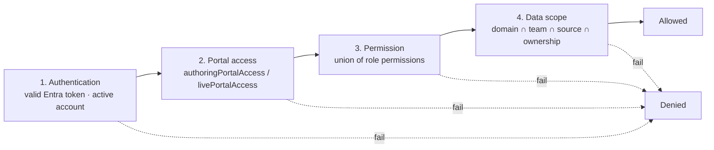

# Access Control

**What this document adds:** the role catalogue, the permission key catalogue, the policy evaluation
algorithm, and the scope-resolution rules. It does not restate the screens
([authoring-portal.md §8](authoring-portal.md#8-user-and-access-management)), the storage shape
([data-model.md §3](data-model.md#3-identity-access-and-taxonomy)), or the source restriction formula
([knowledge-source-administration.md §3.3](knowledge-source-administration.md#33-restriction-model)).

---

## 1. Model

Four independent layers. All four must permit an action.



Layer 3 answers "may this kind of user do this kind of thing". Layer 4 answers "to *this* row".
Conflating them is the usual source of authorization bugs, so they are separate code paths with
separate tests: a permission check returns a boolean, a scope resolution returns a **predicate** that
becomes part of the SQL query.

---

## 2. Role catalogue

| Role key | Portal | Purpose | Notable permissions |
| --- | --- | --- | --- |
| `PLATFORM_ADMINISTRATOR` | Authoring | Platform configuration, taxonomy, profiles, field mappings, feature flags, break-glass | `platform.configure`, `access.manage`, `taxonomy.manage`, `questionbank.reconcile`, everything in `source.*` |
| `SOURCE_ADMINISTRATOR` | Authoring | Keep sources accurate and healthy | `source.manage`, `source.test`, `source.sync`, `source.read`, `document.browse` |
| `AUTHOR` | Authoring | Turn documents into draft questions | `question.generate`, `question.edit`, `question.submit`, `question.read`, `document.browse`, `document.section.manage` |
| `SUBJECT_MATTER_EXPERT` | Authoring | Confirm technical accuracy | `question.read`, `question.review`, `question.review.edit` (configurable) |
| `REVIEWER` | Authoring | Confirm quality, clarity, grounding | `question.read`, `question.review` |
| `APPROVER` | Authoring | Accept accountability for release | `question.approve`, `question.review`, `question.read` |
| `PUBLISHER` | Authoring | Move approved content into the bank | `question.publish`, `question.retire`, `question.regenerate`, `question.read` |
| `ASSESSMENT_MANAGER` | Authoring | Build and publish assessments | `assessment.manage`, `assessment.approve`, `assessment.publish`, `assessment.read`, `question.read` |
| `MANAGER` | Authoring | Team readiness | `report.read` scoped to managed teams, `learning.result.team` |
| `REPORTING_USER` | Authoring | Build and export governed reports | `report.read`, `report.create`, `report.export` |
| `REPORT_PUBLISHER` | Authoring | Govern report publication | `report.publish`, `report.approve` |
| `AUDITOR` | Authoring | Reconstruct history; **read-only** | `audit.read`, `audit.export`, `question.read`, `source.read`, `report.read` |
| `LEARNER` | Live | Prove and improve proficiency | `learning.*` (own-scoped only) |

Rules:

1. A user may hold any number of roles. Effective permissions are the **union** of role permissions,
   intersected with scope (§5).
2. Role definitions are **seeded configuration**, read-only in release 1. Changing the permission
   matrix is a deployment, so a role's meaning cannot drift silently between environments.
3. No role grants both `question.approve` and `question.publish` by default. A tenant may combine them
   by assigning both roles, which is a visible, audited decision rather than a default.
4. `AUDITOR` holds no write permission of any kind, including no `question.edit`. Read-only is
   structural: the role's permission set contains no write key.
5. `LEARNER` is the only role with `PortalScope = LIVE`. A learner token cannot reach an authoring
   route, because the two portals are separate app registrations with separate API scopes
   ([architecture.md §6.3](architecture.md#63-why-two-applications-rather-than-one-with-hidden-menus)).

---

## 3. Role source of truth

> **Knowzy's `UserRole` table is authoritative. Entra group membership is a provisioning hint.**

| # | Rule | Rationale |
| --- | --- | --- |
| S1 | Authorization decisions read `UserRole` from PostgreSQL, never the token's `groups` or `roles` claims | Group claims are overage-truncated above ~200 groups, can be stale for the token's lifetime, and would make a group-membership change an instant privilege change with no Knowzy audit record |
| S2 | Group claims may **seed** a role assignment through a configured mapping (`entraGroupId → roleKey`), executed by a reconciliation job | Onboarding stays automatable |
| S3 | Reconciliation **adds** role grants and **flags** removals; it does not auto-revoke | An accidental group change must not silently strip an approver's accountability mid-review. Removals appear as a worklist with the detected date |
| S4 | Every grant and revocation records the actor, timestamp, and reason, and is append-only | A historical approval must remain explainable: "who was allowed to do this, on that date" |
| S5 | Account status and portal access are checked **per request**, not per token | Revoking access takes effect on the next request; token revocation is never assumed |
| S6 | Scope assignments (`UserDomainScope`, `UserTeam`, `UserSourceAccess`) follow the same rules as roles | One model for "who may", one model for "on what" |

The one exception: **break-glass**. When enabled, a `PLATFORM_ADMINISTRATOR` may override a
separation-of-duties refusal with a mandatory written justification, audited as
`AUTHORING.QUESTION.APPROVAL_OVERRIDE` and surfaced in a standing exception report
([workflows.md §3.4](workflows.md#34-separation-of-duties)). Break-glass grants no new permission —
it only waives a policy check, and it cannot be used to approve a question that fails a validation
gate.

---

## 4. Policy catalogue

A **policy** is a named server-side check: `(subject, action, resource?) → allow | deny + dataScope`.
Every API route and every MCP tool declares exactly one. Navigation filtering in the browser is a
convenience and is never the enforcement point.

### 4.1 Permission keys

| Family | Keys |
| --- | --- |
| `platform` | `platform.configure` |
| `access` | `access.manage`, `access.read` |
| `taxonomy` | `taxonomy.manage`, `taxonomy.read` |
| `source` | `source.read`, `source.manage`, `source.test`, `source.sync` |
| `document` | `document.browse`, `document.section.manage`, `document.exclude` |
| `question` | `question.read`, `question.generate`, `question.regenerate`, `question.edit`, `question.submit`, `question.review`, `question.review.edit`, `question.approve`, `question.approve.bulk`, `question.publish`, `question.retire`, `question.archive` |
| `questionbank` | `questionbank.reconcile` |
| `assessment` | `assessment.read`, `assessment.manage`, `assessment.approve`, `assessment.publish` |
| `report` | `report.read`, `report.create`, `report.export`, `report.approve`, `report.publish` |
| `audit` | `audit.read`, `audit.export` |
| `authoring` | `authoring.dashboard.view` |
| `learning` | `learning.access`, `learning.assessment.list`, `learning.session.create`, `learning.session.own`, `learning.result.own`, `learning.result.team`, `learning.recommendation.own`, `learning.badge.own`, `learning.certificate.own` |

### 4.2 Policy definitions

| Policy | Permission | Resource predicate | Notes |
| --- | --- | --- | --- |
| `authoring.dashboard.view` | `authoring.dashboard.view` | Scope applied to every panel | Panels are individually scoped; a user sees counts for their domains only |
| `source.read` / `source.manage` / `source.test` / `source.sync` | same | `effectiveSourceAccess(user, source)` | Formula in [knowledge-source-administration.md §3.3](knowledge-source-administration.md#33-restriction-model) |
| `document.browse` | `document.browse` | Source access **and** source `isActive` | Purpose flags are enforced per use, not here |
| `question.generate` | `question.generate` | Domain in scope **and** source `usableForGeneration` **and** valid preflight | Preconditions in [workflows.md §2.1](workflows.md#21-preconditions) |
| `question.read` | `question.read` | Question's domain in scope | An `AUDITOR` has unrestricted domain scope by default |
| `question.edit` / `question.submit` | same | Domain in scope **and** status permits the transition | Transition table in [workflows.md §3.2](workflows.md#32-transition-rules) |
| `question.review` / `question.review.edit` | same | Domain in scope | `review.edit` is separate so review-only reviewers can exist |
| `question.approve` | `question.approve` | Domain in scope **and** 13 gates pass **and** separation of duties satisfied | Gates in [authoring-portal.md §5.7](authoring-portal.md#57-approval-blocking-gates) |
| `question.approve.bulk` | `question.approve.bulk` | As above, per item, capped (default 25) | Each item evaluated individually |
| `question.publish` / `question.retire` | same | Domain in scope **and** `sharepoint.write.enabled` | Governance rules G1–G13 in [sharepoint-question-bank.md §4](sharepoint-question-bank.md#4-governance-rules) |
| `questionbank.reconcile` | `questionbank.reconcile` | — | Corrective writes need a per-question operator decision |
| `assessment.*` | same | Assessment's domain in scope | Publish additionally requires a feasible pool |
| `report.read` | `report.read` | Report's `requiredPermission` **and** the caller's data scope **and** minimum group size | Suppression is applied inside the read model, not by the caller |
| `report.export` / `report.publish` | same | As `report.read`, plus the export/publication gate | Every export is audited |
| `audit.read` / `audit.export` | same | Unrestricted by design, redacted at write time | An auditor with partial visibility cannot audit |
| `learning.access` | `learning.access` | `livePortalAccess = true` **and** account `ACTIVE` | |
| `learning.assessment.list` | same | Eligibility conditions 1–8 | [live-learning-portal.md §3.2](live-learning-portal.md#32-eligibility-evaluation-server-side) |
| `learning.session.create` | same | Eligibility **and** no existing `IN_PROGRESS` session | Enforced by a partial unique index, not check-then-act |
| `learning.*.own` | same | `resource.learnerUserId == subject.userId`, resolved from the token | §6 |
| `learning.result.team` | `learning.result.team` | Learner's team ∈ subject's managed team closure **and** group size ≥ minimum | Managers never see a single learner's detail below the threshold |

### 4.3 Enforcement invariants

| # | Invariant |
| --- | --- |
| P1 | Every route and every tool declares a policy. A registry test enumerates both and fails the build on an undeclared handler — there is no "trusted internal" path |
| P2 | The policy engine runs before input validation, so error shapes cannot be used to probe schemas |
| P3 | A policy returns a **dataScope**, and the handler is structurally required to pass it to the repository. Repository methods take a `DataScope` parameter; a query built without one does not compile |
| P4 | Denials are audited with `outcome = DENIED`, the policy name, and the reason — a denial is a security signal, not a 403 to be swallowed |
| P5 | The MCP server re-evaluates the policy independently ([mcp-tools.md §3.1](mcp-tools.md#31-envelope-rules), E3) |
| P6 | Permission keys are a closed union in `@knowzy/shared-types`. A typo is a compile error, not a permanently-denied route |

---

## 5. Scope resolution

```
resolveDataScope(subject) = {
  domainIds:     union(UserDomainScope where revokedAt is null),      // [] = unrestricted
  teamIds:       teamClosure(subject),                                 // managers: managed subtree
  sourceIds:     union(UserSourceAccess where mode = ALLOW),           // [] = no allow-list
  denySourceIds: union(UserSourceAccess where mode = DENY),            // always wins
  ownSubjectId:  subject.userId
}
```

| Rule | Detail |
| --- | --- |
| Empty means unrestricted | An empty `domainIds` is "all domains", not "no domains". Every check is written "set is empty OR intersects", which is why an unscoped administrator works and an unscoped author is a configuration error caught at assignment time |
| `DENY` beats everything | Including an explicit `ALLOW` and including unrestricted domain scope |
| Team closure | A manager's scope is their managed team plus all descendants, computed by recursive CTE, capped in depth (default 6) to bound the query |
| Scope is a query predicate | Never a post-filter over a full result set. Row counts, pagination, and aggregates are all computed within scope, so a suppressed row never affects a count the caller can see |
| Learner scope is ownership | Learners hold no domain or team scope. Their scope is `ownSubjectId`, applied as an equality predicate (§6) |
| Scope changes are immediate | Resolved per request; no caching beyond the request |

### 5.1 Separation of duties

Policies are configuration, defaults in
[workflows.md §3.4](workflows.md#34-separation-of-duties). What this document adds: the evaluation
order, which matters when several apply.

1. Evaluate permission. Missing permission → `FORBIDDEN` (not a separation-of-duties message; do not
   leak policy structure to an unauthorized caller).
2. Evaluate data scope. Out of scope → `FORBIDDEN`.
3. Evaluate validation gates. Any failure → `422` with the gate list.
4. Evaluate separation of duties. Violation → `403 SEPARATION_OF_DUTIES`, naming which rule.
5. Evaluate break-glass if enabled and requested, requiring a justification of ≥20 characters.

Steps 3 and 4 are in that order deliberately: an approver who is also the author should learn that the
question is invalid before learning that they personally may not approve it, because the first is
actionable by them and the second is not.

---

## 6. IDOR and ownership

Detailed threat treatment: [security.md §9](security.md#9-insecure-direct-object-reference-idor-prevention).
The access-control contribution:

| # | Rule |
| --- | --- |
| O1 | No route, tool, or query accepts a `userId`, `learnerId`, or `subjectId` from the client. Own-scoped resources resolve the subject from the validated token |
| O2 | `learning.*.own` policies compare `resource.learnerUserId` to the token subject **inside the query**, so a wrong ID returns `404`, not `403` — an existence oracle is itself a leak |
| O3 | Session, result, recommendation, badge, and certificate IDs are UUIDs, never sequential, so enumeration has no signal |
| O4 | `learning.result.team` is the only way to see another person's result, and it applies the minimum-group-size rule and returns aggregates, not answer detail |
| O5 | Certificate verification (`/api/v1/public/certificates/verify/{code}`) is unauthenticated by design, rate-limited, and returns the minimum necessary data ([badges-and-certificates.md §6](badges-and-certificates.md#6-verification)) |

---

## 7. User and access administration

Screens are specified in [authoring-portal.md §8](authoring-portal.md#8-user-and-access-management).
This section adds the rules behind them.

### 7.1 Effective-permission preview

Before a change is saved, the preview panel shows the **diff** of effective capability, computed by
running the real resolver against the proposed state:

```
preview(user, proposedRoles, proposedScopes) = {
  permissionsGained: [], permissionsLost: [],
  domainsGained: [],     domainsLost: [],
  sourcesGained: [],     sourcesLost: [],
  routesGained: [],      routesLost: [],          // derived from the policy registry
  separationOfDutiesImpact: [...]                  // e.g. "may now approve questions they author"
}
```

The preview calls the same `resolveDataScope` and permission-union code the request path uses. A
second, approximate implementation for display would eventually disagree with enforcement, and the
disagreement would be invisible.

### 7.2 Administration rules

| # | Rule |
| --- | --- |
| A1 | An administrator cannot grant a permission they do not themselves hold, except `PLATFORM_ADMINISTRATOR`, which is bootstrapped by configuration and whose own grants require a second administrator when `requireTwoPersonAdminGrant` is enabled (default off, recommended on in production) |
| A2 | An administrator cannot revoke their own `access.manage`, preventing accidental lockout. Removing the last `PLATFORM_ADMINISTRATOR` is refused with `LAST_ADMINISTRATOR` |
| A3 | Deactivating portal access takes effect on the next request; any `IN_PROGRESS` quiz session is allowed to complete, and the completion is audited with a note that access was revoked mid-session |
| A4 | Role and scope changes require a reason (≥10 characters) and are append-only with actor, previous value, and new value |
| A5 | Access history is retained for the audit retention period, never the shorter user-record period, because it explains historical approvals |
| A6 | Access reports and exports respect the exporter's own scope and are audited as `ADMIN.ACCESS.EXPORTED` |
| A7 | A `DEPROVISIONED` user's roles are marked revoked and their rows retained; they continue to appear in lineage, approvals, and results ([data-model.md §14](data-model.md#14-retention-and-deletion)) |
| A8 | Bulk role assignment is permitted up to a cap (default 50 users) with a single reason applied to each grant, and one audit event per grant plus one for the batch |

### 7.3 Bootstrap

The first `PLATFORM_ADMINISTRATOR` is established by an environment configuration value
(`platform.bootstrapAdminEntraObjectIds`), consumed once per environment and recorded as
`ADMIN.ACCESS.BOOTSTRAPPED`. After bootstrap the value is ignored; it cannot be used to re-grant
administration later, so a leaked configuration file is not a privilege-escalation path.
