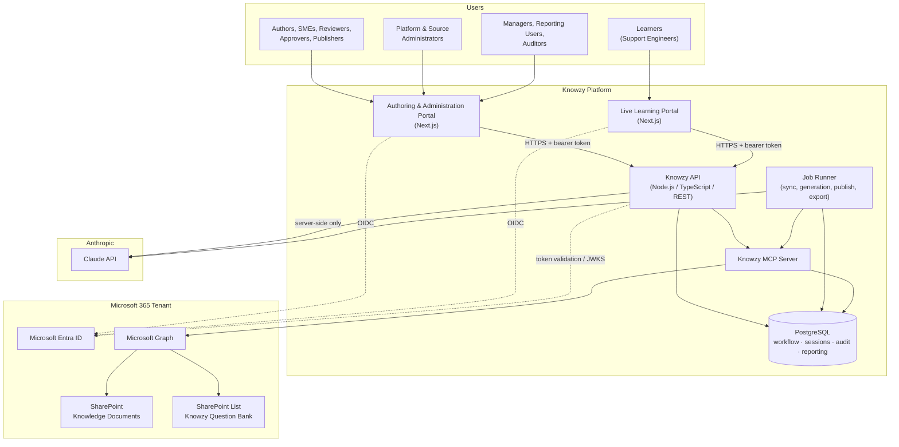
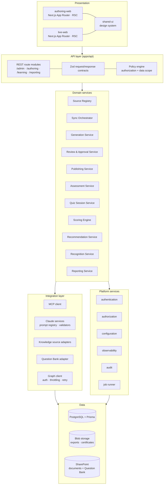
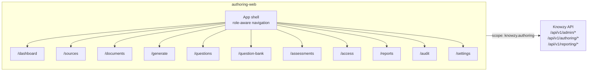
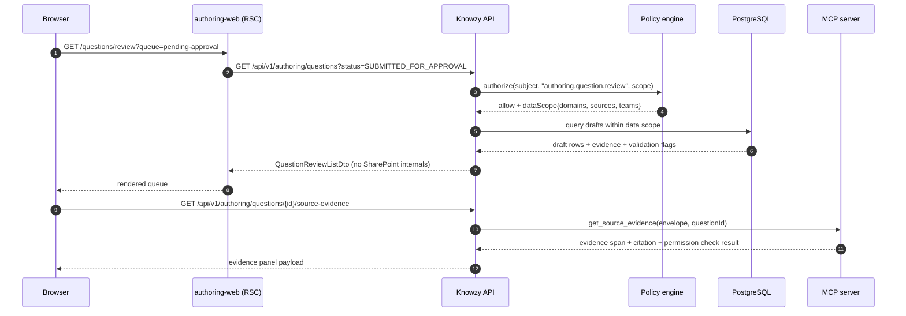
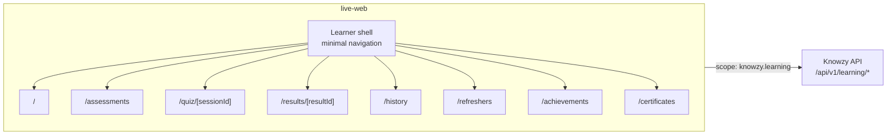
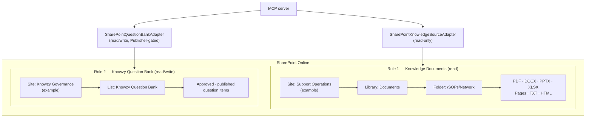
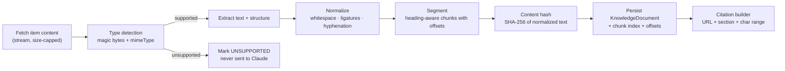
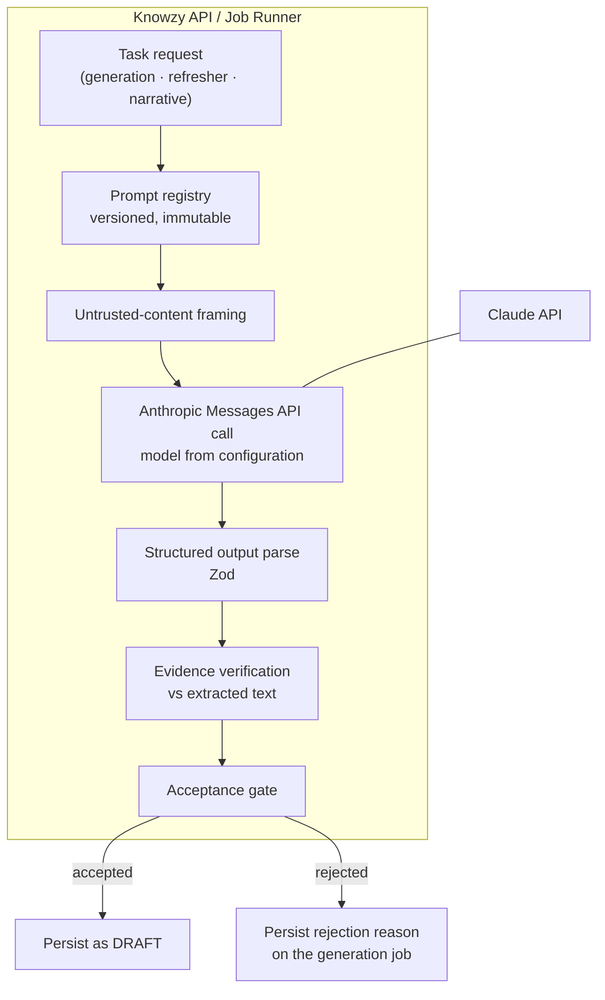
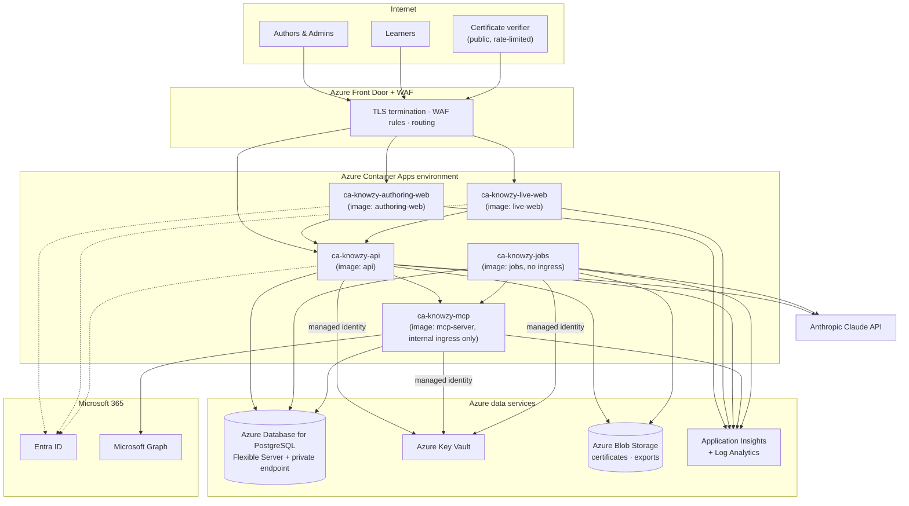

# Solution Architecture

Covers deliverables 4–8 (high-level architecture, Authoring Portal architecture, Live Learning
Portal architecture, shared backend architecture, SharePoint knowledge-source architecture) and the
deployment architecture.

---

## 1. Architectural principles

| # | Principle | Consequence in the design |
| --- | --- | --- |
| P1 | Two applications, one governed backend | Separate Next.js apps, separate app registrations, separate authorization policy sets, one API and one MCP server |
| P2 | Deterministic decisions in code, generative work in the model | Scoring, approval, publishing, badge and certificate eligibility are pure backend functions; Claude drafts and summarizes |
| P3 | Grounding is enforced, not requested | Evidence spans are verified against extracted source text before a draft is persisted |
| P4 | Configuration over code for all source topology | Sites, libraries, folders, and field mappings are database rows, not constants |
| P5 | Ports and adapters at every external boundary | `KnowledgeSourceAdapter`, `QuestionBankAdapter`, `IdentityProvider`, `LlmProvider`, `PdfRenderer` |
| P6 | Server-authoritative sessions | Quiz question sets, answer keys, and scores never depend on client state |
| P7 | Untrusted content boundary | Retrieved documents are data; they never acquire instruction authority |
| P8 | Idempotency at every write to an external system | Deterministic idempotency keys plus pre-write existence checks |
| P9 | Auditability is a first-class feature | Every state transition writes an audit event in the same transaction as the state change |
| P10 | Least privilege, per source | Graph permissions scoped per site (`Sites.Selected`) or delegated on-behalf-of |

---

## 2. Context diagram

### 2.1 What crosses each boundary

| Boundary | Carries | Never carries |
| --- | --- | --- |
| Browser → API | Entra access token, user intent, form data | Roles, permissions, scores, answer keys, source secrets |
| API → MCP | Authorization envelope (subject, effective roles, scopes, correlation ID), typed tool input | Raw tokens for downstream services beyond the scoped credential broker |
| MCP → Graph | Per-source credential from Key Vault or an on-behalf-of token | Anything user-supplied that was not schema-validated |
| API → Claude | System prompt, delimited untrusted source content, task instructions | Tokens, secrets, learner PII beyond display name where required, write tools |
| API → Browser (live quiz) | Question text and options only | Correct answers, explanations, evidence, running score |

---

## 3. Logical architecture

### 3.1 Layer rules

1. Presentation never talks to Integration or Data directly. All access is through the API layer.
2. Domain services never import a Graph or SharePoint type. They speak adapter interfaces only.
3. Only the SharePoint adapter knows SharePoint internal field names (`field_1`, `field_4`, …).
4. Only the generation-provider package (`@knowzy/claude-services`, §9.0) constructs model
   prompts, and it has no database access. **No provider package enforces a budget, a
   concurrency cap, a retry policy or a cost calculation** — those are provider-independent and
   live in the domain control layer, so a new provider cannot arrive with its own idea of a
   ceiling.
5. The policy engine is called on every request; there is no "trusted internal" path.
6. Audit writes participate in the same database transaction as the state change they describe.

---

## 4. Technology selection

| Concern | Selection | Notes |
| --- | --- | --- |
| Web applications | Next.js 15 (App Router), React 19, TypeScript 5.x, Tailwind CSS 4 | Server components for data-dense read screens; client components for the review workspace and quiz runner |
| Component primitives | Radix UI primitives wrapped in `@knowzy/shared-ui` | Accessibility-first; WCAG 2.2 AA target |
| API | Node.js 22 LTS, Fastify 5, TypeScript | Schema-first routing; Express is an acceptable substitute — see [ADR-010](risks-and-decisions.md#adr-010-fastify-for-the-api-runtime) |
| Validation | Zod (shared schemas in `@knowzy/shared-types`) | One schema serves REST validation, MCP tool schemas, and Claude output parsing |
| ORM / database | Prisma 6, PostgreSQL 16 | `pgcrypto` for UUIDv7-style IDs, `pg_trgm` for similarity, `pgvector` reserved |
| Jobs / scheduling | pg-boss (PostgreSQL-backed queue) | Avoids a Redis dependency in release 1 — see [ADR-007](risks-and-decisions.md#adr-007-postgresql-backed-job-queue-pg-boss-over-redisbullmq) |
| MCP | `@modelcontextprotocol/sdk` — server in `@knowzy/mcp-server`, client in the API | Streamable HTTP transport in deployed environments, stdio for local development |
| Generation | A **provider port**, server-side only, with exactly one provider active per job (§9.0). The always-registered, zero-credential provider is the **deterministic local generator** | Candidate platform-managed providers are declared in the provider catalogue: Anthropic (Messages API), Azure OpenAI, Gemini; Microsoft Copilot is declared and **ineligible** (§9.0). Model IDs are configuration, never hardcoded (T-30) |
| Identity | Microsoft Entra ID, OIDC authorization code + PKCE, MSAL | Two SPA/web app registrations + one API registration exposing scopes |
| M365 integration | Microsoft Graph v1.0 | `Sites.Selected` app-only, and/or on-behalf-of delegated per source permission mode |
| PDF | `pdf-lib` with embedded fonts | Deterministic, no headless browser in the container — see [ADR-009](risks-and-decisions.md#adr-009-pdf-lib-for-certificate-rendering) |
| Observability | OpenTelemetry SDK → Azure Monitor / Application Insights exporter | Separate service names per application |
| Containers | Docker, Docker Compose (local), Azure Container Apps (target) | One image per deployable |
| Secrets | `.env` for local development, Azure Key Vault + managed identity for deployed environments | No secret ever reaches browser code |

---

## 5. Authoring and Administration Portal architecture

### 5.1 Composition

### 5.2 Characteristics

| Attribute | Value |
| --- | --- |
| Entra app registration | `knowzy-authoring-web` (separate from live) |
| Requested API scope | `api://knowzy-api/knowzy.authoring` |
| Route namespace | `/dashboard`, `/sources`, `/documents`, `/generate`, `/questions`, `/question-bank`, `/assessments`, `/access`, `/reports`, `/audit`, `/settings` |
| API namespaces consumed | `/api/v1/admin`, `/api/v1/authoring`, `/api/v1/reporting`, `/api/v1/audit` |
| Authorization policy set | `authoring.*` policies (see [access-control.md](access-control.md#4-policy-catalogue)) |
| Audit category prefix | `AUTHORING.*`, `ADMIN.*`, `REPORT.*` |
| Telemetry service name | `knowzy-authoring-web` |
| Session idle timeout | 30 minutes (configurable) |
| Rendering strategy | Server components for lists and dashboards; client components for the review workspace, generation form, and source editor |
| Caching | No caching of question content with answer keys in any shared cache; per-request, per-user only |
| Notable UX requirement | Keyboard-first review queue; see [ux-design.md](ux-design.md#5-review-workspace-interaction-model) |

### 5.3 Data-flow shape for a review screen

---

## 6. Live Learning Portal architecture

### 6.1 Composition

### 6.2 Characteristics

| Attribute | Value |
| --- | --- |
| Entra app registration | `knowzy-live-web` (separate from authoring) |
| Requested API scope | `api://knowzy-api/knowzy.learning` |
| Route namespace | `/`, `/assessments`, `/quiz/[sessionId]`, `/results/[resultId]`, `/history`, `/refreshers`, `/achievements`, `/certificates` |
| API namespaces consumed | `/api/v1/learning` only |
| Authorization policy set | `learning.*` policies |
| Audit category prefix | `LEARNING.*` |
| Telemetry service name | `knowzy-live-web` |
| Session idle timeout | 60 minutes, extended while a quiz is active (configurable) |
| Rendering strategy | Server components for discovery and history; the quiz runner is a client component with a strict response contract |
| Hard constraint | The API surface reachable with the `knowzy.learning` scope contains **no** route capable of returning a correct answer, explanation, or evidence for a question in an in-progress session |
| Offline behaviour | Answer submission retries with an idempotency key; the learner is warned, never silently failed |

### 6.3 Why two applications rather than one with hidden menus

| Risk of a single application | How separation addresses it |
| --- | --- |
| A rendering or routing bug exposes an authoring route to a learner | The authoring routes are not present in the learner's deployed bundle |
| Answer keys leak through a shared data-fetching layer or cache | The learner-facing API scope cannot produce answer keys at all; caches are per-scope |
| Blast radius of an authoring release affects live assessments in progress | Independent deployables; a quiz in progress is unaffected by an authoring deployment |
| Token with authoring privileges is used from a learner device | Separate app registrations and scopes; a learner token cannot call authoring endpoints |
| Audit and telemetry become ambiguous | Separate audit categories and telemetry identifiers make attribution unambiguous |

---

## 7. Shared backend architecture

### 7.1 API surface organization

| Namespace | Scope required | Primary consumers | Example resources |
| --- | --- | --- | --- |
| `/api/v1/admin` | `knowzy.authoring` + admin roles | authoring-web | `knowledge-sources`, `knowledge-sources/{id}/test`, `knowledge-sources/{id}/sync`, `users`, `roles`, `configuration`, `field-mappings` |
| `/api/v1/authoring` | `knowzy.authoring` | authoring-web | `documents`, `generation-jobs`, `questions`, `questions/{id}/transitions`, `question-bank/publish`, `assessments` |
| `/api/v1/learning` | `knowzy.learning` | live-web | `assessments`, `sessions`, `sessions/{id}/answers`, `sessions/{id}/complete`, `results`, `recommendations`, `badges`, `certificates` |
| `/api/v1/reporting` | `knowzy.authoring` + reporting roles | authoring-web | `reports`, `reports/{id}/run`, `reports/{id}/export`, `reports/{id}/publish`, `dashboards` |
| `/api/v1/audit` | `knowzy.authoring` + Auditor | authoring-web | `events`, `events/export` |
| `/api/v1/public` | none (rate-limited) | anyone with a certificate | `certificates/verify/{code}` |
| `/internal` | not internet-exposed | platform | `health/live`, `health/ready`, `metrics` |

### 7.2 Request pipeline

```mermaid
graph LR
    RQ["Request"] --> C1["Correlation ID<br/>+ request ID"]
    C1 --> C2["Security headers<br/>CSP · HSTS"]
    C2 --> C3["Rate limit<br/>per subject + per route class"]
    C3 --> C4["Authenticate<br/>validate Entra JWT · JWKS cache"]
    C4 --> C5["Resolve subject<br/>user · roles · domain/team/source scope"]
    C5 --> C6["Authorize<br/>policy + data scope"]
    C6 --> C7["Validate<br/>Zod input schema"]
    C7 --> C8["Handler<br/>domain service"]
    C8 --> C9["Response contract<br/>Zod output schema + DTO projection"]
    C9 --> C10["Audit + telemetry"]
    C10 --> RS["Response"]
```

**Step 5 detail.** Roles come from the Knowzy database (`UserRole`), optionally seeded and
reconciled from Entra group membership. Group claims in the token are treated as a *hint for
provisioning*, never as the authorization decision. See
[access-control.md](access-control.md#3-role-source-of-truth).

**Step 9 detail.** Every response passes through an explicit DTO projection. `DraftQuestion` has
three projections: `AuthoringDto` (full), `ReviewDto` (full + validation state), and
`LearnerQuestionDto` (question text and options only). A contract test asserts that
`LearnerQuestionDto` cannot be constructed with an answer key field present.

### 7.3 Shared services

| Service | Responsibility | Package |
| --- | --- | --- |
| Authentication | Token validation, JWKS caching, subject resolution, on-behalf-of exchange | `@knowzy/authentication` |
| Authorization | Policy evaluation, role/permission resolution, data-scope construction | `@knowzy/authorization` |
| Configuration | Layered configuration resolution, typed access, secret resolution via Key Vault | `@knowzy/configuration` |
| Observability | Tracing, metrics, structured logging, redaction | `@knowzy/observability` |
| Audit | Transactional audit writes, taxonomy, redaction | `@knowzy/observability` (audit module) |
| MCP client | Tool invocation, envelope construction, timeout and retry policy | `@knowzy/mcp-server` (client sub-export) |
| Claude services | Prompt registry and versioning, untrusted-content framing, output schema validation, evidence verification, token accounting | `@knowzy/claude-services` |
| Reporting | Read-model queries, aggregation, suppression rules, export rendering | `@knowzy/reporting` |
| Certificate generator | Deterministic PDF rendering, verification code signing | `@knowzy/certificate-generator` |

### 7.4 Why MCP sits between the API and SharePoint

MCP is not decoration here. It provides three concrete properties:

1. **One audited, schema-validated gateway** to every knowledge source and to the Question Bank. No
   domain service can reach Graph by another path.
2. **A model-safe tool surface.** When Claude is given tools (knowledge refresher search only), it
   is given a read-only subset of the same tools the API uses, with the same authorization envelope.
   There is no second, weaker code path for the model.
3. **Source pluggability.** `search_source_documents` behaves identically whether the source is
   SharePoint, Confluence, or a mock — the adapter differs, the tool contract does not.

Tool invocation always carries an authorization envelope constructed by the API from the validated
token. The MCP server **re-checks** authorization; it does not trust the caller.
See [mcp-tools.md](mcp-tools.md#3-authorization-envelope).

---

## 8. SharePoint knowledge-source architecture

### 8.1 Two distinct SharePoint roles

The two roles are deliberately different adapters with different credentials and different
permission grants. Knowledge-document access is read-only for the platform's service identity. Only
the Question Bank site receives a write grant, and only for the specific list.

### 8.2 Graph resource path strategy

| Need | Graph shape (v1.0) | Notes |
| --- | --- | --- |
| Resolve a site from a URL | `GET /sites/{hostname}:/sites/{path}` | Used by Test Connection to resolve and then store the site ID |
| List libraries | `GET /sites/{site-id}/drives` | `drive.id` is stored as Document Library ID |
| List folder children | `GET /drives/{drive-id}/root:/{folder-path}:/children` | Paginated with `@odata.nextLink` |
| Item metadata | `GET /drives/{drive-id}/items/{item-id}` | `eTag`, `cTag`, `lastModifiedDateTime`, `size`, `file.mimeType` |
| Item content | `GET /drives/{drive-id}/items/{item-id}/content` | Streamed to the extractor; never streamed to the browser |
| Incremental change detection | `GET /drives/{drive-id}/root/delta` | Delta token persisted per source path; falls back to modified-date scan |
| Item permissions | `GET /drives/{drive-id}/items/{item-id}/permissions` | Used for the permission column in the Document Browser |
| SharePoint Pages | `GET /sites/{site-id}/pages` | Page content extracted from canvas layout |
| Question Bank list items | `GET /sites/{site-id}/lists/{list-id}/items?expand=fields` | Filtering requires indexed columns |
| Question Bank write | `POST /sites/{site-id}/lists/{list-id}/items` / `PATCH .../fields` | Server-side only, `If-Match` on update |

> **Tenant-specific.** Every `{site-id}`, `{drive-id}`, and `{list-id}` above is resolved at runtime
> from administrator-entered configuration and stored in `KnowledgeSource` / `ApplicationConfiguration`.
> None is hardcoded, and none is asserted in this document set.

### 8.3 Permission modes

| Mode | Graph auth | Behaviour | When to choose |
| --- | --- | --- | --- |
| `DELEGATED_OBO` | On-behalf-of exchange of the user's token | Retrieval returns only what the signed-in user can already see | Default for the Document Browser and knowledge-refresher search where trimming must mirror SharePoint exactly |
| `APP_ONLY_SITES_SELECTED` | Client credentials with `Sites.Selected`, granted per site | Retrieval uses the platform identity; access is bounded by the source configuration plus Knowzy's own `UserSourceAccess` and domain restrictions | Background synchronization, scheduled jobs, and generation where no interactive user context exists |

Both modes are supported per source (`permissionMode`). Design rules:

1. Interactive browsing and refresher search default to `DELEGATED_OBO`.
2. Background jobs necessarily use `APP_ONLY_SITES_SELECTED`; therefore a document discovered by a
   background job is **not** automatically visible to a user — visibility is re-evaluated against the
   user at read time.
3. When a source is configured `APP_ONLY_SITES_SELECTED` and used for interactive retrieval, Knowzy
   applies its own restriction layers (role, domain, team, function, `UserSourceAccess`) and the UI
   states plainly that trimming is platform-enforced rather than SharePoint-enforced.

See [security.md](security.md#7-permission-aware-retrieval).

### 8.4 Content extraction pipeline

| Type | Extractor | Structure retained |
| --- | --- | --- |
| PDF | `pdf-parse` / `pdfjs-dist` text layer | Page numbers; OCR is out of scope for release 1 |
| DOCX | `mammoth` → normalized text | Heading hierarchy, lists, tables as text |
| PPTX | OOXML slide parsing | Slide number, title, body, speaker notes |
| XLSX | `exceljs` | Sheet name, header row, row text |
| SharePoint Page | Graph page canvas | Web part / section titles |
| TXT | direct | Line offsets |
| HTML | sanitizing parser | Heading hierarchy; scripts and styles discarded |

Rules:

- Scanned/image-only PDFs produce an `EXTRACTION_EMPTY` status with a clear administrator message,
  not a silent empty chunk set.
- Files above the configured size cap (default 25 MB) are rejected before download completes.
- Password-protected or macro-enabled binaries are `UNSUPPORTED`.
- Extracted text is stored with character offsets so an evidence span can always be re-located and
  re-verified later.

---

## 9. Generation provider architecture

### 9.0 Provider independence — amended 2026-09-24, extended 2026-09-26 and 2026-09-27

**This section was single-provider until 2026-09-24 and is now provider-independent.** The amendment
is recorded rather than quietly applied, because
[MULTI_PROVIDER_GENERATION_ARCHITECTURE.md](integrations/MULTI_PROVIDER_GENERATION_ARCHITECTURE.md)
§0.3 is explicit that multi-provider contradicted this document, and `/docs` outranks the code: no
provider-layer code was written before this paragraph existed.

**What changed:** generation sits behind a port with a catalogue of declared providers and a registry
that resolves at most one of them per job. **What did not change:** everything below §9.1 — the
framing, the zero tool grant, the schema, the evidence verification and the gate chain — applies
identically to every provider, and no threshold moves to accommodate a model.

Eight rules govern it. Rules 7 and 8 were added on 2026-09-26 with provider administration.

1. **Exactly one provider is active per job, and the platform never substitutes.** An unregistered
   or ineligible provider produces a **named refusal**, never a silent downgrade to another provider
   or another execution mode. A substitution would make the job's recorded provenance false, which
   is worse than a refusal an author can read.
2. **Capabilities are declared, never inferred.** `retrievalFree` is the eligibility gate for
   grounded generation: a provider that performs its own retrieval either quotes something the
   platform cannot verify (safe — the candidate is refused) or writes a question shaped by content
   the author never selected while quoting the supplied section (**not** safe — the span verifies,
   scope enforcement passes, and nothing in the gate chain detects it). A provider that cannot
   declare `retrievalFree` is ineligible, and Microsoft Copilot currently cannot.
3. **A provider has exactly one of six states**, and each carries its reason:
   `AVAILABLE`, `UNAVAILABLE`, `BLOCKED_BY_CONFIGURATION`, `BLOCKED_BY_APPROVAL`,
   `BLOCKED_BY_CAPABILITY`, `OVER_BUDGET`. Approval is a **recorded configuration fact** (for
   example the T-29 processor approval), so a provider with a credential and no approval is blocked
   — by approval, said in those words, not by a generic "unavailable".

   The first five are decided by the **registry**, which has no database and therefore no knowledge
   of consumption. `OVER_BUDGET` (added 2026-09-26) is decided by the **usage read model** after the
   registry has spoken, applies only to a provider the registry called `AVAILABLE`, and is **never
   persisted** — a stored value would be false the moment a budget window rolled over. The
   `generation_provider_state` database enum therefore has five members and the port's union has
   six, which is deliberate rather than drift.
4. **The control layer is provider-independent and mandatory.** Token accounting, cost accounting,
   per-job and daily token budgets, the concurrency cap, the retry policy with jittered backoff,
   provider health and provider metrics are implemented once, outside every provider, and are
   applied to **every** provider including the deterministic one. A provider cannot opt out, and the
   first real provider therefore arrives with its ceilings already enforced and already tested.
5. **The deterministic local generator stays registered in every environment, forever.** It is the
   zero-credential path [environment-and-configuration.md](environment-and-configuration.md)
   requires, the control arm in every quality comparison, and the reason the gate chain is known to
   work. Multi-provider must not make it optional.
6. **A user-managed run is still budgeted.** It costs the platform nothing and can still exhaust an
   author's quota, produce an unreviewable batch, or loop. The budget protects the author and the
   reviewer, not only the invoice.
7. **A provider is CONFIGURED through the product, and APPROVED as a separate act.** Enablement, the
   endpoint, the model, the credential reference, the ceilings and the retry cap are administrator
   configuration (`platform.configure`), written to `application_configuration` with a
   `configuration_change` row and an audit event carrying previous and new value. **Recording a
   data-processing approval is a distinct action requiring a reference** to where the approval is
   held. It is not a field on the settings form: `BLOCKED_BY_APPROVAL` is the control that makes an
   approval real, and a checkbox beside "Enabled" is a checkbox nobody stops at. An approval for a
   provider that is `BLOCKED_BY_CAPABILITY` is refused outright, because the record would assert
   something untrue.

   Corollary: **an undecided provider is disabled.** Absent enablement is not enablement — a
   provider nobody turned on must not begin billing because a credential appeared in the
   environment. The deterministic generator is exempt, per rule 5.
8. **A readiness check reports what it checked, and never implies a call it did not make.** A
   provider validation reports the enforcement chain — capability, approval, implementation,
   credential, live call — with each step `PASSED`, `FAILED` or `NOT_ATTEMPTED`, and an outcome of
   `PASSED`, `FAILED` or `INCOMPLETE`. There is no outcome meaning "probably fine". Where no client
   exists, `LIVE_CALL` is `NOT_ATTEMPTED` and the result states that authentication, endpoint
   reachability and model availability are **unverified**. A validation that reported success from a
   configuration read would be the false assurance cited during an incident.
   *(Extended 2026-09-27, P-5 and OPENAI-CODEX-00.)* The chain is now nine checks — capability,
   approval, implementation, configuration, secret resolution, endpoint, authentication, model,
   generation — and the live ones are real for a provider with a readiness client. Each records
   what it **observed** (an HTTP status, a round-trip time), never a claim beyond it.
9. *(2026-09-27, P-5.)* **A secret reference is resolved by an abstraction, in the API only.** A
   `SecretResolver` routes a reference by its scheme to a `SecretSourceProvider` —
   `localstore://{name}` to the local secure store (the **local environment only**) and
   `keyvault://{vault}/secrets/{name}` to Azure Key Vault (declared; it reports
   `SOURCE_UNAVAILABLE` until a client exists). It never falls back from one source to another,
   never caches a value, and reports every resolution to an observer that receives the source, a
   **fingerprint** of the reference and the status — never the reference and never the value. A
   resolved value is a `SecretValue` that prints `[redacted]` on every accidental path to text, and
   `reveal()` is called in one production file.
10. *(2026-09-27, OPENAI-CODEX-00.)* **A provider may be registered for READINESS without being able
    to generate.** Its client declares `supportsGeneration: false`; the registry reads that from
    the registered client and reports the provider `UNAVAILABLE` for generation, so it cannot be
    made active or reached by a job, and its `generate()` refuses as well. Its readiness calls are
    metadata-only (for OpenAI, `GET /models` and `GET /models/{model}`), carry no prompt, document
    or person, and are **not gated by the data-processing approval** — generation is, and remains
    `BLOCKED_BY_APPROVAL`. A provider credential is sent only to an **allow-listed host**, set by
    deployment (`LLM_ENDPOINT_ALLOWLIST`) rather than on a screen, only over https (loopback
    excepted for a test double), with redirects refused.
    *(2026-09-27, OPENAI-CODEX-01: OpenAI is no longer readiness-only — rule 11. The rule stands for
    any future provider registered before it can generate.)*
11. *(2026-09-27, OPENAI-CODEX-01.)* **A network provider generates PROPOSALS through the unmodified
    chain.** OpenAI is registered with a generation client that sends the shared framed prompt
    (PromptVersion unchanged), a strict output schema, no tools and `store: false`. Its key is
    resolved per call through the audited resolver and sent under the same host, https and redirect
    rules as rule 10. It classifies failures for the control layer: 429, 5xx and timeouts are retried,
    and unparseable output is not. Every proposal then passes scope, evidence verification,
    integrity, duplicate detection and confidence exactly as the deterministic generator's does, and
    becomes a DRAFT awaiting review. A provider that breaks ends its job `FAILED`, never `RUNNING`. It
    still may not run without a recorded approval, an enablement and a configured credential.
12. *(2026-09-28, GATEWAY-M1.)* **One request builder, and a credential in a URL never leaves it.**
    Test connection and generation send through the same function, which attaches the resolved key
    to the configured header or query parameter (no fallback between them) at request time, adds
    fixed non-secret headers, refuses redirects and applies the timeout. A URL carrying a credential
    is never returned, stored, logged or thrown; credential-bearing parameters are redacted by exact
    name before any URL is described. A test connection may skip a check the endpoint does not
    support, and a skip is never reported as a pass.

**A credential is a reference, never a value.** Configuration stores
`keyvault://{vault}/secrets/{name}` or, locally, `localstore://{name}` (rule 9), validated as that
shape at the schema, on the row
(`is_secret_ref`) and on every write path. No read model, screen, audit row or
`configuration_change` row may contain it: redaction happens at **write** time
([audit-model.md §7](audit-model.md)), which is what makes an auditor's unscoped read safe by
construction rather than by a filter that can be forgotten.

**Cost is not always observable, and an unobservable cost is recorded as null rather than zero.**
Zero is a claim; null is an absence. A cost figure is written only where the provider declares
`reportsCost` **and** the run is `PLATFORM_MANAGED` — so a per-seat licence (Copilot) and every
user-managed run record no cost at all, and the screen says *"Not observable in this mode"* rather
than `0.00`. The deterministic generator is the one provider whose zero is a fact.

Boundary rule **B4** is unchanged in intent and now reads on the port: no package outside
`@knowzy/claude-services` constructs a prompt or speaks to a model, and that package reaches no
database.

### 9.1 The platform-managed generation path

The diagram shows the Anthropic path as the reference implementation of §9.0; substitute any
`AVAILABLE` platform-managed provider and every box outside `CALL` is identical.

| Control | Implementation |
| --- | --- |
| Server-side only | The Anthropic key exists only in the API/job-runner process environment, sourced from Key Vault. No browser code path exists. |
| Prompt versioning | Every prompt has an immutable ID and semantic version; the version is stored on every generated question (`GenerationPromptVersion`). |
| Untrusted framing | Source content is passed inside explicit delimiters with a system-prompt statement that content inside the delimiters is data and can never alter instructions, tools, roles, or output schema. |
| No tools during generation | The generation call grants Claude no tools. Content is pre-fetched by the API via MCP. |
| Restricted tools for refreshers | The refresher flow may grant a read-only tool subset (`search_enterprise_knowledge`, `get_source_document`) under the same authorization envelope, with a strict call budget. |
| Structured output | Responses must satisfy a Zod schema; malformed output triggers one bounded repair attempt and then fails the item. |
| Insufficient evidence | The schema includes an `insufficientEvidence` result variant. Returning it is a success, not a failure. |
| Evidence verification | `supportingEvidence` must match a normalized span of the supplied chunk text. See [workflows.md](workflows.md#25-evidence-verification-normative). |
| Cost and rate control | Per-job token budget, per-tenant daily budget, concurrency cap, and 429 backoff with jittered exponential delay and a hard attempt cap — **provider-independent**, enforced in the domain control layer on every provider, and configured by the declared `llm.*` keys. A refusal is a terminal `REFUSED` job carrying its reason, never a failure and never a silent truncation of the request. |
| No authoritative decisions | Scoring, approval, publishing, badge and certificate eligibility never call a model, whichever provider drafted the question. |

---

## 10. Data architecture summary

| Store | Holds | Authority |
| --- | --- | --- |
| PostgreSQL | Users, roles, permissions and scopes; knowledge sources, paths, sync runs, document metadata; generation profiles and jobs; draft questions and versions; reviews and approvals; published question references and SharePoint mappings; domains and topics; assessments and versions; quiz sessions, responses, results, topic results; recommendations; badges and certificates; report definitions and publications; audit events; notifications; configuration | Authoritative for everything except approved question content |
| SharePoint — Knowzy Question Bank list | Approved and published question records: text, options, correct answer, explanation, domain, topic, source references, approval and publication metadata, status, version, flags | Authoritative for approved/published question **content** |
| SharePoint — knowledge document libraries | Source documents | Authoritative for source content (read-only to Knowzy) |
| Blob storage | Generated certificates, report exports | Authoritative for the rendered artifact; metadata lives in PostgreSQL |
| Entra ID | Identity, group membership | Authoritative for identity |

**Read-through projection.** Because SharePoint is a weak query target, every published question is
projected into `PublishedQuestionReference` in PostgreSQL (identifiers, status, version, domain,
topic, source references, hashes, item ID, ETag — **not** the answer key). Assessment eligibility
filtering, reporting, and dashboards read the projection; question *content* for a live quiz is
fetched through MCP from SharePoint with a short-TTL server-side cache. Reconciliation keeps the
projection honest. See
[sharepoint-question-bank.md](sharepoint-question-bank.md#8-reconciliation).

---

## 11. Cross-cutting concerns

| Concern | Approach | Detail |
| --- | --- | --- |
| Correlation | One correlation ID per user action, propagated through API → MCP → Graph/Claude → jobs → audit | [audit-model.md](audit-model.md#4-correlation-model) |
| Idempotency | `Idempotency-Key` header on mutating learner and publish endpoints; deterministic keys for job writes | [error-handling.md](error-handling.md#6-idempotency) |
| Concurrency | Optimistic concurrency with row `version` on draft questions and assessments; `If-Match` ETag on SharePoint updates | [error-handling.md](error-handling.md#7-concurrency-conflicts) |
| Throttling resilience | Token-bucket client-side limiter per Graph resource + honour `Retry-After` + circuit breaker per source | [error-handling.md](error-handling.md#5-external-service-failures) |
| Caching | Per-user, per-scope response caching only; source metadata cached with sync-run invalidation; question content cached server-side with short TTL and no answer key in any shared cache | [error-handling.md](error-handling.md#9-caching-rules) |
| Feature flags | Database-backed flags resolved server-side (`sharepoint.write.enabled` defaults **off**) | [environment-and-configuration.md](environment-and-configuration.md#6-feature-flags) |
| Time | All timestamps stored UTC; display in user time zone; availability windows evaluated in UTC with a configured tenant zone for date-only boundaries | [data-model.md](data-model.md#9-time-and-timezone-rules) |
| Localization | Copy externalized from day one; a single locale (`en`) shipped in release 1 | [ux-design.md](ux-design.md#9-content-and-localization) |

---

## 12. Deployment architecture

### 12.1 Deployables

| Deployable | Image | Ingress | Scales on | Notes |
| --- | --- | --- | --- | --- |
| `authoring-web` | Next.js standalone | External (Front Door) | HTTP concurrency | No secrets in image or client bundle |
| `live-web` | Next.js standalone | External (Front Door) | HTTP concurrency | Independent release cadence from authoring |
| `api` | Node/Fastify | External (Front Door) | HTTP concurrency | Holds Anthropic key, DB credentials via Key Vault |
| `mcp-server` | Node/MCP streamable HTTP | **Internal only** | HTTP concurrency | Never internet-reachable; the only component with Graph credentials |
| `jobs` | Node worker | None | Queue depth | Sync, generation, publish, export, certificate rendering |

### 12.2 Local development topology (Docker Compose)

| Service | Purpose |
| --- | --- |
| `postgres` | PostgreSQL 16 with `pg_trgm`, `pgcrypto` |
| `api` | API with hot reload |
| `mcp` | MCP server, stdio or local HTTP |
| `jobs` | Job runner |
| `authoring-web` | Next.js dev server on a distinct port |
| `live-web` | Next.js dev server on a distinct port |
| `mailpit` *(optional)* | Notification capture |

Local development defaults to `MockKnowledgeSourceAdapter` and a mock Question Bank, so the entire
pipeline is exercisable with **no tenant credentials at all**. This is a deliberate design
requirement, not a convenience — see
[knowledge-source-adapters.md](knowledge-source-adapters.md#6-mock-adapter).

### 12.3 Environment promotion

`local → dev → test → prod`. Each environment has its own Entra app registrations, its own
SharePoint site and Question Bank list, its own field-mapping profile, and its own Key Vault. No
configuration value is shared across environments. See
[environment-and-configuration.md](environment-and-configuration.md).

### 12.4 Non-functional targets (initial, to be confirmed with the business)

| Metric | Target |
| --- | --- |
| Assessment discovery page | p95 < 1.0 s |
| Quiz question transition | p95 < 400 ms |
| Answer persistence | p95 < 300 ms |
| Scoring and result creation | p95 < 1.5 s |
| Generation job (10 questions, one 20-page document) | p95 < 90 s, asynchronous with progress |
| Publish 50 approved questions | p95 < 60 s, idempotent, resumable |
| Concurrent learners in an active quiz | 500 (release 1) |
| Availability target | 99.5% business hours (release 1) |
| RPO / RTO | RPO 15 min (PITR), RTO 4 h |

---

## 13. Architecture views not covered here

| View | Document |
| --- | --- |
| Workflow / process views | [workflows.md](workflows.md) |
| Information view (entities, attributes, keys) | [data-model.md](data-model.md) |
| Security view (threats, controls) | [security.md](security.md) |
| Interface view (MCP tools) | [mcp-tools.md](mcp-tools.md) |
| Development view (packages, dependency rules) | [repository-structure.md](repository-structure.md) |
| Reporting view (read models, semantics) | [reporting.md](reporting.md) |
| Decision log | [risks-and-decisions.md](risks-and-decisions.md) |
