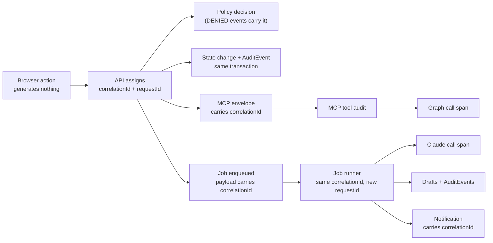

# Audit Model

**What this document adds:** the event taxonomy, the record shape, the correlation model, and the
integrity rules. Storage columns are in [data-model.md §10](data-model.md#10-reporting-audit-notification-and-configuration-entities);
redaction policy is in [security.md §12](security.md#12-logging-redaction-and-monitoring).

---

## 1. Principles

| # | Principle | Consequence |
| --- | --- | --- |
| U1 | Audit is transactional | The audit write shares the database transaction with the state change it describes. A transition that cannot be audited does not commit |
| U2 | Audit is append-only | The application role holds no `UPDATE` or `DELETE` grant on `AuditEvent`. Retention drops whole partitions under a separate role |
| U3 | Audit records intent and outcome | Both the attempt and its result, including denials. A denial is a security signal, not a discarded 403 |
| U4 | Audit is redacted at write time | An unredacted record cannot be un-leaked later |
| U5 | Audit is reconstructable | Any question, session, source, or assessment can be replayed as an ordered event chain from creation to now |
| U6 | Audit is attributable | Every event names an actor (human, system, or model) and carries the correlation ID that links it to every other event in the same user action |
| U7 | Audit is not telemetry | Telemetry is sampled, lossy, and short-lived. Audit is complete, durable, and legally meaningful. They are separate sinks with separate retention |

---

## 2. Event taxonomy

30 action families across five prefixes (ADMIN.COMPETENCY added 2026-09-29,
AUTHORING.DOCUMENT_PREPARATION 2026-10-14). The prefix determines the audit category, which determines
which portal and which role can read it.

### 2.1 `ADMIN.*` — 10 families

| Family | Actions |
| --- | --- |
| `ADMIN.SOURCE` | `CREATED` · `UPDATED` · `PATH_MODIFIED` · `ACTIVATED` · `DEACTIVATED` · `ARCHIVED` · `DELETED` · `RESTRICTIONS_CHANGED` · `CONNECTION_TESTED` · `SYNC_STARTED` · `SYNC_COMPLETED` · `SYNC_FAILED` · `SYNC_CANCELLED` · `DOCUMENT_FAILURE_DISMISSED` |
| `ADMIN.ACCESS` | `ROLE_GRANTED` · `ROLE_REVOKED` · `SCOPE_CHANGED` · `PORTAL_ACCESS_CHANGED` · `SOURCE_ACCESS_CHANGED` · `EXPORTED` · `BOOTSTRAPPED` |
| `ADMIN.USER` | `PROVISIONED` · `RECONCILED` · `SUSPENDED` · `REACTIVATED` · `DEPROVISIONED` · `PSEUDONYMIZED` |
| `ADMIN.CONFIGURATION` | `UPDATED` (previous and new value always recorded) |
| `ADMIN.FIELDMAPPING` | `CREATED` · `UPDATED` · `VALIDATED` · `ACTIVATED` · `RETIRED` |
| `ADMIN.QUESTIONBANK` | `PROVISIONED` · `VERIFIED` · `RECONCILED` · `RECONCILE_DECISION_APPLIED` |
| `ADMIN.TAXONOMY` | `DOMAIN_CREATED` · `DOMAIN_UPDATED` · `TOPIC_CREATED` · `TOPIC_UPDATED` · `TOPIC_MERGED` · `TOPIC_RENAMED` · `RETIRED` |
| `ADMIN.RETENTION` | `EXECUTED` (with counts and the evaluation instant) |
| `ADMIN.FEATUREFLAG` | `ENABLED` · `DISABLED` · `ROLLOUT_CHANGED` |
| `ADMIN.COMPETENCY` (2026-09-29) | `IMPORT_APPLIED` (counts only; one per apply, including a `NO_CHANGES` re-apply) |

### 2.2 `AUTHORING.*` — 9 families

| Family | Actions |
| --- | --- |
| `AUTHORING.DOCUMENT` | `SELECTED` · `EXCLUDED` · `EXCLUSION_REMOVED` · `SECTION_ASSESSABILITY_CHANGED` · `CONTENT_EXTRACTED` |
| `AUTHORING.GENERATION` | `PREFLIGHT_RUN` · `PREFLIGHT_VIEW` · `REQUESTED` · `REGENERATION_REQUESTED` · `JOB_STARTED` · `JOB_COMPLETED` · `JOB_FAILED` · `JOB_CANCELLED` · `CANDIDATE_REJECTED` |
| `AUTHORING.QUESTION` | `CREATED` · `EDITED` · `SUBMITTED` · `APPROVED` · `REJECTED` · `CHANGES_REQUESTED` · `PUBLISHED` · `RETIRED` · `ARCHIVED` · `REUSED` · `REVALIDATION_FLAGGED` · `REVALIDATION_CONFIRMED` · `APPROVAL_OVERRIDE` · `DUPLICATE_DISPOSITIONED` · `EVIDENCE_REVERIFIED` |
| `AUTHORING.REVIEW` | `COMMENT_ADDED` · `SME_ENDORSED` · `SME_ENDORSEMENT_INVALIDATED` · `BULK_OPERATION_EXECUTED` |
| `AUTHORING.QUESTION_SET` | `CREATED` · `UPDATED` · `DELETED` |
| `AUTHORING.ASSESSMENT` | `CREATED` · `VERSION_CREATED` · `VERSION_UPDATED` · `SUBMITTED` · `APPROVED` · `PUBLISHED` · `UNPUBLISHED` · `ARCHIVED` · `POOL_EVALUATED` |
| `AUTHORING.OBJECTIVE` | `CREATED` · `UPDATED` · `DEPRECATED` · `SECTION_MAPPING_CONFIRMED` |
| `AUTHORING.PROFILE` | `CREATED` · `UPDATED` · `PROMPT_VERSION_CREATED` · `PROMPT_VERSION_RETIRED` |
| `AUTHORING.DOCUMENT_PREPARATION` (2026-10-14, AI Document Studio M3) | `UPLOAD_ACCEPTED` · `UPLOAD_REFUSED` · `PREPARATION_COMPLETED` · `PREPARATION_FAILED` · `PREPARATION_REFUSED` · `VERSION_SAVED` · `AI_VERSION_RESTORED` · `ADDED_TO_REPOSITORY` · `VERSION_SUPERSEDED` · `REVALIDATION_REQUIRED` · `VERSION_REJECTED` · `DOWNLOADED`. Identifiers, versions, counts and classes only; never document text, prepared text or file bytes |

### 2.3 `LEARNING.*` — 5 families

| Family | Actions |
| --- | --- |
| `LEARNING.SESSION` | `CREATED` · `QUESTIONS_LOADED` · `ANSWER_SAVED` · `COMPLETED` · `EXPIRED` · `ABANDONED` · `RECOVERED` · `TIME_EXTENSION_GRANTED` |
| `LEARNING.RESULT` | `SCORED` · `VIEWED` · `VOIDED` · `SUPERSEDED` |
| `LEARNING.RECOMMENDATION` | `GENERATED` · `VIEWED` · `COMPLETED` · `DISMISSED` · `NO_SOURCE_FOUND` |
| `LEARNING.BADGE` | `AWARDED` · `REVOKED` |
| `LEARNING.CERTIFICATE` | `ISSUED` · `DOWNLOADED` · `VERIFIED` · `EXPIRED` · `REVOKED` |

`LEARNING.SESSION.ANSWER_SAVED` records the session, question index, and revision — **never the
selected option**. Per-answer content is workflow data in `QuizResponse`, not audit data, and putting
it in a 7-year store would be both a privacy and an answer-key exposure ([security.md §8](security.md#8-answer-key-protection)).

### 2.4 `REPORT.*` — 3 families

| Family | Actions |
| --- | --- |
| `REPORT.DEFINITION` | `CREATED` · `UPDATED` · `DELETED` |
| `REPORT.RUN` | `EXECUTED` · `EXPORTED` · `EXPORT_DOWNLOADED` |
| `REPORT.PUBLICATION` | `SUBMITTED` · `APPROVED` · `PUBLISHED` · `RETIRED` · `ARCHIVED` · `AUDIENCE_CHANGED` |

### 2.5 `PLATFORM.*` — 3 families

| Family | Actions |
| --- | --- |
| `PLATFORM.AUTH` | `SIGN_IN_SUCCEEDED` · `SIGN_IN_FAILED` · `TOKEN_REJECTED` · `SESSION_EXPIRED` · `PORTAL_ACCESS_DENIED` |
| `PLATFORM.SECURITY` | `AUTHORIZATION_DENIED` · `ENVELOPE_VERIFICATION_FAILED` · `RESPONSE_SHAPE_VIOLATION` · `RATE_LIMIT_EXCEEDED` · `ENUMERATION_SUSPECTED` · `PROMPT_CANARY_DETECTED` · `BREAK_GLASS_USED` |
| `PLATFORM.JOB` | `CLAIMED` · `SUCCEEDED` · `FAILED` · `RETRIED` · `QUARANTINED` · `CONSISTENCY_DRIFT_DETECTED` |

`PLATFORM.SECURITY` is the family monitoring alerts on; `RESPONSE_SHAPE_VIOLATION`,
`ENVELOPE_VERIFICATION_FAILED`, `PROMPT_CANARY_DETECTED`, and `BREAK_GLASS_USED` page.

---

## 3. Record shape

```ts
const AuditEvent = z.object({
  id:            z.string().uuid(),
  occurredAt:    z.string().datetime(),      // UTC, server clock, partition key

  // Action
  action:        z.string(),                 // e.g. "AUTHORING.QUESTION.APPROVED"
  family:        z.string(),                 // e.g. "AUTHORING.QUESTION" — indexed
  category:      z.enum(['ADMIN','AUTHORING','LEARNING','REPORT','PLATFORM']),
  outcome:       z.enum(['SUCCESS','FAILURE','DENIED']),
  severity:      z.enum(['INFO','NOTICE','WARNING','HIGH']),

  // Actor
  actorType:     z.enum(['USER','SYSTEM','MODEL']),
  actorUserId:   z.string().uuid().nullable(),
  actorDisplayName: z.string().nullable(),   // name in force at the time
  actorRoles:    z.array(z.string()),        // effective roles at the time — not looked up later
  onBehalfOfUserId: z.string().uuid().nullable(),  // set when actorType = MODEL

  // Subject of the action
  entityType:    z.string(),                 // "DraftQuestion", "KnowledgeSource", …
  entityId:      z.string().nullable(),
  entityLabel:   z.string().nullable(),      // human-readable, e.g. "KNZ-NET-2026-000412"
  domainId:      z.string().uuid().nullable(),   // scope columns, so audit reads can be scoped
  sourceId:      z.string().uuid().nullable(),

  // What changed
  previousValue: z.unknown().nullable(),     // redacted projection, config/scope changes only
  newValue:      z.unknown().nullable(),
  detail:        z.record(z.unknown()),      // action-specific, allow-listed keys only

  // Provenance
  correlationId: z.string(),
  requestId:     z.string().nullable(),
  portal:        z.enum(['AUTHORING','LIVE','SYSTEM']).nullable(),
  ipAddress:     z.string().nullable(),      // truncated: /24 IPv4, /48 IPv6
  userAgentClass: z.string().nullable(),     // classified, not the raw string
  policyName:    z.string().nullable(),      // set when outcome = DENIED
  denyReason:    z.string().nullable(),
  errorCode:     z.string().nullable(),
  schemaVersion: z.number().int(),
});
```

### 3.1 Shape rules

| # | Rule |
| --- | --- |
| H1 | `actorRoles` and `actorDisplayName` are **snapshots**, not foreign keys resolved at read time. A role revoked next year must not change what a past event says the actor held |
| H2 | `previousValue` / `newValue` are populated for configuration, mapping, scope, role, taxonomy, and feature-flag changes. They are **not** populated for question content — the field-level diff lives in `DraftQuestionVersion`, and duplicating question text into a 7-year store would put answer keys there |
| H3 | `detail` keys are allow-listed per action. There is no "dump the request body" path |
| H4 | `entityLabel` exists so an audit view is readable without joining to live tables that may have changed or been archived |
| H5 | `domainId` and `sourceId` are denormalized so audit reads can be scoped as an indexed predicate rather than a post-filter |
| H6 | `ipAddress` is truncated before storage; the full address is never persisted |
| H7 | `schemaVersion` allows the shape to evolve additively; readers handle older versions rather than the store being migrated (U2 forbids rewriting) |
| H8 | Every field is either present or explicitly `null`. There is no implicit absence |

### 3.2 Worked example

```jsonc
// Illustrative. No real tenant value.
{
  "action": "AUTHORING.QUESTION.APPROVED",
  "family": "AUTHORING.QUESTION",
  "category": "AUTHORING",
  "outcome": "SUCCESS",
  "severity": "NOTICE",
  "actorType": "USER",
  "actorDisplayName": "(approver display name)",
  "actorRoles": ["APPROVER", "REVIEWER"],
  "entityType": "DraftQuestion",
  "entityLabel": "KNZ-NET-2026-000412",
  "domainId": "…",
  "detail": {
    "questionVersion": 2,
    "gateResults": { "passed": 13, "failed": 0 },
    "separationOfDuties": { "authorMayApproveOwn": false, "approverIsAuthor": false },
    "evidenceVerification": { "mode": "STRICT", "result": "VERIFIED" },
    "duplicateDisposition": "DISTINCT"
  },
  "correlationId": "c-8f2a…",
  "portal": "AUTHORING",
  "schemaVersion": 1
}
```

Note what makes this useful two years later: the gate results and separation-of-duties evaluation are
recorded **as evaluated then**, not recomputed from today's configuration.

**Since the Authoring Role Simplification (2026-10-07, access-control.md §2.0)** the platform runs
with self-approval permitted. Nothing about this record changes: the approver is still named in the
actor fields and the approval row, the author in the question's lineage, and the evaluation records
the policy that permitted it. An auditor reading a self-approval sees one person in both places and
the setting that allowed it, never a record that hides who did which act.

---

## 4. Correlation model

One user action produces one correlation ID, shared by every event, span, and log line it causes —
across process boundaries and across time.



| # | Rule |
| --- | --- |
| N1 | The **API** mints the correlation ID. A client-supplied value is accepted only as `clientTraceId` in `detail`, never as the correlation ID, so a client cannot merge its activity into someone else's trace |
| N2 | `correlationId` survives process hops: it is a field on the signed MCP envelope, on the job payload, and on the notification row |
| N3 | `requestId` is per HTTP request or per job attempt; a retried job keeps the correlation ID and gets a new request ID, so retries are distinguishable without losing the causal chain |
| N4 | Asynchronous work keeps the **originating** correlation ID. A generation job's drafts trace back to the author's click months later |
| N5 | Scheduled work mints a new correlation ID per run, with `actorType = SYSTEM` and the schedule key in `detail`. It does not inherit a human's ID |
| N6 | Model-initiated tool calls keep the initiating user's correlation ID and set `actorType = MODEL` with `onBehalfOfUserId`, so a refresher's full retrieval trail is one chain |
| N7 | The correlation ID appears in every user-facing error message, so a support request starts with the trace already identified ([error-handling.md §10](error-handling.md#10-user-facing-error-presentation)) |
| N8 | The same ID is the OpenTelemetry trace attribute, so audit events and spans join without a mapping table |
| N9 | Correlation IDs are opaque, non-guessable, and carry no embedded user or tenant data |

### 4.1 Reconstruction queries the model must support

| Question | Path |
| --- | --- |
| "What happened when this author clicked Generate?" | `correlationId` → ordered events across API, MCP, and jobs |
| "Who approved this question and on what evidence?" | `entityId` → `AUTHORING.QUESTION.*` chain, with `gateResults` and the evidence verification result on the approval event |
| "Which document produced this published question?" | Question lineage ([generation-governance.md §9](generation-governance.md#9-question-source-traceability)) plus the `AUTHORING.GENERATION.JOB_COMPLETED` event |
| "What did this administrator change last month?" | `actorUserId` + `category = ADMIN` + date range, with previous/new values |
| "Why did this learner's session fail to start?" | `correlationId` → `LEARNING.SESSION.CREATED` with `outcome = FAILURE` and `errorCode` |
| "Has anyone ever used break-glass?" | `action = PLATFORM.SECURITY.BREAK_GLASS_USED` — a standing exception report, not a query someone must remember to run |
| "Was this certificate genuinely issued?" | `LEARNING.CERTIFICATE.ISSUED` plus the certificate's `renderedHash` and `signatureKeyId` |

---

## 5. Redaction

Applied at write time (U4). The audit writer takes a typed event, not a free-form object, so
redaction is not a filter that can be forgotten.

| Never in an audit event | Instead |
| --- | --- |
| Tokens, secrets, secret reference values | `secretConfigured: true/false` |
| Raw provider error bodies | Knowzy `errorCode` + safe message |
| Document content | Document ID, name, section key, character offsets |
| Question text, options, explanations | `entityLabel` (the QuestionID) and the version number |
| Answer keys, in any form | Nothing — there is no field that could hold one |
| Learner selected options | Session ID, question index, revision |
| Full IP addresses | Truncated prefix |
| Raw user agents | A classification (`desktop-chromium`, `mobile-safari`, …) |
| Personal data beyond display name | Internal subject IDs |

Two independent guards: the writer's allow-list per action, and a test suite that constructs one event
of every action in the taxonomy and asserts the serialized record matches no secret-shaped or
content-shaped pattern.

---

## 6. Integrity and retention

| Control | Implementation |
| --- | --- |
| Append-only | The application database role has `INSERT` and `SELECT` on `AuditEvent` and nothing else |
| No application delete path | No API, tool, or service method deletes an audit event |
| Transactional coupling | The audit insert and the state change share one transaction (U1). A rolled-back transition leaves no audit record and no state change — consistent either way |
| Denials are still recorded | A `DENIED` event is written outside the (non-existent) state transaction, in its own committed transaction |
| Partitioning | Monthly by `occurredAt`; retention drops whole partitions under a separate maintenance role |
| Tamper evidence | Each partition is sealed at month end with a chained hash over `(id, occurredAt, action, entityId, correlationId)` in ID order, stored in `AuditPartitionSeal` and verified by a monthly job. This detects modification by a database-level actor who bypassed the application role |
| Backup | Included in PITR; a restore that would lose audit events is flagged in the runbook as a reportable event |
| Export | `audit.export` produces CSV within the exporter's filters; the export itself is audited as `REPORT.RUN.EXPORTED` with the filter set |
| Retention | 7 years default, minimum 1 year, configurable upward. Retention execution is audited as `ADMIN.RETENTION.EXECUTED` with counts and the evaluation instant |

### 6.1 What integrity does and does not guarantee

Stated plainly: the chained-hash seal detects post-hoc modification of sealed partitions. It does
**not** prevent a sufficiently privileged database actor from inserting a false event in the current
month, nor does it provide external notarization. A tenant requiring stronger guarantees should
forward audit events to an external immutable sink; the correlation model and record shape are
designed to make that a straightforward addition, and it is not in release 1.

---

## 7. Audit reporting

The Audit Explorer is specified in [authoring-portal.md §10](authoring-portal.md#10-audit-explorer).
What this document adds — the standing reports that exist so nobody has to remember to look:

| Report | Contents | Cadence |
| --- | --- | --- |
| Approval accountability | Every question published in the window with its approver, approval date, gate results, and whether separation of duties applied | Monthly |
| Standing exceptions | All `BREAK_GLASS_USED`, `APPROVAL_OVERRIDE`, and bulk approvals above a threshold | Continuous, with alerting |
| Access change log | All `ADMIN.ACCESS.*` with previous and new values, and any role grant not matched by an Entra group mapping | Monthly |
| Configuration change log | All `ADMIN.CONFIGURATION.*`, `ADMIN.FEATUREFLAG.*`, and `ADMIN.FIELDMAPPING.*` with previous and new values | Monthly |
| External write log | All `AUTHORING.QUESTION.PUBLISHED` / `.RETIRED` and `ADMIN.QUESTIONBANK.*`, reconcilable against the bank's own version history | Monthly |
| Security signal summary | `PLATFORM.SECURITY.*` counts by type and subject, with enumeration and rate-limit patterns | Weekly |
| Authorization denial summary | `DENIED` events by policy and subject — a spike usually means a misconfigured scope, not an attack, and either is worth knowing | Weekly |
| Unresolved drift | `ADMIN.QUESTIONBANK.RECONCILED` findings still open, by age | Weekly |

Auditors read audit data **unscoped** by design ([access-control.md §4.2](access-control.md#42-policy-definitions)):
redaction at write time is what makes that safe, and an auditor with partial visibility cannot audit.

---

## 8. What is deliberately not audited

| Not audited | Why | Where it lives instead |
| --- | --- | --- |
| Individual read requests (page loads, list queries) | Volume would dwarf the meaningful signal and degrade the store's usefulness | Application telemetry, 90-day retention |
| Per-answer content during a quiz | Privacy and answer-key exposure in a 7-year store | `QuizResponse`, 2-year retention |
| Question text and field-level content diffs | Answer keys would land in audit | `DraftQuestionVersion` with full diffs |
| Dashboard panel views | Low value, high volume | Telemetry |
| Health-check probes | Machine noise | Metrics |
| Successful token validations | One per request; the sign-in event is the meaningful boundary | `PLATFORM.AUTH.SIGN_IN_SUCCEEDED` |

Sensitive **reads** that *are* audited, because who saw them matters: audit exports, access exports,
report exports and downloads, `get_published_question` with `includeAnswerKey`, evidence
re-verification, permission-principal listings, and certificate verification.
