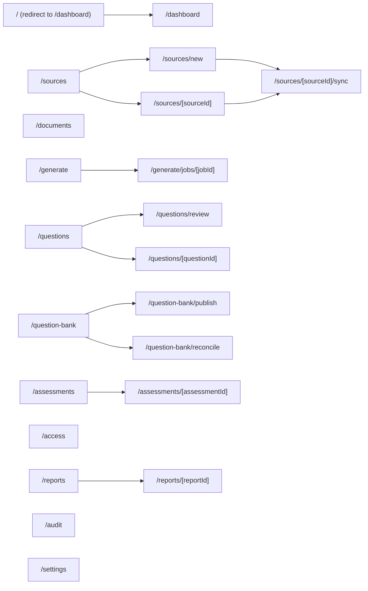
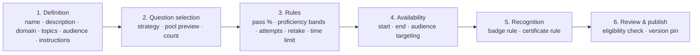

# Authoring and Administration Portal — Functional Design

Deployable: `apps/authoring-web`. Architecture context:
[architecture.md §5](architecture.md#5-authoring-and-administration-portal-architecture).
Interaction and accessibility standards: [ux-design.md](ux-design.md).

---

## 1. Module map and route plan



| Route | Module | Required permission (see [access-control.md](access-control.md#4-policy-catalogue)) |
| --- | --- | --- |
| `/dashboard` | Authoring Dashboard | `authoring.dashboard.view` |
| `/sources`, `/sources/*` | Knowledge Source Administration | `source.read` / `source.manage` |
| `/documents` | Document Browser | `document.browse` |
| `/generate`, `/generate/jobs/*` | AI-Assisted Generation | `question.generate` |
| `/questions`, `/questions/*` | Question workspace | `question.read` |
| `/questions/review` | Review queue | `question.review` |
| `/question-bank`, `/question-bank/publish` | Publishing | `question.publish` |
| `/question-bank/reconcile` | Reconciliation | `questionbank.reconcile` |
| `/assessments`, `/assessments/*` | Assessment Builder | `assessment.read` / `assessment.manage` |
| `/access` | User & Access Management | `access.manage` |
| `/reports`, `/reports/*` | Reports & Dashboards | `report.read` / `report.publish` |
| `/audit` | Audit Explorer | `audit.read` |
| `/settings` | Platform configuration, field mappings, thresholds, badge rules | `platform.configure` |

Navigation renders only the modules the signed-in user is permitted to reach, but navigation
filtering is a convenience. Every route is independently authorized server-side, and the API refuses
unauthorized calls regardless of what the navigation shows.

---

## 2. Authoring Dashboard

### 2.1 Layout

```
┌──────────────────────────────────────────────────────────────────────────────┐
│  Knowzy Authoring            [domain filter ▾] [date range ▾]      [user ▾]  │
├──────────────────────────────────────────────────────────────────────────────┤
│  QUICK ACTIONS  (permission-filtered, keyboard accessible)                    │
│  [Add Source] [Manage Sources] [Test Connection] [Synchronize Source]        │
│  [Generate Quiz] [Review Questions] [Approve Questions] [Publish Questions]  │
│  [Create Assessment] [Users & Roles] [View Reports] [Export] [Publish Report]│
├───────────────────────────────┬──────────────────────────────────────────────┤
│ KNOWLEDGE SOURCES             │ QUESTION PIPELINE                            │
│  Configured            12     │  Draft                 48                    │
│  Active                 9     │  Awaiting review       23                    │
│  Inactive               3     │  Awaiting approval     11                    │
│  Healthy                8     │  Approved (unpublished) 6                    │
│  Degraded               1 !   │  Published            412                    │
│  Failed                 0     │  Rejected              19                    │
│  Docs available     1,284     │  Retired               27                    │
│                               │  Needs revalidation     4 !                  │
├───────────────────────────────┼──────────────────────────────────────────────┤
│ GENERATION JOBS               │ TURNAROUND                                   │
│  Queued 2 · Running 1         │  Draft → approval    1.4 d                   │
│  Succeeded (7d) 34            │  Approval → publish  0.6 d                   │
│  Failed (7d) 2 !              │  Generation → publish 2.3 d                  │
├───────────────────────────────┴──────────────────────────────────────────────┤
│ RECENT SYNC ACTIVITY        │ RECENTLY MODIFIED SOURCE DOCS                  │
│ RECENTLY PUBLISHED ASSESSMENTS │ RECENT ADMINISTRATIVE ACTIVITY              │
└──────────────────────────────────────────────────────────────────────────────┘
```

> Counts above are **illustrative layout examples only**.

### 2.2 Required dashboard data elements

| Panel | Elements | Source |
| --- | --- | --- |
| Knowledge sources | Configured count; active count; inactive count; per-source connection health (`HEALTHY`, `DEGRADED`, `FAILED`, `UNTESTED`); documents available for generation | `KnowledgeSource`, `KnowledgeSourceSync`, `KnowledgeDocument` |
| Recent synchronization activity | Last 10 sync runs: source, mode, start, duration, added/modified/deleted/failed counts, outcome | `KnowledgeSourceSync` |
| Generation jobs | Queued, running, succeeded, failed, partially succeeded; per-job document count, requested vs accepted question count, rejection reasons | `GenerationJob` |
| Question pipeline | Counts by lifecycle state: `GENERATED`, `DRAFT`, `AUTHOR_REVIEW`, `SUBMITTED_FOR_APPROVAL`, `CHANGES_REQUESTED`, `APPROVED`, `PUBLISHED`, `REJECTED`, `RETIRED`, `ARCHIVED` | `DraftQuestion`, `PublishedQuestionReference` |
| Revalidation queue | Questions whose source document hash changed since generation | `KnowledgeDocument.contentHash` vs `DraftQuestion.sourceContentHash` |
| Recently modified source documents | Last 10 modified documents with dependent question counts | `KnowledgeDocument` |
| Recently published assessments | Last 10 published assessment versions with question count and audience | `AssessmentVersion` |
| Review and approval turnaround | Median and p90 for draft→submitted, submitted→decided, approved→published | `QuestionReview`, `QuestionApproval`, audit timestamps |
| Recent administrative activity | Last 20 `ADMIN.*` audit events (actor, action, entity, outcome) | `AuditEvent` |

### 2.3 Quick actions

| Action | Target | Gate |
| --- | --- | --- |
| Add Knowledge Source | `/sources/new` | `source.manage` |
| Manage Knowledge Sources | `/sources` | `source.read` |
| Test Source Connection | Source picker → runs `test_knowledge_source` | `source.test` |
| Synchronize Source | Source picker → queues sync | `source.sync` |
| Generate Quiz | `/generate` | `question.generate` |
| Review Questions | `/questions/review?queue=author` | `question.review` |
| Approve Questions | `/questions/review?queue=approval` | `question.approve` |
| Publish Questions | `/question-bank/publish` | `question.publish` |
| Create Assessment | `/assessments/new` | `assessment.manage` |
| Manage Users and Roles | `/access` | `access.manage` |
| View Reports | `/reports` | `report.read` |
| Export Report | Report picker → export dialog | `report.export` |
| Publish Report | Report picker → publication dialog | `report.publish` |

Every dashboard panel respects the caller's data scope: an Author scoped to two domains sees pipeline
counts for those domains only. Dashboard queries read reporting read models, not transactional joins
— see [reporting.md §3](reporting.md#3-read-model-design).

### 2.4 Dashboard refresh and staleness

- Read models refresh on write for pipeline counts (cheap counters) and on a 5-minute cadence for
  turnaround aggregates.
- Every panel displays "as of {timestamp}". A stale panel is labelled, never silently stale.
- Connection health is **not** re-tested on dashboard load. It shows the last recorded probe result
  with its timestamp. Live testing is an explicit action. This prevents dashboard traffic from
  generating Graph load and from producing misleading "tested" claims.

---

## 3. Knowledge Source Administration (summary)

Full design: [knowledge-source-administration.md](knowledge-source-administration.md).
The portal contributes these screens:

| Screen | Purpose |
| --- | --- |
| `/sources` | Registry table: name, type, status, health, purpose flags, documents, last sync, owner |
| `/sources/new`, `/sources/[id]` | Source editor with type-specific configuration sections and validation |
| `/sources/[id]` → Test Connection panel | Nine-check diagnostic with per-check result and a redacted error summary |
| `/sources/[id]/sync` | Sync configuration, manual run triggers, run history, failed-document retry |
| `/sources/[id]` → Restrictions tab | Role, domain, team, and business-function restrictions; purpose enablement |
| `/sources/[id]` → Documents tab | Indexed document inventory with extraction and indexing status |

---

## 4. AI-Assisted Quiz Generation (portal view)

Workflow detail: [workflows.md §2](workflows.md#2-question-generation-workflow).

### 4.1 Generation form

| Field | Control | Validation |
| --- | --- | --- |
| Knowledge source | Select (active, generation-enabled, user-accessible sources only) | Required |
| Documents | Multi-select, pre-filled from the Document Browser selection | 1–10 documents; all must be `EXTRACTED` |
| Domain | Select from managed `Domain` list | Required |
| Topic | Select or create (create requires `taxonomy.manage`) | Required |
| Target audience | Select (e.g. Tier 1 Support, Tier 2 Support, New Hire) | Required |
| Learning objectives | Repeating text lines | 0–10 |
| Requested number of questions | Number | 1–50, capped per generation profile |
| Question type | Select | Release 1: `MULTIPLE_CHOICE_4` only |
| Generation profile | Select | Required; controls difficulty mix, model, prompt version, evidence strictness |
| Optional instructions | Textarea | ≤1,000 chars; treated as author guidance, never as authority over system rules |
| Source-grounding requirement | Toggle + strictness select (`STRICT`, `STANDARD`) | Default `STRICT`; `STRICT` cannot be disabled, only the evidence-match tolerance varies |

A preflight panel shows, before submission: documents selected, total extracted characters, estimated
chunk count, estimated token cost, estimated duration, and any blocking conditions (unsupported type,
extraction failure, source inactive, permission failure).

### 4.2 Generation job monitor (`/generate/jobs/[jobId]`)

Per-job display: status, progress by document and chunk, accepted question count, rejected count with
reason codes (`SCHEMA_INVALID`, `EVIDENCE_UNVERIFIED`, `DUPLICATE`, `INSUFFICIENT_EVIDENCE`,
`OPTION_DUPLICATE`, `ANSWER_INVALID`), token usage, model and prompt version, correlation ID, and a
"Review drafts" action. Failed jobs offer retry; retry is idempotent and never duplicates accepted
drafts.

### 4.3 Generation profiles

A `GenerationProfile` is administrator-managed configuration, not code:

| Attribute | Purpose |
| --- | --- |
| Name, description | Identification |
| Model ID | e.g. `claude-sonnet-5` — configuration value |
| Prompt template ID + version | Immutable prompt reference recorded on every question |
| Question type | Release 1: `MULTIPLE_CHOICE_4` |
| Difficulty mix | e.g. recall 40% / application 45% / analysis 15% |
| Max questions per document, per chunk | Prevents over-extraction from thin content |
| Evidence strictness | `STRICT` (exact normalized span) / `STANDARD` (≥0.95 similarity) |
| Distractor rules | Plausibility guidance, prohibition on "all of the above" / "none of the above" |
| Duplicate threshold | Similarity score above which a draft is auto-flagged or auto-rejected |
| Temperature and max output tokens | Model parameters |
| Enabled domains | Restricts profile use |

---

## 5. Question Review Workspace

The single highest-leverage screen in the product. If review is slow, the platform fails its primary
business goal regardless of how good generation is.

### 5.1 Layout

```
┌───────────────────────────────────────────────────────────────────────────────┐
│ Review queue: Awaiting approval · Domain: Network · 11 items    [3 selected]  │
├────────────┬──────────────────────────────────────────┬───────────────────────┤
│ QUEUE      │ QUESTION                                 │ SOURCE EVIDENCE       │
│            │                                          │                       │
│ ▸ Q-1041 ! │ Which command clears the ARP cache on…    │ SOP-Network-Reset.pdf │
│ ▸ Q-1042   │                                          │ p.14 · §3.2           │
│ ▪ Q-1043 ◂ │  A  arp -d *          ○                   │ ───────────────────── │
│ ▸ Q-1044   │  B  ip neigh flush all ●  ← proposed      │ "To clear the ARP     │
│ ▸ Q-1045   │  C  netsh int ip reset ○                  │  cache on the Linux   │
│            │  D  ifconfig -a        ○                  │  jump host, run       │
│ Filters    │                                          │  `ip neigh flush all`"│
│  Status    │ Explanation                               │                       │
│  Domain    │  The Linux jump host uses the iproute2…   │ [Open in SharePoint]  │
│  Topic     │                                          │ Verified span ✓       │
│  Source    │ Domain: Network   Topic: ARP / L2         │ Hash match ✓          │
│  Confidence│                                          │                       │
│  Flags     │ Confidence: 0.86 (composite)              │ VALIDATION            │
│            │ Version: 2 · Generated 2026-09-12         │  ✓ Schema             │
│            │                                          │  ✓ Evidence verified  │
│            │ [Comments 2]                              │  ! Similar: Q-0988    │
│            │                                          │    (0.81)             │
│            │ [Save draft] [Request changes] [Reject]   │  ✓ Options distinct   │
│            │ [Approve ⏎]                               │  ✓ Metadata complete  │
└────────────┴──────────────────────────────────────────┴───────────────────────┘
```

> Content above is an **illustrative example**, not real source material.

### 5.2 Displayed elements (all mandatory)

Question text · four options · proposed correct answer · explanation · domain · topic · source
document name · source path · source link (opens in SharePoint, honours the user's own permissions) ·
supporting evidence span with section/page location · generation confidence · validation warnings ·
similar-question warnings with similarity score and link · question version · review history
(who, when, decision, comment, field-level diff).

### 5.3 Author capabilities

Edit question text · edit each option · change proposed correct answer · edit explanation · assign
domain · assign topic · add comment · save draft · submit for approval · reject generated draft ·
archive draft.

Every edit creates a `DraftQuestionVersion` snapshot with a field-level diff. Editing does not
silently clear validation state: changing the question text or options re-runs validation and
re-checks the evidence span, and the panel shows the re-check result before submission is allowed.

### 5.4 Reviewer capabilities

Compare question against source evidence (side-by-side, with the evidence span highlighted in the
retrieved chunk) · edit where the policy permits · approve · reject · request changes · add review
comment · return to author · view version history.

`question.review.edit` is a distinct permission from `question.review`. A tenant can configure
review-only reviewers who must return the item to the author rather than edit it.

### 5.5 Review workspace interaction model

Keyboard-first, because volume review is the point:

| Key | Action |
| --- | --- |
| `j` / `k` | Next / previous item |
| `1`–`4` | Set proposed correct answer to A–D |
| `e` | Focus question text for editing |
| `g` | Jump to evidence panel |
| `c` | Open comment box |
| `Enter` | Primary decision for the queue (approve in the approval queue, submit in the author queue) |
| `r` | Request changes (opens the mandatory comment box) |
| `x` | Reject (opens the mandatory comment box) |
| `Space` | Toggle selection for a bulk operation |
| `?` | Shortcut help |

All shortcuts are discoverable, remappable-by-configuration, disabled while a text field has focus,
and mirrored by visible controls. Full accessibility rules in
[ux-design.md §5](ux-design.md#5-review-workspace-interaction-model).

### 5.6 Bulk operations

| Operation | Allowed | Constraint |
| --- | --- | --- |
| Assign domain | Yes | Author or reviewer, within data scope |
| Assign topic | Yes | Author or reviewer, within data scope |
| Submit for approval | Yes | Each item must pass all validation gates individually |
| Reject | Yes | A single mandatory comment applies to the batch and is copied to each item |
| Archive | Yes | Draft-state items only |
| **Approve** | **Restricted** | Requires `question.approve.bulk`, is capped (default 25 items), requires each item to pass every gate in §5.7, and requires explicit confirmation listing the item IDs |

Bulk operations are transactional per item, not per batch: a batch of 20 with 2 failures commits 18
and reports 2 with reasons. The response enumerates each item's outcome. A bulk audit event records
the batch, plus one audit event per item transition.

### 5.7 Approval blocking gates

Approval (single or bulk) is refused when any of the following holds:

| # | Gate | Error code |
| --- | --- | --- |
| 1 | Source evidence missing or unverified | `EVIDENCE_MISSING` |
| 2 | Question text empty, or below the configured minimum length | `QUESTION_INCOMPLETE` |
| 3 | Any of options A–D missing or blank | `OPTION_MISSING` |
| 4 | Two or more options identical after normalization | `OPTION_DUPLICATE` |
| 5 | Correct answer not exactly one of `A`, `B`, `C`, `D` | `ANSWER_INVALID` |
| 6 | Explanation missing | `EXPLANATION_MISSING` |
| 7 | Domain missing | `DOMAIN_MISSING` |
| 8 | Topic missing | `TOPIC_MISSING` |
| 9 | Any configured required metadata field missing | `METADATA_MISSING` |
| 10 | Duplicate similarity score exceeds the configured threshold and has not been explicitly dispositioned | `DUPLICATE_THRESHOLD_EXCEEDED` |
| 11 | Source document inaccessible at approval time | `SOURCE_INACCESSIBLE` |
| 12 | Source validation failed (hash mismatch without revalidation, or span no longer locatable) | `SOURCE_VALIDATION_FAILED` |
| 13 | Separation of duties violated (approver is the author or last editor, where configured) | `SEPARATION_OF_DUTIES` |

Gates are evaluated server-side at the moment of the transition. The UI shows the same gate results
in the validation panel so an approver is never surprised, but the UI evaluation is advisory.

### 5.8 Question detail and version history (`/questions/[questionId]`)

Tabs: **Current** (editable per state and role) · **Evidence** (chunk text, span highlight, hash and
citation, "re-verify now") · **Versions** (list with field-level diffs and the actor for each) ·
**Reviews** (chronological decisions and comments) · **Publication** (SharePoint item ID, list, ETag,
published version, publish history, reconciliation status) · **Usage** (assessments referencing this
question, attempt counts, item statistics) · **Audit** (correlated audit events).

### 5.9 Item analytics feedback loop

Once a question has been answered enough times (default 30 attempts), the detail page shows
difficulty (proportion correct) and a distractor distribution. Questions where every learner picks
the same wrong option, or where the correct answer is chosen less often than chance, are surfaced in
a "review candidates" report. This is a quality signal for authors, not an automatic action — nothing
is retired or modified automatically.

---

## 6. Question Bank and publishing screens

Workflow detail: [workflows.md §4](workflows.md#4-question-publishing-workflow).
Governance rules: [sharepoint-question-bank.md §4](sharepoint-question-bank.md#4-governance-rules).

| Screen | Contents |
| --- | --- |
| `/question-bank` | Published inventory from the local projection: QuestionID, domain, topic, version, status, `IsActive`, `IsPublished`, published date, publisher, SharePoint item link, reconciliation state |
| `/question-bank/publish` | Approved-but-unpublished queue; target list and mapping profile (read-only display of the resolved configuration); dry-run preview showing the exact field set to be written; publish action with idempotency key; per-item result list |
| `/question-bank/reconcile` | Differences between the local projection and SharePoint (missing in SharePoint, missing locally, version drift, status drift, field drift) with a per-difference recommended action and an explicit operator decision |
| Retire action | Available from the inventory; sets `IsActive = false` in SharePoint and marks the local reference `RETIRED`; requires a comment; never deletes the SharePoint item |

Publishing is disabled entirely until `sharepoint.write.enabled` is turned on for the environment.
Until then the publish screen runs in dry-run mode and says so prominently.

---

## 7. Assessment Builder

Workflow detail: [workflows.md §5](workflows.md#5-assessment-publishing-workflow).

### 7.1 Builder steps



### 7.2 Selection strategy configuration

| Strategy | Configuration | Pool preview |
| --- | --- | --- |
| `FIXED_SET` | Explicit ordered list of QuestionID + published version | Exact list, with a warning if any item is retired or inactive |
| `RANDOM_POOL` | Domain, optional topic filter, question count | Eligible pool size, shortfall warning if pool < count |
| `TOPIC_BALANCED` | Topics + count; equal distribution with documented remainder rule | Per-topic pool sizes and the computed allocation |
| `TOPIC_DISTRIBUTION` | Explicit per-topic counts or percentages | Per-topic pool sizes and feasibility per topic |

The builder blocks publication when the eligible pool cannot satisfy the configuration, and states
exactly which topic is short by how many questions. It never silently under-fills an assessment.

### 7.3 Eligibility criteria enforced at selection time

A question may be selected only when it is: approved, published, active (`IsActive = true` and
`IsPublished = true`), within the assessment's permitted domain, available to the learner under the
learner's domain/team scope, not retired, and valid for the assessment release (its published version
is present in the release's eligibility snapshot).

---

## 8. User and Access Management

Design: [access-control.md §7](access-control.md#7-user-and-access-administration).
Portal screens:

| Tab | Contents |
| --- | --- |
| Users | Searchable list: display name, UPN, status, roles, portal access, domain/team/source scope, last sign-in |
| User detail | Role assignment and revocation with effective-permission preview; portal access toggles (authoring / live); domain, team, business-function, and knowledge-source restrictions; access history; recent authentication activity |
| Roles | Role catalogue with permission matrix (read-only in release 1; role definitions are seeded configuration) |
| Access history | Role and scope change log with actor, previous value, new value, timestamp, reason |
| Exports | Permitted access reports (CSV/Excel), each export audited |

Rules: a user may hold multiple roles; effective permissions are the union of role permissions
intersected with scope restrictions; a preview panel shows exactly what a proposed change will grant
before it is saved; deactivating application access takes effect on the next request (token
revocation is not assumed — the API checks account status per request).

---

## 9. Reports and Dashboards (portal view)

Design: [reporting.md](reporting.md). The portal provides: a report catalogue grouped by
Authoring / Knowledge Sources / Assessment / Proficiency / Recognition; a filter bar (date range,
user, team, domain, topic, assessment, role, status, proficiency level, knowledge source); dashboard
views with saved layouts; saved report definitions; CSV, Excel, and PDF export; and a controlled
publication flow following the `DRAFT → UNDER_REVIEW → APPROVED → PUBLISHED → RETIRED → ARCHIVED`
lifecycle.

Data-level authorization applies identically to on-screen dashboards, exports, and published reports.
A manager sees only authorized teams. Aggregates below the configured minimum group size are
suppressed with a visible "suppressed — group too small" marker rather than a blank cell.

---

## 10. Audit Explorer

For Auditors and Platform Administrators (`audit.read`):

- Filter by actor, action, action family, entity type, entity ID, outcome, correlation ID, date range.
- View a correlated trace: all events sharing a correlation ID, in order, across API, MCP, and jobs.
- Drill from any question to its full lifecycle event chain.
- Export filtered results (CSV), with the export itself audited.
- No secret, token, or document body appears in any audit view. Redaction is applied at write time,
  not at display time.

---

## 11. Settings

| Section | Configures |
| --- | --- |
| Domains and topics | Managed taxonomy, mapping to source domain hints, merge and rename with reference integrity |
| Generation profiles | §4.3 |
| Proficiency thresholds | Default bands and per-assessment overrides |
| Duplicate thresholds | Flag threshold and hard-block threshold |
| Field mapping profiles | [sharepoint-field-mapping.md](sharepoint-field-mapping.md) |
| Question Bank target | Site URL, list, mapping profile, write-enabled flag (per environment) |
| Badge definitions | [badges-and-certificates.md](badges-and-certificates.md) |
| Certificate templates | Branding, expiry policy, verification URL base |
| Notification rules | Who is notified on revalidation, approval requests, publish failures |
| Privacy settings | Minimum group size, learner-detail visibility by role |
| Separation-of-duties policy | Whether authors may approve their own questions (default: no) |
| Retention | Audit, session, and draft retention periods |

All settings changes are audited with previous and new values.

---

## 12. Empty, loading, and error states

Every module specifies all four states, because an enterprise tool is judged on its bad days:

| State | Standard |
| --- | --- |
| Empty | Explains what the screen will contain and offers the one action that populates it (e.g. `/documents` with no sources configured links to Add Knowledge Source, gated by permission) |
| Loading | Skeletons matching final layout; no layout shift; long operations show determinate progress with a correlation ID |
| Partial | Panels fail independently; a failed panel shows its own retry and never blanks the page |
| Error | Plain-language cause, whether it is retryable, what to do next, the correlation ID for support, and no stack trace or internal identifier |

See [error-handling.md §10](error-handling.md#10-user-facing-error-presentation).
