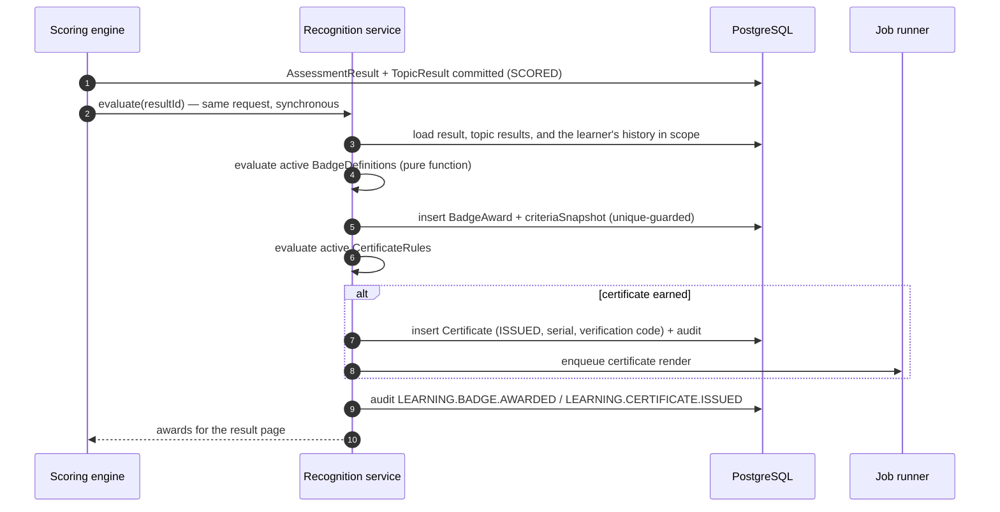

# Badges and Certificates

**What this document adds:** the badge rule language and catalogue, the evaluation contract,
certificate issuance and rendering, the verification protocol, and expiry/revocation. Storage shape is
in [data-model.md §8.7](data-model.md#87-recognition); the learner-facing surfaces are in
[live-learning-portal.md §8](live-learning-portal.md#8-badges-and-certificates-learner-view).

---

## 1. Principles

| # | Principle | Consequence |
| --- | --- | --- |
| R1 | **Recognition is deterministic.** Eligibility is a pure function of stored results and a declarative rule | Claude has no input. Two evaluations of the same result produce the same award, always |
| R2 | **Verifiable, not decorative.** A certificate is checkable by a third party without a Knowzy account | §6 |
| R3 | **Criteria are stated before they are earned.** In-progress badges show their exact criteria | A learner is never told "you almost earned something" without knowing what |
| R4 | **Awards are append-only.** A revocation is a new state with a reason and a date, never a deletion | A revoked certificate is shown as revoked, never silently removed |
| R5 | **Awards are explainable.** Every award stores the criteria snapshot it satisfied | A rule change next year does not rewrite why a badge was earned |
| R6 | **No comparison.** No leaderboards, ranks, percentiles, or peer visibility anywhere | Enforced by the absence of any such read model ([security.md §13](security.md#13-privacy-and-data-subject-requests)) |
| R7 | **Idempotent issuance.** Re-evaluating a result never produces a duplicate award or a second certificate | Unique constraints plus deterministic serials |

---

## 2. Badge rule language

A rule is declarative JSON evaluated by a pure function. There is no scripting, no expression string,
and no configurable code path — a badge rule cannot do anything the language does not express.

```jsonc
// BadgeDefinition.criteria — illustrative
{
  "trigger": "RESULT_SCORED",            // RESULT_SCORED | RECOMMENDATION_COMPLETED | PERIODIC
  "allOf": [
    { "metric": "percentageScore",  "op": "gte",  "value": 90.00 },
    { "metric": "passed",           "op": "eq",   "value": true },
    { "metric": "domainId",         "op": "in",   "value": ["<network domain id>"] },
    { "metric": "resultState",      "op": "eq",   "value": "SCORED" }
  ],
  "window": null,                        // or { "kind": "ROLLING_DAYS", "days": 90 }
  "aggregate": null                      // or { "metric": "distinctAssessments", "op": "gte", "value": 3 }
}
```

### 2.1 Available metrics

| Scope | Metrics |
| --- | --- |
| Single result | `percentageScore` · `passed` · `proficiencyBand` · `assessmentId` · `assessmentVersionId` · `domainId` · `topicIds` · `objectiveIds` · `attemptNumber` · `timeTakenSeconds` · `resultState` · `unansweredCount` |
| Topic detail | `minTopicAccuracy` · `topicGapCount` · `allTopicsAtOrAbove` |
| Learner history | `distinctAssessmentsPassed` · `distinctDomainsPassed` · `consecutivePasses` · `firstAttemptPasses` · `recommendationsCompleted` · `resultsInWindow` · `averageScoreInWindow` |
| Time | `completedAt` (with a window) |

### 2.2 Language rules

| # | Rule |
| --- | --- |
| L1 | Operators are `eq`, `neq`, `gt`, `gte`, `lt`, `lte`, `in`, `notIn`, `between`. No regular expressions, no arithmetic |
| L2 | Composition is `allOf`, `anyOf`, `not` — a finite tree, evaluated eagerly, with a depth cap of 4 |
| L3 | Comparisons on `percentageScore` and topic accuracy use the **stored, rounded** value, so the number the learner saw is the number the rule used ([live-learning-portal.md §5.2](live-learning-portal.md#52-rounding-rule-normative)) |
| L4 | Thresholds are inclusive on the lower bound (`gte`) by convention, matching the proficiency bands |
| L5 | A rule referencing an unknown metric or a deleted taxonomy ID fails **validation at save time**, not silently at evaluation time |
| L6 | Rules are versioned. Editing a rule creates a new version; existing awards keep their `criteriaSnapshot` |
| L7 | Only results in `resultState = SCORED` are eligible. `EXPIRED`, `ABANDONED`, and `VOIDED` results never award anything |
| L8 | A rule must be expressible as a SQL predicate over stored results, which is what makes retroactive evaluation and reporting possible |

---

## 3. Badge catalogue

Seeded definitions. All are configurable; `key` is stable so awards survive renaming.

| Key | Name | Criteria (plain language) | Repeatable |
| --- | --- | --- | --- |
| `DOMAIN_EXPERT` | Domain Expert — {domain} | Score ≥ 90 % on a passed assessment in the domain | Per domain |
| `DOMAIN_PROFICIENT` | Proficient — {domain} | Score ≥ 75 % on a passed assessment in the domain | Per domain |
| `FIRST_ASSESSMENT` | First Steps | Complete and pass any assessment | No |
| `PERFECT_SCORE` | Flawless | Score 100 % with no unanswered questions | Yes |
| `FIRST_ATTEMPT_PASS` | Right First Time | Pass on attempt 1 | Yes |
| `NO_WEAK_TOPICS` | Balanced Knowledge | Pass with every assessed topic at or above the gap threshold, and at least three topics assessed | Yes |
| `BREADTH` | Broad Coverage | Pass assessments in ≥ 3 distinct domains | No |
| `CONSISTENCY` | Consistent Performer | Pass ≥ 3 assessments in a rolling 90 days with an average ≥ 80 % | Yes, once per window |
| `REFRESHER_COMPLETION` | Closing the Gap | Complete ≥ 5 knowledge refreshers | Yes |
| `IMPROVEMENT` | Measurable Improvement | A later attempt on the same assessment exceeds the earlier by ≥ 15 points, both `SCORED` | Yes |

Deliberately absent: anything rewarding speed, volume for its own sake, or relative standing. Speed
badges would compromise careful reading; volume badges would incentivize taking assessments rather
than learning; relative badges would violate R6.

---

## 4. Evaluation



| # | Rule |
| --- | --- |
| E1 | Badge evaluation runs **synchronously** with scoring, in the same transaction, so the result page shows awards immediately and cannot show a different set on refresh |
| E2 | Certificate **rows** are created synchronously; PDF **rendering** is asynchronous. The learner sees "preparing" rather than a broken download ([error-handling.md §5.2](error-handling.md#52-degradation-stated)) |
| E3 | Non-repeatable badges are guarded by a unique index on `(badgeDefinitionId, learnerUserId)`, so concurrency cannot double-award |
| E4 | Repeatable-per-domain badges are unique on `(badgeDefinitionId, learnerUserId, domainId)` |
| E5 | Re-evaluation is idempotent: it inserts what is missing and never duplicates or revokes |
| E6 | A rule activated later can be applied retroactively by an explicit administrator action, audited, with a dry-run count first. Retroactive award is never automatic, because a sudden backfill of badges is confusing and unexplainable to learners |
| E7 | Deactivating a definition stops new awards and leaves existing ones intact and visible |
| E8 | Evaluation failure never fails scoring: the result commits, the failure is logged as a `PLATFORM.JOB` event, and a retry job re-evaluates. A missing badge is recoverable; a missing result is not |
| E9 | `PERIODIC` triggers (windowed rules that can become true without a new result) are evaluated by a nightly job over affected learners only |

---

## 5. Certificates

### 5.1 Rules and content

`CertificateRule`: `key`, `name`, `templateRef`, `validityMonths?`, `criteria` (same language as §2).
Default seeded rule: **Assessment Certificate** — passed, `resultState = SCORED`, and the assessment
version has `certificateRuleId` set.

| Field on the rendered PDF | Source | Notes |
| --- | --- | --- |
| Learner name | `User.displayName` | Included only when `certificate.includeLearnerName` is enabled for the tenant |
| Assessment name | `AssessmentVersion` | |
| Assessment version | `AssessmentVersion.versionNumber` | Makes a historical certificate interpretable |
| Domain | `Domain.name` | |
| Score | `AssessmentResult.percentageScore` | At stored precision |
| Proficiency band | `AssessmentResult.proficiencyBand` | |
| Completion date | `completedAt` | Rendered in the tenant reporting zone, with UTC in the metadata |
| Issue date | `Certificate.issuedAt` | |
| Expiry date | `Certificate.expiresAt` | Omitted when the rule sets no validity period |
| Serial number | `Certificate.serialNumber` | `KNZ-CERT-{YYYY}-{SEQ}` (example) |
| Verification code and URL | `Certificate.verificationCode` | Rendered as text **and** as a QR code |
| Issuer | Tenant branding from configuration | |

Never on a certificate: question content, answer keys, topic-level detail, attempt count, or any
other learner's data.

### 5.2 Rendering

| Concern | Design |
| --- | --- |
| Library | `pdf-lib` with embedded fonts — deterministic, no headless browser in the container ([ADR-009](risks-and-decisions.md#adr-009-pdf-lib-for-certificate-rendering)) |
| Determinism | Fixed creation/modification metadata derived from `issuedAt`, fixed font subset, no remote resource loading. The same certificate re-rendered produces byte-identical output |
| Integrity | `renderedHash` = SHA-256 of the PDF bytes, stored on the row. A re-render that does not match is a `PlatformConsistencyFinding`, not a silent replacement |
| Signing | The verification code is HMAC-derived from `(serialNumber, resultId)` using a Key Vault key; `signatureKeyId` is stored so certificates stay verifiable across key rotation |
| Storage | Blob storage, private container, no public URL. Download is served through an authorized API route, never a direct blob link |
| Accessibility | Tagged PDF with a document title, language, and a text layer; the verification URL is real text, not only a QR image |
| Template versioning | `templateVersion` stored per certificate, so a branding change never alters an issued certificate |
| Failure | Render failure leaves the certificate `ISSUED` with the render queued and retried; the row is the record of entitlement, the PDF is an artifact of it |

---

## 6. Verification

A third party — a manager, an auditor, a customer — must be able to check a certificate without a
Knowzy account.

### 6.1 Protocol

```
GET /api/v1/public/certificates/verify/{code}      — unauthenticated, rate-limited
```

| Response | Body |
| --- | --- |
| Valid | `{ status: "VALID", serialNumber, assessmentName, assessmentVersion, domain, completionDate, issueDate, expiryDate?, proficiencyBand, learnerName? }` |
| Expired | `{ status: "EXPIRED", …same fields…, expiredOn }` |
| Revoked | `{ status: "REVOKED", serialNumber, revokedOn, revokeReasonCategory }` |
| Unknown | `{ status: "NOT_FOUND" }` |

### 6.2 Rules

| # | Rule |
| --- | --- |
| W1 | Minimum necessary data. `learnerName` appears **only** when the tenant enables `certificate.includeLearnerName`; `percentageScore` is returned only when `certificate.verificationIncludesScore` is enabled (default off) |
| W2 | Codes are ≥128 bits of entropy, stored **hashed** (`verificationCodeHash`) with the plaintext held only long enough to render the PDF. A database read does not yield usable codes |
| W3 | Lookup is by hash, in constant time, so timing reveals nothing |
| W4 | Rate-limited per IP (20/min) and globally, with a WAF rule on the path. Enumeration is computationally uninteresting and operationally throttled ([security.md §9](security.md#9-insecure-direct-object-reference-idor-prevention)) |
| W5 | `NOT_FOUND` is returned for malformed, unknown, and deleted codes alike — no oracle distinguishing "never existed" from "existed once" |
| W6 | Every verification attempt is audited as `LEARNING.CERTIFICATE.VERIFIED` with the outcome and a truncated IP prefix, never the full address |
| W7 | The revoke reason is returned as a **category** (`SUPERSEDED`, `RESULT_VOIDED`, `ADMINISTRATIVE`, `ERROR_IN_ISSUANCE`), never free text, which could contain personal or sensitive detail |
| W8 | Verification is read-only and touches no learner-scoped data beyond the certificate |
| W9 | The endpoint returns `Cache-Control: no-store`; a revocation takes effect on the next check |
| W10 | The verification response states the assessment **version**, so a verifier knows which assessment definition was passed |

---

## 7. Expiry and revocation

| Concern | Design |
| --- | --- |
| Expiry | Computed from `validityMonths` at issuance and stored **absolutely** in `expiresAt`. A later rule change never moves an issued certificate's expiry ([data-model.md §9](data-model.md#9-time-and-timezone-rules), T12) |
| Expiry transition | A nightly job moves `ISSUED` → `EXPIRED` past `expiresAt` and audits it. Verification computes status from the date regardless, so an unrun job cannot report an expired certificate as valid |
| Learner visibility | `/certificates` shows expired certificates with their dates; they are never hidden |
| Revocation grounds | The result was voided or superseded; the certificate was issued in error; an administrative decision. Each requires `platform.configure` and a reason category plus an internal comment |
| Revocation effect | `status = REVOKED`, `revokedAt`, `revokeReason`, `revokedByUserId`. The row and the PDF are retained; the download remains available and is labelled revoked, because destroying the artifact would destroy the evidence of what was issued |
| Badge revocation | Same shape (`BadgeAward.revokedAt`), used when a result is voided. The badge wall shows it as revoked with its date |
| Cascade from a voided result | Voiding a result revokes the badges and certificates that result produced, in one transaction, each with `revokeReason = RESULT_VOIDED`, and audits each revocation individually |
| Recertification | Designed, not built: `validityMonths` and the expiry fields exist from day one, and a recertification campaign would be a scheduled notification over expiring certificates. Release 1 notifies the learner 30 days before expiry and does nothing else |
| No silent removal | There is no code path that deletes a `BadgeAward` or a `Certificate` ([data-model.md §13](data-model.md#13-constraints-and-invariants), I20) |

---

## 8. Learner and administrator surfaces

Learner views are specified in
[live-learning-portal.md §8](live-learning-portal.md#8-badges-and-certificates-learner-view). What
this document adds:

| Surface | Requirement |
| --- | --- |
| In-progress badges | Each shows its criteria in plain language, generated from the rule rather than written separately, so the stated criteria cannot drift from the evaluated ones (R3) |
| Award explanation | An earned badge shows the result that earned it and the criteria snapshot it satisfied (R5) |
| Certificate list | Status, issue and expiry dates, download, and the verification URL — copyable as text, so a learner can share it without sharing the PDF |
| Administrator: definitions | Create, edit, activate, deactivate, with rule validation, a dry-run count of who would qualify today, and a preview of the generated criteria text |
| Administrator: revocation | Explicit action with reason category and comment, fully audited, with the consequence stated before confirming |
| Administrator: certificate templates | Branding, expiry policy, verification URL base, and the two disclosure flags in W1 |
| Reporting | Recognition reports catalogued in [reporting.md §4](reporting.md#4-report-catalogue), aggregate-only and subject to the minimum-group-size rule |
