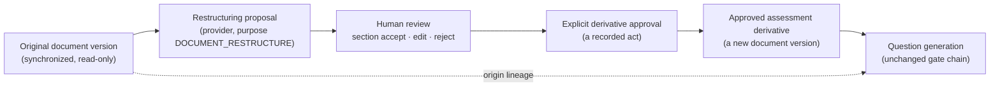

# AI Document Studio Architecture

**Status:** Design only. **Classification: `BLOCKED_BY_APPROVAL`** (§7) and
`REQUIRES_BACKEND_EXTENSION`. No route, screen, table or provider call exists, and no navigation item
is shown.
**Target location:** Knowledge Sources → AI Document Studio.
**Governed by:** [COMPETENCY_PRIVACY_AND_GOVERNANCE.md](COMPETENCY_PRIVACY_AND_GOVERNANCE.md) CP-5 ·
[architecture.md §9.0](../architecture.md#90-provider-independence--amended-2026-09-24-extended-2026-09-26-and-2026-09-27) ·
[generation-governance.md](../generation-governance.md).
**Rules for the content:** [SOURCE_DOCUMENT_AUTHORING_GUIDE.md](../integrations/SOURCE_DOCUMENT_AUTHORING_GUIDE.md).

---

## 1. Why, and the precedent this formalizes

Structure limits yield. The measured case is the GenerationReady corpus (project history,
2026-09-22): seven SOPs restructured by hand went from 67 assessable sections to 76 and from 4
accepted questions to 16. Three lessons from that work are binding on this design:

1. **Restructuring is not unconditionally good.** The best-structured SOP went from 26 assessable
   sections to 12 and produced zero questions before and after. The Studio must be able to say
   **"no restructuring recommended"** and measure before-and-after assessability, not assume it.
2. **A fixed template invites fabrication.** The hand conversion omitted Thresholds, Exceptions and
   Validation Criteria wherever the source stated none. A model asked to fill nine headings will fill
   them.
3. **A question grounded in a derivative is not grounded in the document of record.** That corpus
   carries the rule "no question generated from it may be published". The Studio exists to replace
   that blanket ban with a governed lineage (§5), not to quietly lift it.

## 2. Workflow

**The derivative never replaces the original.** The original stays exactly as synchronized; the
derivative is a separate document that says, on every screen and in its header block:

> **Assessment derivative — not the authoritative source.**

### 2.1 States

| State | Meaning | Usable for generation |
| --- | --- | --- |
| `PROPOSED` | Provider output received and verified (§4), awaiting review | No |
| `IN_REVIEW` | A reviewer has accepted, edited or rejected at least one section | No |
| `APPROVED` | Whole-document approval recorded | **Yes** |
| `REJECTED` | Rejected as a whole | No |
| `STALE` | The original has a newer version than the one the derivative was made from | No — and questions from it enter revalidation |
| `SUPERSEDED` | A newer derivative version was approved | No for new jobs; existing lineage is kept |

**Editing an approved derivative creates a new version in `IN_REVIEW`** and requires approval
again. An approval covers one content hash, never "the latest".

## 3. What is stored

| Field | Why |
| --- | --- |
| Original document id **and version** (source version id + content hash) | So staleness is detectable and lineage points at one exact text |
| Derivative document id and version | The derivative is a `KnowledgeDocument` in a system-owned *Document Studio* source, so sectioning, section keys and evidence verification work unchanged |
| Provider and configured model | Provenance, as for generation |
| Prompt version | The restructuring prompt is versioned and hash-pinned, as `framing.ts` is |
| Transformation timestamp | |
| Requesting author, each section reviewer, approver | Identity per act |
| Approval record | Approver, time, the content hash approved |
| Change summary | Per section: kept, re-headed, merged, split, table restated, rejected |
| Content hash of the derivative | What was approved |
| **Processing purpose** | `DOCUMENT_RESTRUCTURE` — distinct from `QUESTION_GENERATION` (§7) |
| Missing-information findings | Stored **beside** the derivative, never inside it (§4.2) |
| Assessability before and after | Assessable sections and characters, from the real sectionizer, for both texts |

## 4. Transformation rules

### 4.1 Allowed and forbidden

The provider may **reorganize only content already present**.

| Allowed | Forbidden |
| --- | --- |
| Add headings derived from existing content | Invent a threshold, business rule, exception, rationale or success criterion |
| Combine fragmented procedural steps into one coherent section | Turn "should" into "must", or a recommendation into a rule |
| Restate a table as rule sentences or scenarios, keeping the table | Add external knowledge, even correct knowledge |
| Clarify formatting without changing meaning | Add suggested questions, or a "Knowledge Checks" section, to the derivative |
| Identify content unsuitable for assessment | Follow a mandatory template |
| Flag missing rationale, thresholds, exceptions or validation criteria | Remove a qualifier, a condition or a negation |

**There is no mandatory template.** A document gets the headings its content supports. A section the
source has no content for is **absent**, and the absence is a finding, not an empty heading.

### 4.2 Output shape, and how it is verified

The provider returns JSON against a strict schema, with no tools granted (as for generation):

- `sections[]` — each with a `heading`, a `body`, and `sourceQuotes[]`: the verbatim spans of the
  original the body was built from;
- `findings[]` — missing information, content unsuitable for assessment, and "no restructuring
  recommended" — **outside** the derivative;
- `questionSuggestions[]` — if requested at all, stored outside the evidence-bearing text and never
  sectioned.

Verification, before a proposal is shown to anyone:

| Check | Failure |
| --- | --- |
| Every `sourceQuote` is found verbatim (under the platform's existing normalization) in the original version | The section is marked `UNVERIFIED_SOURCE` and cannot be accepted without an edit |
| Every sentence of every `body` is found in the original, **or** is shown to the reviewer as **new text** in the difference view | New text is highlighted and needs an explicit per-sentence acceptance |
| Headings that do not occur in the original are marked **added heading** | Informational; headings are the permitted addition |
| No numeral, date, duration or percentage appears in a body that is absent from its `sourceQuotes` | **Refused outright** — an invented quantity is the most likely and most damaging fabrication |
| Modal verbs (`must`, `shall`, `should`, `may`) match their source sentences | A strengthened modal is refused |

## 5. Grounding and lineage

A question generated from a derivative carries **two separate provenances**, and they are never
conflated:

| Provenance | Points at | Claim it supports |
| --- | --- | --- |
| **Generation evidence** | The exact approved derivative section and its verbatim span — the existing `evidence` columns, verified in STRICT mode as today | "This question is answerable from this derivative text" |
| **Origin lineage** | The original document and **original version** the derivative was made from, plus the original offsets **if** a trustworthy mapping exists | "The derivative text came from here" |

**A derivative quote is never presented as a verbatim quote from the original.** The mapping from a
derivative block to original offsets is recorded only when it is **exact**: the block's text, under
the platform's normalization, occurs verbatim in the original version. Otherwise the block is marked
`ORIGINAL_OFFSET_NOT_AVAILABLE`, and no offset is invented.

**Publication (DS-1, open).** Until decided, the conservative rule applies: a derivative-grounded
question is publishable **only if its evidence span also verifies verbatim against the original
version** — dual verification. A question whose span exists only in the derivative is marked
*derivative-only evidence* on the review screen and is **not publishable**. That keeps the existing
GenerationReady ban true for anything not dual-verified.

## 6. Review experience

A side-by-side screen: **Original | Proposed derivative**.

| Control | Behaviour |
| --- | --- |
| Section accept | Accepts the section as proposed; new text inside it must already be individually accepted |
| Section edit | The reviewer edits; the edit is diffed against the original and re-verified by §4.2 |
| Section reject | The section is dropped; its source text stays in the original only |
| Difference view | Per section: moved, re-headed, merged, restated, new text |
| Missing-information findings | Listed beside the section they concern, with no control that inserts content |
| Provenance panel | Provider, model, prompt version, transformation time, requesting author |
| Assessability panel | Assessable sections and characters, before and after |
| Whole-document approval | Enabled only when every section is accepted, edited or rejected; records approver, time and content hash |

**Separation of duties (DS-3, open):** the proposed default is that the approver must differ from the
person who last edited the derivative, mirroring gate 13.

## 7. Processing approval — why the Studio is blocked

Restructuring sends **whole documents** to a provider, which is a different processing purpose from
question generation (which sends selected sections for a bounded task). The existing OpenAI/Codex
approval (a Teams message, recorded 2026-09-28) was given for generation. **It is not assumed to
cover restructuring** (CP-5).

So the Studio will register purpose `DOCUMENT_RESTRUCTURE` with its **own** approval, recorded the
same way provider approvals are (architecture.md §9.0 rule 7), and a provider without that
purpose-specific approval reads **`BLOCKED_BY_APPROVAL`** for the Studio even while it is `AVAILABLE`
for generation. **No whole-document content is sent externally because question generation is
approved.** The deterministic local provider cannot restructure (it has no such capability), so the
Studio has no zero-credential path, and says so rather than offering a fake one.

The control layer (budgets, concurrency, retries, attempt accounting) applies unchanged.

## 8. Inputs

| Input | Status |
| --- | --- |
| Existing synchronized documents | Supported by the design |
| Already-ingested documents, including imported question-bank files | Supported by the design |
| DOCX, PDF, PPTX, XLSX, Markdown | Whatever the existing extractors read; the Studio works on the **extracted text**, never re-writes the file |
| **Browser upload** | **Not in this design.** Its own milestone (§8.1) |

### 8.1 Browser upload — its own milestone

Upload is deferred until all of these are designed **and tested**: size limits; a file-type
allow-list; magic-byte validation; safe server-generated file names; path-traversal protection; a
malware-scanning extension point; writable-volume configuration; retention and cleanup;
authorization; audit; and no browser-selected server path. That is the same position recorded for
question import (CLAUDE.md, "Question acquisition").

## 9. Open decisions

| ID | Decision | Owner |
| --- | --- | --- |
| DS-1 | May a question whose evidence exists only in an approved derivative be published? (Default: no — dual verification required) | Knowledge governance |
| DS-2 | Approval for purpose `DOCUMENT_RESTRUCTURE` (CP-5) | Privacy, InfoSec |
| DS-3 | Is separation of duties required between derivative editor and approver? | Knowledge governance |
| DS-4 | Who may request a restructuring — any author, or the document's owner only? | Knowledge governance |
| DS-5 | Retention of rejected proposals (they contain provider output about a document) | Privacy |
