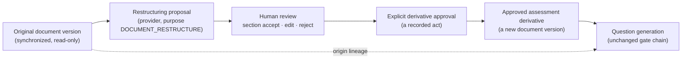

# AI Document Studio Architecture

**Status:** **`IMPLEMENTED`** for the assessment-preparation journey of §11 (M3, 2026-10-14):
upload or choose a document, prepare it, review and edit, download Word or PDF, add it to the
Question Generation Repository, generate questions. **Live AI preparation stays blocked until the
`DOCUMENT_RESTRUCTURE` approval (CP-5) is recorded**; until then only the local-only test
preparation provider (§11.4), which is not AI, can run. §11 supersedes §2–§8 where they disagree;
§10 (Slice 2) is unchanged.
**Target location:** Knowledge Sources → AI Document Studio.
**Governed by:** [COMPETENCY_PRIVACY_AND_GOVERNANCE.md](COMPETENCY_PRIVACY_AND_GOVERNANCE.md) CP-5 ·
[architecture.md §9.0](../architecture.md#90-provider-independence--amended-2026-09-24-extended-2026-09-26-and-2026-09-27) ·
[generation-governance.md](../generation-governance.md).
**Rules for the content:** [SOURCE_DOCUMENT_AUTHORING_GUIDE.md](../integrations/SOURCE_DOCUMENT_AUTHORING_GUIDE.md).

---

## 1. Why, and the precedent this formalizes

Structure limits yield. The measured case is the GenerationReady corpus (project history,
2026-09-22): seven SOPs restructured by hand went from 67 assessable sections to 76 and from 4
accepted questions to 16. Three lessons from that work are binding on this design:

1. **Restructuring is not unconditionally good.** The best-structured SOP went from 26 assessable
   sections to 12 and produced zero questions before and after. The Studio must be able to say
   **"no restructuring recommended"** and measure before-and-after assessability, not assume it.
2. **A fixed template invites fabrication.** The hand conversion omitted Thresholds, Exceptions and
   Validation Criteria wherever the source stated none. A model asked to fill nine headings will fill
   them.
3. **A question grounded in a derivative is not grounded in the document of record.** That corpus
   carries the rule "no question generated from it may be published". The Studio exists to replace
   that blanket ban with a governed lineage (§5), not to quietly lift it.

## 2. Workflow

**The derivative never replaces the original.** The original stays exactly as synchronized; the
derivative is a separate document that says, on every screen and in its header block:

> **Assessment derivative — not the authoritative source.**

### 2.1 States

| State | Meaning | Usable for generation |
| --- | --- | --- |
| `PROPOSED` | Provider output received and verified (§4), awaiting review | No |
| `IN_REVIEW` | A reviewer has accepted, edited or rejected at least one section | No |
| `APPROVED` | Whole-document approval recorded | **Yes** |
| `REJECTED` | Rejected as a whole | No |
| `STALE` | The original has a newer version than the one the derivative was made from | No — and questions from it enter revalidation |
| `SUPERSEDED` | A newer derivative version was approved | No for new jobs; existing lineage is kept |

**Editing an approved derivative creates a new version in `IN_REVIEW`** and requires approval
again. An approval covers one content hash, never "the latest".

## 3. What is stored

| Field | Why |
| --- | --- |
| Original document id **and version** (source version id + content hash) | So staleness is detectable and lineage points at one exact text |
| Derivative document id and version | The derivative is a `KnowledgeDocument` in a system-owned *Document Studio* source, so sectioning, section keys and evidence verification work unchanged |
| Provider and configured model | Provenance, as for generation |
| Prompt version | The restructuring prompt is versioned and hash-pinned, as `framing.ts` is |
| Transformation timestamp | |
| Requesting author, each section reviewer, approver | Identity per act |
| Approval record | Approver, time, the content hash approved |
| Change summary | Per section: kept, re-headed, merged, split, table restated, rejected |
| Content hash of the derivative | What was approved |
| **Processing purpose** | `DOCUMENT_RESTRUCTURE` — distinct from `QUESTION_GENERATION` (§7) |
| Missing-information findings | Stored **beside** the derivative, never inside it (§4.2) |
| Assessability before and after | Assessable sections and characters, from the real sectionizer, for both texts |

## 4. Transformation rules

### 4.1 Allowed and forbidden

The provider may **reorganize only content already present**.

| Allowed | Forbidden |
| --- | --- |
| Add headings derived from existing content | Invent a threshold, business rule, exception, rationale or success criterion |
| Combine fragmented procedural steps into one coherent section | Turn "should" into "must", or a recommendation into a rule |
| Restate a table as rule sentences or scenarios, keeping the table | Add external knowledge, even correct knowledge |
| Clarify formatting without changing meaning | Add suggested questions, or a "Knowledge Checks" section, to the derivative |
| Identify content unsuitable for assessment | Follow a mandatory template |
| Flag missing rationale, thresholds, exceptions or validation criteria | Remove a qualifier, a condition or a negation |

**There is no mandatory template.** A document gets the headings its content supports. A section the
source has no content for is **absent**, and the absence is a finding, not an empty heading.

### 4.2 Output shape, and how it is verified

The provider returns JSON against a strict schema, with no tools granted (as for generation):

- `sections[]` — each with a `heading`, a `body`, and `sourceQuotes[]`: the verbatim spans of the
  original the body was built from;
- `findings[]` — missing information, content unsuitable for assessment, and "no restructuring
  recommended" — **outside** the derivative;
- `questionSuggestions[]` — if requested at all, stored outside the evidence-bearing text and never
  sectioned.

Verification, before a proposal is shown to anyone:

| Check | Failure |
| --- | --- |
| Every `sourceQuote` is found verbatim (under the platform's existing normalization) in the original version | The section is marked `UNVERIFIED_SOURCE` and cannot be accepted without an edit |
| Every sentence of every `body` is found in the original, **or** is shown to the reviewer as **new text** in the difference view | New text is highlighted and needs an explicit per-sentence acceptance |
| Headings that do not occur in the original are marked **added heading** | Informational; headings are the permitted addition |
| No numeral, date, duration or percentage appears in a body that is absent from its `sourceQuotes` | **Refused outright** — an invented quantity is the most likely and most damaging fabrication |
| Modal verbs (`must`, `shall`, `should`, `may`) match their source sentences | A strengthened modal is refused |

## 5. Grounding and lineage

A question generated from a derivative carries **two separate provenances**, and they are never
conflated:

| Provenance | Points at | Claim it supports |
| --- | --- | --- |
| **Generation evidence** | The exact approved derivative section and its verbatim span — the existing `evidence` columns, verified in STRICT mode as today | "This question is answerable from this derivative text" |
| **Origin lineage** | The original document and **original version** the derivative was made from, plus the original offsets **if** a trustworthy mapping exists | "The derivative text came from here" |

**A derivative quote is never presented as a verbatim quote from the original.** The mapping from a
derivative block to original offsets is recorded only when it is **exact**: the block's text, under
the platform's normalization, occurs verbatim in the original version. Otherwise the block is marked
`ORIGINAL_OFFSET_NOT_AVAILABLE`, and no offset is invented.

**Publication (DS-1, open).** Until decided, the conservative rule applies: a derivative-grounded
question is publishable **only if its evidence span also verifies verbatim against the original
version** — dual verification. A question whose span exists only in the derivative is marked
*derivative-only evidence* on the review screen and is **not publishable**. That keeps the existing
GenerationReady ban true for anything not dual-verified.

## 6. Review experience

A side-by-side screen: **Original | Proposed derivative**.

| Control | Behaviour |
| --- | --- |
| Section accept | Accepts the section as proposed; new text inside it must already be individually accepted |
| Section edit | The reviewer edits; the edit is diffed against the original and re-verified by §4.2 |
| Section reject | The section is dropped; its source text stays in the original only |
| Difference view | Per section: moved, re-headed, merged, restated, new text |
| Missing-information findings | Listed beside the section they concern, with no control that inserts content |
| Provenance panel | Provider, model, prompt version, transformation time, requesting author |
| Assessability panel | Assessable sections and characters, before and after |
| Whole-document approval | Enabled only when every section is accepted, edited or rejected; records approver, time and content hash |

**Separation of duties (DS-3, open):** the proposed default is that the approver must differ from the
person who last edited the derivative, mirroring gate 13.

## 7. Processing approval — why the Studio is blocked

Restructuring sends **whole documents** to a provider, which is a different processing purpose from
question generation (which sends selected sections for a bounded task). The existing OpenAI/Codex
approval (a Teams message, recorded 2026-09-28) was given for generation. **It is not assumed to
cover restructuring** (CP-5).

So the Studio will register purpose `DOCUMENT_RESTRUCTURE` with its **own** approval, recorded the
same way provider approvals are (architecture.md §9.0 rule 7), and a provider without that
purpose-specific approval reads **`BLOCKED_BY_APPROVAL`** for the Studio even while it is `AVAILABLE`
for generation. **No whole-document content is sent externally because question generation is
approved.** The deterministic local provider cannot restructure (it has no such capability), so the
Studio has no zero-credential path, and says so rather than offering a fake one.

The control layer (budgets, concurrency, retries, attempt accounting) applies unchanged.

## 8. Inputs

| Input | Status |
| --- | --- |
| Existing synchronized documents | Supported by the design |
| Already-ingested documents, including imported question-bank files | Supported by the design |
| DOCX, PDF, PPTX, XLSX, Markdown | Whatever the existing extractors read; the Studio works on the **extracted text**, never re-writes the file |
| **Browser upload** | **Not in this design.** Its own milestone (§8.1) |

### 8.1 Browser upload — its own milestone

Upload is deferred until all of these are designed **and tested**: size limits; a file-type
allow-list; magic-byte validation; safe server-generated file names; path-traversal protection; a
malware-scanning extension point; writable-volume configuration; retention and cleanup;
authorization; audit; and no browser-selected server path. That is the same position recorded for
question import (CLAUDE.md, "Question acquisition").

## 9. Open decisions

| ID | Decision | Owner |
| --- | --- | --- |
| DS-1 | May a question whose evidence exists only in an approved derivative be published? (Default: no — dual verification required) | Knowledge governance |
| DS-2 | Approval for purpose `DOCUMENT_RESTRUCTURE` (CP-5) | Privacy, InfoSec |
| DS-3 | Is separation of duties required between derivative editor and approver? | Knowledge governance |
| DS-4 | Who may request a restructuring — any author, or the document's owner only? | Knowledge governance |
| DS-5 | Retention of rejected proposals (they contain provider output about a document) | Privacy |

## 10. Slice 2 — the purpose, its approval, and the overview (2026-10-07)

Decided by the product owner on 2026-10-07 and recorded before any code. **A governance and
product-readiness milestone: it establishes the purpose, the approval model and the platform's true
state. It builds no part of the transformation.**

### 10.1 The purpose

| Purpose | Covers | Approval held in |
| --- | --- | --- |
| `QUESTION_GENERATION` | Sending **selected sections** to a provider for the bounded task of proposing questions | `llm.approvedProviders` (since AI-PROVIDER-M1) |
| `DOCUMENT_RESTRUCTURE` | Sending **whole documents** to a provider to propose an assessment derivative (§2) | `llm.purposeApprovals.DOCUMENT_RESTRUCTURE` (new) |

**Neither approval satisfies the other**, in either direction. They are separate keys, written by
separate acts, and every reader consults only its own purpose's key. A contract test asserts it.
This is CP-5's position (privacy document §6): restructuring is a distinct processing purpose, and
the Codex approval recorded for generation on 2026-09-28 does not cover it.

### 10.2 Recording an approval

The **Authoring Administrator** (`platform.configure`) records, replaces or removes a
`DOCUMENT_RESTRUCTURE` approval per provider, on the AI Document Studio screen.

| Field | Rule |
| --- | --- |
| Approval reference | **Required**, at least 4 characters: where the decision is held (CP-5's answer) |
| Approver | The acting identity, recorded from the request, never typed |
| Timestamp | The server's clock at the write |
| Audit | One event per act, in the same transaction as the configuration row and its `configuration_change` row |

| Act | Audit action (`ADMIN.CONFIGURATION.*`) |
| --- | --- |
| First approval for a provider | `PURPOSE_APPROVAL_RECORDED` |
| A new reference where one was held | `PURPOSE_APPROVAL_REPLACED` (previous and new reference) |
| Withdrawal | `PURPOSE_APPROVAL_REMOVED` |
| Each evaluation of the status | `PURPOSE_STATUS_EVALUATED` (the overall state and the per-provider states) |

An approval is refused for a provider that **cannot** restructure (§10.3, capability), because a
durable record asserting it was cleared for something it can never do would be untrue — the same
rule provider approval follows. **Recording an approval does not enable anything**: with no
restructuring client the state moves only from `BLOCKED_BY_APPROVAL` to `NOT_BUILT`.

### 10.3 The readiness model

Checked per provider, **most permanent first** (the generation registry's order):

| # | Check | Fails when | Effect |
| --- | --- | --- | --- |
| 1 | **Provider exists** | Not in the provider catalogue | Not listed |
| 2 | **Capability** | The provider retrieves its own context (Copilot), or is the deterministic local generator, which cannot rewrite a document | **Ineligible**: listed with the reason, no state, no approval control |
| 3 | **Purpose approval** | No `DOCUMENT_RESTRUCTURE` approval is recorded | `BLOCKED_BY_APPROVAL` |
| 4 | **Client implementation** | No restructuring client is registered for the provider | `NOT_BUILT` |
| 5 | **Configuration** | The provider is not enabled with an endpoint, model and credential reference | `NOT_BUILT` with that reason too |
| — | All pass | — | `READY` |

**The overall state** is the most advanced state any eligible provider reaches (`READY` >
`NOT_BUILT` > `BLOCKED_BY_APPROVAL`). On this release the registry of restructuring clients is
**empty by construction**, so no provider and no overall state can read `READY`; a contract test
asserts both that the registry is empty and that the evaluator cannot return `READY` without an
entry. **No state claims a transformation capability that does not exist.**

Expected now: overall `BLOCKED_BY_APPROVAL`. After an approval is recorded: `NOT_BUILT`.

### 10.4 Status endpoint and screen

- `GET /api/v1/authoring/document-studio/status` (`report.read`) returns the purpose, the overall
  state, and per provider: exists, capability (with reason), approval (reference, approver, time),
  client implementation, configuration, state and reason. It is computed from the catalogue, the
  restructuring-client registry and configuration on every call — no stored or mocked status.
- `POST /api/v1/authoring/document-studio/approvals` (`platform.configure`) records, replaces or
  removes one approval.
- **AI Document Studio** is its **own sidebar entry**, between Question Import and Generate. The
  screen explains assessment preparation, its measured motivation (documented evaluation results
  only), the workflow of §2, and shows the current state, approval status, provider readiness and
  implementation status. It has **no** Run, Transform, Rewrite or Prepare control, and says
  *Transformation capability not yet implemented*.

### 10.5 Still the design, not the build

The derivative workflow of §2–§6 — proposal, verification, side-by-side review, whole-document
approval, dual lineage — is unchanged and unbuilt (roadmap §3a M3), as is upload (§8.1, M4). DS-1
and DS-3..DS-5 stay open. DS-2 is now **recordable** (§10.2) but not recorded.

## 11. M3 — Assessment preparation (2026-10-14)

Decided by the product owner on 2026-10-14 (the simplified M3 brief) and recorded here before any
code. **Where this section and §2–§10 disagree, this section wins.** It replaces the multi-stage
derivative design with one plain journey, and it supersedes four earlier positions on purpose:

| Earlier position | Superseded by |
| --- | --- |
| §7: "the Studio has no zero-credential path" | §11.4: a **test preparation provider**, deterministic, local environment only, never labelled AI |
| §5 / DS-1: dual verification against the original before publication | §11.8: the prepared document is the **immediate evidence source**; lineage to the original is kept, not re-verified word for word |
| §2.1 states and §6 section-by-section review with a separate approval | §11.6: five version states; **the user's confirmation to add the document to the repository is its approval** |
| §8.1: upload is its own milestone (M4) | §11.2: upload is built in M3, with every control §8.1 lists |

### 11.1 The journey

**Add document → Prepare with AI → Review → Download or add to repository → Generate questions.**

The screen uses business words only: *Original document*, *Prepared document* (in full,
*Assessment-prepared document*), *Prepare for question generation*, *Review changes*,
*Download Word*, *Download PDF*, *Add to Question Generation Repository*, *Generate questions*.
Internal terms — readiness states, content hashes, offsets, output checks, capability contracts —
appear only in a collapsed *Details* panel.

The Studio has four views: **Add document**, **My prepared documents**, **History**, and
**Readiness** (the Slice 2 overview and the approval controls, unchanged).

### 11.2 Add document

Two ways in:

1. **Upload** from the user's computer.
2. **Choose an existing synchronized document** from any source except the Studio's own.

Accepted upload types, chosen because their extractors are proven on the pilot corpus: **DOCX,
PDF, PPTX, Markdown and plain text**. XLSX is not offered (a workbook is a table of records, not a
procedure).

Every upload passes these controls, each with a test that fails when it is removed:

| Control | Rule |
| --- | --- |
| Size | 1 byte to **8 MiB**, checked before anything is parsed |
| Extension | The allow-list above; anything else is refused by name |
| Signature | The bytes must match the extension: `%PDF-` for PDF; a ZIP holding `word/document.xml` (DOCX) or `ppt/presentation.xml` (PPTX); valid UTF-8 with no NUL byte for text |
| Executable or active content | Refused: a Windows or Linux executable or a script header; an Office macro project (`vbaProject.bin`) or a macro-enabled content type; a PDF with `/JavaScript`, `/JS`, `/Launch` or `/EmbeddedFile` |
| Stored name | Server-generated (`<uuid>.<ext>`); the user's file name is stored as a label only and never touches the file system |
| Path | The stored path is checked to lie inside the Studio storage root, segment by segment |
| Extraction | The synchronization that follows the write extracts it with the platform's extractors; anything other than `EXTRACTED` removes the file, marks its row deleted, and refuses the upload with the extractor's reason. The API itself never parses a document (boundary rule B2) |
| Duplicate | The SHA-256 of the bytes is unique; a second upload of the same file is refused and names the first |
| Malware scanning | An extension point. No scanner is configured in this build, so every upload records **Not scanned**, and the screen says so |
| Authorization | `document.prepare`, a new permission key held by the Authoring Administrator |
| Audit | `UPLOAD_ACCEPTED` or `UPLOAD_REFUSED`, with type, size and the reason |
| No browser-selected path | The browser sends bytes and a name, never a path |

**The original is never modified.** An uploaded file is written once and synchronized into a
system source, **AI Document Studio — Originals** (`usableForGeneration: false`), so it is
extracted and versioned by the same pipeline as every other document. A synchronized original is
used where it is and is never copied.

Storage is the deployment's `DOCUMENT_STUDIO_STORAGE_DIR` (local: `/repo/.document-studio`,
git-ignored and docker-ignored). With no directory configured, upload and repository addition are
refused with that reason, and choosing an existing document still works for preparation. A file
refused by the content controls is never written; one that fails extraction is removed. Retention of uploaded originals follows source retention (open, DS-5).

### 11.3 Prepare for question generation

One primary action. The provider receives the original's extracted text, its sections, and the
rules below, and returns JSON against a strict schema: `sections[]` (a heading, a content kind —
rule, procedure, threshold, scenario, exception, definition, decision, responsibility or general —
and blocks: paragraph, list, numbered list, table, warning), plus `findings[]` (missing
information, unclear information, not suitable for assessment), kept **outside** the prepared text.

| The preparation may | The preparation may not |
| --- | --- |
| Add meaningful headings; group related information | Invent a fact, rule, threshold, responsibility, exception or rationale |
| Separate rules, procedures, thresholds, scenarios and exceptions | Add outside information, even correct information |
| Split large sections and combine fragments | Turn *should* into *must*, or *must* into *should* |
| Restate tables and decision logic clearly | Remove a warning, control, escalation step or safety statement |
| Keep procedural order, terminology and every number, limit, percentage, date and condition | Resolve an ambiguity silently |
| Flag unclear or missing information; mark sections unsuitable for assessment | Change the original |

The output is checked before anyone sees it:

| Check | Effect |
| --- | --- |
| Schema (strict) | A response that does not parse is a **failed preparation**; it is not repaired by guessing and no version is stored |
| Every number, percentage, date and duration in the prepared text occurs in the original | Otherwise **refused outright**: an invented quantity is the most damaging fabrication |
| A *must/shall/required* sentence whose closest original sentence says only *should/may*, or the reverse | A **warning** on the review screen |
| An original sentence with a warning, escalation, prohibition or safety term and no close match in the prepared text | A **warning**: possibly removed |
| A prepared sentence not found verbatim in the original | **Highlighted** as reworded in *Review changes* |

**Readiness, behind the scenes.** Live AI preparation runs only when, for one provider: the
`DOCUMENT_RESTRUCTURE` approval (CP-5) is recorded; a restructuring client exists (OpenAI, from this
milestone); the provider is enabled with an endpoint, a model and a resolvable credential; the token
and concurrency budgets permit the run (§11.9); and the original is extracted and current. While no
approval is recorded the screen says exactly:

> AI document preparation is not yet enabled for this environment. Contact your administrator.

### 11.4 The test preparation provider

The workflow may be validated before CP-5 with a **deterministic test preparation provider**, by
the owner's decision. It is **not AI** and is never called AI:

- It is enabled by the feature flag `documentStudio.testPreparation.enabled`, whose ceiling is the
  `local` environment only. In `dev`, `test` and `prod` it cannot be switched on, and startup
  refuses a stored row that tries.
- Its provider id is `TEST_PREPARATION`, outside the generation provider catalogue, so it can never
  be approved, made active or chosen for question generation.
- It keeps every sentence of the original verbatim, uses the original's headings (a section label
  where there are none), classifies blocks by keyword, and raises findings by rule. It sends
  nothing anywhere.
- Every version it produces records `TEST_PREPARATION` and the model `knowzy-test-preparation-1`,
  and the screen labels it **Test preparation — not AI** wherever the provider is shown, including
  the downloads. When a live provider is ready, the live provider is used.

Automated tests and the browser suite use it with **synthetic documents only**.

### 11.5 Review

Original on the left, prepared document on the right. Added headings and reworded sentences are
highlighted; warnings and missing-information findings are listed beside the prepared text. A
simple editor — one text area in a small Markdown dialect: `#` headings, `-` and `1.` lists, `|`
tables, `> Warning:` callouts and `> [!MISSING]`, `> [!UNCLEAR]`, `> [!NOT_FOR_ASSESSMENT]`
markers — saves the prepared text.

| Action | Effect |
| --- | --- |
| Save changes | Updates the current **DRAFT**; editing a ready version creates a new draft from it |
| Restore AI version | Replaces the draft's text with the preparation output it came from |
| Prepare again | A new preparation run and a new draft, from the original's current version |
| Download Word / Download PDF | §11.7 |
| Add to Question Generation Repository | §11.8, after the confirmation |
| Discard draft | The draft becomes **REJECTED**; nothing is deleted |

### 11.6 Versions

| State | Meaning | Selectable for new generation |
| --- | --- | --- |
| `DRAFT` | Prepared or edited, not yet added | No |
| `READY_FOR_QUESTION_GENERATION` | Added to the repository by a recorded confirmation | **Yes** |
| `SUPERSEDED` | A newer version of the same prepared document was added | No; questions already made from it keep it |
| `REVALIDATION_REQUIRED` | The original changed, was replaced or was deleted after this version was prepared | No, until a revalidated version is added |
| `REJECTED` | A draft the user discarded | No |

Rules: the original never changes; one draft at a time per prepared document; editing a ready
version creates a new draft; adding a draft makes **that exact version** ready and supersedes the
previous ready version; a version with downstream questions can never be deleted (there is no
delete route, and a database trigger refuses the delete); one prepared document per original.

**Revalidation.** Before every Studio read, every preparation and every generation job, and after
every synchronization the API runs, the platform compares each draft or ready version's recorded
original content hash with the original's current one. A difference, or a deleted original, marks
the version `REVALIDATION_REQUIRED` and excludes its repository document from generation.
Revalidation is completed by **Prepare again**, or by **Review against the updated original** (a
new draft with the same text, pinned to the original's current version, for a person to check and
add). Adding the revalidated draft supersedes the flagged version.

### 11.7 Downloads

`.docx` and `.pdf`, written by the platform (`@knowzy/certificate-generator`, no third-party
library), each with the complete
prepared content — headings, paragraphs, lists, tables, warnings and the missing-information
markers — and this notice first:

> Assessment-prepared document derived from [original document name]. This document is intended
> for question generation and does not replace the authoritative original.

followed by the original document's name and version, the prepared version number, the provider
and model (or *Test preparation — not AI*), and the preparation time. File names are
`<Original Name> - Assessment Prepared.docx` and `.pdf`, keeping only letters, digits, spaces and
`- _ . ( )`. Each download is audited.

### 11.8 Add to the Question Generation Repository

The confirmation reads:

> Add this prepared document as a source for question generation? The original document will
> remain unchanged and linked to this prepared version.

On confirmation, in one recorded act: the exact version's text is written as
`<prepared document id>-v<n>.md` into the system source **Assessment-prepared documents**
(`usableForGeneration: true`) and synchronized; the resulting document is linked to the version,
and through it to the original document and original version; the user and time are recorded; the
version becomes `READY_FOR_QUESTION_GENERATION`, and the previous ready version `SUPERSEDED` with
its repository document excluded from new generation. A version already added is refused as a
duplicate. Missing-information markers are written to the downloads but **not** into the
repository text, so no question can be generated from a note about what is absent.

The screen then offers **Generate questions now**, which opens the existing Generate screen with the
source and the document preselected. Generation, review, approval and publication are unchanged.

**Evidence.** A question generated from it cites the prepared document as its **immediate source**:
its evidence span, section key and section hash are verified STRICT against the prepared text, as
for any document, and they are the record of the exact prepared section used. The question's
lineage names the original document and original version, and the question screen says:
*Immediate source: Assessment-prepared document — derived from [original], version n. The prepared
text is not a verbatim quote of the original, and the original remains authoritative.* No prepared
quotation is required to match the original word for word, and none is presented as one.

### 11.9 Recorded, separately, for every version

Original document and original version (counter and content hash); provider and configured model;
prompt version (hash-pinned, as `framing.ts` is); preparation time; who prepared, who last edited,
who added, and when; the prepared version number; the SHA-256 of the prepared text; the repository
document; and audit events in the new family `AUTHORING.DOCUMENT_PREPARATION`: `UPLOAD_ACCEPTED`,
`UPLOAD_REFUSED`, `PREPARATION_COMPLETED`, `PREPARATION_FAILED`, `PREPARATION_REFUSED`,
`VERSION_SAVED`, `AI_VERSION_RESTORED`, `ADDED_TO_REPOSITORY`, `VERSION_SUPERSEDED`,
`REVALIDATION_REQUIRED`, `VERSION_REJECTED`, `DOWNLOADED`.

**Controls.** Each preparation attempt is one `document_preparation_run` row, as each generation
attempt is one `generation_provider_call` row. Its tokens count against the **same** daily, weekly
and monthly windows as generation, the per-job ceiling applies to its estimate, and the concurrency
cap counts running preparations. A run left `RUNNING` for more than ten minutes is failed by the
next request, so a crashed container cannot freeze the Studio. An unobservable cost is null, never 0.

### 11.10 Not in M3

Knowledge Proficiency, employee competency features, multi-stage approval, section-by-section
acceptance, a malware scanner, and Key Vault. DS-1 is closed by §11.8 and DS-3 by §11.6 (no
separate approver). DS-4 is decided as any holder of `document.prepare`, and DS-5 as "rejected
drafts are kept"; both may be revisited.
