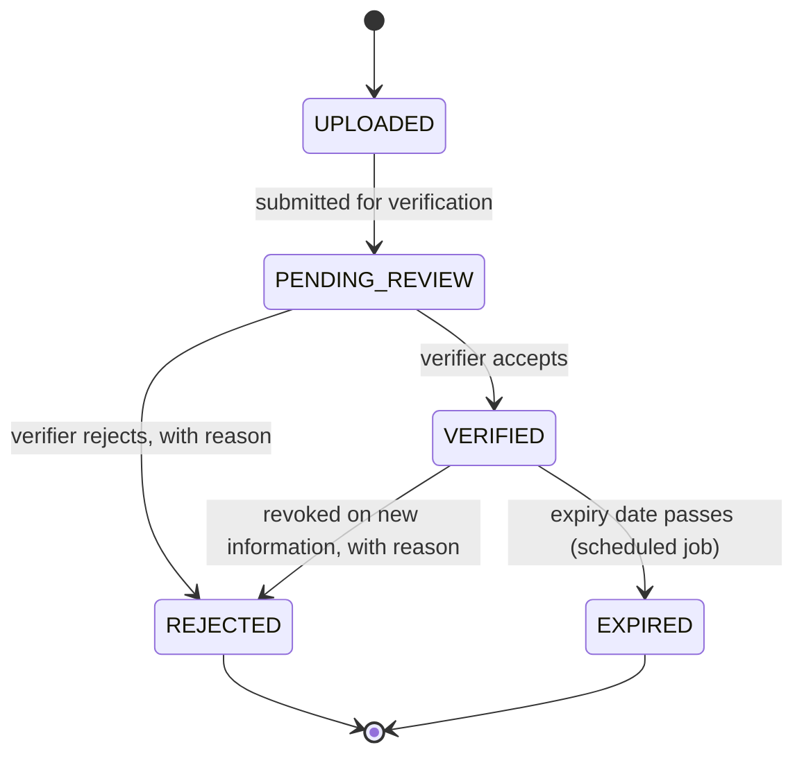

# Certification Tracking Architecture

**Status:** Design only. **Classification: `REQUIRES_BACKEND_EXTENSION`**, blocked on CP-6. No
table, route, upload or screen exists, and no navigation item is shown.
**Target location:** Profile → My Certifications (Live Learning Portal).
**Governed by:** [COMPETENCY_PRIVACY_AND_GOVERNANCE.md](COMPETENCY_PRIVACY_AND_GOVERNANCE.md).

---

## 1. Two different things called "certificate"

| | Issued certificate (exists) | Certification evidence (this document) |
| --- | --- | --- |
| What | A certificate **this platform issues** for a scored result, rendered by `@knowzy/certificate-generator` | A certificate **somebody else issued** — a university, a vendor, an internal academy — that a person submits |
| Model | `Certificate`, `CertificateRule` (badges-and-certificates.md) | `CertificationEvidence` (proposed) — **deliberately a different name** |
| Trust | Deterministic: the platform produced it | Asserted by the person until a verifier accepts it |
| Statuses | `ISSUED`, `EXPIRED`, `REVOKED` | `UPLOADED`, `PENDING_REVIEW`, `VERIFIED`, `REJECTED`, `EXPIRED` |

Reusing `Certificate` for evidence would put an unverified PDF and a platform-issued credential in one
table, and the first report counting "certificates" would add them together.

## 2. Evidence types

`DEGREE`, `DIPLOMA`, `VENDOR_CERTIFICATION`, `INTERNAL_CERTIFICATION`, `COURSE_COMPLETION`,
`TRAINING_RECORD`. Badge export (the platform's own badges, outward) is a different, later concern
and is listed in §8.

## 3. Lifecycle

Nothing is deleted by a transition. A revocation is a new state with a reason and an audit event,
never an edit of the verified record.

## 4. Record

| Field | Rule |
| --- | --- |
| Holder | The submitting user; never another user's |
| Type, title, issuer | Required; issuer from a curated list where one exists, free text otherwise (flagged) |
| Credential id | Optional; stored **hashed** for duplicate detection, displayed masked |
| Issued on, expires on | Expires-on drives `EXPIRED` |
| File | Optional reference to stored evidence (§5) |
| Verification | Verifier identity, time, method (issuer lookup, document inspection, attestation), reason on rejection |

## 5. Secure file handling

Evidence files carry names, dates of birth and candidate numbers, so whether they are stored at all is
CP-6. If they are, they inherit **every** browser-upload control listed in
[AI_DOCUMENT_STUDIO_ARCHITECTURE.md §8.1](AI_DOCUMENT_STUDIO_ARCHITECTURE.md#81-browser-upload--its-own-milestone)
— size, type allow-list, magic bytes, generated names, no traversal, a malware-scan hook, a dedicated
writable volume, retention, authorization, audit — plus: files are never served inline from the
application origin, never indexed as knowledge documents, and never sent to a model provider.

## 6. Access, retention, audit, duplicates

| Concern | Rule |
| --- | --- |
| Read | The holder; a verifier while the record is `PENDING_REVIEW`; others only under a policy decided by CP-2 |
| Verify | A distinct permission (proposed `certification.verify`); a verifier may not verify their own evidence |
| Retention | Declared per type before build; a rejected file is deleted after its window, the record kept |
| Audit | Every transition, with the actor; never the file content, never the credential id in clear |
| Duplicates | Same holder + issuer + hashed credential id is refused as a duplicate; same issuer + credential id for a **different** holder is flagged for a verifier, never auto-resolved |

## 7. A certificate is not a competency

**Verified evidence does not establish competency by itself.** A competency observation with source
`CERTIFICATION_EVIDENCE` is produced only by an **approved mapping rule** ("vendor certification X,
unexpired, implies competency C at level L on scale S"), versioned and audited. With no rule, a
verified certificate is shown as a certificate and nothing more.

## 8. Open decisions

| ID | Decision |
| --- | --- |
| CT-1 | Are evidence files stored (CP-6), or only the record plus a verifier's attestation? |
| CT-2 | Who verifies, and by what method per type? |
| CT-3 | Retention per evidence type |
| CT-4 | Badge export (the platform's own badges to an external wallet): which standard, and is it wanted? |
