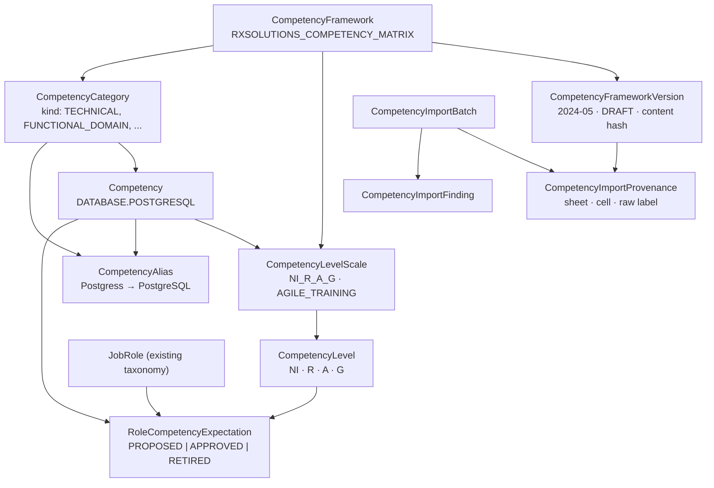

# Competency Model

**Status:** Normative. Added 2026-09-29 with COMPETENCY-M0/M1; implemented by migration
`0015_competency_foundation` and `packages/domain/src/competency/`.
**Owns:** the normalized entities that represent a competency framework, the level vocabulary, the
alias and normalization strategy, and the role-target entity. It does **not** own observations about
people — there are none in this release
([COMPETENCY_PRIVACY_AND_GOVERNANCE.md](COMPETENCY_PRIVACY_AND_GOVERNANCE.md)).
**Related:** [COMPETENCY_IMPORT_PLAN.md](COMPETENCY_IMPORT_PLAN.md) ·
[KNOWLEDGE_PROFICIENCY_ARCHITECTURE.md](KNOWLEDGE_PROFICIENCY_ARCHITECTURE.md) ·
[data-model.md §3.5](../data-model.md#35-competency-reference-definitions)

---

## 1. Hierarchy

Framework-scoped definitions (categories, competencies, scales, aliases) exist **once** per
framework, with a stable `code`. A **version** is one imported source file; its provenance rows record
which definitions that file contained and where. This is what makes a re-import idempotent: the
second apply of the same file matches the same codes and the same content hash, and creates nothing.

## 2. Entities

| Entity (table) | Purpose | Key fields | Identity |
| --- | --- | --- | --- |
| `CompetencyFramework` (`competency_framework`) | A named framework, e.g. the RxSolutions matrix | `code`, `name`, `status` | `code` unique |
| `CompetencyFrameworkVersion` (`competency_framework_version`) | One source file of a framework | `versionLabel`, `sourceFileName`, `sourceContentSha256`, `status` (`DRAFT`/`APPROVED`/`SUPERSEDED`), approval fields | `(framework, sourceContentSha256)` and `(framework, versionLabel)` unique |
| `CompetencyLevelScale` (`competency_level_scale`) | A level vocabulary | `code`, `name` | `(framework, code)` unique |
| `CompetencyLevel` (`competency_level`) | One level of a scale | `code` (source code), `label` (normalized), `ordinal`, `sourceLabels[]` | `(scale, code)` and `(scale, ordinal)` unique |
| `CompetencyCategory` (`competency_category`) | A band of the matrix | `code`, `name`, `kind`, `ordinal` | `(framework, code)` unique |
| `Competency` (`competency`) | One competency | `code` (`CATEGORY.COMPETENCY`), `name`, `category`, `levelScale`, `status` | `(framework, code)` unique |
| `CompetencyAlias` (`competency_alias`) | A source label and the decision that maps it | `subject` (`CATEGORY`/`COMPETENCY`), `contextCode`, `alias`, `foldedAlias`, `decision`, `note` | `(framework, subject, contextCode, foldedAlias)` unique |
| **Role catalogue entry** = `JobRole` (`job_role`, existing since 0010) | The role a target applies to | `code`, `name` | Reused, **not duplicated** — see §2.1 |
| `RoleCompetencyExpectation` (`role_competency_expectation`) | An approved target level for a role and competency | `jobRole`, `competency`, `targetLevel`, `status`, `source`, approval fields | — |
| `CompetencyImportBatch` (`competency_import_batch`) | One apply of one file | `outcome` (`APPLIED`/`NO_CHANGES`), `profileCode`, `importerVersion`, `summary` | — |
| `CompetencyImportFinding` (`competency_import_finding`) | One finding of that apply | `code`, `severity`, `sheetName`, `cellReference`, `subjectLabel`, `message` | — |
| `CompetencyImportProvenance` (`competency_import_provenance`) | Where a definition was read | `subject`, the definition's id, `sheetName`, `cellReference`, `rawLabel` | `(version, subject, sheetName, cellReference)` unique |

**Deliberately absent:** a competency *rating*, *observation*, *self-assessment* or *assessment*
table. Each is person-level, and the privacy boundary says none is stored until CP-1..CP-4 are
decided. They are designed in
[KNOWLEDGE_PROFICIENCY_ARCHITECTURE.md §3](KNOWLEDGE_PROFICIENCY_ARCHITECTURE.md#3-evidence-concepts).

### 2.1 Why the role catalogue is `JobRole`

The taxonomy already has a role catalogue — `JobRole`, deliberately *not* named `Role`, because
`Role` is the RBAC role. A second role catalogue for competencies would mean a question filed under
"Developer" and a competency target for "Developer" referring to two different rows that look the
same in a dropdown. So a `RoleCompetencyExpectation` references `job_role`.

**The workbook does not populate it.** Its `Role` column holds free-text titles written on person
rows (45 distinct spellings, most held by fewer than five people). Those are *assignments*, not
catalogue definitions, and a title held by one person on a named team is identifying. Role
catalogue entries are created by an administrator under `taxonomy.manage`, as they are today.

### 2.2 Framework version approval

An imported version is `DRAFT`. Approving it is a **separate act** requiring an approver identity, a
timestamp and a reference to where the approval is held — the same shape as provider approval
(architecture.md §9.0 rule 7). A database CHECK refuses `APPROVED` without all three. There is no
approval screen in this release (decision CM-6), so every imported version stays `DRAFT`, and a
draft definition may be read and catalogued but must not be the basis of a target.

## 3. Level vocabulary

### 3.1 The matrix scale (`NI_R_A_G`)

The reference equivalence, as supplied with the milestone brief, with the variants the workbook
itself uses:

| Ordinal | Code | Normalized label | Source labels found in the workbook |
| ---: | --- | --- | --- |
| 0 | `NI` | Not Involved | "Not Involved" |
| 1 | `R` | Limited Involvement or Limited Competency | "Limited involvement" (LMS sheet), "Limited competency" (all other sheets) |
| 2 | `A` | Involved and Competency Improving | "Competency Improving", "Competency improving" |
| 3 | `G` | Involved and Competent | "Competent" |

**No `Expert` level exists.** The workbook defines none, and the brief forbids inferring one. The
platform's assessment bands (`EXPERT` … `CRITICAL_KNOWLEDGE_GAP`, reporting.md §5) are a **different
vocabulary for a different evidence source** and are not mapped onto this scale (§6, CM-3).

**The code/label pairing is a supplied definition, not an inference from colour or position.** The
workbook corroborates it — the summary sheet lists levels in the order R, A, G, NI and its legend
lists Limited, Improving, Competent, Not Involved in the same order — but the importer does not
derive the mapping from that; it declares it and records the source labels it found.

**Ordinal caveat.** The ordinal is used for exactly one thing: comparing an observation to a target
on the same scale. Whether `NI` means "no competency" or "not applicable to this person's work" is
open (CM-2), and the two readings give opposite gap answers.

### 3.2 The Agile training scale (`AGILE_TRAINING`)

The `Agile` sheet does not use NI/R/A/G. Its cells say **Untrained**, **Trained** or **Certified**,
so it gets its own scale rather than being forced onto the matrix one:

| Ordinal | Code | Label |
| ---: | --- | --- |
| 0 | `UNTRAINED` | Untrained |
| 1 | `TRAINED` | Trained |
| 2 | `CERTIFIED` | Certified |

Equivalence between this scale and NI/R/A/G is **not declared** (CM-4). "Certified" in particular is
certification evidence, not a competency level, and belongs with
[CERTIFICATION_TRACKING_ARCHITECTURE.md](CERTIFICATION_TRACKING_ARCHITECTURE.md) once mapping rules
exist.

## 4. Categories

| Code | Normalized name | Kind | Source labels |
| --- | --- | --- | --- |
| `LMS` | LMS and product knowledge | `PRODUCT_KNOWLEDGE` | LMS |
| `FUNCTIONAL_DOMAIN` | Functional and domain knowledge | `FUNCTIONAL_DOMAIN` | Functional/Domain, Functional |
| `DESIGN` | Design | `TECHNICAL` | Design |
| `DEVELOPMENT` | Development | `TECHNICAL` | Development, Coding |
| `DATABASE` | Database | `TECHNICAL` | Database, DB |
| `ERP` | ERP | `TECHNICAL` | ERP |
| `BI_REPORTING` | BI and reporting | `TECHNICAL` | BI & Reporting |
| `MIDDLEWARE` | Middleware | `TECHNICAL` | Middleware |
| `DEVOPS` | DevOps | `TECHNICAL` | DevOps |
| `COTS` | COTS | `TECHNICAL` | COTS |
| `TESTING` | Testing | `TECHNICAL` | Testing |
| `CLOUD` | Cloud | `TECHNICAL` | Cloud, Cloud Platform |
| `INFRASTRUCTURE` | Infrastructure | `TECHNICAL` | Infra, Infrastructure |
| `PROCESS` | Process | `PROCESS` | Process |
| `AGILE_PRACTICE` | Agile practice | `AGILE_PRACTICE` | the `Agile` sheet's Present band |
| `POWER_SKILLS` | Power skills | `POWER_SKILL` | Power Skills |

The **kind** is this platform's grouping (the brief's "technical, functional, agile, power skills"),
declared in code, not read from the file. The expansion of "LMS" is taken from the milestone brief;
the workbook does not define the acronym (CM-5).

## 5. Normalization and aliases

### 5.1 The fold

Every label is compared through one deterministic fold:

1. Unicode NFKC, then lower case;
2. `&` becomes `and`;
3. every character other than `a-z`, `0-9`, `+` and `#` is removed.

So `React Js` and `React JS` fold to `reactjs`; `Rx-Universe/ Rx-Suite` to `rxuniverserxsuite`;
`.NET` to `net`; `C++` stays `c++`. The fold decides *equality*; it never produces a display name.

### 5.2 The decision order

For each header label, under its category, the first rule that applies wins:

| # | Rule | Result | Alias decision recorded |
| --- | --- | --- | --- |
| N1 | The folded label is a **declared alias** in the profile's normalization table (§5.3) | The declared competency | The declared decision (`SPELLING_CORRECTION`, `ABBREVIATION`, `CATEGORY_QUALIFIED`, `PROVISIONAL`) |
| N2 | The folded label equals the fold of a competency **already created in this category** | That competency | `CASE_OR_SPACING` |
| N3 | The folded label is within edit distance 2 of an existing competency in the category (both at least 4 characters) | **Nothing is created** — a `BLOCKING` finding `NEAR_MATCH_UNDECLARED` | none |
| N4 | Otherwise | A new competency, code derived from the label, display name = the label as written | `UNDECLARED`, with an `INFO` finding so a person reviews it |

N3 exists because "Postgress" and "PostgreSQL" are one competency and "Oracle" under Database and
"Oracle" under ERP are two, and no fold can tell a typo from a different product. **Spelling variants
are never merged silently, and never split silently either**: a near match that nobody has declared
stops the apply.

### 5.3 The declared normalization table (profile `RX_COMPETENCY_MATRIX_2024`)

Declared in `packages/domain/src/competency/reference-profile.ts`. Every row is a normalization
decision; `PROVISIONAL` rows are applied but reported every time, because they need an SME to
confirm them.

| Category | Code | Normalized name | Source labels | Decision |
| --- | --- | --- | --- | --- |
| LMS | `LMS.RX_NET` | Rx.NET | Rx.NET | exact |
| LMS | `LMS.NG` | NG | NG | exact |
| LMS | `LMS.OPTIFACTS` | Optifacts | Optifacts | exact |
| LMS | `LMS.INLAB` | Inlab | Inlab | exact |
| LMS | `LMS.OPTUITIVE` | Optuitive | Optuitive | exact |
| LMS | `LMS.RX_UNIVERSE` | Rx-Universe / Rx-Suite | RxUniverse · RxUniverse/RXSuite · Rx-Universe/ Rx-Suite | **PROVISIONAL** — two sheets add "Rx-Suite"; whether it is the same product is unconfirmed (CM-7) |
| LMS | `LMS.RXLAB_NET` | Rxlab.NET | Rxlab.NET · RxLab.NET | case |
| LMS | `LMS.VISIONSTAR` | VisionStar | VisionStar | exact |
| Functional | `FUNCTIONAL_DOMAIN.RXSOLUN_OFS` | RXSolun OFS | RXSolun OFS | **PROVISIONAL** — placed under Functional/Domain in four sheets and under LMS in two; placed by majority, pending SME confirmation (CM-8) |
| Functional | `FUNCTIONAL_DOMAIN.B2B` | B2B | B2B | exact |
| Functional | `FUNCTIONAL_DOMAIN.ORDER_MANAGEMENT` | Order Management | Order Management · OM | abbreviation |
| Functional | `FUNCTIONAL_DOMAIN.FULFILMENT_SHIPPING` | Fulfilment and Shipping | Fulfilment & Shipping · F&S | abbreviation |
| Functional | `FUNCTIONAL_DOMAIN.PRINTING` | Printing | Printing | exact |
| Functional | `FUNCTIONAL_DOMAIN.PRICING_PROMOTIONS` | Pricing and Promotions | Pricing & Promotions · Pricing | abbreviation |
| Functional | `FUNCTIONAL_DOMAIN.CALCULATION` | Calculation | Calculation | exact |
| Functional | `FUNCTIONAL_DOMAIN.INTEGRATIONS` | Integrations | Integrations | exact |
| Functional | `FUNCTIONAL_DOMAIN.MASTER_DATA` | Master Data | Master Data | exact |
| Design | `DESIGN.TECHNICAL_ARCHITECTURE` | Technical Architecture | Tech Arch · Technical Architechture | abbreviation; spelling correction |
| Development | `DEVELOPMENT.DOTNET` | .NET | .NET | exact |
| Development | `DEVELOPMENT.JAVA` | Java | Java | exact |
| Development | `DEVELOPMENT.ANGULAR` | Angular | Agular · Angular | spelling correction |
| Development | `DEVELOPMENT.REACT_JS` | React JS | React Js · React JS | case |
| Development | `DEVELOPMENT.RUBY` | Ruby | Ruby | exact |
| Development | `DEVELOPMENT.ANSI_C` | ANSI C | Ansi-C | case |
| Development | `DEVELOPMENT.POWERBUILDER` | PowerBuilder | PowerBuilder · Powerbuilder | case |
| Development | `DEVELOPMENT.COBOL` | COBOL | Cobol | case |
| Development | `DEVELOPMENT.CPP` | C++ | C++ | exact |
| Development | `DEVELOPMENT.FLUTTER` | Flutter | Flutter | exact |
| Development | `DEVELOPMENT.ECRION` | Ecrion | Ecrion | exact |
| Database | `DATABASE.SQL_SERVER` | SQL Server | SQL Server | exact |
| Database | `DATABASE.MYSQL` | MySQL | MySQL | exact |
| Database | `DATABASE.POSTGRESQL` | PostgreSQL | Postgress | spelling correction |
| Database | `DATABASE.GREENPLUM` | Greenplum | Greenplum | exact |
| Database | `DATABASE.ALLEGROGRAPH` | AllegroGraph | AllegroGraph · Allegrograph | case |
| Database | `DATABASE.INFORMIX` | Informix | Informix | exact |
| Database | `DATABASE.ORACLE_DATABASE` | Oracle Database | Oracle *(under Database)* | category-qualified |
| ERP | `ERP.MICROSOFT_DYNAMICS` | Microsoft Dynamics | Microsoft Dynamics · MS Dynamics | abbreviation |
| ERP | `ERP.SAP` | SAP | SAP | exact |
| ERP | `ERP.ORACLE_ERP` | Oracle ERP | Oracle *(under ERP)* | category-qualified |
| BI | `BI_REPORTING.JASPER` | Jasper | Jasper | exact |
| BI | `BI_REPORTING.SSRS` | SSRS | SSRS | exact |
| BI | `BI_REPORTING.TALEND` | Talend | Talend | exact |
| BI | `BI_REPORTING.QLIKVIEW` | QlikView | Qlikview · QV | case; abbreviation |
| BI | `BI_REPORTING.QLIK_SENSE` | Qlik Sense | Qliksens · QS | spelling correction; abbreviation |
| Middleware | `MIDDLEWARE.MQ` | MQ | MQ | exact |
| Middleware | `MIDDLEWARE.IIB` | IIB | IIB | exact |
| Middleware | `MIDDLEWARE.APIGEE` | Apigee | APIGEE | case |
| Middleware | `MIDDLEWARE.DELL_BOOMI` | Dell Boomi | DELL Boomi | case |
| DevOps | `DEVOPS.DEVOPS` | DevOps | *(the band header; no sub-header)* | the category is its own competency |
| COTS | `COTS.IBM_ODM` | IBM ODM (Rules) | IBM ODM (Rules) | exact |
| COTS | `COTS.FORGEROCK` | ForgeRock | Forgerock | case |
| COTS | `COTS.APPDYNAMICS` | AppDynamics | Appdynamics | case |
| COTS | `COTS.SPLUNK` | Splunk | Splunk | exact |
| COTS | `COTS.LAUNCHDARKLY` | LaunchDarkly | Launch Darkly | case |
| Testing | `TESTING.MANUAL` | Manual testing | Manual | category-qualified |
| Testing | `TESTING.AUTOMATED` | Automated testing | Automated · Automated testing | category-qualified |
| Testing | `TESTING.PERFORMANCE` | Performance testing | Performance | category-qualified |
| Testing | `TESTING.SECURITY` | Security testing | Security | category-qualified |
| Cloud | `CLOUD.AWS` | AWS | AWS | exact |
| Cloud | `CLOUD.AZURE` | Azure | Azure | exact |
| Infrastructure | `INFRASTRUCTURE.IT_INFRASTRUCTURE` | IT infrastructure | IT Infra · IT Infrastructure | abbreviation |
| Process | `PROCESS.AGILE` | Agile | AGILE | case |
| Power skills | `POWER_SKILLS.PRESENTATION` | Presentation | Presentation | exact |
| Power skills | `POWER_SKILLS.COMMUNICATION` | Communication | Communication | exact |
| Power skills | `POWER_SKILLS.LEADERSHIP` | Leadership | Leadership | exact |
| Agile practice | `AGILE_PRACTICE.AGILE_BASICS` | Agile basics | Agile Basics | case (scale `AGILE_TRAINING`) |
| Agile practice | `AGILE_PRACTICE.PRODUCT_OWNER_BASIC` | Product Owner (basic) | PO (Basic) | abbreviation |
| Agile practice | `AGILE_PRACTICE.PRODUCT_OWNER_ADVANCED` | Product Owner (advanced) | PO (Advanced) | abbreviation |
| Agile practice | `AGILE_PRACTICE.SCRUM_DEVELOPER` | Scrum developer | Scrum developer | exact |
| Agile practice | `AGILE_PRACTICE.SCRUM_MASTER` | Scrum Master | Scrum Master | exact |
| Agile practice | `AGILE_PRACTICE.AGILE_COACH` | Agile coach | Coach | category-qualified |

`PROCESS.AGILE` (one NI/R/A/G column on every team sheet) and the six `AGILE_PRACTICE` competencies
(training status on the Agile sheet) are **not merged**: different scales, different evidence, and
no source relating them (CM-4).

## 6. Open decisions

Recorded, not chosen. Each names what it blocks.

| ID | Decision | Owner | Blocks |
| --- | --- | --- | --- |
| CM-1 | Is the RxSolutions matrix the organization's **official** framework, or one team's working file? Who owns it? | Competency owner / HR | Approving framework version 2024-05 |
| CM-2 | Does `NI` mean "no competency" or "not applicable"? | Framework owner | Any gap calculation involving `NI` |
| CM-3 | Is there a mapping between the matrix scale and the assessment proficiency bands, and in which direction? | Framework owner + assessment owner | `ASSESSMENT_MEASURED` competency observations |
| CM-4 | How do Agile training status and the Process › Agile rating relate, if at all? | Agile practice lead | Agile readiness reporting |
| CM-5 | The expansion of "LMS" and the display names of the product competencies | Framework owner | Final display names (codes are stable regardless) |
| CM-6 | Who approves a framework version, and through what screen? | Product owner | `APPROVED` framework versions; therefore any role target |
| CM-7 | Is Rx-Suite the same product as Rx-Universe? | Product SME | Confirming `LMS.RX_UNIVERSE` |
| CM-8 | Is RXSolun OFS product knowledge or functional/domain knowledge? | Product SME | Confirming its category |
| CM-9 | Where do approved **role targets** come from? The workbook has none (its "Target" block is per person) | Workforce planning / HR | Every gap and readiness figure |
