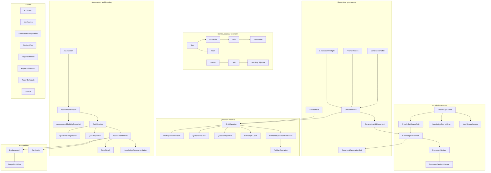

# Data Model

The PostgreSQL / Prisma information model. Authoritative for entities, attributes, keys, enumerations,
indexes, constraints, and retention.

Scope boundary: this document models everything Knowzy owns in PostgreSQL. Approved question
**content** lives in the SharePoint Question Bank and is modelled in
[sharepoint-question-bank.md](sharepoint-question-bank.md). What PostgreSQL holds about a published
question is a reference and a projection, never a second copy of the answer key.

---

## 1. Modelling principles

| # | Principle | Consequence |
| --- | --- | --- |
| M1 | One authority per fact | `PublishedQuestionReference` never stores the correct answer; the bank does. `KnowledgeDocument` never stores document bytes; SharePoint does. |
| M2 | Lineage is immutable | Generation lineage (source, version, hash, section, excerpt) is written once and never updated. Edits create new versions carrying the same lineage. |
| M3 | History is additive | Nothing that a human decided is overwritten. Versions, reviews, approvals, results, and recommendations are append-only. |
| M4 | Derived values are recomputable | Every denormalized counter has a documented formula and a nightly consistency job that **reports** drift rather than silently correcting it. |
| M5 | Configuration is data | Thresholds, profiles, mappings, badge rules, and proficiency bands are rows, not constants. |
| M6 | Scope columns exist on every scoped entity | `domainId`, `teamId`, and `sourceId` are present wherever data scoping applies, so authorization is an indexable predicate, not a post-filter. |
| M7 | Soft delete for anything with lineage | `status` transitions to `DELETED` / `ARCHIVED` / `RETIRED`. Hard delete is reserved for configuration rows with no lineage. |
| M8 | Snapshots for anything scored | A quiz session snapshots its questions and answer keys; a result snapshots its threshold set. A historical record stays interpretable after configuration changes. |
| M9 | UTC everywhere | All `timestamptz`, all stored UTC. See §9. |
| M10 | Every mutation is auditable | `AuditEvent` rows are written in the same transaction as the mutation they describe. |

### 1.1 Common column set

Every entity carries these unless explicitly noted:

| Column | Type | Notes |
| --- | --- | --- |
| `id` | `uuid` PK | UUIDv7-style, generated server-side for time-ordered index locality |
| `createdAt` | `timestamptz` | Default `now()`, never client-supplied |
| `updatedAt` | `timestamptz` | Maintained by Prisma `@updatedAt` |
| `createdByUserId` | `uuid?` | `null` only for system-generated rows, which set `createdBySystem` |
| `modifiedByUserId` | `uuid?` | Last actor |
| `version` | `int` | Optimistic concurrency counter on mutable entities — see [error-handling.md §7](error-handling.md#7-concurrency-conflicts) |

Append-only entities (`AuditEvent`, `DraftQuestionVersion`, `QuizResponse` revisions,
`AssessmentResult`, `KnowledgeRecommendation`) omit `updatedAt`, `modifiedByUserId`, and `version`
because they are never updated.

---

## 2. Entity map



---

## 3. Identity, access, and taxonomy

### 3.1 `User`

| Column | Type | Notes |
| --- | --- | --- |
| `entraObjectId` | `text` unique | Entra `oid` claim — the stable join key. Never the UPN, which can change. |
| `userPrincipalName` | `text` | Display / search only |
| `displayName` | `text` | |
| `email` | `text?` | |
| `jobTitle`, `department`, `businessFunction` | `text?` | Provisioned from Entra; `businessFunction` participates in source restrictions |
| `primaryTeamId` | `uuid?` | FK `Team` |
| `status` | `UserStatus` | `ACTIVE`, `SUSPENDED`, `DEPROVISIONED` |
| `authoringPortalAccess` | `bool` | Independent of role assignment |
| `livePortalAccess` | `bool` | |
| `timeZone` | `text` | IANA zone for display only (§9) |
| `lastSignInAt` | `timestamptz?` | |
| `provisionedAt`, `lastReconciledAt` | `timestamptz?` | Entra reconciliation markers |

Rules: a user row is created on first successful sign-in (just-in-time) or by administrator
provisioning. `DEPROVISIONED` users are retained because they appear in lineage, approvals, and
results; their rows are never deleted. Account status is checked **per request**, so revoking access
takes effect without waiting for token expiry.

### 3.2 `Role`, `Permission`, `UserRole`

| Entity | Key columns |
| --- | --- |
| `Role` | `key` (unique, e.g. `APPROVER`), `name`, `description`, `isSystem`, `portalScope` (`AUTHORING`, `LIVE`, `BOTH`) |
| `Permission` | `key` (unique, e.g. `question.approve`), `name`, `family`, `description` |
| `RolePermission` | `roleId`, `permissionId` — composite PK |
| `UserRole` | `userId`, `roleId`, `grantedByUserId`, `grantedAt`, `revokedAt?`, `reason` |

`UserRole` is **append-only with a revocation timestamp**, not a delete. A role that was held in the
past remains visible in access history and explains a historical approval. The full role and
permission catalogue is in [access-control.md §4](access-control.md#4-policy-catalogue).

### 3.3 Data-scope entities

| Entity | Purpose |
| --- | --- |
| `Team` | `name`, `parentTeamId?` (hierarchical), `managerUserId?`. Manager reporting scope resolves through the hierarchy. |
| `UserTeam` | Many-to-many membership with `isPrimary`. |
| `UserDomainScope` | `userId`, `domainId`, `grantedByUserId`, `grantedAt`, `revokedAt?` — restricts authoring and reporting to named domains. |
| `UserSourceAccess` | `userId`, `sourceId`, `mode` (`ALLOW` / `DENY`), `reason`, actor, timestamps. Explicit `DENY` always wins (see [knowledge-source-administration.md §3.3](knowledge-source-administration.md#33-restriction-model)). |

An empty scope set means **unrestricted on that dimension**, which is why every scope check is written
as "set is empty OR intersects" rather than a plain intersection.

### 3.4 Taxonomy

| Entity | Columns | Notes |
| --- | --- | --- |
| `Domain` | `code` (unique, e.g. `NET` — used in QuestionID), `name`, `description`, `isActive`, `requireSmeSignoff` | `code` is immutable once a question has been published under it |
| `Topic` | `domainId`, `name`, `slug`, `description`, `isActive`, `mergedIntoTopicId?` | Rename is safe; merge sets `mergedIntoTopicId` and rewrites references in one transaction |
| `LearningObjective` | `domainId`, `topicId?`, `title`, `description`, `targetAudience`, `cognitiveLevel` (`RECALL`, `APPLICATION`, `ANALYSIS`), `targetQuestionCount`, `status`, `isAdHoc` | Ad-hoc objectives captured from free text are flagged for curation ([generation-governance.md §8.1](generation-governance.md#81-objective-catalogue)) |
| `ObjectiveSectionMapping` | `objectiveId`, `documentId`, `sectionKey`, `score`, `confirmedByUserId`, `confirmedAt`, `generationJobId?` | The pinned mapping for reproducibility |

Taxonomy deletion is prohibited where references exist. `mergedIntoTopicId` and
`Domain.isActive = false` are the supported retirement paths, so no historical result loses its label.

### 3.5 Competency reference definitions

Added 2026-09-29, migration `0015_competency_foundation`. Normative detail:
[competencies/COMPETENCY_MODEL.md](competencies/COMPETENCY_MODEL.md). **Reference definitions only:
no table here holds an observation about a person**
([COMPETENCY_PRIVACY_AND_GOVERNANCE.md](competencies/COMPETENCY_PRIVACY_AND_GOVERNANCE.md)).

| Entity | Columns | Notes |
| --- | --- | --- |
| `CompetencyFramework` | `code` (unique), `name`, `description`, `status` | |
| `CompetencyFrameworkVersion` | `frameworkId`, `versionLabel`, `sourceFileName`, `sourceContentSha256`, `status` (`DRAFT`/`APPROVED`/`SUPERSEDED`), `effectiveFrom?`, `approvedAt?`, `approvedByUserId?`, `approvalReference?`, `importerVersion` | Unique on `(frameworkId, sourceContentSha256)` and `(frameworkId, versionLabel)`. CHECK: `APPROVED` requires all three approval fields |
| `CompetencyLevelScale` | `frameworkId`, `code`, `name`, `description` | Unique `(frameworkId, code)` |
| `CompetencyLevel` | `scaleId`, `code`, `label`, `ordinal`, `description`, `sourceLabels[]` | Unique `(scaleId, code)` and `(scaleId, ordinal)` |
| `CompetencyCategory` | `frameworkId`, `code`, `name`, `kind`, `ordinal`, `status` | Unique `(frameworkId, code)` |
| `Competency` | `frameworkId`, `categoryId`, `levelScaleId`, `code`, `name`, `description`, `status` | Unique `(frameworkId, code)`; code is `CATEGORY.COMPETENCY` |
| `CompetencyAlias` | `frameworkId`, `subject`, `contextCode`, `categoryId?`, `competencyId?`, `alias`, `foldedAlias`, `decision`, `note` | Unique `(frameworkId, subject, contextCode, foldedAlias)`. CHECK: subject matches exactly one target |
| `RoleCompetencyExpectation` | `jobRoleId`, `competencyId`, `targetLevelId`, `status`, `source`, `rationale`, `effectiveFrom?`, `approvedAt?`, `approvedByUserId?`, `approvalReference?` | References the **existing** `JobRole`. CHECK: `APPROVED` requires all three approval fields. No write path in this release |
| `CompetencyImportBatch` | `frameworkVersionId`, `outcome`, `profileCode`, `importerVersion`, `sourceFileName`, `sourceContentSha256`, `actorLabel`, `correlationId`, `summary` (JSONB of counts), `startedAt`, `completedAt` | One row per apply, including a `NO_CHANGES` re-apply |
| `CompetencyImportFinding` | `batchId`, `code`, `severity`, `sheetName?`, `cellReference?`, `subjectLabel?`, `message` | A header-row reference only; never person-row content |
| `CompetencyImportProvenance` | `frameworkVersionId`, `batchId`, `subject`, `categoryId?`, `competencyId?`, `levelId?`, `sheetName`, `cellReference`, `rawLabel` | Unique `(frameworkVersionId, subject, sheetName, cellReference)` |

Definitions are framework-scoped and created once; a version records, through provenance, which of
them its source file contained. Nothing is deleted: a definition is retired.

---

## 4. Knowledge source and document entities

Field-level configuration semantics: [knowledge-source-administration.md §4](knowledge-source-administration.md#4-sharepoint-source-configuration-fields).
This section covers only storage shape and constraints.

### 4.1 `KnowledgeSource`

| Column | Type | Notes |
| --- | --- | --- |
| `name` | `text` unique | 3–120 chars |
| `description` | `text?` | ≤500 chars |
| `sourceType` | `SourceType` | Full enum present from day one (§11) |
| `connection` | `jsonb` | Type-specific; for `SHAREPOINT`: `tenant`, `siteUrl`, `siteId`, `authMethod`, `secretRef`. **Never a secret value** — §4.5 |
| `restrictions` | `jsonb` | `{ roles[], domains[], teams[], functions[] }` |
| `usableForGeneration`, `usableForRefreshers`, `usableForExplanations` | `bool` | Independent purpose flags, enforced in the MCP layer |
| `permissionMode` | `PermissionMode` | `DELEGATED_OBO`, `APP_ONLY_SITES_SELECTED` |
| `connectionStatus` | `ConnectionStatus` | `UNTESTED`, `HEALTHY`, `DEGRADED`, `FAILED` — **only a probe may set this** |
| `connectionStatusAt` | `timestamptz?` | When the probe ran; always displayed with the status |
| `syncSchedule` | `jsonb` | `{ mode, intervalHours?, cron? }` |
| `isActive` | `bool` | Inactive sources are excluded from all retrieval |
| `archivedAt` | `timestamptz?` | Archive is reversible; see §14 |
| `ownerUserId` | `uuid` | Accountable owner, receives health notifications |

### 4.2 `KnowledgeSourcePath`

`sourceId`, `containerId`, `containerName`, `folderPath`, `includedFileTypes` (`text[]`),
`excludedFileTypes` (`text[]`), `includedMetadata` (`text[]`), `domainMapping` (`jsonb`),
`topicMapping` (`jsonb`), `deltaToken` (`text?`), `deltaTokenAt`, `requiresFullSync` (`bool`),
`isActive`, `lastSuccessfulSyncAt`.

Unique on `(sourceId, containerId, folderPath)`. `folderPath` is stored normalized (leading `/`, no
trailing `/`, no `.`/`..` segments) and validated on write, so path traversal cannot be expressed.

### 4.3 `KnowledgeDocument`

Complete attribute list in
[knowledge-source-administration.md §6.7](knowledge-source-administration.md#67-source-document-metadata-specification-33-complete).
Storage notes:

| Column | Type | Notes |
| --- | --- | --- |
| `sourceId`, `pathId` | `uuid` | Unique on `(sourceId, sourceDocumentId)` |
| `sourceDocumentId` | `text` | Provider-native item ID |
| `contentHash` | `char(64)` | SHA-256 of normalized extracted text — the authority for "did content change" |
| `sourceVersion` | `text` | Provider version label |
| `sourceETag` | `text?` | Provider eTag, stored separately because the dual test in [generation-governance.md §5](generation-governance.md#5-document-change-detection) needs both |
| `localVersionCounter` | `int` | Monotonic local counter, incremented on each confirmed content change |
| `extractedText` | `text?` | Normalized text. Nullable: `UNSUPPORTED` and `TOO_LARGE` documents have none |
| `extractedCharCount` | `int` | |
| `extractionStatus` | `ExtractionStatus` | `PENDING`, `EXTRACTED`, `EMPTY`, `UNSUPPORTED`, `FAILED`, `TOO_LARGE`, `QUARANTINED` |
| `indexingStatus` | `IndexingStatus` | `PENDING`, `INDEXED`, `FAILED`, `SKIPPED` |
| `status` | `DocumentStatus` | `ACTIVE`, `DELETED`, `ARCHIVED` |
| `isExcludedFromGeneration` | `bool` | With `exclusionReason`, `excludedByUserId`, `excludedAt` |
| `sourceMetadata` | `jsonb` | Only the columns named in the path's Included Metadata |
| `domainHint`, `topicHint` | `uuid?` | Derived from mapping rules; the author may override |

`extractedText` is stored because evidence verification, re-verification years later, and
"compare with previous version" all require the text as it was when questions were generated. It is
**not** a copy of the file; binaries are never persisted.

### 4.4 `DocumentSection` and `DocumentSectionLineage`

`DocumentSection`: `documentId`, `sectionKey` (`char(64)`), `ordinal`, `heading`, `headingPath`,
`pageNumber?`, `slideNumber?`, `sheetName?`, `startOffset`, `endOffset`, `sectionContentHash`,
`assessableCharCount`, `isAssessable`, `nonAssessableReason?`, `targetQuestionCount`,
`coverageStatus`, `documentVersionCounter`.

Unique on `(documentId, sectionKey, documentVersionCounter)` — a section is versioned with the
document, so coverage history survives re-extraction.

`DocumentSectionLineage`: `documentId`, `fromSectionKey?`, `toSectionKey?`, `fromVersionCounter`,
`toVersionCounter`, `matchRule` (`KEY`, `HASH`, `SIMILARITY`, `NEW`, `REMOVED`), `headingSimilarity?`,
`contentSimilarity?`. Implements the five-step matching order in
[generation-governance.md §6.6](generation-governance.md#66-section-lineage-across-document-versions).

### 4.5 `KnowledgeSourceSync` and failure records

`KnowledgeSourceSync`: source, `pathIds` (`uuid[]`), `mode` (`INCREMENTAL`, `FULL`, `HEALTH_CHECK`),
`trigger` (`MANUAL`, `SCHEDULE`, `SYSTEM`), `actorUserId?`, `startedAt`, `completedAt?`,
`durationMs?`, `outcome` (`RUNNING`, `SUCCEEDED`, `PARTIAL`, `FAILED`, `CANCELLED`), counts
(`scanned`, `added`, `modified`, `deleted`, `unchanged`, `failed`), `extractedCharCount`,
`questionsFlaggedForRevalidation`, `errorSummary` (`jsonb`, redacted), `correlationId`.

`SyncDocumentFailure`: `syncId`, `documentId?`, `sourceDocumentId`, `phase` (`LISTING`, `DOWNLOAD`,
`EXTRACTION`, `INDEXING`), `errorCode`, `safeMessage`, `attemptCount`, `nextRetryAt?`,
`state` (`PENDING_RETRY`, `QUARANTINED`, `DISMISSED`, `RESOLVED`), `dismissedByUserId?`,
`dismissReason?`.

**Secrets never enter these tables.** `errorSummary` holds Knowzy error codes and safe messages only;
raw provider bodies are logged with the correlation ID and scrubbed by the redactor
([security.md §11](security.md#11-secrets-and-key-management)).

---

## 5. Generation governance entities

Semantics are normative in [generation-governance.md](generation-governance.md). This is the storage
shape.

### 5.1 `GenerationProfile`

`name`, `description`, `modelId`, `promptVersionId`, `questionType`, `difficultyMix` (`jsonb`),
`maxQuestionsPerDocument`, `maxQuestionsPerSection`, `evidenceStrictness` (`STRICT`, `STANDARD`),
`distractorRules` (`jsonb`), `duplicateFlagThreshold`, `duplicateBlockThreshold`,
`coverageSettings` (`jsonb`: `charsPerQuestion`, `minPerSection`, `maxPerSection`,
`minAssessableChars`), `temperature`, `maxOutputTokens`, `enabledDomainIds` (`uuid[]`), `isActive`.

### 5.2 `PromptVersion`

`promptKey`, `semanticVersion`, `body`, `outputSchemaHash`, `createdAt`, `createdByUserId`,
`retiredAt?`. **Immutable after creation** — enforced by a database rule, because every generated
question references it and yield analytics compare versions. A change is a new row.

### 5.3 `GenerationPreflight`

| Column | Notes |
| --- | --- |
| `sourceId`, `documentIds` (`uuid[]`) | The selection the preflight evaluated |
| `objectiveIds` (`uuid[]?`), `targetAssessmentId?` | Optional inputs |
| `checkResults` | `jsonb` — the six checks of [generation-governance.md §4.1](generation-governance.md#41-stage-0--the-six-mandatory-pre-generation-checks), each with status and evidence |
| `recommendation` | `PreflightRecommendation`: `VIEW_EXISTING`, `REUSE_EXISTING`, `GENERATE_ADDITIONAL`, `REGENERATE`, `GENERATE_NEW` |
| `chosenAction` | Same enum, set when the author acts; `null` while undecided |
| `chosenAt`, `chosenByUserId` | |
| `expiresAt` | Default 60 minutes. An expired preflight cannot authorize a job — state may have moved |

`chosenAction ∈ {VIEW_EXISTING, REUSE_EXISTING}` is what the "regeneration avoided" metric counts
([generation-governance.md §10.2](generation-governance.md#102-reuse-and-savings-metrics)).

### 5.4 `GenerationJob`

| Column | Notes |
| --- | --- |
| `preflightId` | **Required.** No job without a recorded preflight decision |
| `sourceId`, `profileId`, `promptVersionId`, `modelId` | Model and prompt captured at run time, never resolved later |
| `domainId`, `topicId`, `targetAudience` | |
| `scope` | `GenerationScope` (§11) |
| `objectiveIds` (`uuid[]`), `resolvedSectionKeys` (`text[]`) | The pinned, reproducible input |
| `requestedQuestionCount`, `acceptedQuestionCount` | |
| `rejectionCounts` | `jsonb` keyed by reason code |
| `reasonCode` | `GenerationReasonCode` — required (§11) |
| `justification` | `text?`, required when `reasonCode = PUBLISHER_REQUESTED` |
| `status` | `QUEUED`, `RUNNING`, `SUCCEEDED`, `PARTIAL`, `FAILED`, `CANCELLED` |
| `inputTokens`, `outputTokens`, `estimatedCost` | Cost accounting |
| `startedAt`, `completedAt`, `durationMs` | |
| `correlationId` | Links audit, telemetry, MCP calls |

`GenerationJobDocument`: `jobId`, `documentId`, `sourceVersionAtRun`, `contentHashAtRun`,
`sectionHashesAtRun` (`jsonb`), `outcome`, `failureReason?`. This row is the reason a job is
reproducible: it records what the document *was*, not what it is now.

`GenerationJobRejection`: `jobId`, `sectionKey?`, `objectiveId?`, `reason` (`SCHEMA_INVALID`,
`EVIDENCE_UNVERIFIED`, `DUPLICATE`, `INSUFFICIENT_EVIDENCE`, `OPTION_DUPLICATE`, `ANSWER_INVALID`,
`QUESTION_INCOMPLETE`), `detail`, `matchedQuestionId?`, `similarityScore?`, `candidatePayload`
(`jsonb`, redacted to the stem). Rejected candidates are **not** persisted as questions; this table
is the record of why.

### 5.5 `DocumentGenerationStat`

One row per `KnowledgeDocument`. Columns follow
[generation-governance.md §3](generation-governance.md#3-document-generation-tracking) exactly:
`documentId` (unique), `lastGeneratedAt`, `lastApprovedQuestionAt`, `totalDraftQuestionsGenerated`,
`totalApprovedQuestions`, `totalPublishedQuestions`, `activeQuestionCount`, `retiredQuestionCount`,
`coveragePercentage` (`numeric(5,2)?`, `null` when no assessable sections),
`versionAtLastGeneration`, `hashAtLastGeneration`, `generationStatus`, `recomputedAt`.

Maintained transactionally on every lifecycle transition, and verified nightly against
`DraftQuestion` + `PublishedQuestionReference`. Drift produces a `PlatformConsistencyFinding` row and
a notification — never a silent correction (M4).

### 5.6 `QuestionSet`

`name`, `description`, `domainId`, `originGenerationJobId?`, `createdByUserId`, `isActive`.
`QuestionSetMember`: `setId`, `questionId`, `publishedVersion?`, `ordinal`. A set **references**
questions by ID and version; it never copies content.

---

## 6. Question lifecycle entities

### 6.1 `DraftQuestion`

The working record for a question in any pre-bank state, and the local anchor for a published one.

| Column | Type | Notes |
| --- | --- | --- |
| `internalQuestionId` | `uuid` | The stable platform identity across all versions |
| `proposedQuestionId` | `text?` | `KNZ-{DOMAIN_CODE}-{YYYY}-{SEQ}`, allocated at generation, confirmed at publish |
| `questionType` | `QuestionType` | Release 1: `MULTIPLE_CHOICE_4` (§7) |
| `status` | `QuestionStatus` | Ten states (§11) |
| `version` | `int` | Increments on every field edit |
| `domainId`, `topicId`, `learningObjectiveId?` | `uuid` | |
| `questionText` | `text` | |
| `answerPayload` | `jsonb` | Discriminated by `questionType` (§7). For `MULTIPLE_CHOICE_4`: `{ options: {A,B,C,D}, correctOption: "A"\|"B"\|"C"\|"D" }` |
| `explanation` | `text` | |
| `sourceId`, `sourceDocumentId`, `sectionKey` | | Lineage, immutable |
| `sourceUrl`, `sourceDocumentName`, `sourceSiteName`, `sourceLibraryName`, `sourceFolderPath` | `text` | Denormalized lineage, immutable (M2) |
| `sourceVersionAtGeneration`, `sourceETagAtGeneration` | `text` | |
| `sourceContentHash`, `sectionContentHash` | `char(64)` | Hash at generation time — the revalidation comparator |
| `supportingEvidence` | `text` | Verified verbatim span, original casing preserved |
| `evidenceStartOffset`, `evidenceEndOffset` | `int` | Re-locatable span |
| `evidenceVerificationMode` | `STRICT`, `STANDARD` | |
| `evidenceSimilarityScore` | `numeric(4,3)?` | `1.000` for exact matches |
| `generationJobId?`, `modelId`, `promptVersionId` | | `null` job for manually authored questions |
| `confidenceScore` | `numeric(4,3)` | Composite (§6.2) |
| `confidenceComponents` | `jsonb` | The six weighted components, so a reviewer sees *why* |
| `similarityClusterId?`, `maxSimilarityScore?`, `duplicateDisposition?` | | `DISTINCT` / `DUPLICATE` / `null` |
| `needsRevalidation` | `bool` | With `revalidationReason` (`CONTENT_CHANGED`, `SOURCE_DELETED`, `SOURCE_SECTION_REMOVED`), `revalidationDetectedBySyncId`, `revalidationDetectedAt` |
| `publishedVersion` | `int?` | Set at publish |
| `archivedAt`, `retiredAt` | `timestamptz?` | |

Indexes and constraints in §12 / §13. Note what is **absent**: no `isCorrect` boolean on a column the
learner-facing projection could select, and no learner-visible view over this table at all. The answer
lives inside `answerPayload`, and the `LearnerQuestionDto` projection is constructed from an explicit
field list ([security.md §8](security.md#8-answer-key-protection)).

### 6.2 Confidence storage

`confidenceComponents` stores the exact structure weighted in
[workflows.md §2.8](workflows.md#28-confidence-indicator):
`{ evidenceMatch, sectionCoverage, optionDistinctness, metadataCompleteness, duplicateDistance,
modelDeclared }`, each with `raw`, `weight`, and `contribution`. Confidence is advisory and
authorizes nothing.

### 6.3 `DraftQuestionVersion`

Append-only snapshot: `questionId`, `version`, `snapshot` (`jsonb` — the full question as of that
version), `diff` (`jsonb` — field-level previous/new pairs), `changedByUserId`, `changedAt`,
`changeKind` (`GENERATED`, `EDITED`, `REVALIDATED`, `PUBLISHED`), `evidenceReverified` (`bool`),
`evidenceReverifyResult` (`jsonb?`).

### 6.4 `QuestionReview` and `QuestionApproval`

`QuestionReview`: `questionId`, `questionVersion`, `reviewerUserId`, `kind` (`AUTHOR`, `SME`,
`REVIEWER`), `outcome` (`ENDORSED`, `CHANGES_REQUESTED`, `REJECTED`, `COMMENTED`), `comment`,
`isBlocking`, `createdAt`. SME endorsement is **version-bound**: an edit invalidates it, implemented
as a query predicate on `questionVersion`, not by mutating the row.

`QuestionApproval`: `questionId`, `questionVersion`, `approverUserId`, `decision` (`APPROVED`,
`REJECTED`, `CHANGES_REQUESTED`), `comment?`, `gateResults` (`jsonb` — all 13 gates with pass/fail),
`separationOfDutiesResult` (`jsonb`), `overrideJustification?`, `overrideByUserId?`, `decidedAt`.

Storing `gateResults` on the approval row means an auditor can see exactly what the platform checked
at the moment of approval, not what it would check today.

### 6.5 `SimilarityCluster`

`SimilarityCluster`: `id`, `domainId?`, `memberCount`, `representativeQuestionId`, `createdAt`,
`recomputedAt`. `QuestionSimilarity`: `questionAId`, `questionBId`, `compositeScore`,
`componentScores` (`jsonb`), `computedAt`, `claudeAdjudication` (`jsonb?` — verdict plus rationale,
**advisory only**). Unique on the ordered pair `(least(a,b), greatest(a,b))`.

Cluster membership is the transitive closure of flagged pairs, recomputed when a pair crosses the flag
threshold. Selection strategies take at most one member per cluster
([generation-governance.md §4.5](generation-governance.md#45-stage-3--assessment-pool-de-duplication)).

### 6.6 `PublishedQuestionReference`

The PostgreSQL projection of a bank item. **Contains no answer key and no explanation.**

| Column | Notes |
| --- | --- |
| `questionId` | The confirmed `KNZ-…` QuestionID, unique |
| `internalQuestionId` | FK `DraftQuestion` |
| `targetSiteId`, `targetListId` | Resolved bank target at publish time |
| `sharePointItemId` | The item ID — the proof of publication |
| `eTag` | For `If-Match` conditional updates |
| `publishedVersion` | The question version published |
| `status` | `PUBLISHED`, `RETIRED`, `SUPERSEDED` |
| `isActive`, `isPublished` | Mirror of the bank's governance columns |
| `domainId`, `topicId`, `learningObjectiveId?` | Denormalized for pool filtering without touching SharePoint |
| `questionTextHash`, `answerPayloadHash` | Drift detection for reconciliation, without storing content |
| `sourceDocumentId`, `sectionKey`, `sourceContentHash` | Lineage for reporting |
| `publishedAt`, `publishedByUserId`, `retiredAt`, `retiredByUserId`, `retireComment` | |
| `lastReconciledAt`, `reconciliationState` | `IN_SYNC`, `MISSING_REMOTE`, `MISSING_LOCAL`, `VERSION_DRIFT`, `STATUS_DRIFT`, `FIELD_DRIFT` |

This projection is what assessment eligibility, dashboards, and reports read. Question *content* for a
live quiz is fetched through MCP with a short-TTL server-side cache
([architecture.md §10](architecture.md#10-data-architecture-summary)).

### 6.7 `PublishOperation`

`operationKey` (`char(64)` unique — `sha256(targetListId + questionId + publishedVersion +
operationType)`), `questionId`, `batchId`, `operationType` (`CREATE`, `UPDATE`, `RETIRE`),
`state` (`PENDING`, `IN_FLIGHT`, `SUCCEEDED`, `ALREADY_PUBLISHED`, `FAILED`), `attemptCount`,
`claimedAt?`, `claimedBy?`, `lastError` (`jsonb?`), `sharePointItemId?`, `resultETag?`,
`idempotencyKey?` (the client header), `correlationId`.

The unique `operationKey` is the structural guarantee behind
[workflows.md §4.2](workflows.md#42-idempotency): a retried publish cannot create a second item.

---

## 7. Question type extensibility

Release 1 ships `MULTIPLE_CHOICE_4` only. The model is built so a new type needs a new enum value, a
new payload schema, and a new scorer — and **no change** to lifecycle, review, publishing, assessment,
session, reporting, or audit code.

### 7.1 The discriminated payload

```ts
// @knowzy/shared-types — one Zod schema serves REST validation,
// the MCP tool schema, and Claude output parsing.
const MultipleChoice4 = z.object({
  type: z.literal('MULTIPLE_CHOICE_4'),
  options: z.object({ A: z.string().min(1), B: z.string().min(1),
                      C: z.string().min(1), D: z.string().min(1) }),
  correctOption: z.enum(['A', 'B', 'C', 'D']),
});

// Designed, not built in release 1:
const MultiSelect      = z.object({ type: z.literal('MULTI_SELECT'),
                                    options: z.record(z.string()),
                                    correctOptions: z.array(z.string()).min(1) });
const TrueFalse        = z.object({ type: z.literal('TRUE_FALSE'),
                                    correctValue: z.boolean() });
const ShortAnswer      = z.object({ type: z.literal('SHORT_ANSWER'),
                                    acceptedAnswers: z.array(z.string()).min(1),
                                    matchMode: z.enum(['EXACT', 'NORMALIZED', 'REGEX']) });
const ScenarioOrdering = z.object({ type: z.literal('SCENARIO_ORDERING'),
                                    steps: z.array(z.string()).min(2),
                                    correctOrder: z.array(z.number().int()) });

const AnswerPayload = z.discriminatedUnion('type',
  [MultipleChoice4, MultiSelect, TrueFalse, ShortAnswer, ScenarioOrdering]);
```

### 7.2 What each new type must supply

| Extension point | Contract |
| --- | --- |
| `QuestionType` enum value | Already reserved in the database enum (§11), so no migration is needed when the type ships |
| Payload schema | A member of `AnswerPayload` |
| Learner projection | A `LearnerQuestionDto` variant that structurally cannot carry the key (`correctOption`, `correctOptions`, `correctValue`, `acceptedAnswers`, `correctOrder` are absent from the type) |
| Scorer | `Scorer<T>` — a pure function `(payload, response) => { correct: boolean, partialCredit?: number }`, registered by type, unit-tested against a fixture table |
| Validation gates | Type-specific additions to the 13 gates ([authoring-portal.md §5.7](authoring-portal.md#57-approval-blocking-gates)); the generic gates apply unchanged |
| Bank field mapping | A mapping-profile entry for the type's payload columns ([sharepoint-field-mapping.md](sharepoint-field-mapping.md)) |
| Renderer | A quiz-runner component satisfying the accessibility contract in [ux-design.md §7](ux-design.md#7-accessibility-standards) |

### 7.3 Why the gates hold for all types

`QuizResponse.responsePayload` is also a discriminated union, and scoring dispatches on
`questionType` from the **session snapshot**, never from the client. A client that submits a
`MULTI_SELECT` response to a `MULTIPLE_CHOICE_4` question fails schema validation before any scoring
code runs. Partial credit is expressible (`partialCredit`) but unused in release 1, and
`percentageScore` remains defined as `correct / total` because no release-1 type awards partial marks.

---

## 8. Assessment, session, result, and recognition entities

### 8.1 `Assessment` and `AssessmentVersion`

`Assessment`: `name`, `slug`, `domainId`, `description`, `ownerUserId`, `status`
(`DRAFT`, `ACTIVE`, `ARCHIVED`), `currentPublishedVersionId?`.

`AssessmentVersion`: `assessmentId`, `versionNumber`, `status` (`DRAFT`, `UNDER_REVIEW`, `APPROVED`,
`PUBLISHED`, `UNPUBLISHED`, `ARCHIVED`), `topicIds` (`uuid[]`), `objectiveIds` (`uuid[]`),
`targetAudience`, `instructions`, `questionCount`, `selectionStrategy`, `selectionConfig` (`jsonb`),
`passPercentage` (`numeric(5,2)`), `proficiencyThresholds` (`jsonb`), `attemptLimit` (`int?`,
`null` = unlimited), `retakePolicy` (`jsonb`: `waitHours`, `resetOnPass`), `timeLimitMinutes` (`int?`),
`availabilityStart`, `availabilityEnd` (`timestamptz?`), `allowBackNavigation` (default `true`),
`showAnswersAfterCompletion` (default `true`), `scoreOnExpiry` (`SCORE_PARTIAL`, `VOID`),
`minimumObjectiveCoverage` (`jsonb?`), `badgeRuleId?`, `certificateRuleId?`, `submittedByUserId?`,
`approvedByUserId?`, `publishedByUserId?`, timestamps for each.

Validation at publish: proficiency bands contiguous, non-overlapping, covering 0–100 exactly; pool
sufficiency per topic and per objective; no two members of one similarity cluster in a `FIXED_SET`.

### 8.2 `AssessmentEligibilitySnapshot`

`assessmentVersionId`, `snapshotAt`, `strategy`, `resolvedSelectionConfig` (`jsonb`),
`proficiencyThresholds` (`jsonb`), `poolMembers` (`jsonb` — array of `{ questionId,
publishedVersion, topicId, objectiveId?, similarityClusterId? }`), `poolSizeByTopic` (`jsonb`),
`poolSizeByObjective` (`jsonb`).

At session creation the live pool is intersected with this snapshot, so a release never acquires
questions the approver never saw and never serves a retired one
([workflows.md §5.1](workflows.md#51-eligibility-snapshot)).

### 8.3 `QuizSession` and `QuizSessionQuestion`

`QuizSession`: `learnerUserId`, `assessmentVersionId`, `eligibilitySnapshotId`, `mode`
(`SCORED`, `PRACTICE` — practice reserved, unused in release 1), `status` (`IN_PROGRESS`,
`COMPLETED`, `EXPIRED`, `ABANDONED`), `selectionSeed` (`text` — the session ID, stored so selection is
reproducible), `totalQuestions`, `currentIndex`, `startedAt`, `expiresAt?`, `completedAt?`,
`lastActivityAt`, `writeSequence` (`int` — monotonic, rejects out-of-order writes),
`idempotencyKey?`, `attemptNumber`, `recoveryCount` (`int`, default 0).

`QuizSessionQuestion` is the **immutable snapshot**: `sessionId`, `presentationIndex`, `questionId`,
`publishedVersion`, `questionType`, `questionText`, `answerPayload` (`jsonb` — **includes the key**),
`explanation`, `domainId`, `topicId`, `learningObjectiveId?`, `sourceReferences` (`jsonb`),
`snapshotAt`.

Access rule: `QuizSessionQuestion.answerPayload` and `.explanation` are selected **only** by the
scoring engine and by the post-completion result projection. A repository method
`findLearnerQuestion()` exists with an explicit column list that omits both, and it is the only method
the session routes may call. See [security.md §8](security.md#8-answer-key-protection).

### 8.4 `QuizResponse`

`sessionId`, `presentationIndex`, `revision` (`int`), `responsePayload` (`jsonb`, discriminated by
question type), `isLatest` (`bool`), `answeredAt`, `clientElapsedMs?`, `serverElapsedMs`,
`isFlagged`, `writeSequence`, `idempotencyKey`.

Append-only: changing an answer inserts `revision + 1` and clears `isLatest` on the prior row in the
same transaction. Unique on `(sessionId, presentationIndex, revision)` and a partial unique index on
`(sessionId, presentationIndex) WHERE isLatest`. Scoring reads only `isLatest` rows. No correctness
flag is stored here — correctness is computed at completion from the snapshot, so a response row can
never leak the key.

### 8.5 `AssessmentResult` and `TopicResult`

`AssessmentResult` (append-only): `sessionId` (unique), `learnerUserId`, `assessmentId`,
`assessmentVersionId`, `attemptNumber`, `totalQuestions`, `correctAnswers`, `incorrectAnswers`,
`unansweredCount`, `percentageScore` (`numeric(5,2)`), `passed` (`bool`),
`proficiencyBand` (`ProficiencyBand`), `appliedThresholds` (`jsonb` — copied, per M8),
`passPercentageApplied` (`numeric(5,2)`), `timeTakenSeconds`, `startedAt`, `completedAt`,
`resultState` (`SCORED`, `EXPIRED`, `ABANDONED`, `VOIDED`), `scoringEngineVersion` (`text`),
`supersedesResultId?`, `supersedeReason?`, `voidedByUserId?`.

`TopicResult`: `resultId`, `topicId`, `questionsAsked`, `correct`, `incorrect`, `unanswered`,
`topicAccuracy` (`numeric(5,2)`), `topicBand`, `isKnowledgeGap` (`bool`),
`gapState` (`GAP`, `NO_GAP`, `INSUFFICIENT_EVIDENCE`). An `ObjectiveResult` row of the same shape is
written when the assessment carries objectives.

Rounding is normative in
[live-learning-portal.md §5.2](live-learning-portal.md#52-rounding-rule-normative). `numeric(5,2)` is
chosen so the stored value **is** the decided value — there is no hidden precision.

### 8.6 `KnowledgeRecommendation`

Append-only: `resultId`, `learnerUserId`, `topicId`, `rank`, `topicAccuracy`, `questionsAsked`,
`gapSummary`, `recommendedLearningArea`, `approvedExplanation` (verbatim from the bank),
`refresherText?`, `citations` (`jsonb` — array of `{ candidateId, documentId?, sourceId,
documentName, sourceType, webUrl }` built from the platform's own retrieval records, never from model
output), `modelId?`, `promptVersionId?`, `noSourceFound` (`bool`),
`disposition` (`NEW`, `VIEWED`, `COMPLETED`, `DISMISSED`), `viewedAt?`, `completedAt?`,
`dismissedAt?`, `correlationId`.

`noSourceFound = true` means the card renders the approved explanation plus the honest statement in
[workflows.md §7.4](workflows.md#74-anti-fabrication-controls). No citation row exists in that case —
the schema cannot hold a fabricated one.

### 8.7 Recognition

`BadgeDefinition`: `key`, `name`, `description`, `iconRef`, `category`, `criteria` (`jsonb` —
declarative and deterministic), `domainId?`, `isActive`, `isRepeatable`.
`BadgeAward` (append-only): `badgeDefinitionId`, `learnerUserId`, `resultId?`, `awardedAt`,
`criteriaSnapshot` (`jsonb`), `revokedAt?`, `revokeReason?`, `revokedByUserId?`.
Unique on `(badgeDefinitionId, learnerUserId)` where `isRepeatable = false`.

`CertificateRule`: `key`, `name`, `templateRef`, `validityMonths?`, `criteria` (`jsonb`).
`Certificate`: `certificateRuleId`, `learnerUserId`, `resultId`, `serialNumber` (unique),
`verificationCode` (unique, high-entropy), `verificationCodeHash`, `issuedAt`, `expiresAt?`,
`status` (`ISSUED`, `EXPIRED`, `REVOKED`), `revokedAt?`, `revokeReason?`, `blobRef`,
`renderedHash` (`char(64)`), `signatureKeyId`, `templateVersion`.

Full rules: [badges-and-certificates.md](badges-and-certificates.md).

---

## 9. Time and timezone rules

| # | Rule |
| --- | --- |
| T1 | Every timestamp column is `timestamptz` and every stored value is UTC. No `timestamp without time zone` appears in the schema. |
| T2 | The database session `TimeZone` is set to `UTC` on every connection, so an implicit cast cannot introduce a local offset. |
| T3 | Application code obtains "now" from one injected clock (`Clock.now()`), never from `new Date()` scattered through services. Tests substitute a fixed clock. |
| T4 | Display conversion happens in the presentation layer only, using `User.timeZone` with a tenant default (`platform.defaultTimeZone`). |
| T5 | **Instant comparisons** — session expiry, availability windows, retake cooling-off, certificate expiry, token freshness — are evaluated in UTC with no zone conversion. |
| T6 | **Date-only boundaries** — "questions approved today", report date ranges, daily budget windows — are resolved against the tenant reporting zone (`reporting.timeZone`), converted to a UTC half-open interval `[startUtc, endUtc)` at query construction, and the resolved interval is displayed with the report. |
| T7 | Half-open intervals everywhere: `availabilityStart <= now < availabilityEnd`. No inclusive upper bounds, so no gap or overlap at midnight. |
| T8 | DST is a non-issue for T5 (instants) and is handled for T6 by converting through the IANA zone rather than a fixed offset. A report for a DST-transition day covers 23 or 25 hours, which is correct. |
| T9 | `timeTakenSeconds` is computed from server timestamps (`completedAt - startedAt` minus recorded pauses, of which there are none in release 1). `clientElapsedMs` is stored for diagnostics and **never** used in a decision. |
| T10 | Retention and expiry jobs compare in UTC and record the evaluation instant on the row they act upon, so a deletion is explainable. |
| T11 | Durations are stored as integer seconds or milliseconds in explicitly named columns (`timeTakenSeconds`, `durationMs`), never as intervals, so aggregation semantics are unambiguous. |
| T12 | `expiresAt` is always absolute, never "start + limit" computed at read time, so a configuration change mid-session cannot extend or shorten an attempt in flight. |

---

## 10. Reporting, audit, notification, and configuration entities

| Entity | Shape |
| --- | --- |
| `AuditEvent` | Append-only. Full field list in [audit-model.md §3](audit-model.md#3-record-shape). Partitioned monthly by `occurredAt`. |
| `Notification` | `recipientUserId`, `kind`, `severity`, `subject`, `body`, `entityType`, `entityId`, `channel` (`IN_APP`, `EMAIL`, `TEAMS` — only `IN_APP` delivered in release 1), `state` (`PENDING`, `DELIVERED`, `READ`, `DISMISSED`, `FAILED`), `correlationId`. |
| `ApplicationConfiguration` | `key` (unique), `scope` (`PLATFORM`, `DOMAIN`, `SOURCE`, `PROFILE`, `ASSESSMENT`), `scopeId?`, `value` (`jsonb`), `valueType`, `isSecretRef` (`bool`), `updatedByUserId`, `updatedAt`. Every change writes a `ConfigurationChange` row with previous and new value. |
| `FeatureFlag` | `key`, `enabled`, `environment`, `rolloutRule` (`jsonb?`), `updatedByUserId`. `sharepoint.write.enabled` defaults **off** ([environment-and-configuration.md §6](environment-and-configuration.md#6-feature-flags)). |
| `ReportDefinition` | `key`, `name`, `category`, `parameters` (`jsonb`), `queryRef`, `defaultFilters` (`jsonb`), `requiredPermission`, `minimumGroupSize`, `status` (report lifecycle), `ownerUserId`. |
| `ReportRun` | `definitionId`, `parameters`, `requestedByUserId`, `rowCount`, `suppressedCellCount`, `startedAt`, `completedAt`, `outcome`, `correlationId`. |
| `ReportPublication` | `definitionId`, `versionNumber`, `status` (`DRAFT`, `UNDER_REVIEW`, `APPROVED`, `PUBLISHED`, `RETIRED`, `ARCHIVED`), `audienceRule` (`jsonb`), approver and publisher references. |
| `ReportSchedule` | Shape present, execution deferred — [reporting.md §9](reporting.md#9-scheduled-reporting-future). |
| `ReportExport` | `runId`, `format` (`CSV`, `XLSX`, `PDF`), `blobRef`, `rowCount`, `requestedByUserId`, `expiresAt`. Every export is audited. |
| `JobRun` | `jobType`, `payloadRef`, `state`, `attemptCount`, `claimedBy`, `claimedAt`, `lastError`, `correlationId`. pg-boss owns the queue; `JobRun` is the queryable operational record. |
| `PlatformConsistencyFinding` | `checkKey`, `entityType`, `entityId`, `expected`, `actual`, `detectedAt`, `state` (`OPEN`, `ACKNOWLEDGED`, `RESOLVED`). The output of M4's nightly checks. |

---

## 11. Enumerations

Every enum below exists in the database from the first migration, including values whose feature ships
later. Adding a value to a PostgreSQL enum is cheap; changing stored history is not.

| Enum | Values |
| --- | --- |
| `UserStatus` | `ACTIVE`, `SUSPENDED`, `DEPROVISIONED` |
| `PortalScope` | `AUTHORING`, `LIVE`, `BOTH` |
| `SourceType` | `SHAREPOINT`, `MOCK`, `CONFLUENCE`, `SERVICENOW`, `SQL_DATABASE`, `REST_API`, `AZURE_BLOB`, `FILE_REPOSITORY`, `INTERNAL_KNOWLEDGE_API`, `MCP_GENERIC` |
| `PermissionMode` | `DELEGATED_OBO`, `APP_ONLY_SITES_SELECTED` |
| `AuthMethod` | `MANAGED_IDENTITY`, `CLIENT_CREDENTIALS`, `ON_BEHALF_OF` |
| `ConnectionStatus` | `UNTESTED`, `HEALTHY`, `DEGRADED`, `FAILED` |
| `SyncMode` | `INCREMENTAL`, `FULL`, `HEALTH_CHECK` |
| `SyncTrigger` | `MANUAL`, `SCHEDULE`, `SYSTEM` |
| `SyncOutcome` | `RUNNING`, `SUCCEEDED`, `PARTIAL`, `FAILED`, `CANCELLED` |
| `DocumentStatus` | `ACTIVE`, `DELETED`, `ARCHIVED` |
| `ExtractionStatus` | `PENDING`, `EXTRACTED`, `EMPTY`, `UNSUPPORTED`, `FAILED`, `TOO_LARGE`, `QUARANTINED` |
| `IndexingStatus` | `PENDING`, `INDEXED`, `FAILED`, `SKIPPED` |
| `CoverageStatus` | `NOT_COVERED`, `PARTIALLY_COVERED`, `COVERED`, `MODIFIED`, `NON_ASSESSABLE` |
| `SectionMatchRule` | `KEY`, `HASH`, `SIMILARITY`, `NEW`, `REMOVED` |
| `GenerationScope` | `ENTIRE_DOCUMENT`, `MODIFIED_SECTIONS_ONLY`, `UNCOVERED_SECTIONS_ONLY`, `OBJECTIVES`, `SELECTED_SECTIONS` |
| `GenerationReasonCode` | `NEW_KNOWLEDGE`, `CONTENT_CHANGED`, `COVERAGE_GAP`, `NEW_OBJECTIVE`, `PUBLISHER_REQUESTED` |
| `GenerationStatus` | `NOT_PROCESSED`, `DRAFTS_PENDING`, `HAS_APPROVED`, `HAS_PUBLISHED`, `MODIFIED_SINCE_GENERATION`, `EXCLUDED` |
| `PreflightRecommendation` | `VIEW_EXISTING`, `REUSE_EXISTING`, `GENERATE_ADDITIONAL`, `REGENERATE`, `GENERATE_NEW` |
| `JobState` | `QUEUED`, `RUNNING`, `SUCCEEDED`, `PARTIAL`, `FAILED`, `CANCELLED` |
| `RejectionReason` | `SCHEMA_INVALID`, `EVIDENCE_UNVERIFIED`, `DUPLICATE`, `INSUFFICIENT_EVIDENCE`, `OPTION_DUPLICATE`, `ANSWER_INVALID`, `QUESTION_INCOMPLETE` |
| `QuestionType` | `MULTIPLE_CHOICE_4`, `MULTI_SELECT`, `TRUE_FALSE`, `SHORT_ANSWER`, `SCENARIO_ORDERING` |
| `QuestionStatus` | `GENERATED`, `DRAFT`, `AUTHOR_REVIEW`, `SUBMITTED_FOR_APPROVAL`, `CHANGES_REQUESTED`, `APPROVED`, `PUBLISHED`, `REJECTED`, `RETIRED`, `ARCHIVED` |
| `EvidenceMode` | `STRICT`, `STANDARD` |
| `RevalidationReason` | `CONTENT_CHANGED`, `SOURCE_DELETED`, `SOURCE_SECTION_REMOVED` |
| `DuplicateDisposition` | `DISTINCT`, `DUPLICATE` |
| `ReviewKind` | `AUTHOR`, `SME`, `REVIEWER` |
| `ReviewOutcome` | `ENDORSED`, `CHANGES_REQUESTED`, `REJECTED`, `COMMENTED` |
| `PublishOperationType` | `CREATE`, `UPDATE`, `RETIRE` |
| `PublishOperationState` | `PENDING`, `IN_FLIGHT`, `SUCCEEDED`, `ALREADY_PUBLISHED`, `FAILED` |
| `ReconciliationState` | `IN_SYNC`, `MISSING_REMOTE`, `MISSING_LOCAL`, `VERSION_DRIFT`, `STATUS_DRIFT`, `FIELD_DRIFT` |
| `SelectionStrategy` | `FIXED_SET`, `RANDOM_POOL`, `TOPIC_BALANCED`, `TOPIC_DISTRIBUTION` |
| `AssessmentVersionStatus` | `DRAFT`, `UNDER_REVIEW`, `APPROVED`, `PUBLISHED`, `UNPUBLISHED`, `ARCHIVED` |
| `SessionMode` | `SCORED`, `PRACTICE` |
| `SessionStatus` | `IN_PROGRESS`, `COMPLETED`, `EXPIRED`, `ABANDONED` |
| `ExpiryPolicy` | `SCORE_PARTIAL`, `VOID` |
| `ResultState` | `SCORED`, `EXPIRED`, `ABANDONED`, `VOIDED` |
| `ProficiencyBand` | `EXPERT`, `PROFICIENT`, `DEVELOPING`, `NEEDS_IMPROVEMENT`, `CRITICAL_KNOWLEDGE_GAP` |
| `GapState` | `GAP`, `NO_GAP`, `INSUFFICIENT_EVIDENCE` |
| `RecommendationDisposition` | `NEW`, `VIEWED`, `COMPLETED`, `DISMISSED` |
| `CognitiveLevel` | `RECALL`, `APPLICATION`, `ANALYSIS` |
| `CertificateStatus` | `ISSUED`, `EXPIRED`, `REVOKED` |
| `NotificationChannel` | `IN_APP`, `EMAIL`, `TEAMS` |
| `ReportStatus` | `DRAFT`, `UNDER_REVIEW`, `APPROVED`, `PUBLISHED`, `RETIRED`, `ARCHIVED` |
| `ExportFormat` | `CSV`, `XLSX`, `PDF` |
| `AuditOutcome` | `SUCCESS`, `FAILURE`, `DENIED` |
| `CompetencyCategoryKind` (0015) | `PRODUCT_KNOWLEDGE`, `FUNCTIONAL_DOMAIN`, `TECHNICAL`, `PROCESS`, `AGILE_PRACTICE`, `POWER_SKILL` |
| `CompetencyDefinitionStatus` (0015) | `ACTIVE`, `RETIRED` |
| `CompetencyFrameworkVersionStatus` (0015) | `DRAFT`, `APPROVED`, `SUPERSEDED` |
| `CompetencyAliasSubject` (0015) | `CATEGORY`, `COMPETENCY` |
| `CompetencyAliasDecision` (0015) | `EXACT`, `CASE_OR_SPACING`, `SPELLING_CORRECTION`, `ABBREVIATION`, `CATEGORY_QUALIFIED`, `PROVISIONAL`, `UNDECLARED` |
| `RoleCompetencyExpectationStatus` (0015) | `PROPOSED`, `APPROVED`, `RETIRED` |
| `CompetencyImportOutcome` (0015) | `APPLIED`, `NO_CHANGES` |
| `CompetencyImportFindingSeverity` (0015) | `INFO`, `WARNING`, `DECISION_REQUIRED`, `BLOCKING` |
| `CompetencyProvenanceSubject` (0015) | `CATEGORY`, `COMPETENCY`, `LEVEL` |

---

## 12. Indexing strategy

Indexes exist for three reasons: authorization predicates, queue queries, and reporting reads.
Anything else is added on evidence.

| Table | Index | Serves |
| --- | --- | --- |
| `DraftQuestion` | `(status, domainId, updatedAt DESC)` | Review and approval queues within data scope |
| `DraftQuestion` | `(needsRevalidation, domainId) WHERE needsRevalidation` | Revalidation queue — partial index keeps it tiny |
| `DraftQuestion` | `(sourceDocumentId, sectionKey)` | "Questions from this document/section", coverage recompute |
| `DraftQuestion` | `(generationJobId)` | Job → drafts drill-down |
| `DraftQuestion` | GIN `pg_trgm` on `questionText` | Stage-2 duplicate candidate blocking |
| `DraftQuestion` | `(domainId, topicId, status)` | Pool and coverage counts |
| `DraftQuestion` | reserved `vector` column + HNSW index | Semantic duplicate detection (future) |
| `PublishedQuestionReference` | `(questionId)` unique | Bank lookup |
| `PublishedQuestionReference` | `(domainId, topicId, isActive, isPublished)` | Assessment pool filtering |
| `PublishedQuestionReference` | `(reconciliationState) WHERE reconciliationState <> 'IN_SYNC'` | Reconciliation worklist |
| `PublishOperation` | `(operationKey)` unique | Idempotency |
| `PublishOperation` | `(state, claimedAt) WHERE state IN ('PENDING','IN_FLIGHT')` | Worker claim and crash recovery |
| `KnowledgeDocument` | `(sourceId, sourceDocumentId)` unique | Sync upsert |
| `KnowledgeDocument` | `(sourceId, status, extractionStatus)` | Document Browser listings |
| `KnowledgeDocument` | GIN `tsvector` on `extractedText`, GIN `pg_trgm` on `name` | Local document search |
| `DocumentSection` | `(documentId, documentVersionCounter, ordinal)` | Coverage rendering |
| `DocumentSection` | `(documentId, coverageStatus)` | Scope resolution |
| `QuizSession` | `(learnerUserId, status)` | "Resume open attempt" |
| `QuizSession` | `(assessmentVersionId, startedAt DESC)` | Reporting |
| `QuizSession` | unique `(learnerUserId, assessmentId) WHERE status = 'IN_PROGRESS'` | Enforces "no parallel sessions" as a constraint, not a check-then-act |
| `QuizSessionQuestion` | `(sessionId, presentationIndex)` unique | Snapshot read |
| `QuizResponse` | `(sessionId, presentationIndex) WHERE isLatest` unique | Scoring reads exactly one row per question |
| `AssessmentResult` | `(learnerUserId, completedAt DESC)` | Learner history |
| `AssessmentResult` | `(assessmentVersionId, completedAt)` | Assessment reporting |
| `TopicResult` | `(topicId, isKnowledgeGap)` | Gap reporting |
| `AuditEvent` | `(occurredAt DESC)`, `(actorUserId, occurredAt DESC)`, `(entityType, entityId)`, `(correlationId)`, `(action, occurredAt DESC)` | Audit Explorer filters; monthly partitions |
| `QuestionSimilarity` | unique `(questionAId, questionBId)` normalized ordered pair | Prevents duplicate pair rows |
| `UserRole` | `(userId) WHERE revokedAt IS NULL` | Effective-role resolution on every request |

Reporting aggregates are served by materialized views refreshed on a schedule, not by these indexes —
see [reporting.md §3](reporting.md#3-read-model-design).

---

## 13. Constraints and invariants

Enforced in the database where expressible, in a transaction where not. A rule that exists only in
application code is documented as such.

| # | Invariant | Enforcement |
| --- | --- | --- |
| I1 | A `MULTIPLE_CHOICE_4` question has exactly four non-blank options and a `correctOption` in `{A,B,C,D}` | `CHECK` on `answerPayload` via a validated JSON schema constraint, plus Zod at the boundary |
| I2 | No two options identical after normalization | Application gate (`OPTION_DUPLICATE`); normalization is not expressible in a `CHECK` |
| I3 | A question cannot reach `APPROVED` without a verified evidence span | Transactional gate; `supportingEvidence` and `evidenceStartOffset` are `NOT NULL` for `status >= APPROVED` via a `CHECK` on status |
| I4 | A question cannot reach `PUBLISHED` without a `PublishedQuestionReference` carrying a non-null `sharePointItemId` | FK + transactional order; the status change and the reference upsert share one transaction |
| I5 | `PublishedQuestionReference` never contains answer content | Column set; a schema test asserts the absence of `answerPayload`, `correctOption`, and `explanation` |
| I6 | One `IN_PROGRESS` session per learner per assessment | Partial unique index (§12) |
| I7 | Exactly one `isLatest` response per session question | Partial unique index (§12) |
| I8 | `correctAnswers + incorrectAnswers = totalQuestions` on every result | `CHECK` |
| I9 | `unansweredCount <= incorrectAnswers` | `CHECK` — unanswered items count as incorrect |
| I10 | `percentageScore` is consistent with the counts | `CHECK` with the rounding tolerance of one unit in the second decimal |
| I11 | Proficiency bands are contiguous, non-overlapping, and cover 0–100 | Validated at write of `proficiencyThresholds`; publication blocked otherwise |
| I12 | `availabilityStart < availabilityEnd` when both present | `CHECK` |
| I13 | An `AuditEvent` row is never updated or deleted | No `UPDATE`/`DELETE` grant on the table for the application role; retention runs as a separate role dropping whole partitions |
| I14 | A `PromptVersion` is never modified | `BEFORE UPDATE` rule raising an exception |
| I15 | Generation lineage columns on `DraftQuestion` are never modified after insert | `BEFORE UPDATE` trigger comparing the lineage column set |
| I16 | A `GenerationJob` has a non-null `preflightId` and `reasonCode` | `NOT NULL` |
| I17 | `justification` is present when `reasonCode = 'PUBLISHER_REQUESTED'` | `CHECK` |
| I18 | `documentIds` on a job is non-empty | `CHECK (cardinality(documentIds) BETWEEN 1 AND 10)` on `GenerationJobDocument` count, asserted in the same transaction |
| I19 | A certificate's `verificationCode` is unique and its hash is stored | Unique index on both columns |
| I20 | A revoked badge or certificate is never deleted | Status plus `revokedAt`; no delete path exists in the API |
| I21 | Every `UserRole` grant records the granting actor | `NOT NULL` on `grantedByUserId` |
| I22 | Taxonomy rows referenced by questions or results cannot be deleted | `ON DELETE RESTRICT` |

---

## 14. Retention and deletion

| Data | Default retention | Mechanism | Configurable |
| --- | --- | --- | --- |
| `AuditEvent` | 7 years | Monthly partition drop | Yes (`retention.audit.years`, minimum 1) |
| `KnowledgeSourceSync` + failures | 400 days | Row delete by `startedAt` | Yes |
| `GenerationJob` + rejections | Indefinite | — | Yes, with a floor of 2 years |
| `DraftQuestion` in `REJECTED` / `ARCHIVED` | 2 years after terminal transition | Soft archive then delete, lineage summary retained on the job | Yes |
| `DraftQuestionVersion` | Follows its question | Cascade | No |
| `QuizSession` + `QuizResponse` | 2 years | Delete; the `AssessmentResult` survives | Yes |
| `QuizSessionQuestion` | 2 years | Delete with the session. **Answer-key snapshots are removed as early as retention allows** | Yes |
| `AssessmentResult` + `TopicResult` | 5 years, then aggregate-only | Detail delete, aggregate rows retained in the reporting schema | Yes |
| `KnowledgeRecommendation` | 2 years | Delete | Yes |
| `Certificate` | Indefinite | Never deleted — verification must keep working | No |
| `BadgeAward` | Indefinite | — | No |
| `ReportExport` blobs | 30 days | Blob lifecycle rule + row delete | Yes |
| `Notification` | 180 days | Delete | Yes |
| `User` | Indefinite | `DEPROVISIONED`, never deleted (appears in lineage and approvals) | No |

Rules:

1. Retention jobs log what they removed, with counts and the evaluation instant, as an
   `ADMIN.RETENTION.EXECUTED` audit event. A deletion that cannot be audited does not run.
2. Deletion never cascades into another entity's authority. Deleting a session does not delete its
   result; deleting a document does not delete the questions generated from it.
3. A subject-access or erasure request is handled as **pseudonymization**, not deletion: `User`
   identity fields are replaced with a tombstone, `BadgeAward` and `Certificate` retain the internal
   subject key, and lineage integrity is preserved. The procedure is recorded in
   [security.md §13](security.md#13-privacy-and-data-subject-requests).
4. Nothing in §14 may run while `sharepoint.write.enabled` is off **and** a reconciliation shows
   drift, because a local delete during drift would lose the only record of a bank item.

---

## 15. Prisma conventions and migrations

| Convention | Rule |
| --- | --- |
| Model naming | Singular PascalCase (`DraftQuestion`); table names snake_case via `@@map` |
| Field naming | camelCase in Prisma, snake_case in PostgreSQL via `@map` |
| Enums | PostgreSQL native enums, declared in Prisma, never plain strings |
| JSON | `Json` in Prisma with a paired Zod schema in `@knowzy/shared-types`; every `jsonb` column has exactly one owning schema and a parse at the boundary |
| Money / scores | `Decimal` mapped to `numeric`, never `Float` |
| Nullability | Explicit; no `String?` used as a poor man's default |
| Relations | Explicit `@relation` names on every relation, so migrations are readable |
| Cascades | `ON DELETE RESTRICT` by default; `CASCADE` only for owned child rows (`DraftQuestionVersion`, `QuizSessionQuestion`, `TopicResult`) |
| Migrations | `prisma migrate` with checked-in SQL; hand-written SQL for partitions, triggers, rules, partial indexes, `CHECK` constraints, and extensions |
| Extensions | `pgcrypto`, `pg_trgm`, `unaccent`; `vector` created but unused in release 1 |
| Seed data | Roles, permissions, role-permission matrix, default generation profile, default proficiency bands, badge definitions, and the mock source. Seeds are idempotent and environment-aware. |
| Forbidden | Raw SQL in domain services; `prisma.$queryRaw` is permitted only inside `@knowzy/reporting` and the similarity module, both of which take parameterized queries only |

### 15.1 Migration safety rules

1. Every migration is forward-only and runs against a copy of production data in the test environment
   before promotion.
2. Adding a column is always nullable-or-defaulted first; backfill is a separate migration; the
   `NOT NULL` constraint is a third.
3. Enum values are only ever **added**. A value in use is never renamed or removed; it is deprecated in
   documentation and stops being written.
4. Renaming a column is done as add → dual-write → backfill → switch reads → drop, across four
   releases, because two deployables read this schema independently.
5. A migration that would rewrite an audit, version, result, or lineage row is rejected in review.
