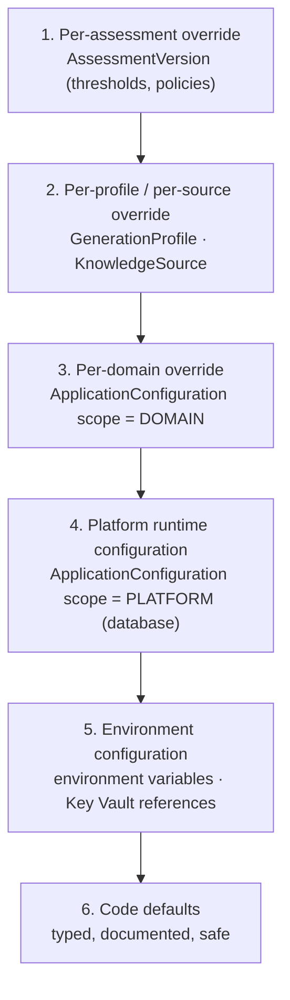

# Environments and Configuration

**What this document adds:** the environment definitions, the configuration precedence model, the
feature-flag catalogue, promotion rules, and startup validation. Generation and coverage settings are
catalogued in [generation-governance.md §13](generation-governance.md#13-configuration-summary);
secret storage and rotation in [security.md §11](security.md#11-secrets-and-key-management);
deployment topology in [architecture.md §12](architecture.md#12-deployment-architecture).

---

## 1. Position

> **No configuration value is shared across environments, and no environment-specific value exists in
> code.** Development, test, and production differ only in data.

Two consequences shape everything below: every environment has its own Entra app registrations, its
own SharePoint site and Question Bank list, its own field-mapping profile, and its own Key Vault; and
the application must **refuse to start** rather than run with an incomplete or ambiguous configuration
(§9).

---

## 2. Environments

| Environment | Purpose | Knowledge source | Question Bank | Claude | Identity |
| --- | --- | --- | --- | --- | --- |
| `local` | Development on a laptop | **Mock adapter**, fixture tree | **Mock bank**, JSON fixtures | Optional; a stub returns recorded responses when no key is present | Dev Entra tenant, or a local stub issuer |
| `dev` | Shared integration | Real SharePoint dev site | Real dev list, **writes off by default** | Real, low budget | Dev app registrations |
| `test` | Verification and UAT | Real SharePoint test site | Real test list, writes on | Real, production-shaped budget | Test app registrations |
| `prod` | Production | Real SharePoint production sites | Real production list, writes on | Real | Production app registrations |

| # | Rule |
| --- | --- |
| V1 | `local` runs the **entire** pipeline with **no tenant credentials at all**. This is a design requirement, not a convenience ([knowledge-source-adapters.md §6](knowledge-source-adapters.md#6-mock-adapter)) |
| V2 | The mock adapter and mock bank are **never registered** outside `local`; a startup assertion fails the process if they are |
| V3 | `dev` ships with `sharepoint.write.enabled = false`, so the publish flow runs in dry-run mode until someone deliberately enables it |
| V4 | No environment reads another environment's Key Vault, database, or SharePoint site. There is no "shared dev secret" |
| V5 | Production data is never copied to a lower environment. Migration rehearsal uses a structurally-equivalent synthetic dataset |
| V6 | `KNOWZY_ENV` is required, is one of the four values, and is stamped on every telemetry span, log line, and audit event, so a record's origin is never ambiguous |

---

## 3. Configuration layers

Six layers, highest precedence first. A value resolved at a higher layer wins outright; there is no
merging of scalars.



| Layer | Changed by | Takes effect | Audited |
| --- | --- | --- | --- |
| 1 Assessment | `assessment.manage`, in the builder | On the next version publish | `AUTHORING.ASSESSMENT.VERSION_UPDATED` |
| 2 Profile / source | `platform.configure` / `source.manage` | Next use | `AUTHORING.PROFILE.UPDATED` / `ADMIN.SOURCE.UPDATED` |
| 3 Domain | `platform.configure` | Immediately (cache invalidated by `updatedAt`) | `ADMIN.CONFIGURATION.UPDATED` |
| 4 Platform | `platform.configure` | Immediately | `ADMIN.CONFIGURATION.UPDATED` |
| 5 Environment | Deployment | On restart | Deployment record |
| 6 Code default | Release | On restart | Release notes |

### 3.1 Which layer owns what

| Category | Layer | Why |
| --- | --- | --- |
| Connection topology: database, Key Vault, Blob, MCP endpoint, Entra tenant and client IDs, `KNOWZY_ENV` | **5 only** | Infrastructure identity must not be mutable at runtime by an administrator |
| Secret **references** | **5 only** | The reference is environment-shaped; the value never leaves Key Vault |
| Model IDs, budgets, timeouts, rate limits | 4, overridable at 2 | Operationally tunable without a release; a model change is a configuration decision with an audit record |
| Thresholds: duplicate, coverage, proficiency, gap, minimum group size | 4, overridable at 3, 2, or 1 as documented | Governance values a tenant owns |
| Feature flags | 5 for the environment ceiling, 4 for the runtime switch | §6 |
| Retention periods | 4 | Tenant policy |
| Field-mapping profile selection | 5 (which list) + 4 (which profile) | The list is infrastructure; the profile is governance |
| UI copy, locale default | 4 | Product content |

### 3.2 Rules

| # | Rule |
| --- | --- |
| P1 | Every configuration key is declared once in `@knowzy/configuration` with its type, default, permitted layers, and a one-line description. An undeclared key cannot be read |
| P2 | Access is typed (`config.get('duplicate.blockThreshold')` returns `number`), validated on read, and range-checked. A malformed database value falls back to the code default **and raises a platform finding** — it never crashes a request and never silently uses a nonsense value |
| P3 | `process.env` is read only inside `@knowzy/configuration` ([repository-structure.md §5.2](repository-structure.md#52-content-rules) C3) |
| P4 | No code default points at a real tenant, site, list, or credential. Defaults are safe-and-inert: mock adapter, writes off, empty allow-lists |
| P5 | Every change at layers 1–4 records previous and new value ([audit-model.md §2.1](audit-model.md#21-admin--9-families)) |
| P6 | Configuration is cached in process keyed by the row's `updatedAt`; a change invalidates immediately across all instances on their next read ([error-handling.md §9](error-handling.md#9-caching-rules) A8) |
| P7 | A value that would change the meaning of historical data is **copied onto the record** rather than resolved later: proficiency thresholds onto `AssessmentResult`, model and prompt version onto every question, mapping profile onto every publish operation |
| P8 | The Settings screen shows, for every value, the layer it resolved from and the value each lower layer would have given. "Why is this 0.92?" is answerable without reading code |

---

## 4. Environment variable contract

Declared, validated at startup, and documented in `.env.example` with inert placeholder values.

| Variable | Deployables | Notes |
| --- | --- | --- |
| `KNOWZY_ENV` | all | `local` \| `dev` \| `test` \| `prod` |
| `DATABASE_URL` | api, mcp, jobs | Managed identity in deployed environments; password only in `local` |
| `KEY_VAULT_URI` | api, mcp, jobs | Absent in `local` |
| `BLOB_ACCOUNT_URL`, `BLOB_CONTAINER` | api, jobs | Certificates and exports |
| `MCP_ENDPOINT` | api, jobs | Internal URL; `stdio` in `local` |
| `ENTRA_TENANT_ID` | all | |
| `ENTRA_API_CLIENT_ID`, `ENTRA_API_AUDIENCE` | api, mcp | |
| `ENTRA_AUTHORING_CLIENT_ID` | authoring-web | Public value |
| `ENTRA_LIVE_CLIENT_ID` | live-web | Public value |
| `ANTHROPIC_API_KEY_REF` | api, jobs | A **Key Vault reference**, never a key |
| `GRAPH_CREDENTIAL_REF` | **mcp only** | The API's identity cannot read it |
| `ENVELOPE_SIGNING_KEY_REF` | api (sign), mcp (verify) | |
| `CERTIFICATE_SIGNING_KEY_REF` | jobs | |
| `OTEL_EXPORTER_OTLP_ENDPOINT`, `OTEL_SERVICE_NAME` | all | Distinct service name per deployable |
| `PUBLIC_API_BASE_URL` | web apps | The only API value a browser receives |
| `MOCK_FIXTURE_ROOT`, `MOCK_FAULTS` | local only | Startup fails if set outside `local` |

Rules: the web apps receive **only** `PUBLIC_*`, the Entra client ID, and `KNOWZY_ENV` — every other
variable is server-side. A variable prefixed `PUBLIC_` is treated as world-readable, and a secret
reference can never carry that prefix (checked at startup).

---

## 5. Secrets

Storage, rotation, and redaction are specified in
[security.md §11](security.md#11-secrets-and-key-management). The configuration-layer rules:

| # | Rule |
| --- | --- |
| S1 | Configuration stores **references** (`keyvault://{vault}/secrets/{name}`), resolved server-side at call time and cached in memory only, for a bounded TTL |
| S2 | `ApplicationConfiguration.isSecretRef` marks such rows; the API never returns their value, and the editor renders "configured / not configured" plus "replace secret" |
| S3 | Resolution failure yields `SOURCE_NOT_CONFIGURED` / `CONFIGURATION` and a `FAILED` status — never a fabricated success, never a fall-back to another environment's credential |
| S4 | `local` uses a git-ignored `.env` validated by a pre-commit secret scanner; local defaults point at the mock adapter so the file need contain no real credential |
| S5 | Each deployable's managed identity can read only the secrets it needs (least privilege per §4's deployable column) |

---

## 6. Feature flags

Database-backed (`FeatureFlag`), resolved server-side, with an **environment ceiling**: a flag cannot
be enabled at runtime above what the environment permits. This is what prevents an administrator in
`dev` from enabling production writes, and prevents a mis-set database row from turning on something
the environment was never provisioned for.

```
effective(flag) = environmentCeiling(flag, KNOWZY_ENV) AND runtimeSwitch(flag)
```

### 6.1 Catalogue

| Flag | Default | Ceiling | Effect when off |
| --- | --- | --- | --- |
| `sharepoint.write.enabled` | **off** | `dev` off, `test`/`prod` on | Publishing and retirement run in **dry-run** mode and the UI says so prominently ([authoring-portal.md §6](authoring-portal.md#6-question-bank-and-publishing-screens)) |
| `generation.enabled` | on | all | Generation form disabled with an explanation; existing drafts unaffected |
| `generation.objectiveDriven.required` | off | all | Objective-driven generation is available but not mandatory ([generation-governance.md §8](generation-governance.md#8-learning-objective-driven-generation)) |
| `duplicate.claudeAdjudication.enabled` | on | all | Flag-band items show scores without an advisory verdict |
| `refresher.claudeSummary.enabled` | on | all | Refreshers show the approved explanation and citations only, with no generated summary |
| `refresher.enterpriseSearch.enabled` | on | all | No source search; approved explanation only, with the honest no-resource statement |
| `assessment.practiceMode.enabled` | **off** | `local`/`dev` only | The reserved `PRACTICE` session mode is unreachable |
| `recognition.badges.enabled` | on | all | No new awards; existing badges remain visible |
| `recognition.certificates.enabled` | on | all | No new issuance; existing certificates remain downloadable and verifiable |
| `certificate.verification.public` | on | all | The public verification endpoint returns `NOT_FOUND` for every code, and the UI stops offering the URL |
| `reporting.publication.enabled` | on | all | Reports run and export; publication lifecycle is unavailable |
| `reporting.scheduled.enabled` | **off** | none (not implemented) | The `ReportSchedule` shape exists and is inert ([reporting.md §9](reporting.md#9-scheduled-reporting-future)) |
| `access.requireTwoPersonAdminGrant` | off | all | A single administrator may grant administration ([access-control.md §7.2](access-control.md#72-administration-rules) A1) |
| `approval.breakGlass.enabled` | **off** | all | Separation-of-duties refusals cannot be overridden |
| `source.liveSearch.enabled` | on | all | Indexed search only, labelled as such |
| `notifications.email.enabled` | **off** | none (not implemented) | In-app delivery only |
| `semantic.duplicateDetection.enabled` | **off** | none (not implemented) | Lexical detection only; the `vector` column stays unused |

### 6.2 Rules

| # | Rule |
| --- | --- |
| F1 | Every flag is declared with its default, ceiling, owner, and **the user-visible consequence of being off**. A flag whose off-state behaviour is undefined is not permitted |
| F2 | Off-state behaviour is a designed state, not a crash or an empty screen. Each row above names it |
| F3 | Flags gate **capability**, never authorization. A flag can disable publishing for everyone; it can never grant a permission ([access-control.md §4.3](access-control.md#43-enforcement-invariants)) |
| F4 | Flags are resolved server-side. A browser receives only the resolved boolean for flags it needs to render, never the flag table |
| F5 | Toggles are audited (`ADMIN.FEATUREFLAG.*`) and take effect immediately via the `updatedAt` cache key |
| F6 | Flags for unimplemented features have ceiling `none` and cannot be enabled anywhere. The row exists so the roadmap is visible and the schema is stable |
| F7 | Flags are reviewed each release. A flag that has been on everywhere for two releases is removed and its code path becomes unconditional; permanent flags are configuration and belong in §3 |
| F8 | `rolloutRule` supports a percentage or an explicit user list, evaluated server-side, used only for progressive rollout — never for entitlement |

---

## 7. Promotion

`local → dev → test → prod`. **Artifacts** are promoted by digest; **configuration** is not.

| Promoted | Not promoted |
| --- | --- |
| Container image digests | Any environment variable |
| Prisma migrations | Any Key Vault secret or reference |
| Seed definitions (roles, permissions, default profiles, badge definitions) | Any `ApplicationConfiguration` row |
| Report and badge definition **shapes** | Field-mapping profiles (per list, never shared) |
| Prompt versions | Feature-flag runtime switches |

| # | Rule |
| --- | --- |
| R1 | The same image digest that passed CI runs in every environment; nothing is rebuilt per environment ([repository-structure.md §8](repository-structure.md#8-ci-pipeline)) |
| R2 | Migrations run before the application starts, once per environment, forward-only, rehearsed against a synthetic copy in `test` first |
| R3 | A configuration change is promoted by **re-applying it deliberately** in the target environment, audited there. Copying rows between environments is prohibited: it is how a dev site URL reaches production |
| R4 | Each environment's Question Bank verification (§9.1 of [sharepoint-question-bank.md](sharepoint-question-bank.md#91-verification-before-first-write)) must pass in that environment before `sharepoint.write.enabled` is turned on |
| R5 | Rollback is by redeploying the previous digest. A migration that cannot be rolled back forward-only is flagged in review and requires a documented recovery procedure before merge |
| R6 | Prompt versions are immutable, so promoting a prompt is inserting a row; a rollback is pointing the profile at the earlier version, which is auditable |

---

## 8. Local development

| Aspect | Design |
| --- | --- |
| Topology | Docker Compose: `postgres`, `api`, `mcp`, `jobs`, `authoring-web`, `live-web`, optional `mailpit` ([architecture.md §12.2](architecture.md#122-local-development-topology-docker-compose)) |
| Zero-credential start | `docker compose up` plus `npm run seed` yields a working platform on mock fixtures. No tenant value, no Key Vault, no Anthropic key required |
| Claude | With `ANTHROPIC_API_KEY_REF` absent, `claude-services` uses a recorded-response stub keyed by prompt version and input hash, so generation is exercisable and deterministic offline |
| Identity | A local stub issuer mints tokens for seeded users covering every role, so authorization paths are exercisable without a tenant |
| Fault injection | `MOCK_FAULTS` injects throttling, timeouts, 403s, extraction failures, and delta-token invalidation at chosen fixture items |
| Reset | `npm run reset` drops and re-seeds, including fixture bank state, in under a minute |
| Optional real source | A developer with dev-tenant credentials sets `KNOWZY_ENV=dev` and the real source configuration; the mock remains available side by side as a separate source row |

---

## 9. Startup validation

The application validates configuration **before accepting traffic** and exits non-zero on failure.
Starting degraded is worse than not starting: a platform that runs with writes pointed at the wrong
list is a data-integrity incident, and one that runs with a mock adapter in production is a
correctness incident.

| # | Check | On failure |
| --- | --- | --- |
| 1 | `KNOWZY_ENV` present and valid | **Exit** |
| 2 | Every required variable for this deployable present and well-formed | **Exit**, naming every missing variable at once |
| 3 | No `PUBLIC_*` variable holds a secret-shaped value | **Exit** |
| 4 | Mock adapter / mock bank not registered outside `local`; `MOCK_*` variables unset outside `local` | **Exit** |
| 5 | Database reachable and at the expected migration version | **Exit** |
| 6 | Key Vault reachable and every declared secret reference resolvable | **Exit** (except `local`) |
| 7 | MCP endpoint reachable and its tool registry version compatible | Readiness **not ready**; liveness healthy; retry with backoff |
| 8 | Entra JWKS reachable | Readiness not ready; retry |
| 9 | Every declared configuration key resolvable and within range | **Exit** on a malformed declaration; platform finding on a bad database value (P2) |
| 10 | Every feature flag's runtime switch within its environment ceiling | Flag forced off, platform finding raised, startup continues |
| 11 | Question Bank target resolvable **and** its field-mapping profile complete, when `sharepoint.write.enabled` is on | Flag forced off, high-severity notification, startup continues |
| 12 | Blob container reachable and writable | Readiness not ready for `jobs`; the API starts (certificate download degrades per [error-handling.md §5.2](error-handling.md#52-degradation-stated)) |

Checks 1–6 and 9 are **fail-fast**. Checks 7, 8, and 12 are dependency checks that gate readiness
rather than liveness, so a transient dependency outage does not crash-loop the platform. Checks 10 and
11 deliberately degrade to the safe state — flag off — rather than blocking a release, because the
safe state for a write flag is off.
