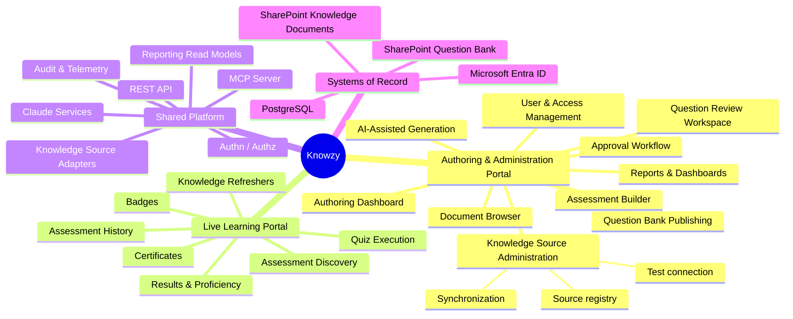

# Executive Summary, Business Goals, and Functional Scope

## 1. Executive summary

Knowzy is an AI-powered knowledge proficiency platform that converts existing enterprise knowledge —
SOPs, runbooks, knowledge articles, training decks, process documents — into **approved, reusable
assessments**, then uses those assessments to measure proficiency, expose knowledge gaps, and drive
targeted remediation.

The platform's core claim is not "AI writes quizzes." It is that **AI removes the typing, and the
organization keeps the judgement.** Claude drafts questions strictly from retrieved source content;
authors and subject matter experts review; an authorized approver approves; a publisher publishes.
Only then does a question exist in the reusable Question Bank, and only from that bank do learners
ever see a question.

### The shape of the solution

Two independently deployable web applications share one governed backend:

- **Authoring and Administration Portal** — knowledge-source administration, document browsing,
  AI-assisted generation, review, approval, publishing, assessment building, user and role
  administration, reports and dashboards.
- **Live Learning Portal** — assessment discovery, quiz execution, results, proficiency, knowledge
  refreshers, badges, certificates.

Behind them: a Node.js/TypeScript REST API, a Model Context Protocol (MCP) server that fronts all
knowledge-source and Question Bank access, a knowledge-source adapter framework (SharePoint first),
Claude called server-side only, PostgreSQL via Prisma for workflow and learning data, and a
**SharePoint List — "Knowzy Question Bank" — as the authoritative store for approved and published
questions** (Option A, confirmed).

### Why the Question Bank lives in SharePoint

Option A places approved question content where the enterprise already governs content: SharePoint.
That yields native versioning, native permissions, native retention and eDiscovery, and a repository
that survives the application. Knowzy keeps a durable internal reference (list item ID, ETag,
version) for every published record so the platform can reconcile, retry, and audit without ever
treating the browser or the model as a source of truth.

Trade-offs are explicit: SharePoint list querying is weaker than SQL, throttling is real, and
filtering requires indexed columns. The design absorbs all three through a read-through cache, a
published-question projection in PostgreSQL for reporting, and mandatory column indexing. See
[ADR-002](risks-and-decisions.md#adr-002-option-a--sharepoint-list-as-the-question-bank-of-record).

### What "done" looks like for the first release

An administrator registers a SharePoint site, library, and folder path through the UI (never through
code). The connection is tested and reported honestly. An author browses that folder, picks a
document, and generates draft questions that each carry a verbatim evidence span from the document. A
reviewer approves. A publisher publishes to the Knowzy Question Bank. A support engineer takes a
short assessment in the Live Portal, is scored by backend code, sees a weak topic, and receives a
grounded refresher citing a real, permission-checked SharePoint document. The authoring dashboard
shows the result. That slice is specified in
[initial-end-to-end-proof.md](initial-end-to-end-proof.md).

---

## 2. Business goals

### 2.1 Primary goals

| # | Goal | Measure of success |
| --- | --- | --- |
| G1 | Cut manual quiz-authoring effort | ≥70% reduction in author minutes per approved question versus manual authoring baseline |
| G2 | Keep human accountability | 100% of published questions carry a named approver and an audited approval transition |
| G3 | Guarantee source grounding | 100% of published questions carry a resolvable source document reference and a verified evidence span |
| G4 | Measure proficiency, not completion | Domain and topic-level proficiency available for every completed assessment |
| G5 | Close gaps, not just report them | Every failed or weak topic produces a grounded, permission-respecting refresher recommendation |
| G6 | Make knowledge reusable | Approved questions are reused across assessments; zero regeneration at quiz time |
| G7 | Satisfy enterprise governance | Full audit trail, role separation, data scoping, and exportable evidence for audit review |
| G8 | Stay source-agnostic | A second knowledge source type is added by implementing one adapter, with no change to generation, review, approval, publishing, assessment, scoring, badge, certificate, or reporting logic |

### 2.2 Secondary goals

- Reduce time-to-competence for new support engineers.
- Give managers a defensible view of team readiness by domain.
- Surface systemic documentation weaknesses (topics everyone fails are often documentation problems,
  not people problems).
- Create a recognition layer (badges, certificates) that is verifiable rather than decorative.

### 2.3 Explicit non-goals for the first release

| Not in scope | Rationale |
| --- | --- |
| Authoring content in Knowzy | Knowzy assesses knowledge; it does not become a document authoring tool |
| Replacing the corporate LMS | Knowzy is a proficiency layer; LMS interoperability is a later consideration |
| Proctoring, lockdown browser, identity verification beyond SSO | Disproportionate for internal proficiency measurement |
| Question types beyond four-option multiple choice | Deliberate scope control; the model and schema are designed for extension |
| Learner-visible leaderboards or peer comparison | Cultural and privacy risk; aggregate reporting only |
| Real-time collaborative editing of questions | Optimistic concurrency with version history is sufficient |
| Self-service tenant onboarding / multi-tenancy | Single-tenant enterprise deployment |

---

## 3. Functional scope

### 3.1 Scope map

### 3.2 In scope — Authoring and Administration Portal

| Module | Capability summary | Detail |
| --- | --- | --- |
| Authoring Dashboard | Source health, pipeline counts by lifecycle state, generation jobs, revalidation queue, turnaround metrics, 13 quick actions | [authoring-portal.md](authoring-portal.md#2-authoring-dashboard) |
| Knowledge Source Administration | Create/edit/activate/deactivate/archive sources, configure paths, per-purpose enablement, role/domain/team/function restriction, test connection, sync scheduling and history | [knowledge-source-administration.md](knowledge-source-administration.md) |
| Document Browser | Browse sites/libraries/folders, search, filter, single and multi-select, metadata and extraction/indexing status, permission view, start generation | [knowledge-source-administration.md](knowledge-source-administration.md#7-document-browser) |
| AI-Assisted Generation | Generation profiles, grounded retrieval via MCP, extraction and segmentation, Claude drafting, schema validation, evidence verification, duplicate detection, draft storage | [workflows.md](workflows.md#2-question-generation-workflow) |
| Question Review | Side-by-side evidence comparison, inline edit, comments, keyboard-driven queue, restricted bulk operations, version history | [authoring-portal.md](authoring-portal.md#5-question-review-workspace) |
| Approval Workflow | Ten-state lifecycle, mandatory comments on reject/change-request, separation of duties, full audit | [workflows.md](workflows.md#3-question-review-and-approval-workflow) |
| Publishing | Server-side, Publisher-gated, idempotent publish to the Knowzy Question Bank; versioning; retirement; reconciliation | [workflows.md](workflows.md#4-question-publishing-workflow) |
| Assessment Builder | Assessment definition, four selection strategies, thresholds, attempt and retake policy, availability window, badge and certificate rules, versioned publishing | [workflows.md](workflows.md#5-assessment-publishing-workflow) |
| User & Access Management | User search, role assignment/revocation, portal/domain/team/source restriction, access history, authentication activity, permitted exports | [access-control.md](access-control.md#7-user-and-access-administration) |
| Reports & Dashboards | Authoring, source, assessment, proficiency, and recognition reports; saved definitions and views; CSV/Excel/PDF export; governed publication | [reporting.md](reporting.md) |

### 3.3 In scope — Live Learning Portal

| Module | Capability summary | Detail |
| --- | --- | --- |
| Assessment Discovery | Browse and filter published assessments by domain; view description, question count, pass criteria, attempt policy | [live-learning-portal.md](live-learning-portal.md#3-assessment-discovery) |
| Quiz Execution | Eligibility check, server-side question selection and snapshot, one question at a time, per-answer server persistence, refresh-safe resume, duplicate-submission prevention | [live-learning-portal.md](live-learning-portal.md#4-quiz-execution) |
| Scoring | Deterministic backend scoring, documented rounding, configurable proficiency bands, topic accuracy, gap identification | [live-learning-portal.md](live-learning-portal.md#5-scoring-and-proficiency) |
| Results & History | Score, pass/fail, proficiency, topic breakdown, gaps, attempt history | [live-learning-portal.md](live-learning-portal.md#6-results-experience) |
| Knowledge Refreshers | Weak-topic analysis, approved explanations, permission-aware MCP knowledge search, grounded Claude summary, citations, recommendation history, honest no-source fallback | [workflows.md](workflows.md#7-knowledge-refresher-workflow) |
| Badges & Certificates | Deterministic badge rules, badge wall, server-generated verifiable PDF certificates, revocation | [badges-and-certificates.md](badges-and-certificates.md) |

### 3.4 In scope — platform capabilities

- Microsoft Entra ID authentication (OIDC authorization code + PKCE) for both portals.
- Server-side RBAC with domain, team, and source-level data scoping.
- MCP server exposing 36 typed tools across source administration, SharePoint navigation, authoring,
  Question Bank, learning, assessment, and reporting.
- Knowledge-source adapter framework with SharePoint and Mock implementations plus six documented
  extension templates.
- Microsoft Graph integration for SharePoint sites, drives, items, content, and permissions.
- Claude integration for drafting and summarizing only, server-side, with grounded, delimited,
  untrusted-content framing and schema-validated output.
- Audit event store covering 28 auditable action families.
- Reporting read models with data-level authorization and minimum-group-size suppression.
- Containerized deployment (Docker / Docker Compose local, Azure Container Apps target) with
  environment-based configuration, Azure Key Vault secrets, and OpenTelemetry telemetry.

### 3.5 Future-ready, designed but not built in release 1

| Capability | Design provision |
| --- | --- |
| Additional question types (multi-select, true/false, scenario, short answer) | `QuestionType` enum, discriminated-union answer schema, and pluggable scorers — [data-model.md](data-model.md#7-question-type-extensibility) |
| Additional source types (Confluence, ServiceNow, SQL, REST, Azure Blob, file repository) | Adapter templates and source registry — [knowledge-source-adapters.md](knowledge-source-adapters.md#7-extension-templates) |
| Scheduled report delivery | `ReportSchedule` shape and job-runner hook — [reporting.md](reporting.md#9-scheduled-reporting-future) |
| Semantic duplicate detection | pgvector column reserved; lexical detection ships first — [workflows.md](workflows.md#26-duplicate-and-similarity-detection) |
| Certificate expiry and recertification campaigns | Expiry and revocation fields present from day one — [badges-and-certificates.md](badges-and-certificates.md) |
| Learner-facing practice mode (unscored) | Quiz session `mode` discriminator reserved |

### 3.6 Out of scope

Anything in §2.3, plus: offline quiz taking, mobile native applications (the web applications are
responsive), automatic translation of questions, and automatic retirement of approved questions on
source change (explicitly prohibited — the platform flags for revalidation, a human decides).

---

## 4. Stakeholders and primary jobs to be done

| Stakeholder | Primary job | Portal |
| --- | --- | --- |
| Platform Administrator | Keep the platform configured, governed, and healthy | Authoring |
| Knowledge Source Administrator | Keep source paths accurate and connections healthy | Authoring |
| Quiz Author | Turn a document into good draft questions quickly | Authoring |
| Subject Matter Expert | Confirm technical accuracy against the source | Authoring |
| Reviewer | Confirm quality, clarity, and grounding | Authoring |
| Approver | Accept accountability for release | Authoring |
| Publisher | Move approved content into the Question Bank safely | Authoring |
| Manager | Understand team readiness and risk | Authoring (reports) |
| Reporting User | Build and export governed reports | Authoring (reports) |
| Auditor | Reconstruct who did what, when, and on what evidence | Authoring (read-only) |
| Learner / Support Engineer | Prove and improve proficiency | Live |

---

## 5. Success criteria for the design foundation itself

This document set is complete when a delivery team can, without further architectural input:

1. Create the monorepo and package boundaries from [repository-structure.md](repository-structure.md).
2. Create the Prisma schema from [data-model.md](data-model.md).
3. Create the SharePoint list from [sharepoint-question-bank.md](sharepoint-question-bank.md).
4. Implement each MCP tool from [mcp-tools.md](mcp-tools.md).
5. Implement each workflow from [workflows.md](workflows.md).
6. Pass a security review against [security.md](security.md).
7. Know exactly which tenant values are still missing, from
   [assumptions-and-tenant-configuration.md](assumptions-and-tenant-configuration.md).
