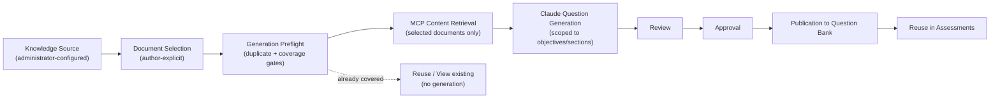
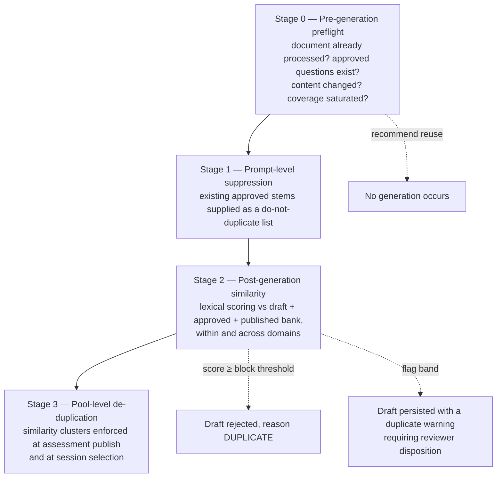
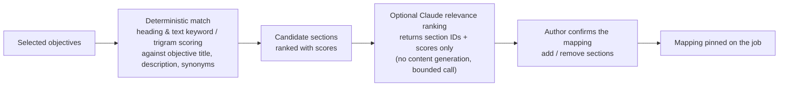

# AI Quiz Generation Governance

Authoritative design for intentional document selection, generation tracking, duplicate prevention,
change detection, delta generation, coverage tracking, objective-driven generation, source
traceability, question reuse, and generation history.

This document governs [workflows.md §2](workflows.md#2-question-generation-workflow). Where the two
differ, this document wins.

---

## 1. Strategic principle

> **Generate once → review → approve → publish → reuse.**
> Never *generate repeatedly → create duplicates → increase review effort*.

New generation is justified only when one of four conditions holds:

| # | Justification | Reason code |
| --- | --- | --- |
| 1 | New knowledge exists (a document not yet processed) | `NEW_KNOWLEDGE` |
| 2 | Existing knowledge changed (version + hash both indicate content change) | `CONTENT_CHANGED` |
| 3 | A coverage gap is identified (sections or objectives not covered) | `COVERAGE_GAP` |
| 4 | A new learning objective is introduced | `NEW_OBJECTIVE` |
| 5 | A publisher explicitly requests regeneration | `PUBLISHER_REQUESTED` |

Every `GenerationJob` records the justification reason code. A job cannot be created without one.
`PUBLISHER_REQUESTED` additionally requires the `Publisher` role and a free-text justification, and
is audited as `AUTHORING.GENERATION.REGENERATION_REQUESTED`.

### 1.1 Hard prohibitions

| Prohibited | Enforcement |
| --- | --- |
| Exposing all available SharePoint content to Claude by default | Claude receives only chunks belonging to documents in `GenerationJobDocument`, filtered to the selected generation scope. There is no code path that enumerates a library into a prompt. |
| Automatically generating questions from an entire library | No job can be created without an explicit document ID list. The API rejects `documentIds: []` and rejects wildcard or path-based selectors with `GENERATION_SELECTION_REQUIRED`. |
| Automatically scanning and processing all documents during generation | Synchronization indexes; generation consumes the index for **selected** documents only. The generation service has no listing capability. |
| Automatic regeneration | Regeneration is always an explicit human action with a reason code. Nothing in the scheduler, sync pipeline, or revalidation flow can trigger generation. |
| Silent duplicate creation | Post-generation duplicate gates run before any draft is persisted. |

**Structural guarantee.** `GenerationService.run()` accepts a `ResolvedGenerationScope` value object
that can only be constructed from an explicit, non-empty document ID list plus a scope selector. The
service has no injected adapter capable of listing documents, so "generate from everything" is not
expressible in the type system, not merely discouraged by policy.

---

## 2. Source document selection model



### 2.1 Author capabilities in selection

| Capability | Where | Notes |
| --- | --- | --- |
| Select an individual document | Document Browser row selection | |
| Select multiple documents | Checkbox multi-select, 1–10 per job (configurable cap) | Cap prevents unreviewable batches |
| Filter documents before generation | Domain, folder, file type, author, modified date, metadata, **coverage status**, **generation status** | Coverage and generation filters are new and central |
| Exclude documents | Explicit exclude action inside a selection, and a persistent per-path exclusion list | Excluded documents are never candidates; the exclusion is audited with a reason |
| View previously generated content | "Questions from this document" panel on document detail | Lists drafts, approved, published, retired with links |
| View document generation history | Document detail → History tab | All `GenerationJob` runs against the document |
| View document coverage information | Document detail → Coverage tab, and a coverage column in the listing | Section map with coverage status |

### 2.2 New Document Browser columns

Added to the listing defined in
[knowledge-source-administration.md §7](knowledge-source-administration.md#7-document-browser):

| Column | Values |
| --- | --- |
| Generation status | `NOT_PROCESSED`, `DRAFTS_PENDING`, `HAS_APPROVED`, `HAS_PUBLISHED`, `MODIFIED_SINCE_GENERATION`, `EXCLUDED` |
| Coverage | Percentage plus a five-segment bar (Not covered / Partial / Covered / Modified / Non-assessable) |
| Last generated | Timestamp + job link |
| Approved questions | Count |
| Published questions | Count |

Selecting a document with existing coverage does not block selection. It changes what the preflight
recommends, which is the point: the author stays in control, but the platform makes the cheap choice
the obvious one.

### 2.3 Document exclusion

A document can be excluded at two levels: **per job** (this selection only) and **persistently**
(`KnowledgeDocument.isExcludedFromGeneration = true`, with `exclusionReason` and actor). Typical
persistent exclusions: templates, meeting notes, org charts, legal notices, superseded documents.
Excluded documents are removed from generation pickers, are omitted from coverage denominators, and
appear in a dedicated "Excluded documents" report so exclusions stay visible rather than becoming
invisible policy.

---

## 3. Document generation tracking

One row per `KnowledgeDocument`, maintained transactionally as questions move through the lifecycle
(`DocumentGenerationStat` in [data-model.md](data-model.md#5-generation-governance-entities)).

| Field | Definition |
| --- | --- |
| Source Document ID | Provider-native item ID |
| Source Name | Owning `KnowledgeSource.name` |
| Source Path | Library + folder path |
| Source URL | `webUrl` |
| Document Name | Current file name |
| SharePoint Item ID | Graph `driveItem.id` (same as Source Document ID for SharePoint; kept as a distinct field so non-SharePoint adapters can differ) |
| SharePoint Version | SharePoint version label (e.g. `2.0`) plus `eTag` |
| Source Content Hash | SHA-256 of normalized extracted text |
| Last Generated Date | Most recent completed `GenerationJob` touching the document |
| Last Approved Question Date | Most recent approval of a question from the document |
| Total Draft Questions Generated | Lifetime count of drafts created from the document |
| Total Approved Questions | Current count in `APPROVED` or beyond |
| Total Published Questions | Current count with `IsPublished = true` |
| Coverage Percentage | §6.4 formula |
| Active Question Count | Published and `IsActive = true` |
| Retired Question Count | `RETIRED` |
| Generation status | Derived enum (§2.2) |
| Version at last generation | SharePoint version label captured when the last job ran |
| Hash at last generation | Content hash captured when the last job ran |

Counters are denormalized for dashboard performance and are recomputable from
`DraftQuestion` + `PublishedQuestionReference` by a nightly consistency job that reports drift rather
than silently correcting it.

---

## 4. Duplicate prevention

Four stages. Stages 0 and 1 prevent duplicates from being generated; stages 2 and 3 prevent them from
being persisted or from meeting in the same assessment.



### 4.1 Stage 0 — the six mandatory pre-generation checks

Run by `preflight_generation` (MCP) before any content reaches Claude. Each check returns a status and
evidence.

| # | Check | Implementation | Outcome |
| --- | --- | --- | --- |
| 1 | Was this document previously processed? | Any `GenerationJobDocument` row for the document | `NEVER_PROCESSED` / `PROCESSED` + job list |
| 2 | Do approved questions already exist for it? | `DocumentGenerationStat.totalApprovedQuestions > 0` | `NO_APPROVED` / `HAS_APPROVED` + count + links |
| 3 | Has source content changed since the last generation? | §5 dual test: version label **and** content hash | `UNCHANGED` / `CHANGED` / `UNKNOWN_BASELINE` |
| 4 | Question similarity risk | Existing stem set for the target sections/objectives; if saturated, warn | `LOW` / `MEDIUM` / `HIGH` |
| 5 | Duplicate questions across domains | Search the published bank for near-duplicate stems on the same source document regardless of domain | Cross-domain match list |
| 6 | Duplicates within the same assessment pool | If a target assessment is specified, check its pool for similarity clusters already represented | Pool conflict list |

### 4.2 Preflight outcomes and offered actions

When check 1 = `PROCESSED`, check 2 = `HAS_APPROVED`, and check 3 = `UNCHANGED`, the UI shows:

> **This document already contains approved quiz content.**
> 12 approved questions · 9 published · coverage 78% · last generated 12 Sep 2026 · document
> unchanged since then (version 1.0, hash match).

with exactly four actions:

| Action | Behaviour | Permission | Audit |
| --- | --- | --- | --- |
| **View Existing Questions** | Opens the filtered question list for the document. No generation. | `question.read` | `AUTHORING.GENERATION.PREFLIGHT_VIEW` |
| **Reuse Existing Questions** | Adds the approved/published questions to an assessment or a saved set. No generation. | `assessment.manage` or `question.read` | `AUTHORING.QUESTION.REUSED` |
| **Generate Additional Questions** | Creates a job scoped to `UNCOVERED_SECTIONS_ONLY` by default (author may widen), with stage-1 suppression active. Reason `COVERAGE_GAP` or `NEW_OBJECTIVE`. | `question.generate` | `AUTHORING.GENERATION.REQUESTED` |
| **Regenerate Questions** | Full regeneration over the document. Requires reason `PUBLISHER_REQUESTED` and the `Publisher` role, plus a written justification. Existing approved questions are **not** deleted or retired — the new drafts enter review alongside them, and the reviewer decides. | `question.regenerate` (Publisher) | `AUTHORING.GENERATION.REGENERATION_REQUESTED` |

**Nothing regenerates automatically.** The preflight has no "proceed anyway" default; the author must
choose. The chosen action, the preflight evidence, and the timestamp are persisted on
`GenerationPreflight` so the decision is auditable and so "regeneration avoided" is measurable (§10.2).

### 4.3 Stage 1 — prompt-level suppression

For the resolved scope, the platform retrieves existing question stems (question text only, plus the
correct-answer letter for internal comparison) for the target sections and objectives, caps the list
(default 100, most recent and highest-similarity-risk first), and supplies it to Claude as an explicit
**do-not-duplicate** list inside the untrusted-content framing, with the instruction that new
questions must test different facts, procedures, or decision points.

This is the cheapest duplicate control available: it prevents the duplicate from existing rather than
detecting it later. It does not replace stage 2.

### 4.4 Stage 2 — post-generation similarity scoring

Candidate blocking (to keep comparisons cheap) then composite scoring:

| Signal | Weight (default) | Implementation |
| --- | --- | --- |
| Stem trigram similarity | 0.45 | `pg_trgm similarity()` on normalized question text |
| Stem token Jaccard | 0.20 | Stopword-stripped, stemmed token sets |
| Option-set overlap | 0.20 | Jaccard over normalized option strings |
| Same source section | 0.10 | Boolean |
| Same correct-answer semantics | 0.05 | Normalized correct-option text equality |

Normalization: lowercase, Unicode NFKC, punctuation and extra whitespace collapsed, code spans
preserved, numbers preserved.

Comparison corpus: all drafts in the same job, all `DRAFT`/`AUTHOR_REVIEW`/`SUBMITTED_FOR_APPROVAL`
questions in the tenant, all `APPROVED` questions, and all published questions in the bank projection
— **across all domains**, satisfying check 5. A domain filter is applied to *ranking* (same-domain
matches are shown first) but never to *detection*.

| Composite score | Behaviour |
| --- | --- |
| `≥ blockThreshold` (default 0.92) | Draft is **not persisted**. Recorded on the job as rejected with reason `DUPLICATE` and a pointer to the matched question. |
| `≥ flagThreshold` (default 0.75) and `< blockThreshold` | Draft persisted with a `DUPLICATE_SUSPECTED` warning, the matched question, and the score. Approval is blocked until a reviewer dispositions it (`DISTINCT` with a note, or `DUPLICATE` → reject). |
| `< flagThreshold` | No action |

Both thresholds are per-tenant configuration and per-generation-profile overridable.

**Optional Claude adjudication** for the flag band only: Claude is asked whether two questions test
the same knowledge, returning a verdict plus rationale. The verdict is **advisory** — displayed to
the reviewer, never auto-deciding, never able to unblock approval on its own.

**Semantic detection (future).** A `pgvector` embedding column is reserved on the question model. When
an embedding provider is available, cosine similarity joins the composite with its own weight. Release
1 ships lexical detection only; this is stated plainly because lexical detection will miss paraphrases,
and the reviewer remains the backstop. See [risks-and-decisions.md R-07](risks-and-decisions.md#5-risk-register).

### 4.5 Stage 3 — assessment-pool de-duplication

Questions whose pairwise score exceeds `flagThreshold` are grouped into a `SimilarityCluster` (union
of flagged pairs, transitively closed). Then:

- **At assessment publish**, `FIXED_SET` configurations containing two members of one cluster are
  rejected with `POOL_DUPLICATE_CONFLICT` naming the pair.
- **At session selection**, random, topic-balanced, and distribution strategies select **at most one
  question per similarity cluster**. If this makes the pool insufficient, the shortfall is reported
  honestly (§ [workflows.md §6](workflows.md#6-live-quiz-execution-workflow)) rather than silently
  filled with a near-duplicate.
- **At reporting**, cluster size is a quality metric: large clusters mean over-generation on a topic.

---

## 5. Document change detection

Change is determined by **both** signals, never one:

```
versionChanged = current.sharePointVersionLabel != baseline.sharePointVersionLabel
                 OR current.eTag != baseline.eTag
hashChanged    = current.contentHash != baseline.contentHash

if  !versionChanged && !hashChanged  →  UNCHANGED
if   versionChanged && !hashChanged  →  METADATA_ONLY_CHANGE     (no regeneration warranted)
if  !versionChanged &&  hashChanged  →  CONTENT_CHANGED_UNVERSIONED  (investigate; treat as changed)
if   versionChanged &&  hashChanged  →  CONTENT_CHANGED          (regeneration may be warranted)
```

`baseline` is the version/hash captured on the last completed generation job for the document
(`DocumentGenerationStat.versionAtLastGeneration` / `hashAtLastGeneration`) — not the last sync, which
would make the comparison meaningless.

Using both signals matters in both directions: SharePoint increments versions for permission and
metadata edits (so version alone over-reports), and some edit paths can leave a version label
unchanged (so hash alone under-reports). `CONTENT_CHANGED_UNVERSIONED` is surfaced to administrators
as a data-integrity notice.

### 5.1 Worked examples

> **Example A — unchanged**
> `Production Runbook`, SharePoint version **1.0**, hash `a91c…`
> Questions generated: **yes** (12 approved). Baseline version 1.0, baseline hash `a91c…`
> → `UNCHANGED`. **No regeneration required.** Preflight shows "already contains approved quiz
> content" and the four actions in §4.2.

> **Example B — modified**
> `Production Runbook`, SharePoint version **2.0**, hash `77be…`
> Questions generated: **yes** (12 approved). Baseline version 1.0, baseline hash `a91c…`
> → `CONTENT_CHANGED`. Document modified. Offered actions:
> | Action | Behaviour |
> | --- | --- |
> | **Generate Delta Questions** | Job scoped to `MODIFIED_SECTIONS_ONLY` (optionally plus uncovered sections). Reason `CONTENT_CHANGED`. |
> | **Review Existing Questions** | Opens the revalidation queue for the document's questions, with the previous evidence span and the new text side by side. |
> | **Compare with Previous Version** | Section-level diff: added, modified, removed, unchanged sections, each annotated with the questions attached to it. |

> Both examples are illustrative. No real document or tenant value is asserted.

### 5.2 Relationship to revalidation

Change detection and revalidation are distinct and must not be conflated:

| Concern | Trigger | Consequence |
| --- | --- | --- |
| **Revalidation** ([knowledge-source-administration.md §6.4](knowledge-source-administration.md#64-revalidation-policy-specification-33-normative)) | Sync detects a hash change | Existing questions are **flagged** for human review. Nothing is retired or modified automatically. |
| **Delta generation** (this document) | Author or publisher acts on a detected change | **New** drafts are created from changed/uncovered sections only. |

A content change therefore produces two independent human decisions: "are the existing questions
still correct?" and "should new questions cover the new content?" Neither is automated.

---

## 6. Content coverage tracking

### 6.1 Section model

Extraction produces sections, not just chunks. A `DocumentSection` is the coverage unit.

| Field | Meaning |
| --- | --- |
| Section Identifier | Stable `sectionKey` = SHA-256 of (normalized heading path + ordinal within parent) |
| Page Number | PDF page; PPTX slide; XLSX sheet; DOCX/HTML/Page approximate page or `null` |
| Heading | Heading text, plus the full heading path for nested sections |
| Content Segment | Normalized text with start and end character offsets into the extracted document |
| Section content hash | SHA-256 of the section's normalized text |
| Question IDs Generated | All drafts generated from the section (any state) |
| Approved Questions | Count in `APPROVED` or beyond |
| Published Questions | Count with `IsPublished = true` |
| Coverage Status | `NOT_COVERED`, `PARTIALLY_COVERED`, `COVERED`, `MODIFIED`, `NON_ASSESSABLE` |
| Target question count | Computed capacity (§6.3) |
| `isAssessable` | Whether the section can carry assessable content |

For flat documents with no heading structure (plain text, some PDFs), sections fall back to
fixed-size windows with stable ordinals, and the UI labels them "Segment 3 of 14" rather than claiming
a heading that does not exist.

### 6.2 Non-assessable sections

Tables of contents, revision histories, approval tables, legal notices, glossaries of external terms,
and reference lists are auto-detected by heading and shape heuristics and marked `NON_ASSESSABLE`.
They are excluded from coverage denominators and from generation scope. Authors with
`document.section.manage` can flip the flag either way, with an audited reason. Without this, coverage
percentages are dominated by content nobody should be tested on.

### 6.3 Target question count per section

```
targetQuestions(section) =
    clamp( ceil(assessableChars(section) / charsPerQuestion),
           minPerSection,
           maxPerSection )
```

Defaults (all per generation profile): `charsPerQuestion = 1200`, `minPerSection = 1`,
`maxPerSection = 5`. Sections below `minAssessableChars` (default 300) are `NON_ASSESSABLE`.

| Coverage status | Rule |
| --- | --- |
| `NOT_COVERED` | `approvedQuestions == 0` |
| `PARTIALLY_COVERED` | `0 < approvedQuestions < targetQuestions` |
| `COVERED` | `approvedQuestions >= targetQuestions` |
| `MODIFIED` | Section content hash changed since the newest attached question was generated — overrides the above and is displayed as such |
| `NON_ASSESSABLE` | §6.2 |

Drafts pending review do **not** count toward coverage. Only approved questions do. Coverage measures
assessable knowledge actually released, not work in progress. Pending drafts appear as a separate
"in review" indicator on the section so authors do not double-generate while review is queued.

### 6.4 Coverage percentage

```
documentCoverage % =
      Σ over assessable sections  min(approvedQuestions_s , targetQuestions_s)
    ─────────────────────────────────────────────────────────────────────────── × 100
      Σ over assessable sections  targetQuestions_s
```

Rounded half-up to one decimal place. `min()` prevents an over-generated section from masking an
uncovered one — the metric cannot exceed 100 and cannot be gamed by piling questions onto one section.
A document with no assessable sections reports `N/A`, never 0% or 100%.

Source-level coverage aggregates the same numerator and denominator across all non-excluded,
`ACTIVE`, extracted documents in the source — not an average of document percentages, which would
over-weight short documents.

### 6.5 Coverage display

```
Production Runbook — coverage 63.5%        (illustrative example)
┌──────────────────────────────────────────────────────────────────────────────┐
│ §1  Incident intake             COVERED           3/3 approved   ✓          │
│ §2  Triage and escalation       COVERED           2/2 approved   ✓          │
│ §3  Batch failure recovery      PARTIALLY         1/3 approved   ◐  2 in rev│
│ §4  API timeout troubleshooting NOT_COVERED       0/4 approved   ○          │
│ §5  Revision history            NON_ASSESSABLE    —              –          │
│ §6  Rollback procedure          MODIFIED          2/2 approved   ! changed  │
└──────────────────────────────────────────────────────────────────────────────┘
[Generate for: ○ Entire document  ● Uncovered sections only  ○ Modified sections only]
```

### 6.6 Section lineage across document versions

On re-extraction, new sections are matched to previous ones in this order:

1. `sectionKey` identical → same section.
2. Section content hash identical → same section, moved (position updated, coverage retained).
3. Heading similarity ≥ 0.85 **and** content trigram similarity ≥ 0.60 → same section, `MODIFIED`.
4. Otherwise new → `NEW`, coverage 0.
5. Previous sections left unmatched → `REMOVED`; attached questions are flagged
   `SOURCE_SECTION_REMOVED` for human decision (never auto-retired).

Lineage is persisted (`DocumentSectionLineage`) so coverage history is continuous across document
versions and so "compare with previous version" can show exactly what moved.

### 6.7 Coverage drives generation

When a job's scope is `UNCOVERED_SECTIONS_ONLY` or `MODIFIED_SECTIONS_ONLY`, the resolver orders
candidate sections by priority and fills the requested question count in that order:

| Priority | Section state |
| --- | --- |
| 1 | `NOT_COVERED` |
| 2 | `MODIFIED` |
| 3 | `PARTIALLY_COVERED` (remaining capacity = target − approved) |
| 4 | `COVERED` — **only** when the scope is `ENTIRE_DOCUMENT` and the author explicitly confirms |

Fully covered sections are never used as filler. If the requested question count exceeds available
capacity in the permitted priorities, the job is created with the achievable count and the author is
told the exact shortfall and why, before submission.

---

## 7. Generation scope selection

Every job carries exactly one scope:

| Scope | Sections used | Typical reason code |
| --- | --- | --- |
| `ENTIRE_DOCUMENT` | All assessable sections, priority-ordered | `NEW_KNOWLEDGE`, `PUBLISHER_REQUESTED` |
| `MODIFIED_SECTIONS_ONLY` | Sections with lineage state `MODIFIED` or `NEW` since the baseline | `CONTENT_CHANGED` |
| `UNCOVERED_SECTIONS_ONLY` | `NOT_COVERED` and `PARTIALLY_COVERED` sections | `COVERAGE_GAP` |
| `OBJECTIVES` | Sections mapped to the selected learning objectives (§8) | `NEW_OBJECTIVE`, `COVERAGE_GAP` |
| `SELECTED_SECTIONS` | An explicit author-chosen section list | any, with justification |

The UI exposes the three scopes named in the specification — Entire Document, Modified Sections Only,
Uncovered Sections Only — plus objective-driven generation as the recommended default, and explicit
section selection for expert use. The resolved section ID list is persisted on the job, so the exact
input to a generation run is reproducible.

---

## 8. Learning-objective-driven generation

**This is the preferred generation method** and the default in the generation form. "Generate 25
questions from this document" is available but de-emphasized, because it samples content rather than
testing competence.

### 8.1 Objective catalogue

`LearningObjective` is managed taxonomy, not free text (free text is permitted but is captured as an
ad-hoc objective and flagged for curation):

| Field | Notes |
| --- | --- |
| Objective ID, title | e.g. "Recover a failed overnight batch job" |
| Domain, topic | Links to managed taxonomy |
| Description | What competence looks like |
| Target audience | Tier 1 / Tier 2 / New hire / etc. |
| Cognitive level | `RECALL`, `APPLICATION`, `ANALYSIS` — drives question style |
| Status | `ACTIVE`, `DEPRECATED` |
| Mapped sections | Resolved per document version (§8.2) |

Illustrative objective set for a support-operations domain: Incident Management · API Troubleshooting ·
Batch Processing · Recovery Procedures · Error Handling · Escalation Process.

### 8.2 Objective → section mapping



The deterministic layer always runs first and is sufficient on its own. Claude's optional ranking pass
may only **reorder and score** candidate section IDs; it cannot introduce a section that the
deterministic layer did not surface, and it cannot generate content in that call. The author confirms
the mapping before generation, and the confirmed mapping is pinned to the job for reproducibility.

When an objective maps to no section, the platform says so — "no content found in the selected
documents for objective X" — and refuses to generate for it. It never generates unsupported questions
to satisfy a requested count.

### 8.3 Per-objective generation and quotas

The author specifies domain, topic, learning objectives, and target audience; question counts are
allocated per objective (explicitly, or evenly with a documented remainder rule: remainders go to the
objectives with the largest uncovered capacity, then alphabetically by objective ID for determinism).
Claude is called **per objective** with only that objective's mapped section text, its cognitive
level, the audience, and the do-not-duplicate stem list for that objective. Consequences:

- Every question carries `learningObjectiveId`, so coverage is reportable by objective, not only by section.
- Question style matches the cognitive level (recall vs application vs analysis).
- Prompts stay small, which improves grounding and reduces cost.
- A failure on one objective does not fail the whole job.

### 8.4 Objective coverage matrix

Reported per domain and per assessment:

| Objective | Approved questions | Target | Coverage | Documents contributing | Last generated |
| --- | --- | --- | --- | --- | --- |
| Incident Management | 6 | 6 | 100% | 2 | 12 Sep 2026 |
| API Troubleshooting | 2 | 5 | 40% | 1 | 12 Sep 2026 |
| Batch Processing | 0 | 4 | 0% | 0 | — |

> Illustrative example. Objective targets are configured per objective (default derived from cognitive
> level: recall 3, application 4, analysis 5) and are the basis for objective-level coverage gaps,
> which are a first-class `COVERAGE_GAP` justification for new generation.

Assessment builders can require objective coverage: an assessment can be configured to draw a minimum
number of questions per objective, and publication is blocked when the objective pool is short —
consistent with the "never silently under-fill" rule in
[authoring-portal.md §7.2](authoring-portal.md#72-selection-strategy-configuration).

---

## 9. Question source traceability

Every generated question stores full lineage, persisted at generation time and immutable thereafter
(edits create new versions that carry the same lineage):

| Field | Source |
| --- | --- |
| Source Site | `KnowledgeDocument.containerSiteName` + `containerSiteId` |
| Source Library | `containerName` + `containerId` |
| Source Folder | `folderPath` |
| Source Document | `sourceDocumentId` + `name` |
| Source Version | SharePoint version label + `eTag` at generation time |
| Source URL | `webUrl` |
| Section Reference | `sectionKey`, heading path, page/slide/sheet, character offsets |
| Supporting Excerpt | Verified verbatim evidence span |
| Content Hash | Document hash **and** section hash at generation time |
| Generation Job ID | `GenerationJob.id` |
| Learning Objective | `learningObjectiveId` when objective-driven |
| Model + prompt version | `claude-sonnet-5` (example) + immutable prompt version |

### 9.1 "View Question Source"

Available from every draft, approved, and published question, for any user with `question.read` on
that question's domain. The panel shows the full lineage above, the evidence span highlighted within
the stored section text, a re-verification action (`get_source_evidence`) that re-checks the span
against the **current** document, and a permission-aware "Open in SharePoint" link. If the document
has since changed, the panel shows the previous and current text at that location with a diff, plus
the revalidation state — the reviewer sees the drift rather than a broken link.

If the source document has been deleted or is inaccessible to the caller, the panel says so plainly
and still shows the stored lineage and excerpt, which is exactly what an auditor needs. No lineage
field is ever fabricated or backfilled.

---

## 10. Question reuse strategy

### 10.1 Reuse rules

1. Approved, published questions are reusable learning assets held in the Knowzy Question Bank.
2. Assessments reference bank questions by QuestionID + published version. **Questions are never
   regenerated when a learner starts an assessment** — see
   [live-learning-portal.md §4.2](live-learning-portal.md#42-the-session-snapshot-is-authoritative).
3. Reuse is the default path; generation is the exception requiring a justification reason code.
4. Regeneration is permitted only when source content significantly changed, the question was retired,
   or a publisher explicitly requests it.
5. "Significantly changed" is defined mechanically: the document's state is `CONTENT_CHANGED` (§5)
   **and** at least one attached section's lineage state is `MODIFIED` or `NEW`.
   `METADATA_ONLY_CHANGE` never justifies regeneration.

### 10.2 Reuse and savings metrics

| Metric | Definition |
| --- | --- |
| Published questions | Count of bank questions with `IsPublished = true` |
| Reused questions | Published questions referenced by ≥1 published assessment version, or served in ≥1 quiz session |
| Reuse factor | Total session appearances ÷ published question count |
| Newly generated questions | Questions created in the reporting window |
| Duplicates blocked at generation | Stage-2 rejects with reason `DUPLICATE` |
| Duplicates flagged and dispositioned as duplicates | Flag-band items a reviewer rejected as duplicates |
| Regeneration avoided | Preflight decisions resolved as **View Existing** or **Reuse Existing** |
| Duplicate prevention savings (estimated) | `(duplicatesBlocked + duplicatesDispositioned + regenerationAvoided × avgQuestionsPerJob) × reviewMinutesPerQuestion` |

`reviewMinutesPerQuestion` is a configured constant (default 4). The savings figure is always labelled
**estimated** in the UI, with the constant shown, because presenting a modelled number as measured
fact would be dishonest. The component counts are exact and are reported alongside it.

---

## 11. Generation history repository

`GenerationJob` is the history record. Retained indefinitely by default (configurable), never deleted
by a document change or a source archive.

| Field | Notes |
| --- | --- |
| Generation Job ID | |
| Source document(s) | Via `GenerationJobDocument`, with per-document version and hash at run time |
| Source Version | Per document, captured at run time |
| Content Hash | Per document and per section, captured at run time |
| Generated question count | Accepted drafts |
| Approved question count | Live count of that job's questions now approved |
| Published question count | Live count now published |
| Rejected count by reason | `SCHEMA_INVALID`, `EVIDENCE_UNVERIFIED`, `DUPLICATE`, `INSUFFICIENT_EVIDENCE`, `OPTION_DUPLICATE`, `ANSWER_INVALID` |
| Generated by | Actor |
| Generated date | |
| Claude model | Configuration value in force at run time |
| Prompt version | Immutable prompt version |
| Scope, objectives, resolved section IDs | Full reproducible input |
| Justification reason code | §1 |
| Preflight result | Persisted `GenerationPreflight` snapshot |
| Token usage and duration | Cost and performance |
| Correlation ID | Links audit, telemetry, and MCP calls |

### 11.1 Author capabilities

| Capability | Design |
| --- | --- |
| **View history** | Per document, per source, per author, per domain; filterable by date, model, prompt version, outcome |
| **Compare generations** | Side-by-side of two jobs on the same document: scope, objectives, model, prompt version, accepted/rejected counts, and the resulting questions with their current states — making it visible when a prompt or model change improved or degraded yield |
| **See what content produced which questions** | Job → document → section → question drill-down, and the reverse from any question back to its section and excerpt (§9.1) |
| **Reuse previously generated question sets** | A job's accepted set can be saved as a named `QuestionSet` and added to assessments wholesale; the set references questions by ID + version, so reuse never copies content |

### 11.2 Yield analytics

Per prompt version and model: acceptance rate, approval rate, rejection reasons, average review time,
average edit distance between generated and approved text. This closes the loop on generation quality
— a prompt version whose questions are always heavily edited is a prompt problem, and the data says so.

---

## 12. Authoring Dashboard widgets

Added to [authoring-portal.md §2](authoring-portal.md#2-authoring-dashboard).

### 12.1 Knowledge Source Coverage

| Element | Definition |
| --- | --- |
| Total documents | `ACTIVE`, extracted, non-excluded documents in scope |
| Documents not processed | No `GenerationJobDocument` row |
| Documents with draft questions | ≥1 question in `GENERATED`…`CHANGES_REQUESTED` |
| Documents with approved questions | `totalApprovedQuestions > 0` |
| Documents requiring review | ≥1 question flagged `needsRevalidation`, or ≥1 section `MODIFIED` with attached questions |
| Documents modified since last generation | State `CONTENT_CHANGED` per §5 |
| Coverage percentage | Source-level aggregate per §6.4 |

Displayed per source and rolled up across the user's accessible sources, with drill-through to a
filtered Document Browser for every count.

### 12.2 Question Reuse Metrics

Published questions · reused questions · reuse factor · newly generated questions (window) ·
duplicate prevention savings (estimated, with component counts). Definitions in §10.2.

### 12.3 Generation Analytics

Generation requests · questions generated · questions approved · questions rejected (with reason
breakdown) · average review time (submitted → decided) · documents awaiting processing (not processed,
plus modified-since-last-generation).

All three widgets respect the caller's data scope and read from reporting read models, not
transactional joins. Corresponding reports are catalogued in
[reporting.md §4](reporting.md#4-report-catalogue).

---

## 13. Configuration summary

| Setting | Default | Scope |
| --- | --- | --- |
| `generation.maxDocumentsPerJob` | 10 | Platform |
| `generation.maxQuestionsPerJob` | 50 | Platform / profile |
| `coverage.charsPerQuestion` | 1200 | Profile |
| `coverage.minPerSection` / `maxPerSection` | 1 / 5 | Profile |
| `coverage.minAssessableChars` | 300 | Profile |
| `duplicate.flagThreshold` | 0.75 | Platform / profile |
| `duplicate.blockThreshold` | 0.92 | Platform / profile |
| `duplicate.suppressionStemLimit` | 100 | Profile |
| `duplicate.claudeAdjudication.enabled` | true | Platform |
| `objective.defaultTargets` | recall 3 / application 4 / analysis 5 | Platform |
| `reuse.reviewMinutesPerQuestion` | 4 | Platform |
| `generation.requireObjectives` | false (recommended true once the objective catalogue is populated) | Platform |
| `generation.allowCoveredSectionFill` | false | Profile |

---

## 14. MCP tools introduced by this design

Defined in [mcp-tools.md §9](mcp-tools.md#9-generation-governance-tools):
`preflight_generation` · `get_document_generation_history` · `get_document_coverage` ·
`compare_document_versions` · `get_generation_history` · `compare_generations` ·
`get_objective_coverage` · `resolve_objective_sections` · `get_reuse_metrics` ·
`save_question_set` · `get_question_set`.
