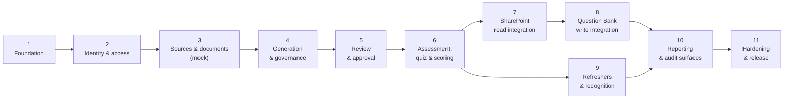

# Implementation Roadmap

**What this document adds:** the eleven delivery phases, their exit criteria, and the sequencing
constraints that make them ordered rather than arbitrary — plus, since 2026-09-29, one extension
workstream (§3a) that widens scope beyond the core path. It does not restate what each phase builds —
each phase names the document that specifies it.

The smallest end-to-end slice, which spans phases 1–6, is specified separately in
[initial-end-to-end-proof.md](initial-end-to-end-proof.md) and is the recommended first milestone.

---

## 1. Sequencing principles

| # | Principle | Consequence |
| --- | --- | --- |
| Z1 | **Prove the thin vertical slice before widening any layer.** | Phases 1–6 deliver one working path end to end. No phase builds a complete layer in isolation |
| Z2 | **Nothing requires tenant credentials until phase 7.** | The mock adapter carries phases 1–6, so integration work is never blocked on tenant provisioning (R-14) |
| Z3 | **Governance ships with the capability it governs, never after.** | Audit lands with the first state transition; policy lands with the first route; gates land with approval |
| Z4 | **Writes to SharePoint are last among the core path.** | `sharepoint.write.enabled` stays off until phase 8's verification passes |
| Z5 | **A phase exits on evidence, not on completion.** | Every exit criterion is observable — a passing test, a demonstrated flow, a produced artifact |
| Z6 | **Review throughput is treated as a feature, not a screen.** | Phase 5 exits on a measured review rate, because R-04 is the likeliest way this platform fails |

---

## 2. Phase overview

Phases 7 and 9 can run in parallel with each other once phase 6 is complete; everything else is
strictly ordered.

---

## 3. Phases

### Phase 1 — Foundation

**Builds:** monorepo, package boundaries, Prisma schema, migrations, seeds, configuration resolution,
observability and the redactor, the transactional audit writer, local Docker topology, CI pipeline.

**Specified by:** [repository-structure.md](repository-structure.md) ·
[data-model.md](data-model.md) · [environment-and-configuration.md](environment-and-configuration.md) ·
[audit-model.md §3](audit-model.md#3-record-shape)

| Exit criteria |
| --- |
| `docker compose up` plus seed yields a running platform with **no tenant credentials** |
| Every §5 boundary rule in `repository-structure.md` is enforced in CI and demonstrably fails on a planted violation |
| The full Prisma schema migrates forward from empty, including partitions, triggers, rules, partial indexes, and `CHECK` constraints |
| Startup validation exits non-zero on each fail-fast check (1–6, 9), verified by test |
| An audit event written in a transaction rolls back with its state change, verified by test |
| The redactor is proven against secret-shaped and content-shaped fixtures |
| Codegen diff (Zod → JSON Schema) is empty and CI-enforced |

---

### Phase 2 — Identity and access

> **Amended 2026-10-07 — Authoring Role Simplification** ([access-control.md §2.0](access-control.md#20-authoring-role-simplification-2026-10-07--read-this-first)).
> Two roles are active: the Authoring Administrator and the Learner. The specialist roles below are
> deactivated (migration 0017), and separation of duties is permitted-off by configuration. The
> Phase 2 exit criteria still hold for the mechanism — declared policies, database-resolved
> permissions, separation evaluated at approval — while the platform's own configuration no longer
> requires two people.

**Builds:** Entra OIDC for both portals, token validation, subject resolution and JIT provisioning,
the policy engine, `DataScope`, the role and permission catalogue, user administration, access history.

**Specified by:** [access-control.md](access-control.md) ·
[security.md §2–3](security.md#2-identity-and-authentication)

| Exit criteria |
| --- |
| Both portals authenticate against the dev tenant (or the local stub issuer) with separate app registrations and scopes |
| The policy registry test passes: **every** route has a declared policy, and a planted undeclared handler fails the build |
| A repository query cannot be constructed without a `DataScope`, enforced at type level |
| Scope resolution is proven for the empty-means-unrestricted rule, the `DENY`-wins rule, and the team closure depth cap |
| Denials are audited with policy name and reason |
| Effective-permission preview is demonstrated to call the same resolver the request path uses |
| Bootstrap administrator provisioning works once per environment and cannot re-grant afterwards |

---

### Phase 3 — Sources and documents (mock adapter)

**Builds:** source registry and editor, Test Connection, synchronization, extraction and sectioning,
the Document Browser, the mock adapter and its fixtures, the adapter conformance suite.

**Specified by:** [knowledge-source-administration.md](knowledge-source-administration.md) ·
[knowledge-source-adapters.md](knowledge-source-adapters.md)

| Exit criteria |
| --- |
| The **adapter conformance suite passes in full** against the mock adapter, including determinism, extraction invariants X1–X8, change detection, section lineage, permission, and fault injection |
| A fixture version switch (`v1` → `v2`) produces a content change; a metadata-only change produces `METADATA_ONLY_CHANGE` |
| Test Connection returns `FAILED` / `SOURCE_NOT_CONFIGURED` when credentials are absent — no fabricated success |
| `connectionStatus` is demonstrably settable **only** by an executed probe |
| Unsupported, empty, oversize, and encrypted fixtures produce their documented statuses with **no text returned** |
| A sync run with document failures completes `PARTIAL`, never `SUCCEEDED`, with retry scheduling |
| Revalidation flags are raised on hash change and **no approved question is altered** (ADR-013), verified by test |
| The Document Browser renders all five states and labels indexed vs live origin |

---

### Phase 4 — Generation and governance

**Builds:** generation profiles and prompt registry, preflight, scope resolution, coverage and section
tracking, Claude integration with untrusted framing, evidence verification, duplicate detection,
generation history and yield analytics.

**Specified by:** [generation-governance.md](generation-governance.md) ·
[workflows.md §2](workflows.md#2-question-generation-workflow) ·
[architecture.md §9](architecture.md#9-claude-integration-architecture)

| Exit criteria |
| --- |
| A job **cannot** be created without an explicit 1–10 document list, a reason code, and a valid preflight — each refusal verified by test |
| `GenerationService.run()` is demonstrably unable to list documents (no such dependency is injectable) |
| Evidence verification rejects a fabricated span, a span from an unrequested section, and an out-of-bounds span; `STRICT` cannot be disabled |
| `insufficientEvidence` is handled as a success and marks the section with its reason |
| Duplicate blocking, flagging, and cluster formation are proven at both thresholds, across domains |
| Coverage percentage matches the documented formula, including `min()` capping and the `N/A` case |
| Prompt versions are immutable, enforced at the database level |
| The prompt-injection canary assertion is in place and fires on a planted injection fixture |
| A generation run is fully reproducible from its persisted job record |
| Token and cost budgets terminate a job as `PARTIAL` with achieved counts |

---

### Phase 5 — Review and approval

**Builds:** review workspace, evidence panel, versioning and diffs, comments, the 13 gates, separation
of duties, bulk operations, question detail tabs.

**Specified by:** [authoring-portal.md §5](authoring-portal.md#5-question-review-workspace) ·
[workflows.md §3](workflows.md#3-question-review-and-approval-workflow) ·
[ux-design.md §5](ux-design.md#5-review-workspace-interaction-model)

| Exit criteria |
| --- |
| All ten lifecycle states and every documented transition are implemented, with mandatory comments enforced server-side |
| All 13 gates are evaluated **server-side at the transition**, and `gateResults` is stored on the approval row |
| Separation of duties refuses approval by the author or last editor, in the documented evaluation order (gates before SoD) |
| Editing question text or options re-runs validation and re-verifies evidence before submission is permitted |
| A version conflict returns the diff and the actor, and never merges silently |
| **Measured review throughput:** an experienced reviewer completes a decision on a prepared queue without touching the mouse, and the median decision time is recorded as the baseline for R-04 |
| Keyboard walkthrough passes; shortcuts are disabled while a text field has focus |
| Bulk approve is capped, permission-gated, per-item transactional, and enumerates item IDs in its confirmation |

---

### Phase 6 — Assessment, quiz, and scoring

**Builds:** assessment builder and versioning, eligibility snapshots, pool evaluation, session
creation and snapshot, the quiz runner, answer persistence, scoring, topic results, the results
experience. Uses the **mock question bank**.

**Specified by:** [workflows.md §5–6](workflows.md#5-assessment-publishing-workflow) ·
[live-learning-portal.md](live-learning-portal.md)

| Exit criteria |
| --- |
| **This phase completes the [initial end-to-end proof](initial-end-to-end-proof.md)** on mock adapters |
| The four selection strategies work, and publication is blocked with a named shortfall when the pool is insufficient |
| Selection is reproducible from the stored seed and takes at most one question per similarity cluster |
| The session snapshot is authoritative: a mid-session retirement, edit, or republication does not affect an in-flight attempt, verified by test |
| Scoring matches every worked example in the rounding rule, including the four documented cases |
| Proficiency bands, gap threshold, and `INSUFFICIENT_EVIDENCE` behaviour match the specification |
| **Answer-key protection is proven:** K2 contract test, K3 response-shape assertion, K4 column discipline, and the reflective leakage suite all pass; a planted answer-key field fails the build |
| Refresh, device change, two tabs, double submit, and expiry all behave as documented, with no lost answers |
| Applied thresholds are copied onto the result, so a later configuration change does not reinterpret it |

---

### Phase 7 — SharePoint read integration

**Builds:** `SharePointKnowledgeSourceAdapter`, Graph client with auth, throttling, and retry, both
permission modes, real extraction over real file types, delta sync, recorded Graph fixtures.

**Specified by:** [architecture.md §8](architecture.md#8-sharepoint-knowledge-source-architecture) ·
[knowledge-source-adapters.md §3](knowledge-source-adapters.md#3-sharepoint-adapter) ·
[security.md §7](security.md#7-permission-aware-retrieval)

**Requires:** the tenant values marked *read* in
[assumptions-and-tenant-configuration.md](assumptions-and-tenant-configuration.md).

| Exit criteria |
| --- |
| The **same conformance suite** passes against the SharePoint adapter using recorded Graph fixtures, with no assertion relaxed |
| All nine Test Connection checks execute against a real dev site and report per-check results honestly, including `NOT_RUN` short-circuits |
| Both permission modes work; `DELEGATED_OBO` trimming matches SharePoint's own, and app-only mode labels enforcement as platform-enforced |
| A document the caller cannot open is excluded from listing, search, extraction, and refresher candidates, each with a stated reason |
| Delta sync completes, checkpoints, and falls back to full on an invalid token without surfacing a failure |
| Real PDF, DOCX, PPTX, XLSX, Pages, HTML, and TXT documents extract with offsets satisfying X2 |
| Throttling behaviour is verified against an induced 429: `Retry-After` honoured, circuit opens, source marked `DEGRADED` |
| No Graph error body, token, or secret appears in any response, audit event, or log line |

---

### Phase 8 — Question Bank write integration

**Builds:** list provisioning and verification, field-mapping profiles and validation,
`SharePointQuestionBankAdapter`, publishing with idempotency, retirement, reconciliation.

**Specified by:** [sharepoint-question-bank.md](sharepoint-question-bank.md) ·
[sharepoint-field-mapping.md](sharepoint-field-mapping.md) ·
[workflows.md §4](workflows.md#4-question-publishing-workflow)

**Requires:** the tenant values marked *write* in
[assumptions-and-tenant-configuration.md](assumptions-and-tenant-configuration.md).

| Exit criteria |
| --- |
| All eight pre-write verification checks pass in the target environment, and publishing stays disabled until they do |
| A mapping profile validates against the real list schema, including a **legacy `field_n` profile**, with no internal field name anywhere outside the adapter package |
| A dry run displays the exact resolved payload and is reviewed before `sharepoint.write.enabled` is turned on |
| **Idempotency is proven:** duplicate `operationKey` creates one item; a simulated lost response yields `ALREADY_PUBLISHED`; a worker crash mid-operation recovers without duplication |
| A stale `If-Match` returns `CONFLICT` and never overwrites; blind overwrite is demonstrably not implemented |
| A 50-question batch with induced failures yields the documented partial outcome, with per-item results and individual retry |
| Retirement sets inactive without deleting, and **no delete method exists** on the adapter |
| Reconciliation detects all six drift states and applies nothing without an explicit per-question operator decision plus comment |
| `CorrectAnswer` drift raises high severity and excludes the question from new selection while in-flight sessions continue |

---

### Phase 9 — Refreshers and recognition

**Builds:** weak-topic analysis, permission-aware knowledge search, grounded refresher generation with
citation validation, recommendation history, badge rules and evaluation, certificate issuance,
rendering, and verification.

**Specified by:** [workflows.md §7](workflows.md#7-knowledge-refresher-workflow) ·
[badges-and-certificates.md](badges-and-certificates.md)

| Exit criteria |
| --- |
| Weak-topic identification is deterministic backend code with unit tests; Claude has no input, verified by inspection of the call graph |
| A cited candidate ID not in the supplied set invalidates the summary, and one bounded retry then falls back to the approved explanation |
| Empty retrieval produces the approved explanation plus the honest statement, and **no source name, title, or link is produced**, verified by test |
| Only `usableForRefreshers` sources are searched, enforced in the MCP layer rather than the UI |
| The tool-call budget is enforced by the caller and terminates the flow when exceeded |
| Badge evaluation is idempotent: re-evaluating a result produces no duplicate award, guarded by unique constraints under concurrency |
| Rule validation rejects unknown metrics and deleted taxonomy IDs **at save time** |
| A certificate re-renders byte-identically and matches its `renderedHash` |
| Verification returns the documented shapes for valid, expired, revoked, and unknown, is rate-limited, and is audited; codes are stored hashed |
| Voiding a result revokes its badges and certificate in one transaction, each audited, with nothing deleted |

---

### Phase 10 — Reporting and audit surfaces

**Builds:** reporting schema and read models, refresh jobs, the report catalogue, dashboards, filters,
suppression, exports, the publication lifecycle, the Audit Explorer, standing reports.

**Specified by:** [reporting.md](reporting.md) ·
[audit-model.md §7](audit-model.md#7-audit-reporting) ·
[authoring-portal.md §2](authoring-portal.md#2-authoring-dashboard)

| Exit criteria |
| --- |
| Every catalogue entry is implemented with its declared permission, grain, and drill-through |
| Scope and suppression are applied **inside** the read model, and a dashboard, a CSV, and a published report of the same dataset are proven identical |
| Complementary suppression is verified: a suppressed cell cannot be derived from a visible total and its siblings |
| Every response carries `asOf`; a stale or failed refresh labels the panel and never blanks it |
| Proficiency semantics match §5 exactly, including latest-not-best, `NOT_ASSESSED` as distinct, and the `NOT_ASSESSED` count shown beside readiness |
| Counter reconciliation detects planted drift and reports it without correcting it |
| Every metric displays its formula |
| CSV formula injection is prevented; every export and download is audited |
| A published report renders under each viewer's own scope, and a viewer with no matching data sees an empty report stating so |
| Audit reconstruction answers all seven questions in §4.1 of the audit model |
| Performance targets in [reporting.md §10](reporting.md#10-performance) are met |

---

### Phase 11 — Hardening and release

**Builds:** no new features. Security review, accessibility audit, performance validation,
resilience verification, operational readiness, documentation.

**Specified by:** [security.md §15](security.md#15-security-review-gates) ·
[ux-design.md §7.6](ux-design.md#76-verification) ·
[architecture.md §12.4](architecture.md#124-non-functional-targets-initial-to-be-confirmed-with-the-business)

| Exit criteria |
| --- |
| **Full security review against [security.md](security.md) passed**, with every gate G-AUTH … G-DEP satisfied |
| **Penetration test focused on A1 (answer keys) and A2 (permission-aware retrieval)** completed, with findings closed or explicitly accepted |
| **WCAG 2.2 AA audit passed**, including the manual screen-reader and keyboard gates — automated results alone do not satisfy this |
| Every non-functional target met or renegotiated with the business and recorded |
| Resilience verified by induced failure of each dependency in §6 of the risk document, with the documented degradation observed — not assumed |
| Backup and restore rehearsed against the stated RPO 15 min / RTO 4 h, including a restore that would lose audit events being flagged as reportable |
| Retention jobs verified to audit what they removed, and blocked while reconciliation drift is unresolved |
| Every risk in the register has an owner and an **observed** detection mechanism |
| Every tenant value in the configuration checklist is supplied, or its absence is an accepted, documented limitation |
| Runbooks exist for: source failure, throttling storm, Claude outage, bank drift, answer-key incident, failed publish batch, stuck job, migration rollback |
| Audit seal verification job has run and passed for at least one sealed partition |

---

## 3a. Extension workstream — Competency and knowledge readiness (added 2026-09-29)

**Not a twelfth phase.** It extends the platform's scope after the core path and reuses Phase 9's
recommendation model and Phase 10's reporting infrastructure, so its later milestones depend on
them. Specification: [architecture.md §14](architecture.md#14-competency-and-knowledge-readiness-architecture--added-2026-09-29)
and [competencies/](competencies/). **It does not authorize employee performance evaluation.**

| Milestone | Builds | Depends on | Exit criteria |
| --- | --- | --- | --- |
| **COMPETENCY-M0/M1** — DONE 2026-09-29 | Specifications; migration 0015 (reference definitions only); `readXlsxGrid`; the deterministic normalizer; the structure-only importer (dry run and apply); the gap rule as a pure function | — | Specifications amended before code · no person-level record emitted, proven by a planted-value test · apply idempotent · provenance retained · a gap without an approved target is `NOT_CALCULABLE` |
| M2 — Competency administration — **DONE 2026-10-07** | A catalogue screen; framework-version approval as a recorded act; role targets proposed and approved against `JobRole`; `competency.manage` | CM-1, CM-6, CM-9 | An `APPROVED` version and target cannot exist without an approval record · every write audited with previous and new value |
| M3 — AI Document Studio | The derivative workflow, verification, side-by-side review, dual lineage | DS-2 (purpose approval), DS-1 | A derivative cannot generate until approved · an invented quantity is refused · a derivative-only span is not publishable while DS-1 is open |
| M4 — Browser upload | The eleven upload controls in AI_DOCUMENT_STUDIO_ARCHITECTURE.md §8.1 | InfoSec review | Each control has a test that fails when it is removed |
| M5 — My Competencies | Self-assessment storage and screen | CP-2, CP-4, an approved framework version | A self-rating never becomes verified; default visibility is the person only |
| M6 — Knowledge Proficiency and Competency Analytics | Aggregate read models and reports | KP-1..KP-4, CP-3, observations to report on | S1 and S3 verified on every grouping · every panel carries source, asOf, verification, suppression count, population |
| M7 — My Certifications | Evidence records and verification | CP-6, M4 | A certificate establishes no competency without an approved mapping rule |
| M8 — Learning recommendations | Deterministic competency recommendations | Phase 9, M2, at least one evidence source | Every recommendation shows its reason and recommends only available content |

---

## 4. Cross-phase workstreams

These are not phases; they accrue in every phase and are verified in phase 11.

| Workstream | Accrual rule |
| --- | --- |
| Audit | Every state transition ships with its audit event in the same transaction (Z3). A transition merged without one is a defect |
| Authorization | Every route and tool ships with a declared policy; the registry test prevents drift |
| Accessibility | axe-core and contrast gates block every merge; the manual gates run every release |
| Copy | Every user-visible string is externalized and keyed on first use, never retrofitted |
| Error handling | Every new failure mode ships with a code, a category, a default message, and a presentation |
| Telemetry | Every operation ships with a span carrying the correlation ID |
| Documentation | A change to normative behaviour updates the owning document in the same change set — the design set is a maintained artifact, not a snapshot |

---

## 5. Phase gate review

Each phase exits through a review that produces a written record.

| Reviewed at every gate | Reviewed at the named gates |
| --- | --- |
| Exit criteria, each with its evidence | Risk register, with R-01, R-03, R-04, and R-16 reviewed every gate regardless of status |
| Boundary and registry tests green | Tenant-configuration checklist (gates 6, 7, 8) |
| Audit coverage for the phase's transitions | Non-functional targets (gates 6, 10, 11) |
| Accessibility gates green | Security gates (gates 2, 6, 8, 11) |
| Open defects triaged | Decision register, for any ADR the phase's learning has invalidated |

A phase does not exit on "code complete". It exits when the evidence for each criterion exists and has
been seen — which is the same standard this design set applies to connection status, coverage
percentages, and savings figures.
