# Initial End-to-End Proof

**What this document adds:** the smallest slice that proves the whole architecture, its acceptance
script, and what it deliberately omits. It is the recommended first milestone and completes at the end
of phase 6 ([implementation-roadmap.md](implementation-roadmap.md)).

---

## 1. Why this slice

A platform of this shape fails in one of two ways: the pipeline works but nobody can review at volume,
or every layer is half-built and nothing works end to end. This slice is chosen to make both failures
visible early.

> **The claim the slice proves:** a real document becomes a grounded question, a human approves it, it
> reaches a bank, a learner is scored on it by deterministic code, a weak topic produces a grounded
> refresher, and the authoring dashboard shows the result — with every state change audited, every
> authorization decision server-side, and **no answer key ever reaching the learner's browser**.

It runs on the **mock adapter and mock bank**, so it needs no tenant credentials (Z2). That is the
point: if the slice only works once SharePoint is provisioned, the architecture's source-agnostic claim
(goal G8) was never tested.

---

## 2. Scope

```mermaid
graph LR
    A["Register a mock<br/>knowledge source"] --> B["Test Connection<br/>(honest result)"]
    B --> C["Synchronize<br/>extract + section"]
    C --> D["Browse &amp; select<br/>one document"]
    D --> E["Preflight<br/>(records a decision)"]
    E --> F["Generate 5 questions<br/>grounded, verified"]
    F --> G["Review one question<br/>against its evidence"]
    G --> H["Approve<br/>(13 gates + SoD)"]
    H --> I["Publish to<br/>mock Question Bank"]
    I --> J["Build &amp; publish<br/>a 5-question assessment"]
    J --> K["Learner takes it<br/>one question at a time"]
    K --> L["Backend scoring<br/>+ topic results"]
    L --> M["Weak topic →<br/>grounded refresher"]
    M --> N["Dashboard shows<br/>the result"]
```

### 2.1 In the slice

| Capability | Minimum viable form |
| --- | --- |
| Identity | Both portals authenticate; roles resolved from the database; four seeded users: administrator, author, approver, learner |
| Source administration | One mock source, one path, Test Connection, manual sync |
| Extraction | One document per supported type in fixtures; sections with heading paths and offsets |
| Document Browser | Listing, selection, extraction status, coverage column |
| Preflight | All six checks, a recorded decision, the four offered actions |
| Generation | One profile, one prompt version, five questions, evidence verification, duplicate scoring |
| Review | Three-pane workspace, evidence highlight, inline edit, keyboard navigation, validation panel |
| Approval | All 13 gates, separation of duties, mandatory comments, transactional audit |
| Publishing | Mock bank, deterministic operation key, pre-write existence check, `PublishedQuestionReference` |
| Assessment | One assessment, `TOPIC_BALANCED` strategy, eligibility snapshot, one published version |
| Quiz | Session creation with server-side snapshot, one question at a time, per-answer persistence, resume |
| Scoring | Deterministic, documented rounding, proficiency band, topic results, gap identification |
| Refreshers | Weak-topic analysis, mock knowledge search, grounded summary with validated citations, and the honest empty case |
| Dashboard | Pipeline counts, source health with probe timestamp, recent activity |
| Audit | Every transition in the slice, one correlation ID per user action, reconstructable chain |

### 2.2 Deliberately out of the slice

| Omitted | Why | Lands in |
| --- | --- | --- |
| Real SharePoint | The slice must prove source-agnosticism, and tenant provisioning must not gate it | Phase 7 |
| Real Question Bank writes | Write governance and mapping profiles are substantial in their own right | Phase 8 |
| Badges and certificates | Recognition is downstream of a correct result and proves nothing new about the pipeline | Phase 9 |
| Reporting beyond four dashboard panels | Read models are a layer, not a slice | Phase 10 |
| Bulk operations, reconciliation, assessment versioning beyond v1 | Breadth, not depth | Phases 5, 8, 10 |
| Multiple question types | `MULTIPLE_CHOICE_4` only (ADR-014) | Not in release 1 |
| Objective-driven generation | Section-scoped generation is enough to prove grounding | Phase 4 completion |
| Email or Teams notifications | In-app only in release 1 | Not in release 1 |

---

## 3. Acceptance script

Run as a single demonstration, in order, by four distinct signed-in users. Each step names its
observable evidence — the script is an acceptance test, not a tour.

| # | Actor | Action | Observable evidence |
| --- | --- | --- | --- |
| 1 | Administrator | Register a mock knowledge source with one path | Source is `UNTESTED`; the UI says "Not yet tested"; `ADMIN.SOURCE.CREATED` audited with the actor |
| 2 | Administrator | Run Test Connection | All nine checks report individually; `connectionStatus` and its timestamp are set **only** now; the result is stamped with the time it ran |
| 3 | Administrator | Delete the path's credential configuration and re-test | Result is `FAILED` / `SOURCE_NOT_CONFIGURED` — **no fabricated success**; then restore |
| 4 | Administrator | Synchronize | Documents indexed; one fixture yields `UNSUPPORTED` and one yields `EMPTY`, each with its reason; run completes `PARTIAL`, not `SUCCEEDED` |
| 5 | Author | Browse documents, filter by coverage, select one | Extraction and indexing status visible; coverage shows `NOT_COVERED`; `AUTHORING.DOCUMENT.SELECTED` audited |
| 6 | Author | Attempt to create a generation job with an empty document list | Refused with `GENERATION_SELECTION_REQUIRED` **before** any job row exists |
| 7 | Author | Run preflight | Six checks reported; recommendation `GENERATE_NEW`; a `GenerationPreflight` row persists with no `chosenAction` yet |
| 8 | Author | Attempt to create a job without a `preflightId` | Refused with `PREFLIGHT_REQUIRED` |
| 9 | Author | Generate 5 questions with reason `NEW_KNOWLEDGE` | Job progresses by document and section; 5 drafts persist; each carries a verbatim evidence span, stored offsets, section key, content hash, model ID, and prompt version |
| 10 | Author | Inspect a rejected candidate on the job | At least one rejection is recorded with its reason and no draft was persisted for it — **including a planted fabricated-evidence fixture rejected as `EVIDENCE_UNVERIFIED`** |
| 11 | Author | Open the review workspace | Three panes visible simultaneously; the evidence span highlighted in its surrounding section text with heading path and hash-match state |
| 12 | Author | Edit the question text | Validation re-runs and the evidence span is re-verified **before** submission is permitted; a new `DraftQuestionVersion` with a field-level diff exists |
| 13 | Author | Submit for approval using the keyboard only | Transition succeeds; all 13 gates evaluated server-side; `AUTHORING.QUESTION.SUBMITTED` audited |
| 14 | **Author** | Attempt to approve their own question | Refused with `SEPARATION_OF_DUTIES`, **after** gates pass — the documented evaluation order |
| 15 | Approver | Attempt to approve a question with an undispositioned duplicate flag | Refused with `DUPLICATE_THRESHOLD_EXCEEDED`; disposition as `DISTINCT` with a note, then proceed |
| 16 | Approver | Approve | `QuestionApproval` stores `gateResults` and the SoD evaluation **as evaluated now**; audited |
| 17 | Approver | Publish to the mock bank | Item created with a returned item ID; `PublishedQuestionReference` upserted; question becomes `PUBLISHED` — all in one transaction |
| 18 | Approver | Publish the same batch again | Result is `ALREADY_PUBLISHED`; **exactly one** bank item exists |
| 19 | Approver | Build a 5-question `TOPIC_BALANCED` assessment over 2 topics with a 4-question pool | Publication **blocked**, naming the short topic and the shortfall — never silently under-filled |
| 20 | Approver | Widen the pool and publish | Eligibility snapshot pins `(questionId, publishedVersion)` pairs and the threshold set |
| 21 | Learner | Discover the assessment | Card shows question count, pass percentage, attempt policy, and the learner's own status |
| 22 | Learner | Start the assessment | Session created; snapshot stored server-side; `201` response contains **no** `correctAnswer`, `explanation`, `supportingEvidence`, or `sourceLocation` |
| 23 | Learner | Inspect every network response during the attempt | No answer key, no explanation, no running score, no correctness signal, at any point. `Cache-Control: no-store` on every learning response |
| 24 | Learner | Answer question 2, refresh the browser, resume | Exact position and all saved answers return from server state; nothing is lost |
| 25 | Learner | Double-submit an answer | Idempotency key returns the original result; one `isLatest` response row exists |
| 26 | Learner | Open a second tab and answer out of order | `SESSION_SEQUENCE_CONFLICT`; the client resynchronizes; no answer is lost |
| 27 | Administrator | Retire one snapshot question mid-session | The in-flight attempt is **unaffected** (ADR-012); the retirement is audited |
| 28 | Learner | Complete with a deliberate 3/5 and one weak topic | `percentageScore = 60.00` exactly per the rounding rule; band `DEVELOPING`; pass/fail decided on the stored value |
| 29 | Learner | View results | Topic breakdown with the gap marked; a single-question topic labelled `INSUFFICIENT_EVIDENCE`, **not** a gap; answers released only now, and only because `showAnswersAfterCompletion` allows it |
| 30 | Learner | View the refresher | Weak topic, approved explanation verbatim from the bank, grounded summary, and citations **only** to documents in the retrieved candidate set |
| 31 | Learner | View a refresher for a topic with no refresher-enabled source | Approved explanation plus "No additional approved learning resource was found for this topic." — **no invented title, link, or document name** |
| 32 | Author | Modify the fixture document to `v2` and re-synchronize | Dependent questions flagged `needsRevalidation` with a reason; **the published question remains live and available to learners** (ADR-013) |
| 33 | Author | Open the revalidation queue | Previous evidence span, new text at that location, and a diff shown side by side; resolve as "Confirm still valid" — hash re-stamped, flag cleared, audited |
| 34 | Administrator | Open the dashboard | Pipeline counts exact; source health shows the **last probe timestamp**, not a live re-test; every panel shows "as of" |
| 35 | Auditor | Filter audit by the correlation ID from step 9 | The full chain returns in order across API, MCP, and job runner — one user action, one trace |
| 36 | Auditor | Drill from the published question to its lifecycle | Generation → edit → submit → approval (with stored gate results) → publish → retirement attempt, each with its actor and timestamp |

---

## 4. Acceptance criteria

The slice is accepted when every row in §3 is observed **and** every criterion below holds.

### 4.1 Grounding

| # | Criterion |
| --- | --- |
| A1 | Every persisted question has a verified evidence span with stored offsets that re-locate in the stored section text |
| A2 | A planted fabricated-evidence candidate is rejected and never persisted (step 10) |
| A3 | A candidate whose evidence comes from a section outside the pinned scope is rejected |
| A4 | `STRICT` verification cannot be disabled through configuration |
| A5 | Every question's lineage — source, document, version, section, hash, job, model, prompt version — is complete and was written once |

### 4.2 Human accountability

| # | Criterion |
| --- | --- |
| A6 | No question reached the bank without an `APPROVED` transition by a named approver |
| A7 | Self-approval was refused (step 14) |
| A8 | `gateResults` is stored on the approval row and reflects the evaluation at that moment |
| A9 | Every transition has an audit event committed in the same transaction; a forced audit failure rolls the transition back, verified by test |

### 4.3 Answer-key protection

| # | Criterion |
| --- | --- |
| A10 | No learning-scope response contained an answer key, explanation, evidence, or source location at any point (step 23) |
| A11 | The K2 contract test, the K3 response-shape assertion, and the reflective leakage suite all pass |
| A12 | A planted answer-key field on `LearnerQuestionDto` **fails the build** |
| A13 | The learner-facing API scope has no route capable of returning a key for an in-progress session |

### 4.4 Determinism

| # | Criterion |
| --- | --- |
| A14 | Scoring, rounding, band assignment, gap identification, and weak-topic ranking are unit-tested pure functions; Claude is absent from all five call graphs |
| A15 | Question selection is reproducible from the stored seed |
| A16 | Two identical fixture runs produce identical document IDs, content hashes, section keys, and offsets |
| A17 | Re-publishing produces `ALREADY_PUBLISHED`, never a second item (step 18) |

### 4.5 Honesty

| # | Criterion |
| --- | --- |
| A18 | Connection status changed only from an executed probe, and is always displayed with its timestamp |
| A19 | An absent credential produced `FAILED`, not a fabricated success (step 3) |
| A20 | Empty refresher retrieval produced no invented source (step 31) |
| A21 | An insufficient pool blocked publication with a named shortfall, and never under-filled (step 19) |
| A22 | A single-question topic was labelled `INSUFFICIENT_EVIDENCE`, not reported as a gap (step 29) |
| A23 | Every dashboard panel displayed its `asOf`, and connection health was not re-probed on load |

### 4.6 Source agnosticism

| # | Criterion |
| --- | --- |
| A24 | The entire slice ran with **zero tenant credentials** |
| A25 | The adapter conformance suite passes against the mock adapter with no assertion relaxed |
| A26 | No SharePoint, Graph, or internal-field-name type appears outside `knowledge-source-adapters`, enforced by the boundary rules |
| A27 | The API application does not import the adapter package, enforced by rule B2 |

### 4.7 Review throughput

| # | Criterion |
| --- | --- |
| A28 | An experienced reviewer completed a decision **without touching the mouse** (step 13) |
| A29 | Median decision time on a prepared 20-item queue is recorded as the R-04 baseline — a number to improve against, not a pass/fail |
| A30 | The evidence panel was visible simultaneously with the question at every step, never behind a modal or a tab |

---

## 5. What the slice proves, and what it does not

| Proven | Not proven |
| --- | --- |
| The full value chain works end to end | That it works against a real tenant's SharePoint topology, permissions, and throttling |
| Grounding is mechanically enforced | That real enterprise documents extract cleanly — scanned PDFs are a known risk (R-06) |
| Human approval is unavoidable | That approval capacity matches generation volume at production scale (R-04) |
| Answer keys are structurally protected | That no future route reintroduces the risk — which is why the gates are permanent, not one-time |
| Scoring is deterministic and reproducible | That the proficiency model matches business expectations (renegotiated in phase 10, R-15) |
| The platform is source-agnostic | That a second **real** adapter is as cheap as claimed — first tested in phase 7 |
| Refreshers never fabricate | That refresher quality is useful to learners, which needs real content and real learners |
| Audit reconstructs a user action | That audit satisfies a specific tenant's compliance regime |

Stating the second column is the point. A slice that proves everything proves nothing, and the items
on the right are what phases 7–11 exist to address.
