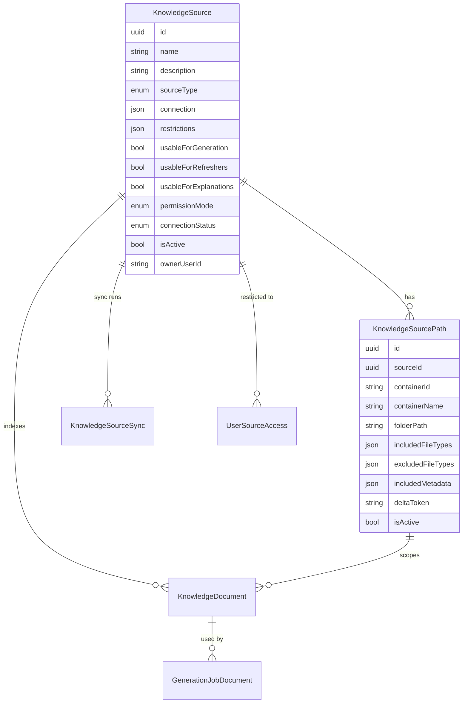
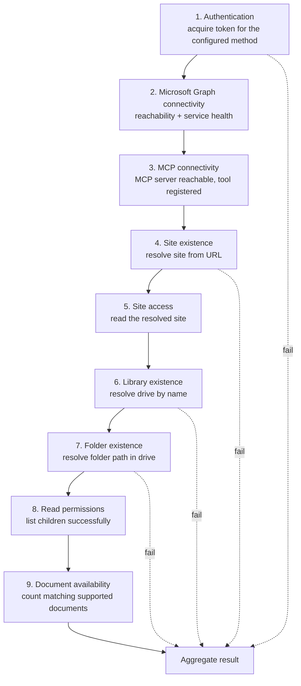
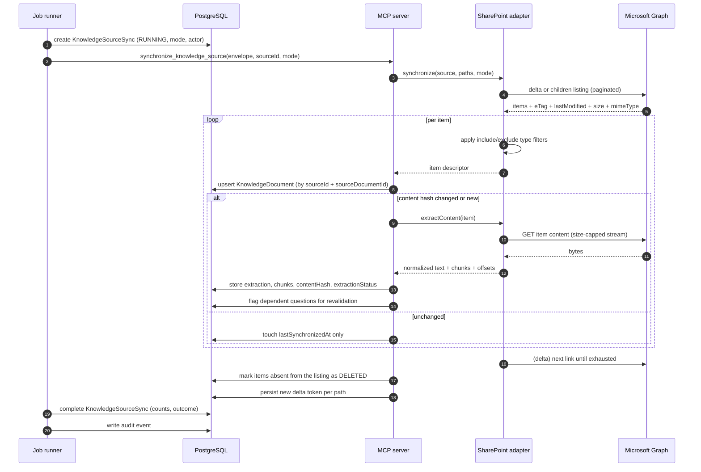

# Knowledge Source Administration Design

Covers deliverable 9 and specification sections 3.2 (source administration), 3.3 (synchronization),
and 3.4 (document browser). Adapter contract: [knowledge-source-adapters.md](knowledge-source-adapters.md).

---

## 1. Design position

Knowledge sources are **configuration data owned by administrators**, never constants in code. The
single most important rule in this document:

> No SharePoint tenant name, site URL, site ID, document library name, library ID, folder path, list
> ID, or field name appears anywhere in application source code. All of it lives in
> `KnowledgeSource`, `KnowledgeSourcePath`, and `ApplicationConfiguration` rows, entered and
> maintained by authorized administrators through the Authoring Portal.

Consequences:

- Moving a SOP library, renaming a folder, or onboarding a second site is an administrative task
  taking minutes, with an audit trail — not a code change and release.
- Development, test, and production differ only in data.
- Local development works with zero tenant values by using the mock adapter.
- A misconfigured path produces a clear diagnostic, not a 500.

---

## 2. Source registry model



**Why paths are a child entity.** One logical source ("Support Operations Knowledge") commonly spans
several folders or libraries. Modelling each as a `KnowledgeSourcePath` lets an administrator add or
retire a folder without recreating the source, keeps per-path delta tokens and sync state accurate,
and keeps domain/topic mapping at the granularity where it is actually meaningful.

---

## 3. Administrator capabilities

| Capability | Route / action | Permission | Audit event |
| --- | --- | --- | --- |
| Add knowledge source | `/sources/new` | `source.manage` | `ADMIN.SOURCE.CREATED` |
| Edit knowledge source | `/sources/[id]` | `source.manage` | `ADMIN.SOURCE.UPDATED` |
| Modify knowledge-source paths | `/sources/[id]` → Paths | `source.manage` | `ADMIN.SOURCE.PATH_MODIFIED` |
| Activate / deactivate source | Registry or detail toggle | `source.manage` | `ADMIN.SOURCE.ACTIVATED` / `DEACTIVATED` |
| Test source connection | Detail → Test Connection | `source.test` | `ADMIN.SOURCE.CONNECTION_TESTED` |
| Synchronize source metadata | Detail → Synchronize | `source.sync` | `ADMIN.SOURCE.SYNC_STARTED` / `COMPLETED` / `FAILED` |
| View synchronization history | `/sources/[id]/sync` | `source.read` | (read; access logged) |
| View source health | Registry and detail | `source.read` | — |
| Delete or archive unused configuration | Detail → Archive / Delete | `source.manage` | `ADMIN.SOURCE.ARCHIVED` / `DELETED` |
| Configure generation usage | Detail → Purposes | `source.manage` | `ADMIN.SOURCE.UPDATED` |
| Configure refresher usage | Detail → Purposes | `source.manage` | `ADMIN.SOURCE.UPDATED` |
| Configure explanation usage | Detail → Purposes | `source.manage` | `ADMIN.SOURCE.UPDATED` |
| Restrict access by role / domain / team / function | Detail → Restrictions | `source.manage` | `ADMIN.SOURCE.RESTRICTIONS_CHANGED` |

### 3.1 Delete versus archive

| Operation | Precondition | Effect |
| --- | --- | --- |
| **Archive** | Always available | Source becomes invisible in pickers, retains all history, documents, and question lineage. Reversible. |
| **Delete** | No `KnowledgeDocument` has ever been used by a `GenerationJob` **and** no published question references the source | Hard delete of the configuration row, audited with the full previous value |

If any question — draft, published, retired, or archived — traces to the source, deletion is refused
with `SOURCE_HAS_LINEAGE` and archive is offered instead. Traceability outlives convenience.

### 3.2 Purpose flags

Three independent booleans, because the trust level of a source differs by use:

| Flag | Meaning | Typical use |
| --- | --- | --- |
| `usableForGeneration` | Documents may be used to generate draft questions | Approved SOPs and runbooks |
| `usableForRefreshers` | Documents may be surfaced as learning resources after an assessment | Training material, guides, KB articles |
| `usableForExplanations` | Content may be cited in post-assessment explanations | Approved reference material |

A source with all three false is effectively catalogue-only. The generation form lists only
generation-enabled sources; refresher search queries only refresher-enabled sources. The flags are
enforced server-side in the MCP layer, not just filtered in the UI.

### 3.3 Restriction model

```
effectiveSourceAccess(user, source) =
      source.isActive
  AND (source.restrictions.roles      is empty OR user.roles          ∩ roles      ≠ ∅)
  AND (source.restrictions.domains    is empty OR user.domainScope    ∩ domains    ≠ ∅)
  AND (source.restrictions.teams      is empty OR user.teams          ∩ teams      ≠ ∅)
  AND (source.restrictions.functions  is empty OR user.functions      ∩ functions  ≠ ∅)
  AND (no explicit DENY in UserSourceAccess for (user, source))
  AND (no ALLOW-list exists for the source OR an ALLOW exists for (user, source))
```

Empty restriction sets mean "not restricted on this dimension". `UserSourceAccess` provides
per-user overrides, and an explicit `DENY` always wins. For sources in `DELEGATED_OBO` permission
mode, SharePoint's own trimming applies **in addition** — Knowzy restrictions can only narrow access,
never widen it.

---

## 4. SharePoint source configuration fields

All fields from specification §3.2, with storage location, validation, and handling notes.

| Field | Storage | Type / validation | Notes |
| --- | --- | --- | --- |
| Source Name | `KnowledgeSource.name` | 3–120 chars, unique | Displayed everywhere |
| Source Description | `KnowledgeSource.description` | ≤500 chars | |
| Source Type | `KnowledgeSource.sourceType` | enum; release 1 accepts `SHAREPOINT` and `MOCK` | Drives which configuration section renders |
| SharePoint Tenant | `connection.tenant` | Hostname, e.g. `contoso.sharepoint.com` | **Tenant-specific value — supplied by the customer** |
| SharePoint Site URL | `connection.siteUrl` | Absolute HTTPS URL, host must match tenant | Administrator enters this; the ID is derived |
| SharePoint Site ID | `connection.siteId` | Graph site ID | **Resolved by Test Connection from the URL and then stored. Never hand-entered, never fabricated.** |
| Document Library Name | `KnowledgeSourcePath.containerName` | Text | Display value |
| Document Library ID | `KnowledgeSourcePath.containerId` | Graph `drive.id` | Resolved by Test Connection from the library name |
| Folder Path | `KnowledgeSourcePath.folderPath` | Server-relative path within the library, normalized, no `..` | `/` means library root |
| Included File Types | `KnowledgeSourcePath.includedFileTypes` | Array from the supported set | Empty = all supported types |
| Excluded File Types | `KnowledgeSourcePath.excludedFileTypes` | Array | Applied after inclusion |
| Included Metadata | `KnowledgeSourcePath.includedMetadata` | Array of SharePoint column names to capture | Captured into `KnowledgeDocument.sourceMetadata` |
| Domain Mapping | `KnowledgeSourcePath.domainMapping` | Rules: static domain, or by folder segment, or by SharePoint column value | Pre-fills the generation form; an author can override |
| Topic Mapping | `KnowledgeSourcePath.topicMapping` | Same rule shapes | Pre-fills; author can override |
| Authentication Method | `connection.authMethod` | enum: `MANAGED_IDENTITY`, `CLIENT_CREDENTIALS`, `ON_BEHALF_OF` | The credential itself lives in Key Vault; only a reference is stored |
| Permission Mode | `KnowledgeSource.permissionMode` | enum: `DELEGATED_OBO`, `APP_ONLY_SITES_SELECTED` | See [architecture.md §8.3](architecture.md#83-permission-modes) |
| Synchronization Frequency | `KnowledgeSource.syncSchedule` | enum + interval: `MANUAL`, `HOURLY_N`, `DAILY`, `WEEKLY` | Cron expression derived server-side |
| Last Synchronization Date | derived from `KnowledgeSourceSync` | timestamp | Last run of any outcome |
| Last Successful Synchronization | derived from `KnowledgeSourceSync` | timestamp | Last `SUCCEEDED` or `PARTIAL` run |
| Connection Status | `KnowledgeSource.connectionStatus` | enum: `UNTESTED`, `HEALTHY`, `DEGRADED`, `FAILED` | Set only by a real probe |
| Active / Inactive | `KnowledgeSource.isActive` | boolean | Inactive sources are excluded from all retrieval |
| Source Owner | `KnowledgeSource.ownerUserId` | User reference | Accountable owner; receives health notifications |
| Created By / Modified By | `createdByUserId` / `modifiedByUserId` | User reference | Set server-side |
| Created Date / Modified Date | `createdAt` / `updatedAt` | timestamp UTC | Set server-side |

### 4.1 Secret handling

No credential, secret, certificate, or token is stored in `KnowledgeSource`. The connection object
holds only a **secret reference** (for example `keyvault://knowzy-prod/secrets/sp-support-ops-client`)
resolved server-side at call time. The API never returns the reference's value, and the source editor
never renders a secret field with a value — only "configured / not configured" plus a "replace
secret" action that writes directly to Key Vault.

> **Illustrative example only — not a real value:**
> ```
> tenant   : contoso.sharepoint.com
> siteUrl  : https://contoso.sharepoint.com/sites/SupportOperations
> siteId   : (resolved at Test Connection time — not asserted here)
> library  : Documents
> driveId  : (resolved at Test Connection time — not asserted here)
> folder   : /SOPs/Network
> secretRef: keyvault://knowzy-dev/secrets/sp-support-ops-client
> ```
> No connection has been attempted and no identifier above is a real tenant value. See
> [assumptions-and-tenant-configuration.md](assumptions-and-tenant-configuration.md).

### 4.2 Source type roadmap

| Status | Types |
| --- | --- |
| Release 1 | `SHAREPOINT`, `MOCK` |
| Designed, template provided | `CONFLUENCE`, `SERVICENOW`, `SQL_DATABASE`, `REST_API`, `AZURE_BLOB`, `FILE_REPOSITORY`, `INTERNAL_KNOWLEDGE_API`, `MCP_GENERIC` |

The `sourceType` enum contains every value from day one so that configuration rows, audit events, and
reports never need migration when an adapter ships. Selecting a type without a registered adapter
returns `SOURCE_TYPE_NOT_AVAILABLE` and the UI marks it "coming soon" rather than hiding it.

---

## 5. Test Connection

### 5.1 The nine checks

Run in order; each check's outcome is reported independently so an administrator can see exactly
where a misconfiguration is.



Checks 1–3 are prerequisites; a failure there short-circuits with `NOT_RUN` for later checks rather
than a cascade of misleading errors. Checks 4–9 each produce `PASS`, `FAIL`, `WARN`, or `NOT_RUN`.

### 5.2 Result contract

```jsonc
// Illustrative response shape. Values are examples; no real connection was made.
{
  "overall": "HEALTHY",              // HEALTHY | DEGRADED | FAILED
  "checkedAt": "2026-09-17T09:14:22Z",
  "correlationId": "c-8f2a…",
  "checks": [
    { "id": "AUTHENTICATION",     "result": "PASS", "detail": "Token acquired via MANAGED_IDENTITY" },
    { "id": "GRAPH_CONNECTIVITY", "result": "PASS", "detail": "Graph v1.0 reachable, 142 ms" },
    { "id": "MCP_CONNECTIVITY",   "result": "PASS", "detail": "MCP server reachable, tool registered" },
    { "id": "SITE_EXISTS",        "result": "PASS", "detail": "Site resolved from the configured URL" },
    { "id": "SITE_ACCESS",        "result": "PASS", "detail": "Site readable" },
    { "id": "LIBRARY_EXISTS",     "result": "PASS", "detail": "Library 'Documents' resolved" },
    { "id": "FOLDER_EXISTS",      "result": "PASS", "detail": "Folder '/SOPs/Network' resolved" },
    { "id": "READ_PERMISSIONS",   "result": "PASS", "detail": "Read access confirmed" },
    { "id": "DOCUMENT_AVAILABILITY","result": "WARN","detail": "3 of 34 items are unsupported types" }
  ],
  "summary": {
    "accessibleSite": "Support Operations",       // display name, not ID
    "accessibleLibrary": "Documents",
    "configuredFolder": "/SOPs/Network",
    "documentsFound": 34,
    "supportedDocuments": 31,
    "unsupportedDocuments": 3,
    "permissionStatus": "READ_CONFIRMED",
    "permissionEnforcement": "DELEGATED_OBO",
    "lastCheckedAt": "2026-09-17T09:14:22Z"
  },
  "errors": []
}
```

Displayed result elements required by the specification: connection status · accessible site ·
accessible library · configured folder · number of documents found · permission status · last checked
timestamp · error summary when unsuccessful.

### 5.3 Redaction rules

The Test Connection response and its audit event **never** contain: access tokens, refresh tokens,
client secrets, certificate material, Key Vault secret values, `Authorization` headers, or raw
provider error bodies. Provider errors are mapped to a Knowzy error code plus a safe, human-readable
cause. The raw provider error is logged with the correlation ID at `debug` level in the API's own
logs only, with credential-shaped values scrubbed by the logging redactor.

| Provider condition | Knowzy code | Administrator-facing message |
| --- | --- | --- |
| 401 / invalid client | `SOURCE_AUTH_FAILED` | "Authentication failed. The configured credential was rejected. Check the secret in Key Vault and the app registration." |
| 403 on site | `SOURCE_SITE_FORBIDDEN` | "The platform identity does not have access to this site. For `Sites.Selected`, grant access to this specific site." |
| 404 on site | `SOURCE_SITE_NOT_FOUND` | "No site was found at the configured URL. Check the tenant hostname and site path." |
| Library not found | `SOURCE_LIBRARY_NOT_FOUND` | "No document library named '{name}' exists on this site." |
| Folder not found | `SOURCE_FOLDER_NOT_FOUND` | "The folder path was not found in this library." |
| 429 | `SOURCE_THROTTLED` | "SharePoint is throttling requests. The test will retry automatically; try again shortly." |
| Timeout | `SOURCE_TIMEOUT` | "The source did not respond in time." |
| MCP unreachable | `MCP_UNAVAILABLE` | "The knowledge gateway is unavailable. This is a platform issue, not a configuration issue." |

### 5.4 Honesty rules for Test Connection

1. `connectionStatus` changes **only** as the result of an executed probe. It is never inferred,
   defaulted to healthy, or assumed from a successful save.
2. A newly created source is `UNTESTED` until a probe runs. The UI shows "Not yet tested".
3. A probe result is always stamped with the time it ran, and the UI always shows that timestamp.
4. Test Connection is rate-limited (default 10 per source per hour) to avoid becoming a throttling
   source itself.
5. Test Connection performs **read-only** operations. It never writes to SharePoint.
6. If the environment has no credentials configured, the probe returns `FAILED` with
   `SOURCE_NOT_CONFIGURED` — it does not return a fabricated success. No document in this set claims
   a tested connection.

---

## 6. Synchronization

Synchronization builds and maintains the **metadata index** (`KnowledgeDocument`) plus extracted text
and chunk offsets. It does not copy documents, and it does not create questions.

### 6.1 Modes

| Mode | Trigger | Scope | Notes |
| --- | --- | --- | --- |
| Manual | Administrator action | Selected source, optionally one path | Always available; audited with the actor |
| Scheduled | Job runner cron per source | All active paths | `MANUAL`, `HOURLY_N`, `DAILY`, `WEEKLY` |
| Incremental | Scheduled default | Changes since the stored delta token, or since `lastSuccessfulSyncAt` when no token exists | Cheapest; the normal path |
| Full | Manual, or automatically after a delta-token failure or configuration change | Every item under every active path | Re-verifies hashes and re-extracts where the hash changed |
| Health check | Lightweight cron (default hourly) | Single cheap read per source | Updates `connectionStatus` only |

Configuration changes that force the next run to be full: folder path change, library change, site
change, included/excluded file-type change, or included-metadata change. The system marks
`requiresFullSync = true` on the path and tells the administrator why.

### 6.2 Sync run pipeline



### 6.3 Change detection

| Change | Detection | Action |
| --- | --- | --- |
| New document | Present in listing, absent locally | Insert `KnowledgeDocument`, extract, index |
| Modified document | `eTag` or `lastModifiedDateTime` differs; confirmed by content hash after re-extraction | Update metadata, increment `sourceVersion`, re-extract, re-chunk, flag dependent questions |
| Metadata-only change | `eTag` differs but content hash identical | Update metadata; **no** revalidation flag (a retitle is not a content change) |
| Deleted document | Absent from a full listing, or delta reports deletion | Mark `status = DELETED`; retain the row for lineage; flag dependent questions `SOURCE_DELETED` |
| Moved / renamed | Same item ID, different path or name | Update path and name; treat as metadata-only unless the hash changed |
| Extraction failure | Extractor error or empty result | `extractionStatus = FAILED` / `EMPTY`, retry with backoff, then quarantine and surface in the source detail |

The content-hash confirmation step matters: SharePoint updates `eTag` for many non-content events. Using
the hash as the authority means authors are only asked to revalidate when the text actually changed.

### 6.4 Revalidation policy (specification 3.3, normative)

1. When a document's content hash changes, the platform identifies every question whose
   `SourceDocumentID` matches and whose `SourceContentHash` differs from the new hash.
2. Those questions are flagged `needsRevalidation = true` with a reason and the detecting sync run ID.
3. **No approved question is automatically modified, retired, unpublished, or deactivated because a
   document changed.** This is an explicit prohibition.
4. Affected published questions remain fully available to learners while flagged. Availability is a
   human decision.
5. Notifications go to the question's author, the source owner, and users holding `question.review`
   in the affected domain.
6. The Authoring Dashboard shows the revalidation queue; the question detail page shows the previous
   evidence span, the new document text at that location, and a diff.
7. A human resolves each flag: **Confirm still valid** (re-stamps the hash, clears the flag, audited),
   **Edit** (creates a new draft version through the normal workflow), or **Retire** (explicit,
   comment required).
8. If the source document is deleted, the flag reason is `SOURCE_DELETED` and the question is
   surfaced with a stronger warning — still without automatic retirement.

### 6.5 Failed-document retry

Per-document failures do not fail a sync run. Each failure records the document, phase
(`LISTING`, `DOWNLOAD`, `EXTRACTION`, `INDEXING`), error code, attempt count, and next retry time.
Retries use exponential backoff with jitter (default 1 m, 5 m, 30 m, 2 h, 12 h) and then quarantine.
Administrators can retry a single document, retry all failures for a source, or dismiss a failure
with a reason. A run with document failures completes as `PARTIAL`, never as `SUCCEEDED`.

### 6.6 Sync history

`KnowledgeSourceSync` records: source, paths covered, mode, trigger (`MANUAL` / `SCHEDULE` /
`SYSTEM`), actor, started, completed, duration, outcome (`SUCCEEDED`, `PARTIAL`, `FAILED`,
`CANCELLED`), items scanned / added / modified / deleted / unchanged / failed, extracted character
count, questions flagged for revalidation, error summary, and correlation ID. History is retained per
the configured retention period (default 400 days) and is reportable.

### 6.7 Source document metadata (specification 3.3, complete)

| Field | Column | Notes |
| --- | --- | --- |
| Source Document ID | `sourceDocumentId` | Provider-native ID (Graph `driveItem.id`); unique with `sourceId` |
| Document Name | `name` | |
| Source Name | via `sourceId` → `KnowledgeSource.name` | Denormalized for reporting |
| SharePoint Site | `containerSiteName` + `containerSiteId` | Display and ID |
| Document Library | `containerName` + `containerId` | |
| Folder Path | `folderPath` | |
| Source URL | `sourceUrl` | `webUrl` — user-resolvable link |
| File Type | `fileType` | Normalized extension |
| File Size | `fileSizeBytes` | |
| Created Date | `sourceCreatedAt` | From the provider |
| Modified Date | `sourceModifiedAt` | From the provider |
| Source Version | `sourceVersion` | Provider eTag/cTag plus a monotonic local counter |
| Content Hash | `contentHash` | SHA-256 of normalized extracted text |
| Indexing Status | `indexingStatus` | `PENDING`, `INDEXED`, `FAILED`, `SKIPPED` |
| Extraction Status | `extractionStatus` | `PENDING`, `EXTRACTED`, `EMPTY`, `UNSUPPORTED`, `FAILED`, `TOO_LARGE`, `QUARANTINED` |
| Last Synchronized Date | `lastSynchronizedAt` | |
| Active / Deleted Status | `status` | `ACTIVE`, `DELETED`, `ARCHIVED` |
| Captured source metadata | `sourceMetadata` (JSON) | Only the columns named in Included Metadata |
| Domain / topic hints | `domainHint`, `topicHint` | Derived from mapping rules |

---

## 7. Document Browser

### 7.1 Layout

```
┌───────────────────────────────────────────────────────────────────────────────┐
│ Documents   Source: [Support Operations ▾]   [Search documents…]              │
│ Filters: Domain ▾ Folder ▾ File type ▾ Author ▾ Modified ▾ Metadata ▾ Status ▾│
├─────────────────────────┬─────────────────────────────────────────────────────┤
│ TREE                    │ ☐ Name              Type  Modified   Extract  Index │
│ ▾ Support Operations    │ ☑ SOP-Network-Reset  PDF  12 Sep    ✓        ✓     │
│   ▾ Documents           │ ☑ Runbook-DNS        DOCX 10 Sep    ✓        ✓     │
│     ▸ /SOPs/Network  ◂  │ ☐ Q3-Metrics         XLSX 08 Sep    ✓        ✓     │
│     ▸ /SOPs/Storage     │ ☐ Legacy-Scan        PDF  02 Sep    ✗ empty  —     │
│     ▸ /Runbooks         │ ☐ Topology           VSDX 01 Sep    ✗ unsup. —     │
│ ▸ Field Services KB     │                                                     │
├─────────────────────────┴─────────────────────────────────────────────────────┤
│ 2 selected · Network domain hint · 41k characters   [Generate Quiz →]         │
└───────────────────────────────────────────────────────────────────────────────┘
```

> Document names above are **illustrative examples**.

### 7.2 Capabilities

Browse configured SharePoint sources · browse sites, libraries, folders, documents · search · filter
by domain, folder, file type, author, modified date, and captured metadata · select one document ·
select multiple documents · preview document metadata · view extraction status · view indexing status
· view source permissions · start quiz generation from the selection.

### 7.3 Browse strategy: index-first, live-verified

The tree and listings are served from the local `KnowledgeDocument` index — fast, filterable, and no
Graph load per keystroke. Live Graph calls happen only when: the administrator expands a path not yet
synchronized; a user requests "refresh from source" on a folder; a document is opened for metadata or
permission detail; or generation begins (where the item is re-verified for existence, permission, and
hash before extraction is used).

This gives responsive browsing while guaranteeing that the content used for generation was verified at
generation time, not merely at sync time.

### 7.4 Search

Two layers. Local search over indexed names, paths, captured metadata, and extracted text
(PostgreSQL full-text plus `pg_trgm` for fuzzy name matching) is the default. An optional live search
delegates to `search_source_documents`, which for SharePoint uses Graph search within the configured
scope — useful for documents not yet indexed. Results are labelled with their origin ("indexed" vs
"live from source") so a user always knows what they are looking at.

### 7.5 Document detail panel

Metadata (all fields in §6.7 that are safe to show) · extraction status with the reason on failure ·
chunk count and extracted character count · content hash (short form) · last synchronized ·
existing questions generated from this document with their lifecycle states · "Open in SharePoint" ·
permission summary.

### 7.6 Permission display

For `DELEGATED_OBO` sources the panel shows the signed-in user's effective access as reported by
Graph (`read` / `write` / `owner`) and states that trimming is SharePoint-enforced. For
`APP_ONLY_SITES_SELECTED` sources it shows the platform identity's access and states plainly that
trimming is **platform-enforced by Knowzy restrictions**, not by SharePoint, so administrators
understand the difference. Principal lists are shown only to users with `source.manage`; a regular
author sees a summary, not a membership dump.

### 7.7 Supported and unsupported types

| Supported in release 1 | Extraction |
| --- | --- |
| PDF (text layer) | Page-anchored text |
| DOCX | Heading-anchored text |
| PPTX | Slide-anchored text incl. notes |
| XLSX | Sheet and row text |
| SharePoint Pages | Section-anchored text |
| Plain text | Line offsets |
| HTML | Heading-anchored, sanitized |
| Approved knowledge-article formats (`.aspx` pages, exported KB HTML) | Treated as HTML/Page |

Unsupported types are listed with a clear `UNSUPPORTED` badge, are excluded from selection for
generation, and display the reason ("file type not supported for extraction", "image-only PDF: no
text layer", "password protected", "exceeds size limit"). **Unsupported binary files are never sent
to Claude.** The gate is enforced in the extraction pipeline, so no code path can bypass it — Claude
receives extracted, normalized text only, never raw file bytes.

### 7.8 Selection to generation

The "Generate Quiz" action carries the selection to `/generate` with source, documents, and derived
domain/topic hints pre-filled. Preconditions: 1–10 documents, all `EXTRACTED`, all from
generation-enabled active sources the user may access, and all currently permission-verified. A
document that fails any precondition is shown with the reason and excluded rather than silently
dropped. Selection is recorded as `AUTHORING.DOCUMENT.SELECTED` for audit and later lineage.

---

## 8. Health monitoring and notifications

| Signal | Detection | Action |
| --- | --- | --- |
| Connection failure | Health check or sync failure | `connectionStatus = FAILED`; notify source owner and Platform Administrators; dashboard alert |
| Degraded connection | Intermittent failures, or throttling above threshold | `DEGRADED`; dashboard warning; backoff applied |
| Sync repeatedly partial | 3 consecutive `PARTIAL` runs | Notify source owner with the failing document list |
| Extraction failure rate | >10% of documents in a run | Notify source owner; likely a scanned-PDF or format problem |
| No documents found | Document availability check returns 0 | `DEGRADED` with `SOURCE_EMPTY`; likely a wrong folder path |
| Delta token invalid | Graph rejects the token | Automatic fallback to full sync, logged, not surfaced as a failure |
| Source unused | No generation job in 180 days | Informational report entry suggesting archive |

Notifications are written to the `Notification` entity with in-app delivery in release 1; email or
Teams delivery is a later phase and the entity already carries a `channel` field.
