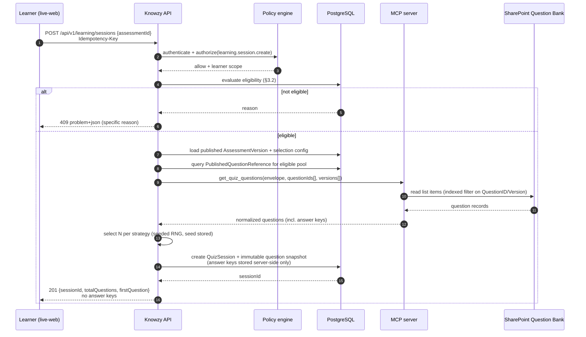

# Live Learning Portal — Functional Design

Deployable: `apps/live-web`. Architecture context:
[architecture.md §6](architecture.md#6-live-learning-portal-architecture).

The Live Portal has one job: let an authorized learner prove and improve proficiency, without ever
being able to see an answer key.

---

## 1. Route plan

| Route | Purpose | Permission |
| --- | --- | --- |
| `/` | Learner home: assigned and available assessments, open sessions, recent results, current gaps, badge highlights | `learning.access` |
| `/assessments` | Discovery: browse and filter published assessments | `learning.assessment.list` |
| `/assessments/[assessmentId]` | Assessment detail and start/resume | `learning.assessment.list` |
| `/quiz/[sessionId]` | Quiz runner | `learning.session.own` |
| `/results/[resultId]` | Result, proficiency, topic breakdown, gaps, refreshers | `learning.result.own` |
| `/history` | Attempt history | `learning.result.own` |
| `/refreshers` | Recommendation inbox and history | `learning.recommendation.own` |
| `/achievements` | Badge wall | `learning.badge.own` |
| `/certificates` | Certificates and downloads | `learning.certificate.own` |

`learning.*.own` policies resolve the subject from the validated token and compare against the
resource owner server-side. No route accepts a user ID from the client. See
[security.md §9](security.md#9-insecure-direct-object-reference-idor-prevention).

---

## 2. Learner shell

Deliberately minimal: product name, four navigation items (Assessments, Results, Refreshers,
Achievements), and the user menu. No admin affordances exist in the bundle. When a quiz is active the
shell enters focus mode — navigation collapses to an explicit "Save and exit" action, so a learner
cannot lose progress by mis-clicking, and progress is never lost because every answer is already
persisted.

---

## 3. Assessment discovery

### 3.1 Listing

Each card shows: assessment name, domain, topic tags, description, question count, pass percentage,
time limit (or "no time limit"), attempt policy (attempts used / allowed, retake wait if any),
availability window, badge and certificate availability, and the learner's own status
(`Not started`, `In progress`, `Passed`, `Failed — retake available on {date}`,
`Attempt limit reached`).

Filters: domain (required by the spec), topic, status, "has open attempt", availability.

### 3.2 Eligibility evaluation (server-side)

An assessment is offered to a learner only when every condition holds:

| # | Condition |
| --- | --- |
| 1 | Assessment version status is `PUBLISHED` |
| 2 | Current UTC time is within the availability window |
| 3 | The learner's domain and team scope includes the assessment's domain and audience |
| 4 | The learner holds the `Learner` role and live-portal access is active |
| 5 | The learner's account is active |
| 6 | Attempts used < attempt limit, or the limit is unlimited |
| 7 | Any retake cooling-off period has elapsed |
| 8 | The eligible published-question pool satisfies the selection configuration |

When an assessment is visible but not startable, the card states the specific reason rather than
disabling the button silently. Condition 8 failing is an authoring problem, not a learner problem —
the learner sees "temporarily unavailable", and the authoring dashboard sees the real cause.

---

## 4. Quiz execution

### 4.1 Session start sequence



### 4.2 The session snapshot is authoritative

On creation, the session stores an immutable snapshot of the selected questions: QuestionID,
published version, question text, options A–D, **correct answer**, explanation, topic, domain, source
references, and the presentation order. From that moment:

- The quiz does **not** call SharePoint again. Retirement, edits, or republication mid-session cannot
  change an in-flight attempt.
- Scoring uses the snapshot, so a scored attempt is reproducible years later.
- The only exception is recovery: if the snapshot row is unreadable (infrastructure failure), a
  recovery path may re-read by QuestionID and version. Any recovery read is audited as
  `LEARNING.SESSION.RECOVERED` with the reason.

### 4.3 One question at a time

| Step | Behaviour |
| --- | --- |
| Present | `GET /api/v1/learning/sessions/{id}/current` returns index, total, question text, options, previously chosen option (if any), remaining time, and flag state |
| Answer | `POST /api/v1/learning/sessions/{id}/answers` with `{questionIndex, selectedOption, clientElapsedMs, Idempotency-Key}` |
| Persist | The answer is written to `QuizResponse` before the response is returned. No batching, no client-held answer state |
| Advance | The server returns the next question, or `completed: true` after the final answer |
| Response | The answer response contains **no** correctness signal, no running score, no explanation |
| Navigate | Backward navigation and answer change are permitted while the session is `IN_PROGRESS` if the assessment allows it (`allowBackNavigation`, default true); each change is a new `QuizResponse` revision with the prior value retained |
| Flag | A learner may flag a question for their own later review within the attempt |

### 4.4 Resume

Session state lives entirely server-side. `GET /sessions/{id}` after a refresh, a browser crash, or a
device change returns the exact position and all saved answers. The learner home surfaces any
`IN_PROGRESS` session prominently. Sessions expire per the assessment time limit, or after a
configurable idle window (default 24 h) for untimed assessments; expiry transitions the session to
`EXPIRED` and scores the answers submitted so far only if the assessment's
`scoreOnExpiry` policy says so (default: score with unanswered items counted incorrect, and label the
result `EXPIRED`).

### 4.5 Duplicate-submission prevention

| Risk | Control |
| --- | --- |
| Double-click on answer submit | Idempotency key per (session, questionIndex, attemptOfSubmission); repeat returns the original result |
| Double completion | `POST /sessions/{id}/complete` is idempotent; a second call returns the existing result ID |
| Two browser tabs | Session is single-logical-stream; a monotonically increasing `sequence` on each write rejects out-of-order writes with `409 SESSION_SEQUENCE_CONFLICT` and the client resynchronizes |
| Replay of a completed session | Completed sessions reject answer writes with `409 SESSION_NOT_ACTIVE` |
| Parallel sessions for one assessment | Blocked by default; an existing `IN_PROGRESS` session must be resumed or abandoned |

### 4.6 What the browser never receives during an active quiz

Correct answers · explanations · supporting evidence · source excerpts · answer keys · running score ·
other learners' results · question difficulty statistics.

Enforcement is structural, not conventional:

1. The `LearnerQuestionDto` type has no answer-key field. A contract test fails the build if one is added.
2. A response-shape assertion on every `/api/v1/learning/sessions/**` route rejects payloads
   containing `correctAnswer`, `explanation`, `supportingEvidence`, or `sourceLocation`.
3. The `knowzy.learning` scope has no route that can return an answer key for an in-progress session.
4. Snapshots are stored in a column set that the learner-facing query never selects.

See [security.md §8](security.md#8-answer-key-protection).

### 4.7 Timed assessments

The server holds the authoritative deadline (`session.expiresAt`). The client displays a countdown
derived from a server-provided remaining-time value and re-syncs on each answer. Client clock skew
cannot extend an attempt. On expiry the server refuses further answers; the client is told to
complete. A configurable grace period (default 10 s) absorbs network latency on the final submission.

---

## 5. Scoring and proficiency

Scoring is deterministic backend code. Claude is not involved and has no input.

### 5.1 Computation

```
totalQuestions    = count(snapshot questions)
correctAnswers    = count(responses where selectedOption == snapshot.correctAnswer)
incorrectAnswers  = totalQuestions - correctAnswers        // unanswered counts as incorrect
rawScore          = correctAnswers / totalQuestions
percentageScore   = roundHalfUp(rawScore * 100, 2)          // NUMERIC(5,2)
passed            = percentageScore >= assessmentVersion.passPercentage
```

### 5.2 Rounding rule (normative)

1. `percentageScore` is computed as `(correctAnswers / totalQuestions) * 100` and rounded
   **half away from zero** to **two decimal places**, stored as `NUMERIC(5,2)`.
2. All pass/fail and proficiency-band comparisons use the **stored, rounded** value, so the number a
   learner sees is the number the decision used. There is no hidden precision.
3. Comparisons are inclusive on the lower bound (`>=`) and exclusive on the upper bound (`<`).
4. UI may display fewer decimals (default: 1) but must never display a rounded value that
   contradicts the decision. Where display rounding would cross a threshold, the exact stored value
   is shown.
5. Worked examples: 7/9 = 77.7777… → **77.78** → Proficient. 27/30 = 90.00 → **Expert** (inclusive
   lower bound). 3/7 = 42.857… → **42.86** → Needs Improvement. 5/9 = 55.5555… → **55.56** → Needs
   Improvement.
6. Topic accuracy uses the same rule with its own denominator (questions of that topic in the
   snapshot).

### 5.3 Default proficiency model

| Band | Range (on `percentageScore`) |
| --- | --- |
| `EXPERT` | 90.00 – 100.00 |
| `PROFICIENT` | 75.00 – < 90.00 |
| `DEVELOPING` | 60.00 – < 75.00 |
| `NEEDS_IMPROVEMENT` | 40.00 – < 60.00 |
| `CRITICAL_KNOWLEDGE_GAP` | < 40.00 |

Thresholds are configurable at two levels: a platform default (`ApplicationConfiguration`) and a
per-assessment override (`AssessmentVersion.proficiencyThresholds`). Validation requires bands to be
contiguous, non-overlapping, and to cover 0–100 exactly; an invalid band set blocks assessment
publication. The threshold set in force is copied into `AssessmentResult` so a historical result is
always interpretable even after the configuration changes.

### 5.4 Topic results and knowledge gaps

For each topic present in the snapshot: questions asked, correct, incorrect, topic accuracy, topic
proficiency band. A topic is a **knowledge gap** when:

- topic accuracy < `gapThreshold` (default 60.00), **and**
- the topic had at least `minTopicQuestions` questions in the snapshot (default 2).

The minimum-question rule prevents a single unlucky question from being reported as a proficiency
gap. When a topic has fewer than the minimum, it is recorded as `INSUFFICIENT_EVIDENCE` and excluded
from gap reporting, and the learner sees "not enough questions to assess" rather than a false gap.

Domain proficiency for a single result is the band of the overall `percentageScore`. Longitudinal
domain proficiency across attempts (used in reporting) is defined in
[reporting.md §5](reporting.md#5-proficiency-semantics).

### 5.5 Result persistence

`AssessmentResult` stores: session, learner, assessment version, snapshot reference, totals, correct,
incorrect, unanswered, `percentageScore`, pass/fail, proficiency band, threshold set applied, time
taken, start and completion timestamps, attempt number, result state (`SCORED`, `EXPIRED`,
`ABANDONED`, `VOIDED`), and the scoring engine version. `TopicResult` rows store per-topic detail.
Results are immutable; a correction creates a new result with a `supersedes` reference and an audited
reason.

---

## 6. Results experience

Shown immediately after completion, and permanently at `/results/[resultId]`:

1. **Headline** — percentage, pass/fail, proficiency band, attempt number, time taken.
2. **Topic breakdown** — per-topic accuracy bars, with gaps marked and `INSUFFICIENT_EVIDENCE`
   topics labelled honestly.
3. **Question review** — each question with the learner's answer, the correct answer, and the
   approved explanation. Released **only after** the session reaches a terminal state, and only if
   the assessment's `showAnswersAfterCompletion` policy allows it (default true; set false for
   assessments with a limited question pool and multiple attempts, to protect pool integrity).
4. **Knowledge gaps** — plain-language summary of weak topics.
5. **Refreshers** — the grounded recommendations from §7, with citations.
6. **Recognition** — badges awarded by this attempt, certificate download when eligible.
7. **Next step** — retake eligibility and date, or the recommended refresher.

The result page never shows another learner's data, a cohort ranking, or a percentile.

---

## 7. Knowledge refreshers (learner view)

Workflow detail: [workflows.md §7](workflows.md#7-knowledge-refresher-workflow).

Each recommendation card shows: weak topic · gap summary · recommended learning area · the approved
explanation from the question bank · the Claude-generated grounded refresher · source document name ·
source type · source link · suggested next action. The learner can mark a refresher reviewed (which
feeds the "refreshers completed" metric and the Knowledge Refresher Completion badge) and can open
the source in SharePoint, where SharePoint's own permissions apply as the final gate.

When no additional approved source is found, the card shows the approved explanation and states
plainly: "No additional approved learning resource was found for this topic." No source title, link,
or document name is ever invented. `/refreshers` retains the full recommendation history with the
originating assessment and result.

---

## 8. Badges and certificates (learner view)

`/achievements` shows earned badges with award date and the originating assessment, plus
in-progress badges with their deterministic criteria stated ("Domain Expert — Network: score 90% or
above on a Network assessment"). `/certificates` lists certificates with status (`ISSUED`,
`EXPIRED`, `REVOKED`), issue and expiry dates, PDF download, and the verification URL. A revoked
certificate is shown as revoked with its date; it is never silently removed. Design:
[badges-and-certificates.md](badges-and-certificates.md).

---

## 9. Accessibility and responsiveness

WCAG 2.2 AA is the target for both portals; the quiz runner carries the strictest requirements
because it is a timed, high-stakes interaction:

- The question is an `<h1>`-level landmark per step; options are a proper radio group with a visible
  and programmatic label, reachable and operable by keyboard alone.
- Progress is announced to assistive technology on each step ("Question 4 of 10").
- Time remaining is announced at configurable intervals and on request, never only visually.
- No colour-only state. Correctness in the review view uses icon + text + colour.
- Focus is moved to the new question heading on advance; focus is never lost or trapped.
- Motion is minimal and respects `prefers-reduced-motion`.
- Fully usable at 320 px width and at 200% zoom; single-column layout on small screens with the
  primary action always reachable without scrolling past the options.
- Time limits: where a learner requires an accommodation, an administrator can grant a per-learner
  time extension on an assessment; the extension is audited.

Full standards: [ux-design.md §7](ux-design.md#7-accessibility-standards).

---

## 10. Learner privacy

| Rule |
| --- |
| A learner sees their own results only |
| Managers see authorized teams only, and aggregate views apply the minimum-group-size rule |
| No leaderboards, rankings, or peer comparison anywhere in the Live Portal |
| Result detail is retained per the configured retention period and then aggregated |
| Certificate verification returns the minimum necessary data; learner name appears only when the tenant enables it |
| Telemetry from the Live Portal records pseudonymous subject identifiers, never answer content |
