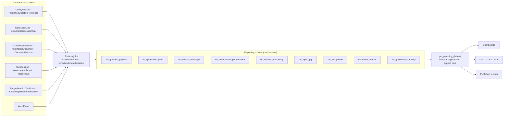

# Reporting and Dashboards

**What this document adds:** the read-model design, the report catalogue, proficiency semantics,
suppression rules, and the publication lifecycle. The portal surfaces are in
[authoring-portal.md §9](authoring-portal.md#9-reports-and-dashboards-portal-view); the access path is
`get_reporting_dataset` ([mcp-tools.md §12](mcp-tools.md#12-reporting-tools)).

---

## 1. Principles

| # | Principle | Consequence |
| --- | --- | --- |
| B1 | **One query path.** On-screen dashboards, CSV exports, and published reports read the same read models through the same tool | A dashboard and its export can never disagree |
| B2 | **Authorization and suppression live inside the read model**, not in the caller | A new export surface cannot forget to apply them |
| B3 | **Every number is defined.** Each metric has one written formula, and the report shows it | A metric nobody can explain is a metric nobody trusts |
| B4 | **Freshness is visible.** Every response carries `asOf`; a stale panel is labelled | Read models refresh asynchronously; pretending otherwise is dishonest |
| B5 | **Aggregates, not people.** Person-level detail is available only where a policy explicitly grants it, and never below the minimum group size | §7 |
| B6 | **No transactional joins in reporting.** Reporting never contends with the authoring or quiz paths | §3 |
| B7 | **Estimates are labelled.** Modelled figures show the constants used | Savings and cost figures are never presented as measured |

---

## 2. Architecture



Read models live in a separate PostgreSQL schema (`reporting`) with its own database role holding
`SELECT` only on the transactional tables. A reporting query cannot lock, block, or mutate anything in
the authoring or quiz path.

---

## 3. Read model design

### 3.1 Refresh strategy per model

| Read model | Grain | Refresh | Latency target |
| --- | --- | --- | --- |
| `rm_question_pipeline` | domain × lifecycle state | **On write** (incremental counters in the transition transaction) | Real time |
| `rm_generation_yield` | job × prompt version × model | Materialized view, 15 min | 15 min |
| `rm_source_coverage` | source × document × section rollup | Incremental on sync and on question-state change; full recompute nightly | 5 min |
| `rm_assessment_performance` | assessment version × topic × question | Materialized view, 15 min | 15 min |
| `rm_learner_proficiency` | learner × domain × window | Materialized view, hourly | 1 h |
| `rm_topic_gap` | topic × team × window | Materialized view, hourly | 1 h |
| `rm_recognition` | badge/certificate × domain × window | Materialized view, hourly | 1 h |
| `rm_reuse_metrics` | domain × window | Materialized view, hourly | 1 h |
| `rm_governance_activity` | actor × action family × day | Partition-aligned view over `AuditEvent`, 15 min | 15 min |

| # | Rule |
| --- | --- |
| D1 | Pipeline counts are **on-write counters**, because the dashboard's most-used numbers must be exact and instant. Every increment happens in the same transaction as the transition it counts |
| D2 | Everything aggregate is a materialized view with a recorded `refreshedAt`. `asOf` in every response comes from that column, never from `now()` |
| D3 | Refresh is `CONCURRENTLY`, so a refresh never blocks a read |
| D4 | A failed refresh leaves the previous data in place and raises the staleness age; the panel labels it. A reporting refresh failure never blanks a dashboard |
| D5 | Every read model carries `domainId`, and where applicable `teamId` and `sourceId`, as indexed columns, so scope is a predicate rather than a post-filter (B2) |
| D6 | Every read model carries the grain's natural key, so a drill-through from an aggregate to its rows is always possible |
| D7 | Counters are reconciled nightly against the transactional tables; drift produces a `PlatformConsistencyFinding` and a notification, never a silent correction ([data-model.md §1](data-model.md#1-modelling-principles), M4) |
| D8 | No read model contains question text, answer keys, explanations, evidence, or learner answer values. Reporting works from identifiers, counts, and scores |
| D9 | Windows are half-open UTC intervals resolved from the tenant reporting zone at query construction, and the resolved interval is displayed with the report ([data-model.md §9](data-model.md#9-time-and-timezone-rules), T6) |

### 3.2 Drill-through contract

Every aggregate cell states its grain and links to the rows behind it, within the caller's scope and
subject to suppression. An aggregate a user cannot decompose is an aggregate they cannot audit — so
each catalogue entry in §4 declares its drill-through target.

---

## 4. Report catalogue

Five categories. Each entry: grain, key metrics, `requiredPermission`, drill-through, and whether
person-level detail is possible.

### 4.1 Authoring

| Report | Grain | Metrics | Permission | Drill-through | Person-level |
| --- | --- | --- | --- | --- | --- |
| Question pipeline | domain × state | Counts in all ten lifecycle states; needs-revalidation count | `report.read` | Question list, filtered | No |
| Review turnaround | domain × reviewer | Median and p90 for draft→submitted, submitted→decided, approved→published | `report.read` | Question list | Yes, for `access.manage` or `audit.read` |
| Generation yield | prompt version × model | Requested, accepted, acceptance rate, approval rate, rejections by reason, mean edit distance generated→approved | `report.read` | Generation jobs | No |
| Rejection analysis | domain × reason code | Rejection counts and share by reason, trend | `report.read` | Job rejections | No |
| Approval accountability | question | Approver, date, gate results, separation-of-duties applied | `audit.read` | Audit chain | Yes, by design |
| Standing exceptions | event | Break-glass uses, approval overrides, bulk approvals above threshold | `audit.read` | Audit chain | Yes, by design |
| Item quality candidates | question | Difficulty (proportion correct), distractor distribution, below-chance flag, minimum 30 attempts | `report.read` | Question detail | No |
| Duplicate and cluster health | domain | Blocked, flagged, dispositioned; cluster count and size distribution | `report.read` | Similarity clusters | No |

### 4.2 Knowledge sources

| Report | Grain | Metrics | Permission | Drill-through |
| --- | --- | --- | --- | --- |
| Source health | source | Connection status with probe timestamp, sync outcomes, failure rate, throttling events, documents available | `source.read` | Sync history |
| Source coverage | source × document | Coverage %, documents not processed, with drafts, with approved, requiring review, modified since last generation | `report.read` | Document Browser, filtered |
| Document usage | document | Questions generated/approved/published, last generated, insufficient-evidence count, coverage % | `report.read` | Document detail |
| Documentation weakness | document × section | Sections with repeated `insufficientEvidence`; topics with high failure across learners and low coverage | `report.read` | Section detail |
| Excluded documents | document | Exclusion reason, actor, date | `report.read` | Document detail |
| Revalidation backlog | domain × source | Flagged questions by reason and age; unresolved > 30 days | `report.read` | Revalidation queue |
| Extraction failures | source × phase | Failure counts by phase and error code, quarantined items | `source.read` | Sync failures |
| Bank reconciliation | domain | Differences by state, unresolved age, decisions taken | `questionbank.reconcile` | Reconciliation worklist |

### 4.3 Assessment

| Report | Grain | Metrics | Permission | Drill-through |
| --- | --- | --- | --- | --- |
| Assessment performance | assessment version | Attempts, unique learners, pass rate, mean and median score, band distribution, mean time taken | `report.read` | Result list (aggregate) |
| Assessment pool health | assessment version | Pool size, per-topic and per-objective sizes, dropped-since-snapshot count, feasibility | `assessment.read` | Eligibility snapshot |
| Attempt behaviour | assessment version | Attempt-number distribution, expiry and abandonment rates, mean time per question | `report.read` | Session list (aggregate) |
| Question performance | assessment version × question | Times asked, proportion correct, distractor distribution | `report.read` | Question detail |
| Objective coverage | domain × objective | Approved vs target, coverage %, contributing documents, shortfalls | `report.read` | Objective detail |

### 4.4 Proficiency

All entries are aggregate by default and subject to §7.

| Report | Grain | Metrics | Permission | Person-level |
| --- | --- | --- | --- | --- |
| Domain proficiency | domain × team × window | Band distribution, mean latest score, learners assessed, coverage of the audience | `report.read` | No |
| Team readiness | team × domain | Share at or above `PROFICIENT`, learners never assessed, mean days since last assessment | `learning.result.team` | No |
| Topic gap analysis | topic × team × window | Gap incidence, mean topic accuracy, learners affected, `INSUFFICIENT_EVIDENCE` share | `report.read` | No |
| Individual progression | learner × domain | Attempt history, score trend, band changes, gaps closed | `learning.result.own` (self) or `access.manage` | Yes, explicitly |
| Refresher effectiveness | topic × window | Recommendations issued, completed, and the score change on the next attempt of the same topic | `report.read` | No |
| Assessment participation | team × assessment | Assigned, started, completed, not started | `learning.result.team` | No |

### 4.5 Recognition and governance

| Report | Grain | Metrics | Permission |
| --- | --- | --- | --- |
| Badge distribution | badge × domain × window | Awards, revocations, distinct earners | `report.read` |
| Certificate issuance | rule × window | Issued, expiring within 30/60/90 days, expired, revoked by category | `report.read` |
| Reuse and savings | domain × window | Published, reused, reuse factor, newly generated, duplicates blocked and dispositioned, regeneration avoided, **estimated** savings with its constants | `report.read` |
| Access change log | actor × window | Role and scope changes with previous and new values | `access.read` |
| Configuration change log | key × window | Configuration, flag, and mapping changes with previous and new values | `audit.read` |
| External write log | question × window | Publishes and retirements, reconcilable against the bank's version history | `audit.read` |
| Security signal summary | signal × window | `PLATFORM.SECURITY.*` counts by type and subject | `audit.read` |
| Authorization denial summary | policy × window | Denials by policy and subject | `audit.read` |

---

## 5. Proficiency semantics

A single result's proficiency is defined in
[live-learning-portal.md §5.3](live-learning-portal.md#53-default-proficiency-model). Reporting needs
**longitudinal** semantics, and the ambiguity there is the single most common source of disputed
numbers — so the rules are normative.

### 5.1 Learner proficiency in a domain

```
latestResult(learner, domain, window) =
    the SCORED result with the greatest completedAt
    among results whose assessmentVersion.domainId = domain
    and completedAt ∈ window

learnerDomainProficiency = band(latestResult.percentageScore)   // using that result's own thresholds
```

| # | Rule |
| --- | --- |
| Q1 | **Latest, not best, not mean.** Proficiency is a statement about current knowledge, so the most recent scored attempt defines it. "Best ever" would let a single lucky attempt stand indefinitely |
| Q2 | The band is computed from the **threshold set stored on that result** (`appliedThresholds`), not today's configuration, so a historical figure remains interpretable ([data-model.md §8.5](data-model.md#85-assessmentresult-and-topicresult)) |
| Q3 | Only `resultState = SCORED` counts. `EXPIRED`, `ABANDONED`, and `VOIDED` results are excluded everywhere in reporting |
| Q4 | A learner with no scored result in the window is `NOT_ASSESSED` — a distinct value, never `CRITICAL_KNOWLEDGE_GAP`. Conflating "we do not know" with "they scored badly" is the most damaging error this document prevents |
| Q5 | Where several assessments cover one domain, the latest result across all of them defines domain proficiency, and the report states which assessment produced it |
| Q6 | Superseded results (`supersedesResultId` chains) resolve to the surviving result |

### 5.2 Group proficiency

```
teamDomainReadiness(team, domain, window) =
      count(learners in team with learnerDomainProficiency ∈ {EXPERT, PROFICIENT})
    ───────────────────────────────────────────────────────────────────────────────
      count(learners in team with learnerDomainProficiency ≠ NOT_ASSESSED)
```

| # | Rule |
| --- | --- |
| Q7 | The denominator excludes `NOT_ASSESSED` learners, and the report **always displays the `NOT_ASSESSED` count alongside** the percentage. A readiness figure computed over three of forty people is a different claim from one computed over forty, and the number alone cannot tell them apart |
| Q8 | Bands are never averaged. Averaging ordinal categories produces a number with no meaning; the band **distribution** is reported instead |
| Q9 | Mean score, where shown, is the mean of `percentageScore` over latest results, labelled "mean latest score", never "mean proficiency" |
| Q10 | Team membership is resolved **as of the query time**, and the report states so. Historical membership reconstruction is out of scope for release 1 and the limitation is displayed |
| Q11 | Team rollups use the manager's team closure, capped in depth ([access-control.md §5](access-control.md#5-scope-resolution)) |

### 5.3 Topic gap semantics

| # | Rule |
| --- | --- |
| Q12 | A topic is a gap for a result per [live-learning-portal.md §5.4](live-learning-portal.md#54-topic-results-and-knowledge-gaps): accuracy below `gapThreshold` **and** at least `minTopicQuestions` questions asked |
| Q13 | `INSUFFICIENT_EVIDENCE` topics are excluded from both numerator and denominator of gap incidence, and their share is reported separately. A topic tested once is not evidence of anything |
| Q14 | Gap incidence for a group is `distinct learners with the topic as a gap ÷ distinct learners assessed on that topic` — not a count of gap occurrences, which would over-weight frequent retakers |
| Q15 | A topic where most learners fail **and** coverage is low is flagged as a probable documentation problem, not a people problem, in the Documentation weakness report. This is an interpretation the platform states explicitly rather than leaving to inference |

### 5.4 Trend

| # | Rule |
| --- | --- |
| Q16 | Trend is computed between **comparable** results: the same assessment, or the same domain with the note that assessment versions differ. Comparing scores across different assessments without that note is prohibited |
| Q17 | A trend needs at least two scored results; one result shows a point, never an arrow |
| Q18 | Improvement is stated in percentage **points**, never percent, and the exact values are shown |

---

## 6. Filters and parameters

| Filter | Applies to | Notes |
| --- | --- | --- |
| Date range | All | Resolved per D9; the resolved UTC interval is displayed |
| Domain | All | Intersected with the caller's domain scope |
| Team | Proficiency, recognition, participation | Intersected with the caller's team closure |
| Topic | Authoring, assessment, proficiency | |
| Assessment / version | Assessment, proficiency, recognition | Version-aware; "all versions" states that scores span definitions |
| Knowledge source / document | Authoring, source | |
| User | Authoring turnaround, access, individual progression | Permitted only where the entry allows person-level detail |
| Role | Access, governance | |
| Status / lifecycle state | Authoring | |
| Proficiency band | Proficiency | |
| Prompt version / model | Generation yield | |

| # | Rule |
| --- | --- |
| P1 | A filter the caller may not use is **absent from the parameter set**, not rejected on submission |
| P2 | A filter narrowing below the minimum group size does not error — it returns suppressed cells (§7), so a filter cannot be used as a disaggregation attack |
| P3 | The applied filter set, the resolved date interval, the caller's effective scope, and `asOf` are returned with every response and rendered on every export and published report. A report screenshot without that context is not reproducible |
| P4 | Saved report definitions store parameters, never results, and are re-evaluated under the **viewer's** scope, so sharing a definition cannot share data |

---

## 7. Privacy and suppression

| # | Rule |
| --- | --- |
| S1 | `minimumGroupSize` (default 5, configurable upward only) applies to every aggregate that could identify an individual: team, topic-by-team, participation, recognition, proficiency distributions |
| S2 | A cell below the threshold returns an explicit `SUPPRESSED` marker with `suppressedCellCount` on the response. Never a blank, never a zero, never an error |
| S3 | **Complementary suppression** applies: when suppressing one cell would let it be derived from a visible total and its siblings, the smallest additional cell is suppressed too, iteratively. Suppressing a cell while publishing the total that reveals it is not suppression |
| S4 | Totals and row counts are computed within scope, so a suppressed row never contributes to a visible count |
| S5 | Person-level detail requires an explicit policy (`access.manage`, `audit.read`, or `learning.result.own`). A manager with `learning.result.team` sees aggregates only — never a named learner's answers, gaps, or per-question detail |
| S6 | Suppression and scope are applied **inside** the read model, so the dashboard, the CSV, and the published report are identically constrained (B2) |
| S7 | Learner answer values and question content never appear in any report at any permission level (D8) |
| S8 | Exports carry the scope and suppression context in a header block, so a file that leaves the platform still states what it does and does not contain |
| S9 | A suppression override does not exist. There is no configuration or role that disables S1 for an aggregate report |

---

## 8. Export and publication

### 8.1 Export

| Concern | Rule |
| --- | --- |
| Formats | CSV, XLSX, PDF |
| Generation | Asynchronous above a row threshold (default 5,000), with progress and a notification on completion |
| Scope | The exporter's own scope and suppression, re-evaluated at export time — never the scope captured when the definition was saved |
| Header block | Report name, parameters, resolved date interval, effective scope, `asOf`, minimum group size, suppressed-cell count, exporter, export timestamp |
| CSV safety | Cells beginning `= + - @`, tab, or CR are prefixed with a single quote ([security.md §10](security.md#10-input-validation-and-output-encoding)) |
| Retention | Export blobs expire after 30 days; the `ReportExport` row is retained |
| Audit | Both the export and each download are audited (`REPORT.RUN.EXPORTED`, `.EXPORT_DOWNLOADED`) |
| Delivery | Download through an authorized route only; no public blob URL exists |

### 8.2 Publication lifecycle

`DRAFT → UNDER_REVIEW → APPROVED → PUBLISHED → RETIRED → ARCHIVED`

| Transition | Permission | Rule |
| --- | --- | --- |
| Submit | `report.create` | Definition must validate and run successfully once |
| Approve | `report.approve` | Approver reviews the metric definitions and the audience rule, not just the output |
| Publish | `report.publish` | Audience rule stated as roles and/or teams; publication does **not** widen data access |
| Retire / Archive | `report.publish` | Never deleted; the definition and its publications are retained |

| # | Rule |
| --- | --- |
| U1 | A published report is a **definition plus an audience**, never a frozen result set. Each viewer's render applies their own scope and suppression, so publishing can never leak beyond a viewer's entitlement |
| U2 | A viewer whose scope yields nothing sees an empty report with that stated — not another team's data, and not an error |
| U3 | Editing a published definition creates a new version requiring re-approval; the published version stays live until the new one is published |
| U4 | Every metric on a published report links to its formula (B3) |
| U5 | Publication, audience changes, and retirement are audited |

---

## 9. Scheduled reporting (future)

Designed, not built in release 1. The shape exists from day one so adding it needs no schema change
([data-model.md §10](data-model.md#10-reporting-audit-notification-and-configuration-entities)).

```jsonc
// ReportSchedule — shape present, execution deferred
{
  "definitionId": "…",
  "cron": "0 7 * * 1",                 // Mondays 07:00 in reportTimeZone
  "reportTimeZone": "Europe/Paris",    // example
  "parameters": { "window": "LAST_7_DAYS" },
  "format": "XLSX",
  "recipients": { "roles": ["MANAGER"], "teamIds": [], "userIds": [] },
  "channel": "IN_APP",                 // EMAIL and TEAMS deferred
  "runAsMode": "PER_RECIPIENT",        // normative — see below
  "isActive": false
}
```

| # | Rule for when it ships |
| --- | --- |
| H1 | `runAsMode: "PER_RECIPIENT"` is the **only** permitted mode: the report is evaluated once per recipient under that recipient's scope and suppression. A single evaluation under an author's scope, delivered to many, would be a scope-escalation delivery mechanism |
| H2 | Delivery carries a link to an authorized route, not an attachment, unless the tenant explicitly enables attachments per schedule and accepts that data then leaves the platform's access controls |
| H3 | Each run is a `ReportRun` with its own audit event and per-recipient delivery records |
| H4 | A recipient who loses entitlement stops receiving the report on the next run, without an administrator having to remember |
| H5 | Schedules use the tenant reporting zone with DST handled through the IANA zone; a skipped or doubled local hour is resolved to a single run, logged |
| H6 | Failed runs retry with backoff and then notify the schedule owner; a silently missing report is worse than a visibly failed one |
| H7 | Email and Teams channels require the `Notification.channel` delivery work, which is itself deferred ([knowledge-source-administration.md §8](knowledge-source-administration.md#8-health-monitoring-and-notifications)) |

---

## 10. Performance

| Target | Value |
| --- | --- |
| Dashboard panel (on-write counters) | p95 < 300 ms |
| Aggregate report, ≤12-month window | p95 < 2 s |
| Drill-through to rows, first page | p95 < 1 s |
| Export, 50,000 rows | < 60 s, asynchronous with progress |
| Materialized view refresh | < 5 min per model, `CONCURRENTLY` |

| Technique | Detail |
| --- | --- |
| Pre-aggregation | Every catalogue entry maps to a read model; no report issues a multi-table transactional join |
| Partition alignment | Audit-derived models are partition-aligned with `AuditEvent`, so a windowed query prunes partitions |
| Covering indexes | Each read model is indexed on `(scope columns, window column)` in the order the catalogue queries use |
| Pagination | Cursor-based; `pageSize` capped server-side |
| Cost ceiling | A query whose planned cost exceeds a threshold is refused with guidance to narrow the window, rather than running and timing out |
| Isolation | Reporting runs under its own database role and connection pool, so a heavy report cannot exhaust the connections the quiz path needs |
| Instrumentation | Every dataset records rows returned, suppressed cells, duration, and `asOf`; slow datasets are surfaced as a platform finding rather than left for users to discover |
