# Repository Structure

**What this document adds:** the monorepo layout, the package catalogue, the enforceable dependency
rules, and the CI gates. Technology selections are in
[architecture.md §4](architecture.md#4-technology-selection); the package-to-service mapping is in
[architecture.md §7.3](architecture.md#73-shared-services).

---

## 1. Position

The layout exists to make the architecture's layer rules
([architecture.md §3.1](architecture.md#31-layer-rules)) **mechanically enforceable** rather than
conventional. Every rule in §5 is checked in CI. A violation fails the build, not a review comment.

Single repository, npm workspaces, Turborepo for task orchestration. One repository because the two
portals share types, schemas, and a design system, and because a Zod schema that serves REST
validation, MCP tool definitions, and Claude output parsing must be impossible to version-skew.

---

## 2. Layout

```
knowzy/
├─ apps/
│  ├─ authoring-web/            Next.js 15 App Router — Authoring & Administration Portal
│  ├─ live-web/                 Next.js 15 App Router — Live Learning Portal
│  ├─ api/                      Fastify 5 REST API
│  ├─ mcp-server/               MCP server (streamable HTTP / stdio)
│  └─ jobs/                     Job runner (sync · generation · publish · export · render)
├─ packages/
│  ├─ shared-types/             Zod schemas, DTOs, enums, error codes, permission keys
│  ├─ shared-ui/                Design system (Radix + Tailwind tokens)
│  ├─ database/                 Prisma schema, migrations, seeds, repositories
│  ├─ authentication/           Token validation, subject resolution, OBO broker
│  ├─ authorization/            Policy engine, permission resolution, DataScope
│  ├─ configuration/            Layered config resolution, Key Vault secret resolution
│  ├─ observability/            Tracing, metrics, logging, redaction, audit writer
│  ├─ knowledge-source-adapters/ KnowledgeSourceAdapter + QuestionBankAdapter implementations
│  ├─ content-extraction/       Per-type extractors, normalization, sectioning, hashing
│  ├─ claude-services/          Prompt registry, untrusted framing, output parsing, evidence verification
│  ├─ domain/                   Domain services (generation, review, publishing, scoring, recognition…)
│  ├─ reporting/                Read-model queries, aggregation, suppression, export rendering
│  ├─ certificate-generator/    Deterministic PDF rendering, verification code signing
│  └─ testing/                  Fixtures, adapter conformance suite, factories, test harnesses
├─ fixtures/
│  ├─ knowledge/                Mock source document trees (real PDF/DOCX/PPTX/XLSX/HTML/TXT)
│  ├─ bank/                     Mock question bank state
│  └─ graph/                    Recorded Graph responses for SharePoint adapter tests
├─ infrastructure/
│  ├─ docker/                   Dockerfiles per deployable
│  ├─ compose/                  Local development topology
│  └─ iac/                      Container Apps, PostgreSQL, Key Vault, Blob, Front Door
├─ docs/                        This design set
└─ tools/
   ├─ eslint-config/            Shared lint rules including the boundary rules in §5
   ├─ tsconfig/                 Shared TypeScript configurations
   └─ scripts/                  Codegen (JSON Schema from Zod), migration helpers, CI utilities
```

---

## 3. Package catalogue

| Package | Owns | Must not contain |
| --- | --- | --- |
| `shared-types` | Every Zod schema, DTO, enum, error code, permission key, and MCP tool schema. The single source for all three consumers | Runtime dependencies beyond `zod`. No I/O, no database, no framework |
| `shared-ui` | Components with their accessibility contracts, tokens, themes | Business logic, data fetching, any API client |
| `database` | Prisma schema, migrations, seeds, and **repositories**. Repository methods take a `DataScope` parameter | Business rules, HTTP, adapter types |
| `authentication` | Token validation, JWKS cache, subject resolution, OBO exchange and broker handles | Policy decisions |
| `authorization` | Policy registry and engine, permission resolution, `DataScope` construction, envelope signing | Database access beyond the role/scope repositories it is injected |
| `configuration` | Layered resolution, typed accessors, secret **reference** resolution via Key Vault | Any secret value at rest, any default that points at a real tenant |
| `observability` | Spans, metrics, structured logging, the **redactor**, and the transactional audit writer | Domain knowledge beyond the audit taxonomy |
| `knowledge-source-adapters` | Both ports and every implementation. **The only place a SharePoint internal field name or Graph type may appear** | Database access, prompt construction, domain rules |
| `content-extraction` | Extractors per document type, normalization, sectioning, offsets, hashing | Graph calls, database access |
| `claude-services` | Prompt registry and versioning, untrusted-content framing, structured output parsing, evidence verification, token accounting | **Database access of any kind** |
| `domain` | Generation, review/approval, publishing, assessment, session, scoring, recommendation, recognition services | Graph or SharePoint types, HTTP, prompt strings, raw SQL |
| `reporting` | Read-model queries, aggregation, suppression, export rendering. The only package besides the similarity module permitted `$queryRaw`, parameterized | Transactional writes |
| `certificate-generator` | PDF rendering, HMAC verification codes | Database access; it receives a value object |
| `testing` | Fixtures, factories, the adapter conformance suite, the leakage suite | Production code |

---

## 4. Application boundaries

| App | May import | Notes |
| --- | --- | --- |
| `authoring-web` | `shared-types`, `shared-ui`, `configuration` (public subset only) | No database, no adapters, no Claude, no secrets. Talks to the API over HTTP |
| `live-web` | `shared-types`, `shared-ui`, `configuration` (public subset only) | Same, plus: its bundle contains no authoring route and no code path that could render an answer key |
| `api` | `shared-types`, `database`, `authentication`, `authorization`, `configuration`, `observability`, `domain`, `claude-services`, `reporting`, `certificate-generator`, and the MCP **client** sub-export | **Not** `knowledge-source-adapters`. Every source access goes through MCP |
| `mcp-server` | `shared-types`, `database`, `authorization`, `configuration`, `observability`, `knowledge-source-adapters`, `content-extraction` | The only component with Graph credentials. Internal ingress only |
| `jobs` | Same as `api`, plus the MCP client | No ingress |

The `api` → adapters prohibition is the most load-bearing boundary in the repository: it is what makes
"no domain service can reach Graph by another path"
([architecture.md §7.4](architecture.md#74-why-mcp-sits-between-the-api-and-sharepoint)) a structural
fact.

---

## 5. Dependency rules

Enforced by `eslint-plugin-boundaries`, `dependency-cruiser`, and TypeScript project references.
Each rule names the invariant it protects.

### 5.1 Layer rules

| # | Rule | Protects |
| --- | --- | --- |
| B1 | `apps/*-web` may not import `database`, `knowledge-source-adapters`, `claude-services`, `domain`, `reporting`, or `certificate-generator` | No secret, no adapter, no answer-key-capable code in a browser bundle |
| B2 | `apps/api` may not import `knowledge-source-adapters` or `content-extraction` | Single audited gateway to external sources |
| B3 | `packages/domain` may not import any Graph, SharePoint, or adapter type, transitively | [architecture.md §3.1](architecture.md#31-layer-rules) rule 2 — domain speaks adapter interfaces only |
| B4 | `packages/claude-services` may not import `database` or any repository | Layer rule 4 — the prompt layer has no data access, so it cannot widen retrieval |
| B5 | `packages/knowledge-source-adapters` may not import `database`, `domain`, or `claude-services` | Adapters are pure; they cannot mutate platform state |
| B6 | `packages/shared-ui` may not import anything but `shared-types` | The design system stays a design system |
| B7 | `packages/shared-types` may not import any workspace package | It is the root of the graph; a cycle here would break codegen |
| B8 | No package may import from an app | Apps are leaves |
| B9 | No cycles anywhere, at any granularity | Enforced by `dependency-cruiser` |
| B10 | Deep imports are prohibited; every package has an explicit `exports` map | A boundary that can be bypassed by path is not a boundary |

### 5.2 Content rules

| # | Rule | Protects |
| --- | --- | --- |
| C1 | No string literal matching `/^field_\d+$/` or `/_x0020_/` outside `knowledge-source-adapters` | [sharepoint-field-mapping.md §4.1](sharepoint-field-mapping.md#41-where-mapping-happens) |
| C2 | No literal site URL, site ID, drive ID, list ID, or tenant hostname anywhere in `apps/` or `packages/`. A lint rule matches `*.sharepoint.com` and GUID-shaped literals in configuration defaults | "Sources are data, not code" (invariant 5) |
| C3 | No `process.env` outside `packages/configuration` | One resolution path, one place to audit |
| C4 | No `prisma.$queryRaw` outside `packages/reporting` and the similarity module | [security.md §10](security.md#10-input-validation-and-output-encoding) |
| C5 | No `dangerouslySetInnerHTML` in either web app, with no exceptions | Markup from a document can never reach the DOM |
| C6 | No `new Date()` in `packages/domain` or `packages/database`; the injected `Clock` only | [data-model.md §9](data-model.md#9-time-and-timezone-rules) T3 |
| C7 | No user-visible string literal in a component; all copy is keyed | [ux-design.md §9.2](ux-design.md#92-localization-readiness) C1 |
| C8 | No `any` in `shared-types`; `strict` TypeScript everywhere with `noUncheckedIndexedAccess` | Schemas are the contract |
| C9 | Repository methods that read an owned entity require a subject or `DataScope` parameter, asserted by a type-level test | [security.md §9](security.md#9-insecure-direct-object-reference-idor-prevention) D7 |
| C10 | `LearnerQuestionDto` and every response type on `/api/v1/learning/**` are asserted at type level to lack answer-key fields | [security.md §8](security.md#8-answer-key-protection) K2 |

### 5.3 Registry completeness rules

| # | Rule |
| --- | --- |
| G1 | Every API route has a declared policy; a route without one fails the build ([access-control.md §4.3](access-control.md#43-enforcement-invariants) P1) |
| G2 | Every MCP tool has a declared policy, portal partition, timeout budget, and audit action |
| G3 | Every error code in the union has exactly one category, status, and default message |
| G4 | Every `jsonb` column has exactly one owning Zod schema |
| G5 | Every `BadgeDefinition` and `CertificateRule` criteria object validates against the rule language |
| G6 | The generated JSON Schema for MCP tools matches the Zod validators (codegen diff must be empty) |

---

## 6. Tooling

| Concern | Choice |
| --- | --- |
| Package manager | npm workspaces, committed lockfile, frozen install in CI |
| Task orchestration | Turborepo with remote caching; explicit `dependsOn` graphs |
| TypeScript | 5.x, `strict`, `noUncheckedIndexedAccess`, project references for incremental builds |
| Lint | ESLint flat config in `tools/eslint-config`, including all §5 rules |
| Format | Prettier, single config, CI-checked |
| Test | Vitest for unit and integration, Playwright for end-to-end and accessibility, Testcontainers for PostgreSQL |
| Codegen | Zod → JSON Schema for MCP manifests; Prisma client; generated artifacts are committed and diff-checked |
| Commits | Conventional commits; changesets for package versioning |
| Hooks | Pre-commit: format, lint on staged files, secret scan |

---

## 7. Testing layout

| Level | Location | Scope |
| --- | --- | --- |
| Unit | Beside the source (`*.test.ts`) | Pure functions: scoring, rounding, proficiency bands, badge rules, similarity scoring, normalization, coverage formulas, transforms |
| Contract | `packages/testing/contracts` | DTO projections (K2/C10), error-code registry, policy registry, JSON Schema codegen parity |
| Integration | `apps/*/test` | Route + policy + repository + database via Testcontainers |
| Adapter conformance | `packages/testing/conformance` | The suite in [knowledge-source-adapters.md §8](knowledge-source-adapters.md#8-adapter-conformance-suite), run against mock and recorded-Graph fixtures |
| Leakage | `packages/testing/leakage` | Reflective sweep of every MCP tool and every learning route for secrets and answer-key fields |
| End-to-end | `e2e/` | The [initial-end-to-end-proof.md](initial-end-to-end-proof.md) slice, plus the keyboard and screen-reader walkthroughs |
| Accessibility | `e2e/a11y` | axe-core across every route and documented state; contrast matrix |
| Performance | `e2e/perf` | The targets in [architecture.md §12.4](architecture.md#124-non-functional-targets-initial-to-be-confirmed-with-the-business) and [reporting.md §10](reporting.md#10-performance) |

**Nothing in the test suite requires tenant credentials.** The mock adapter and recorded Graph
fixtures cover every path; a live-tenant smoke run is a separate, optional, credential-gated job whose
absence never turns the suite green by default.

---

## 8. CI pipeline

```mermaid
graph LR
    A["Install<br/>frozen lockfile"] --> B["Typecheck<br/>project references"]
    B --> C["Lint + boundaries<br/>§5 rules"]
    C --> D["Codegen diff<br/>must be empty"]
    D --> E["Unit + contract"]
    E --> F["Integration<br/>Testcontainers"]
    F --> G["Adapter conformance<br/>mock + recorded Graph"]
    G --> H["Leakage suite"]
    H --> I["Build images"]
    I --> J["E2E + a11y"]
    J --> K["Security scan<br/>deps · image · SBOM"]
    K --> L["Publish by digest"]
```



| Gate | Fails the build on |
| --- | --- |
| Typecheck | Any error, in any package |
| Boundaries | Any §5 violation |
| Codegen diff | Any drift between Zod schemas and generated JSON Schema or Prisma client |
| Contract tests | A DTO that can carry an answer key; an undeclared route or tool policy; an unregistered error code |
| Leakage | Any secret-shaped or answer-key-shaped value in any tool output or learning response |
| Conformance | Any adapter contract violation |
| Accessibility | Any axe-core violation on an affected route; any contrast failure |
| Security scan | Any `high` or `critical` dependency or image finding; any license-policy violation |
| Migration review | A migration that would rewrite an audit, version, result, or lineage row ([data-model.md §15.1](data-model.md#151-migration-safety-rules)) |

Images are built once, scanned, signed, and deployed **by digest** through
`local → dev → test → prod`. The same digest is promoted; nothing is rebuilt per environment, so the
artifact that passed the gates is the artifact that runs.
