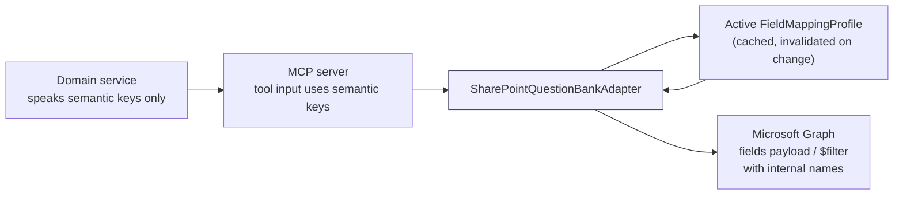

# SharePoint Field Mapping

How Knowzy's internal question fields become SharePoint list columns without a single internal field
name appearing in application code.

Column design: [sharepoint-question-bank.md §3](sharepoint-question-bank.md#3-column-design).

---

## 1. The problem this solves

SharePoint distinguishes three names per column, and only one of them is stable:

| Name | Example | Stability |
| --- | --- | --- |
| **Display name** | `Question Text` | Administrators can rename it at any time |
| **Internal name** | `QuestionText`, or `field_4`, or `Question_x0020_Text` | Fixed at creation, **differs between environments** |
| **Static name** | usually equals the internal name | Fixed |

The internal name is what Microsoft Graph requires in `fields` payloads and `$filter` expressions, and
it is assigned when the column is created. The same logical list, created three different ways, yields
three different internal names:

| Creation method | Resulting internal name for "Question Text" |
| --- | --- |
| Created via Graph/CSOM with an explicit internal name | `QuestionText` |
| Created through the SharePoint UI as a new column | `QuestionText` (if typed without spaces) |
| Created through the SharePoint UI as "Question Text" | `Question_x0020_Text` |
| Added to a list originally built from a template, or renamed after creation | `field_4` |

A design that hardcodes any of these is a design that works in dev and fails in production. Worse, a
design that hardcodes `field_4` — a name carrying no meaning — produces a codebase nobody can safely
change.

### 1.1 Design position

> Knowzy code refers to question fields by **internal semantic keys** (`questionText`,
> `correctAnswer`, `sourceDocumentId`). A `FieldMappingProfile` row translates each key to the
> internal SharePoint name for one environment's list. Only `SharePointQuestionBankAdapter` ever
> sees a SharePoint internal name, and it reads every one of them from the active profile.

Consequences:

- A list whose columns are `field_1`…`field_40` is fully supported with zero code change.
- Onboarding a second environment is a profile row, not a release.
- A renamed display name changes nothing, because the platform never uses display names for I/O.
- A missing or mistyped column is caught by profile validation with a precise message, not by a
  runtime 400 from Graph.

---

## 2. Semantic key catalogue

The keys are the contract. They are stable across environments, list recreations, and SharePoint
renames, and they match the field names in
[data-model.md §6.1](data-model.md#61-draftquestion).

| Group | Semantic keys |
| --- | --- |
| Identity | `title` · `questionId` · `internalQuestionId` · `questionType` |
| Content | `questionText` · `optionA` · `optionB` · `optionC` · `optionD` · `correctAnswer` · `explanation` |
| Taxonomy | `domain` · `domainCode` · `topic` · `learningObjective` · `cognitiveLevel` · `targetAudience` |
| Lineage | `sourceId` · `sourceName` · `sourceType` · `sourceSite` · `sourceLibrary` · `sourceFolderPath` · `sourceDocumentId` · `sourceDocumentName` · `sourceUrl` · `sourceVersion` · `sourceSectionKey` · `sourceSectionLocation` · `supportingEvidence` · `sourceContentHash` · `sourceSectionHash` |
| Provenance | `generationJobId` · `generatorModel` · `promptVersion` · `generationTimestamp` · `confidenceIndicator` · `generatedBy` |
| Governance | `status` · `isActive` · `isPublished` · `version` · `approvedBy` · `approvalDate` · `approvalComment` · `publishedBy` · `publishedDate` · `retiredBy` · `retiredDate` · `retireComment` · `reviewComments` · `correlationId` · `needsRevalidation` |

Fifty keys. Adding a key is a schema change to the profile model and is versioned (§7).

---

## 3. Profile model

`FieldMappingProfile` and `FieldMapping` in PostgreSQL:

| Entity | Columns |
| --- | --- |
| `FieldMappingProfile` | `key` (unique, e.g. `knowzy-default-v1`), `name`, `description`, `environment`, `targetSiteId`, `targetListId`, `schemaVersion`, `status` (`DRAFT`, `VALIDATED`, `ACTIVE`, `RETIRED`), `validatedAt`, `validationResult` (`jsonb`), `activatedAt`, `activatedByUserId` |
| `FieldMapping` | `profileId`, `semanticKey`, `internalName`, `displayNameAtMapping`, `sharePointType`, `isRequired`, `isIndexed`, `maxLength?`, `choiceValues?` (`text[]`), `transform?` (§5), `notes?` |

Unique on `(profileId, semanticKey)` and on `(profileId, internalName)` — a profile cannot map two
keys to one column, which would silently overwrite data.

### 3.1 Example profile (illustrative)

```jsonc
// Illustrative only. No real tenant list was read to produce this.
{
  "key": "knowzy-default-v1",
  "environment": "dev",
  "targetSiteId": "(resolved at Test Connection time — not asserted here)",
  "targetListId": "(resolved at Test Connection time — not asserted here)",
  "schemaVersion": 1,
  "status": "VALIDATED",
  "mappings": [
    { "semanticKey": "questionId",         "internalName": "QuestionID",
      "sharePointType": "Text",     "isRequired": true,  "isIndexed": true,  "maxLength": 48 },
    { "semanticKey": "questionText",       "internalName": "QuestionText",
      "sharePointType": "Note",     "isRequired": true,  "isIndexed": false },
    { "semanticKey": "correctAnswer",      "internalName": "CorrectAnswer",
      "sharePointType": "Choice",   "isRequired": true,  "isIndexed": false,
      "choiceValues": ["A", "B", "C", "D"] },
    { "semanticKey": "isActive",           "internalName": "IsActive",
      "sharePointType": "Boolean",  "isRequired": true,  "isIndexed": true },
    { "semanticKey": "approvedBy",         "internalName": "ApprovedBy",
      "sharePointType": "User",     "isRequired": true,  "isIndexed": false,
      "transform": "USER_LOOKUP_BY_UPN" },
    { "semanticKey": "generationTimestamp","internalName": "GenerationTimestamp",
      "sharePointType": "DateTime", "isRequired": true,  "isIndexed": false,
      "transform": "ISO8601_UTC" }
  ]
}
```

### 3.2 A legacy profile for the same list

```jsonc
// The same logical list, created through the SharePoint UI and later renamed.
// Nothing in Knowzy's code changes — only these internalName values.
{
  "key": "contoso-legacy-bank",
  "environment": "prod",
  "schemaVersion": 1,
  "status": "VALIDATED",
  "mappings": [
    { "semanticKey": "questionId",   "internalName": "field_1",
      "displayNameAtMapping": "Question ID",   "sharePointType": "Text",   "isIndexed": true },
    { "semanticKey": "questionText", "internalName": "field_4",
      "displayNameAtMapping": "Question Text", "sharePointType": "Note" },
    { "semanticKey": "optionA",      "internalName": "field_5",
      "displayNameAtMapping": "Option A",      "sharePointType": "Note" },
    { "semanticKey": "correctAnswer","internalName": "field_9",
      "displayNameAtMapping": "Correct Answer","sharePointType": "Choice",
      "choiceValues": ["A", "B", "C", "D"] },
    { "semanticKey": "isActive",     "internalName": "Question_x0020_Active",
      "displayNameAtMapping": "Question Active","sharePointType": "Boolean", "isIndexed": true }
  ]
}
```

`displayNameAtMapping` is captured so a human reading the profile can tell what `field_4` *is*. It is
recorded for comprehension, never used for I/O — if an administrator renames the column tomorrow, the
profile keeps working and the recorded display name is refreshed on the next validation.

---

## 4. Resolution and enforcement

### 4.1 Where mapping happens



The boundary is exactly one class. `@knowzy/shared-types` exports the semantic key union, and a lint
rule rejects any string literal matching `/^field_\d+$/` or `/_x0020_/` anywhere outside the adapter
package. A layer test asserts that no domain service imports the adapter's types
([repository-structure.md §5](repository-structure.md#5-dependency-rules)).

### 4.2 Resolution rules

| # | Rule |
| --- | --- |
| R1 | The active profile is selected by `(environment, targetListId)`; exactly one profile per list may be `ACTIVE`, enforced by a partial unique index |
| R2 | Resolution is by semantic key. A key with no mapping raises `FIELD_MAPPING_INCOMPLETE` **before** any Graph call, naming the missing key |
| R3 | A write payload is built from mapped keys only. An unmapped internal name can never appear in a payload, because the payload is constructed by iterating the profile, not the object |
| R4 | `$filter` and `$select` expressions are built from the profile too, so a filtered read cannot reference a column that does not exist |
| R5 | The profile is cached in process with the profile row's `updatedAt` as the cache key; any profile change invalidates it immediately |
| R6 | A `DRAFT` profile is usable for dry runs only. Publishing requires `ACTIVE`, which requires `VALIDATED` |
| R7 | Required keys missing from a profile block activation. Optional keys may be unmapped; the adapter simply omits them from the payload and records which keys were omitted on the publish operation |

### 4.3 Dry run

`publish_question_to_sharepoint` with `dryRun: true` returns the exact resolved payload:

```jsonc
// Illustrative output of a dry run against the legacy profile above.
{
  "outcome": "DRY_RUN",
  "profileKey": "contoso-legacy-bank",
  "writtenFields": {
    "field_1": "KNZ-NET-2026-000412",
    "field_4": "Which command clears the ARP cache on the Linux jump host?",
    "field_5": "arp -d *",
    "field_9": "B",
    "Question_x0020_Active": true
  },
  "omittedOptionalKeys": ["cognitiveLevel", "targetAudience"],
  "warnings": []
}
```

This is the screen an administrator reads before enabling `sharepoint.write.enabled` for an
environment. It is the cheapest possible way to catch a mapping mistake — before anything is written.

---

## 5. Type compatibility and transforms

| Semantic type | SharePoint type | Transform | Notes |
| --- | --- | --- | --- |
| String (short) | `Text` | `TRUNCATE_GUARD` | Write fails with `FIELD_VALUE_TOO_LONG` rather than truncating silently. `maxLength` in the profile is validated against the column's actual limit. |
| String (long) | `Note` (plain text) | `PLAIN_TEXT` | Rich-text columns are **rejected** at validation: markup in a question would reach the quiz runner |
| Enumerated | `Choice` | `ENUM_TO_CHOICE` | Every platform enum value must exist in `choiceValues`, or validation fails naming the gap. `Fill-in choices` must be disabled |
| Boolean | `Boolean` | — | A `Choice` of Yes/No is accepted with `CHOICE_TO_BOOLEAN`, flagged as a warning |
| Integer | `Number` (0 dp) | `INTEGER` | Decimal places > 0 is a validation warning |
| Decimal | `Number` (3 dp) | `DECIMAL_3` | Used by `confidenceIndicator` |
| Timestamp | `DateTime` | `ISO8601_UTC` | Always written UTC; SharePoint's regional display is a presentation concern ([data-model.md §9](data-model.md#9-time-and-timezone-rules)) |
| User | `User` | `USER_LOOKUP_BY_UPN` | Resolves the Entra user; on failure falls back to `USER_AS_TEXT` into a paired text column if one is mapped, else records `unresolvedUsers` on the operation rather than failing the publish |
| User (degraded) | `Text` | `USER_AS_TEXT` | For tenants where the platform identity cannot resolve people; writes the display name plus UPN |
| URL | `URL` | `HYPERLINK` | Written as `{ Url, Description }`; the description is the document name |
| Hash | `Text(64)` | — | Lowercase hex, validated |
| Multi-value | `MultiChoice` | `ARRAY_TO_MULTICHOICE` | Not used in release 1; present for future question types |

### 5.1 Transform rules

1. Transforms are **pure, total functions** with a declared inverse for reads. A transform that cannot
   round-trip is not permitted — reconciliation compares values after the inverse, so a lossy
   transform would manufacture permanent false drift.
2. Every transform is unit-tested with a fixture table covering empty, maximum-length, Unicode,
   and boundary values.
3. Read and write use the same transform registry, so `publish` and `reconcile` cannot disagree about
   what a value means.
4. A transform never silently coerces. Failure produces `FIELD_TRANSFORM_FAILED` with the semantic
   key, the offending value's shape (not the value itself, which may be content), and the reason.

---

## 6. Profile validation

Run on demand, on save, before activation, and nightly against the active profile.

| # | Check | Severity on failure |
| --- | --- | --- |
| 1 | List resolves by `targetListId` | Blocking |
| 2 | Every mapped `internalName` exists on the list | Blocking |
| 3 | Every required semantic key is mapped | Blocking |
| 4 | Column type is compatible with the semantic type | Blocking |
| 5 | `Choice` columns contain every platform enum value | Blocking |
| 6 | `Note` columns are plain text, not rich text | Blocking |
| 7 | `maxLength` in the profile does not exceed the column's actual limit | Blocking |
| 8 | Columns the platform requires to be indexed are indexed | Warning — filtered reads degrade above the list view threshold |
| 9 | No two semantic keys map to one internal name | Blocking (also a database constraint) |
| 10 | No mapped column is read-only or calculated | Blocking |
| 11 | `displayNameAtMapping` still matches the live display name | Informational — refreshed automatically |
| 12 | Unmapped columns exist on the list that the platform does not write | Informational — reported so an administrator knows the platform is not maintaining them |

The validation result is stored on the profile (`validationResult`) with the timestamp, and the
Settings screen always shows when validation last ran. A profile is never described as valid on the
basis of a past run without showing that run's date.

### 6.1 Auto-generating a profile

For an administrator-provisioned list, "Generate mapping profile" reads the list schema via Graph and
proposes mappings by matching, in order:

1. Exact internal-name match to the semantic key in PascalCase (`questionText` → `QuestionText`).
2. Exact display-name match after normalization (`Question Text` → `questionText`).
3. Decoded display-name match for `_x0020_`-style names.
4. Trigram similarity ≥ 0.80 against the semantic key's canonical display name, offered as a
   **suggestion requiring confirmation**.
5. Unmatched keys are left blank and listed as required work.

Every generated mapping is marked `proposed` until a human with `platform.configure` confirms it. The
platform never activates a machine-guessed mapping: a wrong guess on `correctAnswer` would write
answer keys into the wrong column.

---

## 7. Profile versioning and change control

| Situation | Handling |
| --- | --- |
| A new semantic key is added to the platform | `schemaVersion` increments. Existing profiles become `VALIDATED` with a warning listing the unmapped new key; if the key is required, they are downgraded to `DRAFT` and publishing is blocked until mapped. This is deliberate — a silent omission would lose data. |
| A column is renamed in SharePoint | No action. Internal names do not change on rename; `displayNameAtMapping` refreshes on the next validation. |
| A column is deleted in SharePoint | Nightly validation fails check 2, the profile is flagged, publishing is blocked, and Platform Administrators are notified. |
| A column's type is changed | Check 4 fails; publishing is blocked. Type changes are never absorbed silently. |
| A new list is created for a new environment | New profile, new key. Profiles are never shared across environments ([environment-and-configuration.md](environment-and-configuration.md)). |
| A mapping must change on a live list | Create a new profile version, validate it, dry-run a representative question, then activate. Activation is audited with the full before/after mapping set as `ADMIN.FIELDMAPPING.ACTIVATED`. |
| A profile is retired | `RETIRED`; retained forever, because a `PublishOperation` references the profile that wrote each item and an auditor must be able to see which mapping produced a given field value. |

### 7.1 Audit

Every profile create, edit, validate, activate, and retire writes an audit event with the previous and
new mapping set. `PublishOperation` records `mappingProfileId` and `mappingProfileVersion`, so for any
bank item the platform can answer "which column did this value go into, and under which mapping?"
years later.

---

## 8. Mock and non-SharePoint sources

The mapping layer belongs to the **Question Bank adapter**, not to the question model, so alternative
bank implementations need no mapping at all:

| Bank implementation | Mapping |
| --- | --- |
| `SharePointQuestionBankAdapter` | Full profile as described here |
| `MockQuestionBankAdapter` (local development) | Identity mapping — semantic keys are the storage keys. No profile, no tenant values, no credentials |
| A future relational or API-backed bank | Its own adapter; it may ignore `FieldMappingProfile` entirely, because the profile is a SharePoint concern |

This is the same separation that makes goal G8 hold on the read side: the internal semantic key set is
the stable contract, and each adapter is responsible for its own external naming.
