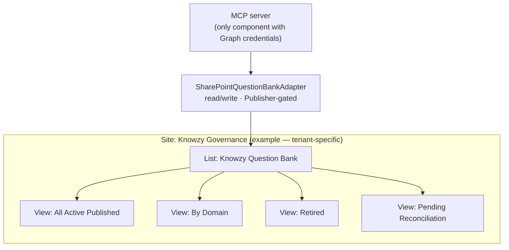
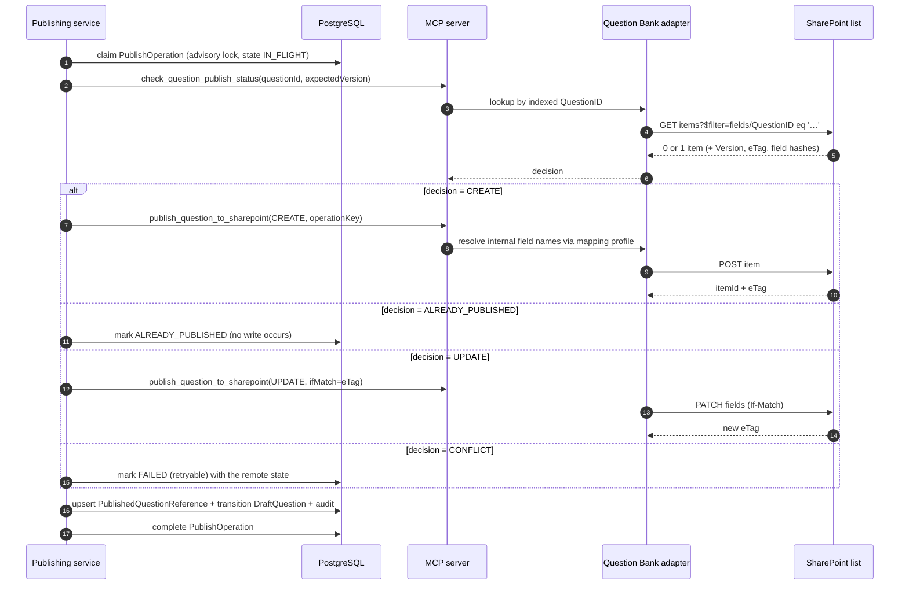
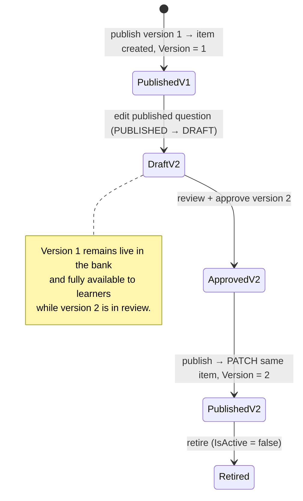
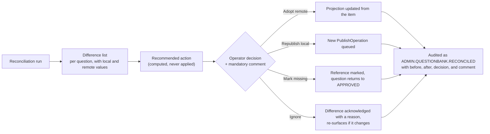

# SharePoint Question Bank Design

**Option A, confirmed:** approved and published question content is authoritative in a SharePoint List
named **Knowzy Question Bank**. PostgreSQL holds a reference and a projection, never a second copy of
the answer key.

Decision rationale and trade-offs: [ADR-002](risks-and-decisions.md#adr-002-option-a--sharepoint-list-as-the-question-bank-of-record).
Field naming and mapping profiles: [sharepoint-field-mapping.md](sharepoint-field-mapping.md).

---

## 1. Purpose and authority

| Concern | Authority | Why |
| --- | --- | --- |
| Approved question **content** — text, options, correct answer, explanation, lineage, governance flags | **SharePoint list item** | Native versioning, permissions, retention, eDiscovery; the repository survives the application |
| Question **identity and workflow state** before publication | PostgreSQL `DraftQuestion` | Lifecycle, reviews, approvals, and versions are relational workflow data |
| Published question **discoverability** — pool filtering, dashboards, reporting | PostgreSQL `PublishedQuestionReference` | SharePoint list querying is too weak for the query patterns assessment selection needs |
| Proof of publication | `sharePointItemId` + `eTag` in PostgreSQL | A question is never marked `PUBLISHED` without a verified item ID |

### 1.1 The one-copy rule

The correct answer and the explanation exist in exactly two places, both intentional:

1. The bank item — authoritative, governed by SharePoint.
2. The immutable `QuizSessionQuestion` snapshot of an individual attempt — required so a scored
   attempt is reproducible years later ([data-model.md §8.3](data-model.md#83-quizsession-and-quizsessionquestion)).

`PublishedQuestionReference` stores **hashes** of the question text and answer payload for drift
detection, never the values. A schema test asserts the absence of answer columns on that table
([data-model.md §13](data-model.md#13-constraints-and-invariants), I5).

---

## 2. List design

### 2.1 Placement



The Question Bank lives on a **different site** from knowledge documents, with a different permission
grant. Only this site receives a write grant, and only for this list. Knowledge-document sites remain
read-only to the platform identity ([architecture.md §8.1](architecture.md#81-two-distinct-sharepoint-roles)).

### 2.2 List settings

| Setting | Value | Reason |
| --- | --- | --- |
| List type | Generic custom list | No document library semantics are needed |
| Versioning | **Enabled**, major versions, limit 100 | Native version history is a primary reason for Option A |
| Content approval | **Disabled** | Approval happens in Knowzy with the full 13-gate evaluation and separation of duties; a second, weaker approval in SharePoint would create two conflicting sources of governance truth |
| Attachments | **Disabled** | A question is data, not a document |
| Item-level permissions | Default (site-inherited) | Learners never read the list directly; all access is server-side |
| Quick Edit | Disabled | Discourages manual edits that would immediately appear as reconciliation drift |
| Indexed columns | `QuestionID`, `Domain`, `Topic`, `Status`, `IsActive`, `IsPublished`, `Version`, `SourceDocumentID` | Filtering on a non-indexed column fails above the list view threshold — this is not optional |
| Unique-value enforcement | `QuestionID` | A second layer behind the platform's own uniqueness |

### 2.3 Tenant-specific values

Site URL, site ID, list ID, and the resolved internal field names are **configuration**, stored in
`ApplicationConfiguration` under `questionBank.*` per environment and resolved at runtime:

> **Illustrative example only — not a real value and no connection has been made:**
> ```
> questionBank.siteUrl        : https://contoso.sharepoint.com/sites/KnowzyGovernance
> questionBank.siteId         : (resolved by Test Connection — not asserted here)
> questionBank.listTitle      : Knowzy Question Bank
> questionBank.listId         : (resolved by Test Connection — not asserted here)
> questionBank.mappingProfile : knowzy-default-v1
> questionBank.writeEnabled   : false        (feature flag default)
> ```
> See [assumptions-and-tenant-configuration.md](assumptions-and-tenant-configuration.md).

---

## 3. Column design

Display names are the contract for administrators; internal names are resolved per environment
through a mapping profile, because SharePoint assigns internal names at creation time and a list
created through the UI can end up with `field_1`, `field_4`, … names that differ between environments.
Only the adapter ever sees an internal name ([sharepoint-field-mapping.md](sharepoint-field-mapping.md)).

### 3.1 Identity and content

| Display name | Type | Required | Indexed | Notes |
| --- | --- | --- | --- | --- |
| `Title` | Single line | Yes | — | Set to `QuestionID` so the default list view is usable; not the platform's identifier |
| `QuestionID` | Single line (48) | Yes | **Yes**, unique | `KNZ-{DOMAIN_CODE}-{YYYY}-{SEQ}`, e.g. `KNZ-NET-2026-000412` (example) |
| `InternalQuestionId` | Single line (36) | Yes | Yes | The Knowzy UUID — the durable join key if `QuestionID` format ever changes |
| `QuestionType` | Choice | Yes | — | `MULTIPLE_CHOICE_4` in release 1; the full enum is provisioned so no column change is needed later |
| `QuestionText` | Multiple lines (plain) | Yes | — | Plain text, not rich text: rich text would invite markup injection into the quiz runner |
| `OptionA` … `OptionD` | Multiple lines (plain) | Yes | — | One column each. A JSON blob would defeat the native-governance rationale for Option A |
| `CorrectAnswer` | Choice (`A`,`B`,`C`,`D`) | Yes | — | Single letter |
| `Explanation` | Multiple lines (plain) | Yes | — | Shown to learners only after a terminal session state |

### 3.2 Taxonomy

| Display name | Type | Required | Indexed |
| --- | --- | --- | --- |
| `Domain` | Single line | Yes | **Yes** |
| `DomainCode` | Single line (16) | Yes | Yes |
| `Topic` | Single line | Yes | **Yes** |
| `LearningObjective` | Single line | No | — |
| `CognitiveLevel` | Choice (`RECALL`,`APPLICATION`,`ANALYSIS`) | No | — |
| `TargetAudience` | Single line | No | — |

Taxonomy is written as **text, not lookup columns**. Lookups add throttling cost, break on list
recreation, and would make the bank depend on a second SharePoint list whose lifecycle Knowzy does not
control. PostgreSQL holds the referential integrity; the bank holds the resolved labels plus
`DomainCode` so a label rename never orphans an item.

### 3.3 Source lineage

| Display name | Type | Indexed | Notes |
| --- | --- | --- | --- |
| `SourceID` | Single line (36) | — | `KnowledgeSource.id` |
| `SourceName` | Single line | — | |
| `SourceType` | Choice | — | Full `SourceType` enum provisioned |
| `SourceSite` | Single line | — | Display name |
| `SourceLibrary` | Single line | — | |
| `SourceFolderPath` | Single line (255) | — | |
| `SourceDocumentID` | Single line (128) | **Yes** | Enables "all questions from this document" without a full scan |
| `SourceDocumentName` | Single line | — | |
| `SourceURL` | Hyperlink | — | Resolvable link; SharePoint permissions remain the final gate |
| `SourceVersion` | Single line (32) | — | Version label at generation time |
| `SourceSectionKey` | Single line (64) | — | Stable section identifier |
| `SourceSectionLocation` | Single line (255) | — | Human-readable: heading path, page, slide, or sheet |
| `SupportingEvidence` | Multiple lines (plain) | — | The verified verbatim span |
| `SourceContentHash` | Single line (64) | — | Document hash at generation time |
| `SourceSectionHash` | Single line (64) | — | Section hash at generation time |

### 3.4 Generation provenance

| Display name | Type | Notes |
| --- | --- | --- |
| `GenerationJobID` | Single line (36) | |
| `GeneratorModel` | Single line (64) | The model the generator used, whichever provider ran. Renamed from `ClaudeModel` on 2026-09-26 (P-4) while NO TENANT LIST EXISTS, which is the only moment the rename is free. Configuration value in force at run time |
| `PromptVersion` | Single line (32) | Immutable prompt version |
| `GenerationTimestamp` | Date and time | UTC |
| `ConfidenceIndicator` | Number (3 dp) | Platform-computed composite, advisory only |
| `GeneratedBy` | Person or Group | Requesting author |

### 3.5 Governance and workflow

| Display name | Type | Required | Indexed | Notes |
| --- | --- | --- | --- | --- |
| `Status` | Choice | Yes | **Yes** | `Published`, `Retired`, `Superseded` — the bank only ever holds post-approval states |
| `IsActive` | Yes/No | Yes | **Yes** | Retirement sets this false; the item is never deleted |
| `IsPublished` | Yes/No | Yes | **Yes** | Separates "written to the bank" from "eligible for selection" |
| `Version` | Number (integer) | Yes | **Yes** | The published question version |
| `ApprovedBy` | Person or Group | Yes | — | Named accountability, per goal G2 |
| `ApprovalDate` | Date and time | Yes | — | |
| `ApprovalComment` | Multiple lines | No | — | |
| `PublishedBy` | Person or Group | Yes | — | |
| `PublishedDate` | Date and time | Yes | — | |
| `RetiredBy` | Person or Group | No | — | |
| `RetiredDate` | Date and time | No | — | |
| `RetireComment` | Multiple lines | No | — | Mandatory at retirement, enforced by the platform |
| `ReviewComments` | Multiple lines | No | — | Flattened review history for readability inside SharePoint |
| `KnowzyCorrelationID` | Single line (64) | Yes | — | Links the item to the audit trail and the publish operation |
| `NeedsRevalidation` | Yes/No | No | — | Mirrors the platform flag so a SharePoint reader sees the same state |

### 3.6 What is deliberately absent

| Not stored in the bank | Why |
| --- | --- |
| Draft, rejected, or archived questions | The bank holds released content only. Work in progress lives in PostgreSQL. |
| Review and approval **transitions** | Relational workflow data. Only the outcome and the flattened comment history are written. |
| Learner responses, sessions, results | Learning data never touches the bank. |
| Item statistics (difficulty, distractor distribution) | Derived analytics; recomputed in PostgreSQL and would immediately be stale in the bank. |
| Similarity scores and cluster IDs | Recomputed as the corpus changes; a stale score in a governed store would be misleading. |
| Any secret, token, or credential | Never, anywhere. |

---

## 4. Governance rules

These rules are normative. Each is enforced server-side and each is auditable.

| # | Rule | Enforcement |
| --- | --- | --- |
| G1 | **Only approved questions are written.** A write is refused unless the question's status is `APPROVED` and all 13 gates in [authoring-portal.md §5.7](authoring-portal.md#57-approval-blocking-gates) pass at the moment of the write. | `publish_question_to_sharepoint` re-evaluates the gates; it does not trust the caller's assertion |
| G2 | **Writes are server-side only.** No browser code path, no client credential, no user-delegated write. | The Graph write credential exists only in the MCP server process; `ca-knowzy-mcp` has internal ingress only |
| G3 | **Writes are role-gated.** `question.publish` for create/update, `question.retire` for retirement. | Envelope permission check before argument validation |
| G4 | **Writes are feature-flagged.** `sharepoint.write.enabled` defaults **off**; until enabled, publishing runs in dry-run mode and says so prominently. | [environment-and-configuration.md §6](environment-and-configuration.md#6-feature-flags) |
| G5 | **Writes are idempotent.** Deterministic operation key plus a pre-write existence check. | §5 |
| G6 | **Writes are audited.** `AUTHORING.QUESTION.PUBLISHED` / `.RETIRED` with the item ID, ETag, version, field set written, and correlation ID, committed in the same transaction as the local state change. | [audit-model.md §2](audit-model.md#2-event-taxonomy) |
| G7 | **Nothing is ever deleted.** Retirement sets `IsActive = false` and `Status = Retired`. There is no delete code path against the list. | The adapter exposes no `deleteItem` method; the conformance suite asserts its absence |
| G8 | **Updates are conditional.** Every update carries `If-Match: {eTag}`. A 412 triggers re-read and re-evaluation, never a blind overwrite. | §5.3 |
| G9 | **A question is `PUBLISHED` locally only with a verified item ID.** | Transactional order: item ID returned → `PublishedQuestionReference` upserted → status transition, all in one transaction |
| G10 | **The bank is never the source of an authorization decision.** Learner eligibility, scope, and answer-key access are decided in Knowzy. | The bank has no learner-facing read path |
| G11 | **Manual edits are detected, not prevented.** SharePoint permissions can permit a human edit; reconciliation surfaces it as `FIELD_DRIFT` for an explicit operator decision. | §8 |
| G12 | **Field names are never hardcoded.** All writes resolve internal names through the active mapping profile. | [sharepoint-field-mapping.md](sharepoint-field-mapping.md) |
| G13 | **Retired questions stay readable.** They leave new assessment selection but remain intact in historical snapshots and results. | Selection filters on `IsActive AND IsPublished`; snapshots are independent copies |

### 4.1 SharePoint permission grant

| Principal | Grant | Scope |
| --- | --- | --- |
| Knowzy platform identity (`APP_ONLY_SITES_SELECTED`) | `Sites.Selected` → **Write** | The Knowzy Governance site only |
| Knowzy platform identity | No grant | Every knowledge-document site (read-only grants live there, separately) |
| Publishers (human) | Read on the list | Transparency; humans publish **through Knowzy**, not by editing the list |
| Auditors (human) | Read on the list | Independent verification of what the platform wrote |
| Learners | **No access** | Learners reach questions only through the API, which never returns a key for an active session |

Granting humans write access to the list is possible but discouraged, and the consequence is stated
plainly: manual edits become reconciliation drift that an operator must resolve, and the platform's
audit trail will not contain the change.

---

## 5. Idempotent publishing

### 5.1 Operation key

```
operationKey = sha256( targetListId + questionId + publishedVersion + operationType )
```

Stored with a unique index on `PublishOperation.operationKey`
([data-model.md §6.7](data-model.md#67-publishoperation)). The key is **deterministic**, so a retry
computes the same key and collides with the existing row rather than starting a second operation.

### 5.2 Write sequence



### 5.3 The five idempotency controls

| Control | Protects against |
| --- | --- |
| Deterministic `operationKey` with a unique index | Two concurrent publishes of the same question version |
| Pre-write existence check by indexed `QuestionID` | A create whose response was lost — the retry finds the item and returns `ALREADY_PUBLISHED` |
| `Idempotency-Key` header on the batch endpoint | A double-clicked or retried batch request; replay returns the original batch result |
| `If-Match: {eTag}` on every update | Lost-update overwrite of a concurrent change (including a manual SharePoint edit) |
| `IN_FLIGHT` reclaim with a timeout, re-checking remote state before acting | A worker crash mid-operation |

### 5.4 Partial batch handling

Each question publishes in its own transaction and its own operation record. A batch of 50 with 3
failures yields 47 `PUBLISHED` and 3 still `APPROVED` with retryable operations and stated reasons.
No question is ever left claiming publication without a verified item ID. The batch result enumerates
every item's outcome, and failures are retryable individually or as a group
([workflows.md §4.3](workflows.md#43-partial-batch-handling)).

### 5.5 QuestionID allocation

`proposedQuestionId` is allocated at generation from a per-domain PostgreSQL sequence and **confirmed**
at publication. It stays "proposed" until then because a conflict can force reallocation:

| Situation | Resolution |
| --- | --- |
| Item with this `QuestionID` exists for a **different** `InternalQuestionId` | Allocate the next sequence value, record the collision as a `PlatformConsistencyFinding`, and publish under the new ID. The proposed ID is never reused. |
| Sequence gap after a failed publish | Accepted. IDs are identifiers, not counts; gaps are normal and are never backfilled. |
| Domain code change | Prohibited once any question has published under it ([data-model.md §3.4](data-model.md#34-taxonomy)) |

---

## 6. Read strategy and throttling

SharePoint is the content authority but a poor query target. Every read path is designed around that.

| Read | Path | Why |
| --- | --- | --- |
| Assessment pool filtering | PostgreSQL `PublishedQuestionReference` | Runs on every session creation; needs multi-column predicates and joins |
| Dashboards and reports | PostgreSQL reporting read models | Aggregation over hundreds of thousands of rows |
| Question content for a live session | MCP → bank, **once**, at session creation, into the session snapshot | Content authority, read exactly once per attempt |
| Question content for review of a published question | MCP → bank with a short-TTL server-side cache (default 60 s) | Low volume, freshness matters |
| Reconciliation | MCP → bank, paged, scheduled off-peak | Full comparison, deliberately throttle-aware |

### 6.1 Throttling controls

| Control | Value |
| --- | --- |
| Client-side token bucket per Graph resource | Configurable; default 10 requests/second sustained per site |
| `Retry-After` honoured | Always; the value is never overridden with a shorter wait |
| Backoff | Exponential with full jitter, capped at 60 s, maximum 5 attempts for reads |
| Circuit breaker | Per source and per list; opens after 5 consecutive 5xx/429 storms, half-opens after 30 s |
| Batch reads | `$select` restricted to mapped fields only, `$top` 200, `expand=fields` once per page |
| Cache | Server-side, per-scope, short TTL; **no answer key in any shared cache** ([error-handling.md §9](error-handling.md#9-caching-rules)) |
| Reconciliation window | Scheduled, rate-limited, resumable by cursor; never run synchronously from a user request |

---

## 7. Versioning

Three version concepts coexist and must not be confused.

| Concept | Owned by | Meaning |
| --- | --- | --- |
| **Question version** (`DraftQuestion.version`) | Knowzy | Increments on every field edit of a draft. Most versions never publish. |
| **Published version** (`Version` column, `PublishedQuestionReference.publishedVersion`) | Knowzy, written to the bank | The question version that was published. Monotonic per question. |
| **List item version** (SharePoint `1.0`, `2.0`, …) | SharePoint | Native item history, one increment per write the platform performs |

### 7.1 Publishing a new version



| Rule | Detail |
| --- | --- |
| One item per `QuestionID` | A new version **updates** the existing item rather than creating a second one. Two items with one `QuestionID` would break every lookup and the uniqueness constraint. |
| Version N stays live until N+1 publishes | An edit does not withdraw the published question. Availability is never reduced as a side effect of authoring. |
| History of version N | Preserved in three places: the SharePoint item's native version history, `DraftQuestionVersion` (full snapshot plus field-level diff), and any `QuizSessionQuestion` snapshot that served it. |
| In-flight assessments | Continue to reference the version they started on. Snapshots and results are never rewritten ([workflows.md §3.5](workflows.md#35-versioning)). |
| Eligibility snapshots | Pin `(questionId, publishedVersion)`. Publishing version 2 does not retroactively add it to an assessment release approved against version 1. |
| Superseded marking | When a question is replaced by a different question rather than a new version, the old item is set `Status = Superseded`, `IsActive = false`, with `RetireComment` naming the replacement `QuestionID`. |
| Native version limit | Capped at 100 major versions. A question exceeding it is a signal to investigate churn; the platform raises a `PlatformConsistencyFinding` at 90. |

### 7.2 What a version bump does **not** do

- It does not retire version N.
- It does not invalidate results scored against version N.
- It does not change the `QuestionID`, the `InternalQuestionId`, or the SharePoint item ID.
- It does not re-open approval for assessments that pinned version N.

---

## 8. Reconciliation

Because the bank is an external system with its own permissions, drift is possible. Reconciliation
makes drift **visible and operator-resolved**, never silently corrected.

### 8.1 Drift states

| State | Meaning | Typical cause | Recommended action |
| --- | --- | --- | --- |
| `IN_SYNC` | Local projection matches the item | — | None |
| `MISSING_REMOTE` | Local says published; no item with that `QuestionID` | Item deleted in SharePoint, or a create whose local record committed without a verified ID (prevented by G9, but checked anyway) | Republish local, or mark missing with a comment |
| `MISSING_LOCAL` | Item exists; no local reference | Item created manually, or a local record lost | Adopt remote into the projection, or flag as unmanaged |
| `VERSION_DRIFT` | `Version` differs between item and projection | A failed update that partially applied, or a manual edit of `Version` | Re-read remote, then republish the correct version |
| `STATUS_DRIFT` | `Status` / `IsActive` / `IsPublished` differ | Manual retirement or reactivation in SharePoint | Adopt remote (a human governance action) or republish local, with a comment either way |
| `FIELD_DRIFT` | Content hash of `QuestionText` or the answer payload differs | Manual content edit in SharePoint | **Never auto-overwritten.** Present both values and require an explicit decision |

### 8.2 Detection

Hash-based, so no content needs to be stored locally to detect a content change:

```
remoteQuestionTextHash = sha256(normalize(item.QuestionText))
remoteAnswerPayloadHash = sha256(normalize(item.OptionA|OptionB|OptionC|OptionD|CorrectAnswer))

FIELD_DRIFT  ⟺  remoteQuestionTextHash  != local.questionTextHash
             OR  remoteAnswerPayloadHash != local.answerPayloadHash
```

Normalization matches evidence-verification normalization
([workflows.md §2.5](workflows.md#25-evidence-verification-normative)) so whitespace and Unicode differences
introduced by SharePoint's own editor do not register as content changes.

### 8.3 Run modes

| Mode | Trigger | Scope | Notes |
| --- | --- | --- | --- |
| Scheduled | Nightly, off-peak | All published references, paged by cursor | Rate-limited and resumable; a run that is throttled resumes rather than restarting |
| On-demand | `/question-bank/reconcile`, `questionbank.reconcile` | All, one domain, or a question list | Read-only by default |
| Post-failure | Automatic after a publish batch with failures | The failed questions only | Confirms actual remote state before a retry |
| Pre-publish spot check | Inside `publish_question_to_sharepoint` | One question | This is the pre-write existence check; reconciliation is the same logic at scale |

### 8.4 Operator workflow



| Rule | Detail |
| --- | --- |
| No auto-heal | The tool applies nothing without `applyDecisions` and a per-question comment. An automated overwrite could destroy a deliberate human governance action. |
| Answer-key drift is escalated | `FIELD_DRIFT` touching `CorrectAnswer` raises a high-severity notification to Platform Administrators and the question's domain approvers, and the question is flagged so it is excluded from **new** session selection until resolved. In-flight sessions are unaffected because they hold snapshots. |
| Ignore is not forever | An `IGNORE` decision records the observed hashes. If they change again, the difference re-surfaces. |
| Retention interlock | Local deletion of a published reference is blocked while any drift is unresolved ([data-model.md §14](data-model.md#14-retention-and-deletion), rule 4) — otherwise the only record of a bank item could be lost. |
| Every run is reportable | Counts by state, unresolved age, and decisions taken are a standing report ([reporting.md §4](reporting.md#4-report-catalogue)). |

---

## 9. Provisioning the list

The list is created **once per environment** by an administrator, with the platform verifying rather
than assuming. Two supported paths:

| Path | How | When |
| --- | --- | --- |
| **Platform-provisioned** (recommended) | An administrator with `platform.configure` runs "Provision Question Bank" against a configured site. The platform creates the list, all columns with known internal names, the indexes, and the four views, then stores `listId` and a generated mapping profile. | Greenfield environments |
| **Administrator-provisioned** | The list already exists (created by hand or by a tenant template). The administrator supplies the site and list title; the platform resolves internal field names by reading the list schema and generates a mapping profile for review. | Existing governed lists, or tenants where app-only list creation is not permitted |

### 9.1 Verification before first write

| # | Check | Failure code |
| --- | --- | --- |
| 1 | Site resolves and is readable | `SOURCE_SITE_NOT_FOUND` / `SOURCE_SITE_FORBIDDEN` |
| 2 | List resolves by title and `listId` matches configuration | `QUESTIONBANK_LIST_NOT_FOUND` |
| 3 | Write access confirmed by a **dry-run** create-then-rollback on a reserved probe item, or by inspecting effective permissions where the tenant forbids probe writes | `QUESTIONBANK_WRITE_FORBIDDEN` |
| 4 | Every required column exists with a compatible type | `QUESTIONBANK_SCHEMA_INCOMPLETE` (naming the missing or mistyped columns) |
| 5 | All eight indexed columns are indexed | `QUESTIONBANK_INDEX_MISSING` (warning; publishing proceeds, filtered reads are degraded) |
| 6 | Versioning is enabled | `QUESTIONBANK_VERSIONING_DISABLED` (warning) |
| 7 | Mapping profile resolves every internal field name | `FIELD_MAPPING_INCOMPLETE` |
| 8 | `QuestionID` uniqueness is enforced | Warning; the platform's own constraint still applies |

Publishing stays disabled until checks 1–4 and 7 pass **and** `sharepoint.write.enabled` is turned on.
Nothing in this document asserts that any of these checks has been run in any tenant.

---

## 10. Known constraints and how the design absorbs them

| Constraint | Reality | Mitigation |
| --- | --- | --- |
| List view threshold (5,000 items) | Filtering on a non-indexed column fails once the list grows | Eight indexed columns (§2.2); every platform query filters on an indexed column; pool filtering does not touch SharePoint at all |
| Weak query surface | No joins, limited operators, no aggregation | `PublishedQuestionReference` projection carries every field the platform needs to filter or aggregate on |
| Throttling | Real and tenant-dependent | Token bucket, `Retry-After`, circuit breaker, off-peak reconciliation, read-once-per-session (§6.1) |
| Eventual consistency of list indexes | A freshly created item may not appear in a filtered query immediately | The pre-write existence check also matches on `InternalQuestionId`, and a create returns the item ID directly rather than being re-found by query |
| Internal field names are assigned at creation | `field_1`, `field_4`, … vary between environments | Mapping profiles ([sharepoint-field-mapping.md](sharepoint-field-mapping.md)); no internal name in code |
| Column type changes are disruptive | Changing a type in place can lose data | The full `QuestionType`, `SourceType`, and `CognitiveLevel` choice sets are provisioned from day one |
| Manual edits are possible | SharePoint permissions can allow them | Detected as drift, escalated for `CorrectAnswer`, never silently overwritten (§8) |
| 100-version cap per item | Native history is bounded | Finding raised at 90 versions; `DraftQuestionVersion` retains full local history regardless |
| SharePoint outage | Publishing and live question reads depend on it | Publishing queues and resumes; in-flight sessions are unaffected because they hold snapshots; session **creation** fails with a clear retryable error ([error-handling.md §5](error-handling.md#5-external-service-failures)) |
