# UX Design Standards

**What this document adds:** the information architecture, the design-system foundations, the
normative interaction and accessibility standards, and the content rules. Screens, layouts, and
module-level behaviour are specified in
[authoring-portal.md](authoring-portal.md) and [live-learning-portal.md](live-learning-portal.md) and
are not repeated here.

---

## 1. Design principles

| # | Principle | Test of the principle |
| --- | --- | --- |
| X1 | **Review speed is the product.** Generation only pays off if review is fast | An experienced reviewer can decide on a question without touching the mouse |
| X2 | **Never claim more than the platform knows.** Untested is "not yet tested"; stale is labelled; estimated is labelled | No screen displays a status the platform did not observe |
| X3 | **Evidence is always one glance away.** A question is never shown without a path to what it came from | The source span is visible beside the question, not behind a modal |
| X4 | **The learner's screen is minimal and calm.** A timed, high-stakes interaction is not the place for density | The quiz runner has one question, four options, and one primary action |
| X5 | **Bad days are designed.** Empty, loading, partial, and error states are specified for every module | No screen has an unspecified failure state |
| X6 | **Density serves the expert, clarity serves the newcomer.** Authoring is dense; learning is spacious | Two distinct layout scales in one design system |
| X7 | **Accessibility is a gate, not a pass.** WCAG 2.2 AA is verified before release, not retrofitted | §7 checklist is a release blocker |

---

## 2. Information architecture

Two applications, two navigation models, no shared shell.

```mermaid
graph TB
    subgraph AUTH["Authoring — task-oriented, role-filtered"]
        A0["Dashboard<br/>(what needs me now)"]
        A1["Knowledge<br/>Sources · Documents"]
        A2["Create<br/>Generate · Questions · Review"]
        A3["Release<br/>Question Bank · Assessments"]
        A4["Govern<br/>Access · Reports · Audit · Settings"]
        A0 --- A1 --- A2 --- A3 --- A4
    end

    subgraph LIVE["Live — linear, own-data only"]
        L0["Home<br/>(what's next for me)"]
        L1["Assessments"]
        L2["Quiz runner<br/>(focus mode)"]
        L3["Results · History"]
        L4["Refreshers · Achievements · Certificates"]
        L0 --> L1 --> L2 --> L3 --> L4
    end
```

| Rule | Detail |
| --- | --- |
| Four authoring groups, not eleven routes | Navigation groups map to the work (**Knowledge**, **Create**, **Release**, **Govern**), so a user finds a screen by intent rather than by remembering a route name |
| Role-filtered, server-authorized | Navigation renders only permitted modules; every route is independently authorized server-side ([access-control.md §4.3](access-control.md#43-enforcement-invariants)) |
| One primary action per screen | Visually dominant, keyboard-reachable, and the same action the `Enter` key performs |
| Breadcrumbs on detail screens | Source → path → document → question is a four-level drill; users must be able to climb back |
| Deep links are first-class | Every filtered list state is a URL. A reviewer can send a colleague a link to a specific queue, filter, and item |
| No cross-portal navigation | The Live Portal contains no link into authoring, and vice versa. The bundles are separate ([architecture.md §6.3](architecture.md#63-why-two-applications-rather-than-one-with-hidden-menus)) |
| Focus mode | While a quiz is active, learner navigation collapses to "Save and exit" |

---

## 3. Design system foundations

`@knowzy/shared-ui`: Radix primitives, Tailwind tokens, one component per concern, no ad-hoc styling
in feature code.

| Foundation | Standard |
| --- | --- |
| Type scale | A modular scale with a 16 px base; authoring body 14 px, learning body 16 px, quiz question 20–24 px. Never below 12 px, and never for anything a decision depends on |
| Spacing | 4 px base unit; authoring density uses 4/8/12, learning uses 8/16/24 |
| Colour tokens | Semantic only (`--surface`, `--border`, `--text-primary`, `--accent`, `--success`, `--warning`, `--danger`, `--info`). Feature code never references a hue |
| Contrast | 4.5:1 for text, 3:1 for large text and UI boundaries, verified per token pair in both themes as a build step |
| Themes | Light and dark, both meeting contrast; the system preference is honoured and overridable |
| Status colour | Always paired with an icon **and** text. `HEALTHY`/`DEGRADED`/`FAILED`/`UNTESTED` are never distinguishable by colour alone |
| Focus | A single high-contrast focus ring token, visible on every interactive element in both themes, never removed |
| Motion | Purposeful and brief (≤200 ms), only to show origin or state change; fully disabled under `prefers-reduced-motion` |
| Iconography | One set, decorative icons `aria-hidden`, meaningful icons labelled |
| Data display | One table component with consistent sort, filter, selection, empty, loading, and error behaviour, so eleven list screens behave identically |
| Charts | Never colour-only: direct labels or patterns, accessible text alternatives, and a data table behind every chart |
| Numbers | Scores always at the precision the decision used ([live-learning-portal.md §5.2](live-learning-portal.md#52-rounding-rule-normative)); counts with thousands separators; durations humanized with an exact value on hover |
| Timestamps | Relative for recency ("12 min ago") with the absolute UTC-derived local value on hover and in exports |
| Responsive | Authoring targets ≥1280 px with graceful degradation to 768 px; the Live Portal is fully usable at 320 px |

---

## 4. Interaction standards

| Concern | Standard |
| --- | --- |
| Destructive and irreversible actions | Confirmation naming the object and the consequence. Retire and reject require a comment before the confirm button enables |
| Optimistic UI | Permitted only for local, reversible state (filters, selection, expand). Never for a transition, a publish, or an answer |
| Long operations | Determinate progress where the total is known, the correlation ID visible, and a leave-safe design: navigating away never cancels a job |
| Save semantics | Explicit save in the review workspace, with a dirty indicator and an interception on navigate-away. Autosave is deliberately avoided: a half-edited question must not become the reviewed artifact |
| Conflict | On `VERSION_CONFLICT`, show what changed, who changed it, and offer "reload" or "reapply my edits". Never merge silently ([error-handling.md §7.1](error-handling.md#71-local-optimistic-concurrency)) |
| Selection and bulk | Selection persists across pagination within a filter, and the count is always visible. Bulk approve is visually distinct and states the cap |
| Filters | URL-reflected, individually removable as chips, with a single "clear all"; the active filter set is always visible above results |
| Tables | Sticky header, keyboard row navigation, `Space` to select, `Enter` to open, and a visible row count that respects data scope |
| Search | Debounced 250 ms, minimum two characters, result origin labelled ("indexed" vs "live from source") |
| Notifications | In-app, non-blocking, grouped by kind, never a modal for anything the user did not initiate |
| Empty states | Explain what the screen will contain and offer the one action that populates it, gated by permission |
| Undo | Where an action is reversible (filter, selection, exclusion), offer undo. Where it is not (publish, approve), do not pretend — confirm instead |

---

## 5. Review workspace interaction model

The highest-leverage interaction in the product. Shortcuts and layout are in
[authoring-portal.md §5](authoring-portal.md#5-question-review-workspace); this section is the
normative interaction contract.

### 5.1 Contract

| # | Requirement |
| --- | --- |
| V1 | **Three panes, always visible:** queue, question, evidence. The evidence panel is never behind a tab, a modal, or a scroll — comparing a question to its source is the entire job |
| V2 | The evidence span is **highlighted in place** within the surrounding section text, with the heading path, page/slide/sheet, verification result, and hash-match state |
| V3 | **No pane scroll resets** on navigation between items. A reviewer's position in the evidence text survives moving to the next question where the section is the same |
| V4 | The validation panel shows **all** gate results at once with their codes and plain-language reasons. An approver never discovers problems one attempt at a time |
| V5 | Editing question text or options **immediately re-runs** validation and re-verifies the evidence span, and the panel shows the re-check result before submission is permitted. Validation state is never silently carried over from before the edit |
| V6 | Every shortcut is discoverable (`?`), mirrored by a visible control, disabled while a text field has focus, and remappable by configuration |
| V7 | A mandatory-comment action (`reject`, `request changes`, `retire`) opens the comment box with focus already in it and the primary button disabled until the minimum length is met |
| V8 | The primary decision key (`Enter`) is queue-contextual — approve in the approval queue, submit in the author queue — and the button label always states which, so the key never does something unexpected |
| V9 | Decisions are **never** batched implicitly. `j`/`k` moves without deciding; a decision is always an explicit keystroke or click |
| V10 | After a decision the next item loads with focus on its heading, and a brief undo affordance is offered for the 5 s in which the transition is still reversible (comment-only corrections), after which it is not offered at all |
| V11 | Similar-question warnings are inline with the score and a link that opens the match **side by side**, not in a new tab that loses context |
| V12 | Confidence is shown with its component breakdown on demand, and never presented as authority — the label reads "composite confidence", not "quality" |

### 5.2 Anti-patterns, explicitly rejected

| Rejected | Why |
| --- | --- |
| Evidence in a modal | Comparison requires simultaneity. A modal makes the comparison serial and the review slow |
| Autosave on the reviewed artifact | The saved state must be the state the reviewer intended, not a keystroke mid-thought |
| Infinite scroll in the queue | Position must be stable and addressable; reviewers work in sessions and return |
| A single "Approve all" | Bulk approve exists, is permission-gated, capped, and enumerates item IDs in its confirmation. A one-click blanket approval would hollow out goal G2 |
| Colour-only validation state | Fails §7 and is unreadable at a glance in a dense panel |
| Hiding the queue during editing | A reviewer needs to know how much is left; it is what makes the work finite |

---

## 6. Quiz runner interaction model

| # | Requirement |
| --- | --- |
| Q1 | One question per screen. No progressive disclosure, no multi-question pages, no side content |
| Q2 | The question is the `<h1>` for the step; options are a single native-semantics radio group |
| Q3 | Selecting an option does not submit. Submission is an explicit action, so a mis-click is recoverable |
| Q4 | The primary action is reachable **without scrolling past the options** at 320 px width and 200 % zoom |
| Q5 | Progress ("Question 4 of 10") is visible and announced on every advance |
| Q6 | Remaining time comes from the server's authoritative value, is announced at configurable intervals and on request, and is never the only indication of expiry |
| Q7 | Backward navigation and answer change are permitted when the assessment allows it, and the previously chosen option is pre-selected on return |
| Q8 | Flagging a question for one's own later review is available and is purely private |
| Q9 | No feedback of any kind on submission — no correctness, no score, no explanation ([security.md §8](security.md#8-answer-key-protection)) |
| Q10 | A save or network failure states plainly that the answer is retrying and that progress is not lost, because it is not ([error-handling.md §10.4](error-handling.md#104-learner-specific-rules)) |
| Q11 | Focus moves to the new question heading on advance; focus is never lost, never trapped, and never left on a removed element |
| Q12 | "Save and exit" is always reachable in one action and never requires confirmation, because there is nothing to lose |

---

## 7. Accessibility standards

**Target: WCAG 2.2 Level AA for both portals.** The quiz runner carries the strictest requirements
because it is timed and high-stakes. These are normative and release-blocking.

### 7.1 Structure and semantics

| # | Standard |
| --- | --- |
| S1 | One `<h1>` per view; heading levels are sequential with no skips |
| S2 | Landmark regions (`banner`, `navigation`, `main`, `contentinfo`) on every page; a skip-to-content link is the first focusable element |
| S3 | Native semantics first. Radix primitives supply roles and states; a custom ARIA pattern requires a documented justification and a screen-reader test record |
| S4 | Every form control has a programmatically associated visible label. Placeholder text is never a label |
| S5 | Errors are associated with their control via `aria-describedby`, announced on occurrence, and summarized at the top of long forms with in-page links |
| S6 | Tables use `<th>` with `scope`, and a caption or an `aria-label` stating what the table contains |
| S7 | Icon-only controls have an accessible name; decorative icons are `aria-hidden` |

### 7.2 Keyboard

| # | Standard |
| --- | --- |
| K1 | Every function is operable by keyboard alone. No pointer-only interaction exists in either portal |
| K2 | Tab order follows visual order; `tabindex` above 0 is prohibited |
| K3 | Focus is always visible, using the single focus-ring token, in both themes, at 3:1 contrast against adjacent colours |
| K4 | No keyboard trap. Dialogs trap focus **within** the dialog, return it to the invoking element on close, and close on `Escape` |
| K5 | Single-character shortcuts (the review workspace) are disabled while a text field has focus and are remappable — satisfying WCAG 2.1.4 Character Key Shortcuts |
| K6 | Focus is managed on route change, on item advance, and on async content arrival; it is never silently reset to the document body |
| K7 | Drag operations, where any exist, have a keyboard equivalent (WCAG 2.5.7) |

### 7.3 Perception

| # | Standard |
| --- | --- |
| P1 | Text contrast 4.5:1; large text and UI component boundaries 3:1; verified per token pair in both themes as a build step, not by sampling |
| P2 | **No information conveyed by colour alone**, anywhere: source health, validation state, coverage bars, proficiency bands, correctness in the review view, chart series |
| P3 | Usable at 200 % zoom and at 320 px width with no loss of function and no horizontal scrolling of the page |
| P4 | Text is real text. No text in images; charts carry text alternatives and an underlying data table |
| P5 | `prefers-reduced-motion` disables all non-essential motion; no content relies on animation to be understood |
| P6 | Content reflows without loss at 400 % of a 1280 px viewport (WCAG 1.4.10) |
| P7 | Content on hover or focus is dismissable, hoverable, and persistent (WCAG 1.4.13) — relevant to the evidence and confidence tooltips |

### 7.4 Time and cognition

| # | Standard |
| --- | --- |
| T1 | Time limits exist only where an assessment defines one, and an administrator can grant a **per-learner time extension**, audited, as an accommodation |
| T2 | Remaining time is announced at intervals and on request, and expiry never occurs without prior warning |
| T3 | Session idle timeout warns before it expires and never discards unsaved work silently |
| T4 | A quiz answer is never lost to a timeout, because every answer is already persisted server-side |
| T5 | Plain language throughout; the reading level of learner-facing copy is reviewed, and error copy follows the standards in [error-handling.md §10.5](error-handling.md#105-copy-standards) |
| T6 | No unexpected context change on focus or input (WCAG 3.2.1, 3.2.2) |
| T7 | Consistent help placement and consistent component behaviour across screens (WCAG 3.2.3, 3.2.6) |
| T8 | No cognitive-function test for authentication beyond SSO (WCAG 3.3.8) |

### 7.5 Dynamic content

| # | Standard |
| --- | --- |
| D1 | Live regions: `polite` for progress, counts, and staleness; `assertive` only for errors and expiry warnings |
| D2 | Loading states are announced, not merely animated; skeletons match the final layout so nothing shifts on arrival (zero layout shift is a measured target) |
| D3 | Async result counts are announced ("23 questions in this queue") |
| D4 | Toasts are announced, dismissable by keyboard, persist long enough to read (minimum 6 s or until dismissed), and never carry the only copy of important information |
| D5 | A panel that fails independently announces its own failure and exposes its own retry |

### 7.6 Verification

| Gate | Method | When |
| --- | --- | --- |
| Automated | axe-core in CI on every route and every documented state; zero violations required to merge | Every commit |
| Contrast | Token-pair contrast test in both themes | Every commit |
| Keyboard | Scripted keyboard-only walkthrough of the review workspace, the quiz runner, the source editor, and the publish flow | Every release |
| Screen reader | Manual pass with NVDA + Firefox and VoiceOver + Safari on the quiz runner, the review workspace, and the results page | Every release |
| Zoom / reflow | 200 % and 400 % checks on both portals | Every release |
| Audit | Full WCAG 2.2 AA audit with findings tracked to closure | Before release 1 |

Automated testing catches perhaps half of what matters here; the manual gates are not optional, and
a release is not accessible because axe-core is green.

---

## 8. State, feedback, and density

Four states for every module, per
[authoring-portal.md §12](authoring-portal.md#12-empty-loading-and-error-states). What this document
adds:

| State | Additional standard |
| --- | --- |
| Empty | Distinguish "nothing exists yet" (offer the creating action) from "nothing matches your filters" (offer to clear them). Conflating them is the most common empty-state mistake |
| Loading | Skeletons match final layout; no spinner longer than 3 s without determinate progress; no layout shift on arrival |
| Partial | Each panel owns its own failure and retry; a partially loaded page is labelled so a user does not read a missing panel as a zero |
| Error | Per [error-handling.md §10](error-handling.md#10-user-facing-error-presentation) |
| **Stale** | A fifth state the platform needs because read models refresh asynchronously: every panel shows "as of {timestamp}", and connection health explicitly shows the last probe time rather than implying freshness |
| **Suppressed** | Aggregates below the minimum group size render an explicit "suppressed — group too small" marker, never a blank cell or a zero |
| **Estimated** | Modelled figures (duplicate-prevention savings, token cost) are labelled "estimated" with the constant shown |

---

## 9. Content and localization

### 9.1 Voice

| Rule | Detail |
| --- | --- |
| Direct and specific | "Publishing is not enabled for this environment" beats "Operation not permitted" |
| No blame | The system describes what happened, not what the user did wrong |
| No false precision | "Not yet tested" rather than a hopeful default; "estimated" where modelled |
| Sentence case | Headings, labels, and buttons. Title case only for proper nouns |
| Verbs on buttons | "Publish questions", not "OK" |
| No jargon in learner-facing copy | No "eligibility snapshot", "similarity cluster", or "read model" in the Live Portal |
| Consistent terminology | One term per concept, taken from [glossary.md](glossary.md). "Question", never "item" or "quiz question", within one surface |

### 9.2 Localization readiness

Release 1 ships a single locale (`en`), but the constraints hold from day one — retrofitting
externalization is expensive and always incomplete.

| # | Requirement |
| --- | --- |
| C1 | **All UI copy is externalized** from the first commit: labels, headings, empty states, validation messages, error messages, email and notification templates, PDF certificate text. No user-visible string literal in a component |
| C2 | Error copy is keyed by the stable error code ([error-handling.md §2.1](error-handling.md#21-code-registry-rules), E3), so one catalogue serves both the API and both portals |
| C3 | Interpolation is named (`{count}`, `{documentName}`), never positional or concatenated, because word order varies by language |
| C4 | Plurals use ICU plural rules, not `count === 1 ? 'x' : 'xs'` |
| C5 | Dates, times, numbers, and percentages are formatted through `Intl`, with the tenant time zone for date-only boundaries ([data-model.md §9](data-model.md#9-time-and-timezone-rules)) |
| C6 | Layouts tolerate ~35 % text expansion without truncation or overlap; a pseudo-localization build is part of CI to prove it |
| C7 | Logical CSS properties (`margin-inline`, `padding-inline`) throughout, so a future RTL locale is a stylesheet change rather than a rewrite |
| C8 | **Content is not localized.** Questions, options, explanations, evidence, and document names are rendered in the language of the source. The platform never machine-translates a question — an approved question's wording is what a human approved ([executive-summary.md §3.6](executive-summary.md#36-out-of-scope)) |
| C9 | The locale is a user preference with a tenant default, never inferred solely from the browser |
| C10 | Copy changes are reviewed as product changes and versioned with the release |

---

## 10. Design deliverables and review gates

| Deliverable | Contents |
| --- | --- |
| Token set | Type scale, spacing, colour tokens for both themes, focus ring, motion durations, with contrast verification |
| Component inventory | Every `@knowzy/shared-ui` component with its states (default, hover, focus, active, disabled, error, loading) and its accessibility contract |
| Screen specifications | Per module, all five states (empty, loading, partial, error, stale), at ≥1280 px and 768 px for authoring, 320 px and 1024 px for learning |
| Interaction specifications | The review workspace (§5) and quiz runner (§6) contracts, with focus-order diagrams |
| Copy catalogue | All externalized strings, error copy keyed by code, reviewed for voice |
| Accessibility record | axe results, contrast matrix, keyboard walkthrough scripts, screen-reader test notes, WCAG 2.2 AA audit findings |

### 10.1 Gates

| Gate | Blocks | Requires |
| --- | --- | --- |
| G-A11Y | Any merge | axe-core zero violations on affected routes; contrast test passing |
| G-STATE | Any new screen | All five states specified and implemented |
| G-COPY | Any new user-visible string | Externalized, keyed, reviewed for voice |
| G-KEYBOARD | Any change to the review workspace or quiz runner | Keyboard-only walkthrough passing; shortcut disabled-in-field behaviour verified |
| G-DENSITY | Any authoring list screen | Uses the shared table component; no bespoke list implementation |
| G-HONESTY | Any status, count, or metric display | Shows its `asOf`, and labels estimated, suppressed, and untested values per §8 |
