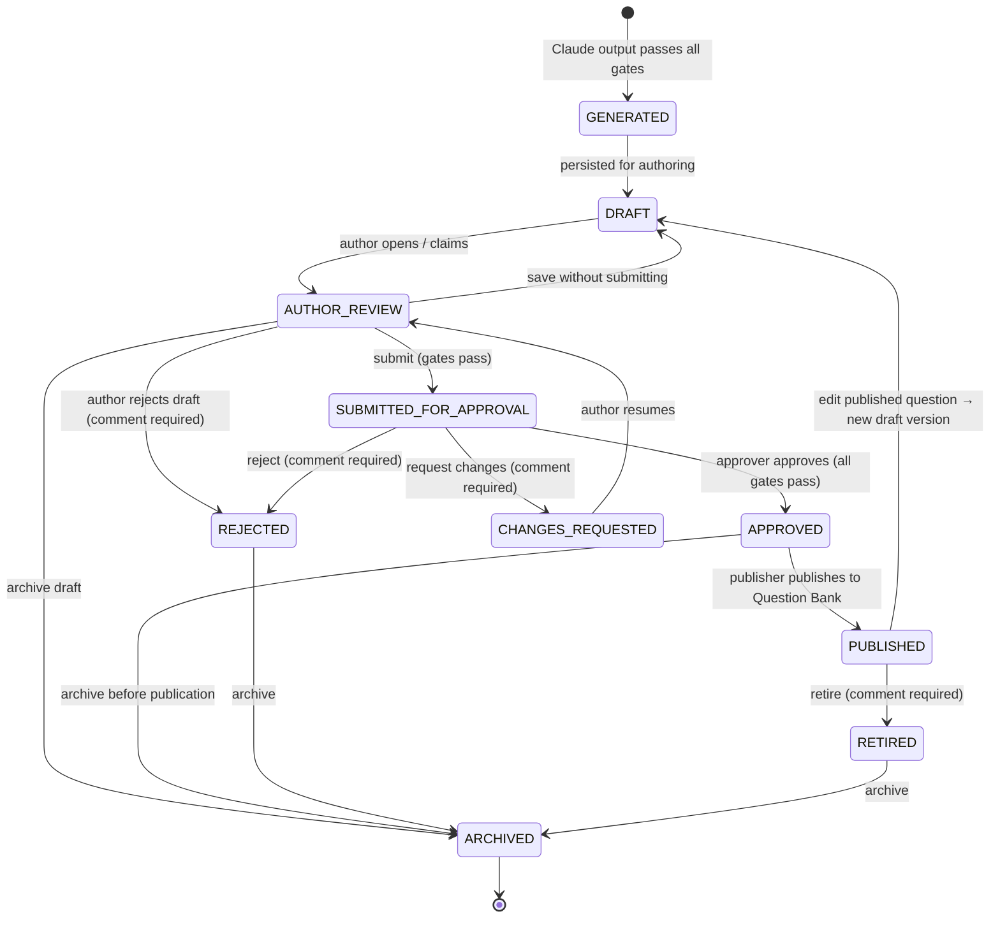
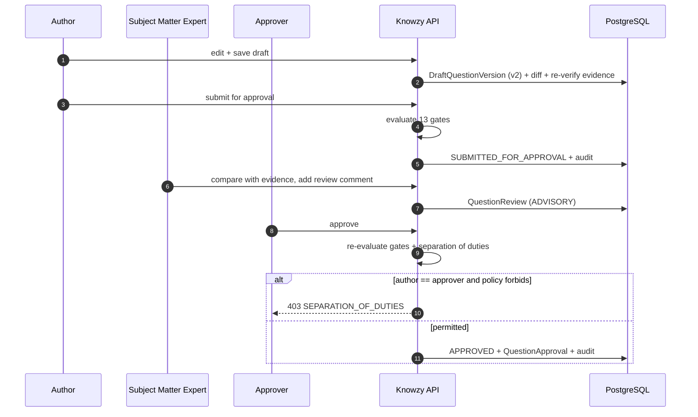
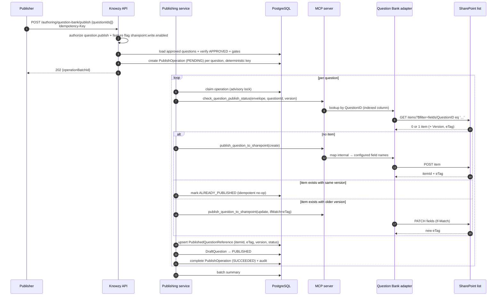
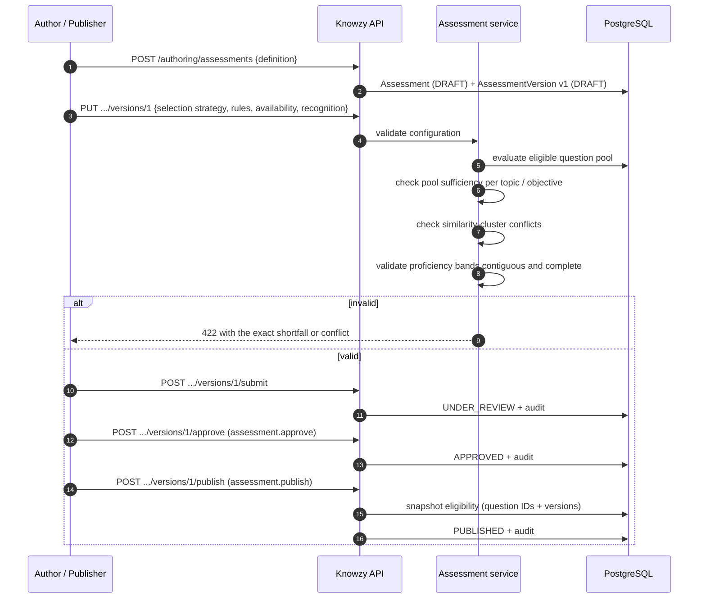
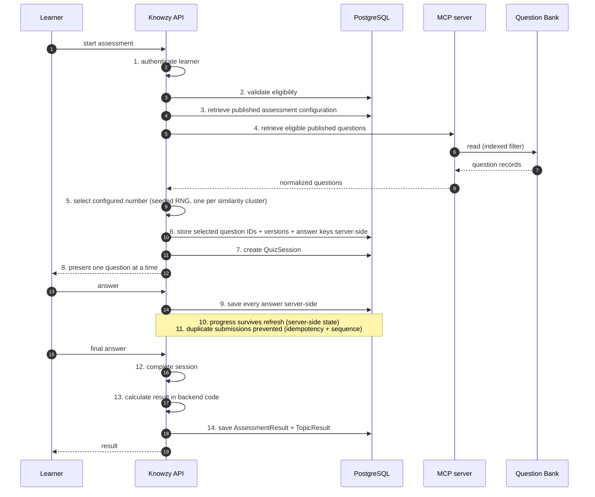
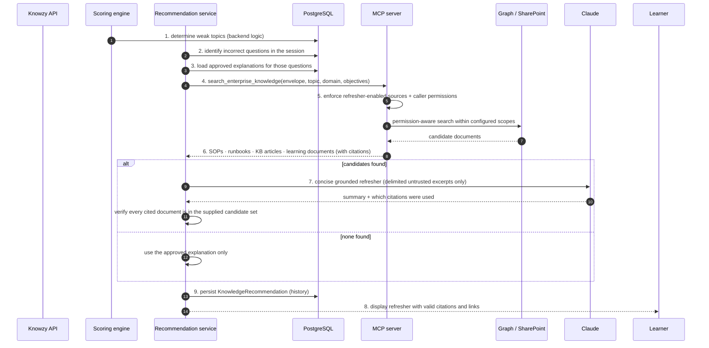

# Core Workflows

Covers deliverables 12–17: question generation, question review and approval, question publishing,
assessment publishing, live quiz execution, and knowledge refreshers.

Generation governance (intentional selection, duplicate prevention, coverage, delta generation,
objective-driven generation, reuse) is specified in
[generation-governance.md](generation-governance.md) and is **normative over this document**.

---

## 1. End-to-end value chain

```mermaid
graph LR
    A["SharePoint<br/>knowledge documents"] --> B["MCP content retrieval<br/>(selected documents only)"]
    B --> C["Claude draft<br/>question generation"]
    C --> D["Author review"]
    D --> E["SME review"]
    E --> F["Approval"]
    F --> G["Publication to<br/>SharePoint Question Bank"]
    G --> H["Assessment configuration"]
    H --> I["Live Learning Portal"]
    I --> J["Quiz execution"]
    J --> K["Backend scoring"]
    K --> L["Knowledge refreshers"]
    L --> M["Badges &amp; certificates"]
    K --> N["Reports &amp; dashboards"]
```



---

## 2. Question generation workflow

### 2.1 Preconditions

| # | Precondition | Failure code |
| --- | --- | --- |
| 1 | Caller holds `question.generate` in the target domain | `FORBIDDEN` |
| 2 | Source is `ACTIVE` and `usableForGeneration = true` | `SOURCE_NOT_GENERATION_ENABLED` |
| 3 | Caller has effective access to the source | `SOURCE_FORBIDDEN` |
| 4 | An explicit, non-empty document ID list is supplied (1–10) | `GENERATION_SELECTION_REQUIRED` |
| 5 | Every document is `ACTIVE`, `EXTRACTED`, non-excluded | `DOCUMENT_NOT_READY` |
| 6 | Every document type is supported | `DOCUMENT_UNSUPPORTED` |
| 7 | Domain and topic are supplied and exist | `TAXONOMY_MISSING` |
| 8 | Generation profile exists and is enabled for the domain | `PROFILE_NOT_AVAILABLE` |
| 9 | A justification reason code is supplied | `GENERATION_JUSTIFICATION_REQUIRED` |
| 10 | Generation preflight has been run and its decision recorded | `PREFLIGHT_REQUIRED` |
| 11 | Token and job budgets are available | `BUDGET_EXCEEDED` |

Precondition 4 is structural: the generation service cannot list documents, so "all documents" is not
expressible. Precondition 10 makes the duplicate/coverage gate unavoidable.

### 2.2 Sequence

```mermaid
sequenceDiagram
    autonumber
    participant AU as Author (authoring-web)
    participant API as Knowzy API
    participant PF as Preflight service
    participant JOB as Job runner
    participant MCPS as MCP server
    participant ADP as SharePoint adapter
    participant GR as Microsoft Graph
    participant CL as Claude
    participant PG as PostgreSQL

    AU->>API: POST /authoring/generation-jobs/preflight {sourceId, documentIds, objectives?}
    API->>PF: run six pre-generation checks
    PF->>PG: generation history · coverage · approved counts · version/hash baseline
    PF->>PG: similarity risk · cross-domain matches · pool conflicts
    PF-->>API: preflight result + recommendation
    API-->>AU: preflight panel (View / Reuse / Generate additional / Regenerate)

    AU->>API: POST /authoring/generation-jobs {scope, objectives, counts, reasonCode, preflightId}
    API->>PG: validate + create GenerationJob (QUEUED) + GenerationJobDocument rows
    API->>PG: resolve and pin section ID list for the scope
    API-->>AU: 202 {jobId}
    API->>JOB: enqueue

    JOB->>MCPS: extract_document_content(envelope, documentIds[], sectionIds[])
    MCPS->>ADP: verify existence, permission, hash; fetch content if stale
    ADP->>GR: GET item metadata / content
    GR-->>ADP: bytes + eTag + version label
    ADP-->>MCPS: normalized text + sections + offsets + hashes
    MCPS-->>JOB: grounded chunk set with citations

    JOB->>PG: load do-not-duplicate stem list for scope
    loop per learning objective (or per section group)
        JOB->>CL: generation request<br/>system rules + delimited untrusted content + stems + schema
        CL-->>JOB: structured JSON (questions[] or insufficientEvidence)
        JOB->>JOB: 1. schema validation (Zod)
        JOB->>JOB: 2. evidence verification vs section text
        JOB->>JOB: 3. answer/option integrity checks
        JOB->>PG: 4. duplicate scoring vs drafts, approved, published (all domains)
        alt all gates pass
            JOB->>PG: insert DraftQuestion (DRAFT) + lineage + section link + objective
        else gate fails
            JOB->>PG: record rejection reason on the job (no draft persisted)
        end
    end
    JOB->>PG: recompute DocumentGenerationStat + section coverage
    JOB->>PG: complete job + audit event
    JOB-->>AU: notification "drafts ready for review"
```

### 2.3 Stage detail

| Stage | Input | Output | Failure behaviour |
| --- | --- | --- | --- |
| Preflight | Source, documents, optional objectives, optional target assessment | Six check results + recommendation + persisted decision | Cannot be skipped; job creation without `preflightId` is refused |
| Scope resolution | Scope selector, coverage state, lineage state, objective mapping | Pinned ordered section ID list | Empty resolution → `GENERATION_SCOPE_EMPTY` with the reason (e.g. "all sections already covered") |
| Retrieval | Pinned section IDs | Chunked text with offsets, citations, hashes | Document missing/inaccessible → per-document failure, job continues with the rest and reports it |
| Verification at retrieval time | Item existence, caller permission, hash freshness | Verified chunk set | Hash drift → re-extract; permission failure → document excluded with a clear reason |
| Generation | One objective (or section group) per call | Structured JSON | Malformed → one bounded repair attempt, then per-call failure |
| Schema validation | Model output | Typed candidate questions | `SCHEMA_INVALID` |
| Evidence verification | Candidate + section text | Verified span with offsets | `EVIDENCE_UNVERIFIED` |
| Integrity checks | Candidate | Pass/fail | `OPTION_DUPLICATE`, `ANSWER_INVALID`, `QUESTION_INCOMPLETE` |
| Duplicate scoring | Candidate vs corpus | Score + cluster assignment | `DUPLICATE` (block) or `DUPLICATE_SUSPECTED` (flag) |
| Persistence | Accepted candidates | `DraftQuestion` in `DRAFT` | Transactional per question |
| Recompute | Job results | Coverage + stats refreshed | Reported drift, never silent correction |

### 2.4 Generated question payload

Every generated question carries, at minimum:

Internal Question ID · Proposed SharePoint Question ID · Domain · Topic · Question Text · Option A ·
Option B · Option C · Option D · Proposed Correct Answer · Explanation · Source ID · Source Name ·
Source Document ID · Source Document Name · Source URL · Source Section or Location · Supporting
Evidence · Content Hash · Claude Model · Prompt Version · Generation Timestamp · Confidence Indicator ·
Generated By · Current Status · Version · Review Comments · Approval Metadata.

Plus the governance lineage from
[generation-governance.md §9](generation-governance.md#9-question-source-traceability): source site,
library, folder, source version, section key, section hash, generation job ID, learning objective.

**Proposed SharePoint Question ID** format (example):
`KNZ-{DOMAIN_CODE}-{YYYY}-{SEQ}` → `KNZ-NET-2026-000412`. Domain codes are managed taxonomy values;
the sequence is allocated from a per-domain PostgreSQL sequence at generation time and confirmed at
publish time. It is *proposed* until publication because a publish conflict can force reallocation.

### 2.5 Evidence verification (normative)

Grounding is enforced mechanically, not requested politely.

```
normalize(t) = NFKC(t)
               |> collapse whitespace
               |> unify quotes/dashes/ligatures
               |> de-hyphenate line breaks
               |> lowercase        (comparison only; stored span keeps original casing)

STRICT   : normalize(evidence) must be an exact substring of normalize(sectionText)
STANDARD : trigram similarity(normalize(evidence), best-matching window of
           normalize(sectionText)) >= 0.95
```

| Rule | Detail |
| --- | --- |
| Length bounds | Evidence span 40–1,200 characters. Too short is not evidence; too long is not a citation. |
| Location | The matched character offsets are stored, so the span is re-locatable in future versions. |
| Section attribution | The span must fall inside a section that was part of the pinned scope. A span from an unrequested section fails verification. |
| Failure | `EVIDENCE_UNVERIFIED` — the question is **not persisted**; the reason is recorded on the job. |
| Re-verification | Runs again on every edit to question text or options, at submit-for-approval, and at approval. |

This single control is what prevents plausible-sounding fabrication from reaching a reviewer, and it
is why `STRICT` cannot be switched off — only its tolerance varies.

### 2.6 Duplicate and similarity detection

Specified in full in
[generation-governance.md §4](generation-governance.md#4-duplicate-prevention): prompt-level
suppression, composite lexical scoring across all domains, block and flag thresholds, similarity
clusters, optional advisory Claude adjudication, and pool-level de-duplication at assessment publish
and session selection.

### 2.7 Insufficient evidence

`insufficientEvidence` is a first-class success result, not an error:

```jsonc
// Illustrative model output shape
{ "result": "insufficientEvidence",
  "sectionKey": "…",
  "reason": "The section describes escalation ownership but states no procedure,
             threshold, or decision rule that could be tested reliably." }
```

The job records it per section, the coverage view marks the section `NOT_COVERED` with the note
"insufficient assessable content", and the author is shown the reason. Repeated insufficient-evidence
results on a document are a documentation-quality signal and appear in the source-document usage
report. The platform never pads a requested count with unsupported questions.

### 2.8 Confidence indicator

A **composite, platform-computed** value in [0,1] — not the model's self-report:

| Component | Weight | Basis |
| --- | --- | --- |
| Evidence match quality | 0.35 | Exact vs similarity score, span length adequacy |
| Section coverage adequacy | 0.15 | Whether the section carries enough assessable content |
| Option distinctness | 0.20 | Pairwise option dissimilarity, no near-identical distractors |
| Metadata completeness | 0.10 | All required fields present |
| Duplicate distance | 0.10 | `1 − maxSimilarityScore` |
| Model-declared confidence | 0.10 | Advisory only, capped contribution |

Stored with its component breakdown so a reviewer can see *why* confidence is low. Confidence never
authorizes anything — a 0.99 question still requires human approval.

---

## 3. Question review and approval workflow

### 3.1 Lifecycle



### 3.2 Transition rules

| Transition | Required permission | Mandatory comment | Additional gates |
| --- | --- | --- | --- |
| `GENERATED → DRAFT` | system | — | Automatic on persistence |
| `DRAFT → AUTHOR_REVIEW` | `question.edit` | — | Within data scope |
| `AUTHOR_REVIEW → SUBMITTED_FOR_APPROVAL` | `question.submit` | — | All 13 gates in [authoring-portal.md §5.7](authoring-portal.md#57-approval-blocking-gates) |
| `SUBMITTED_FOR_APPROVAL → APPROVED` | `question.approve` | optional | All 13 gates + separation of duties |
| `SUBMITTED_FOR_APPROVAL → CHANGES_REQUESTED` | `question.review` | **yes** | — |
| `SUBMITTED_FOR_APPROVAL → REJECTED` | `question.review` | **yes** | — |
| `AUTHOR_REVIEW → REJECTED` | `question.edit` | **yes** | — |
| `APPROVED → PUBLISHED` | `question.publish` | — | `sharepoint.write.enabled`, successful idempotent write |
| `PUBLISHED → RETIRED` | `question.retire` | **yes** | — |
| `PUBLISHED → DRAFT` (new version) | `question.edit` | — | Creates version N+1; published version N remains intact |
| `* → ARCHIVED` | `question.archive` | — | Not permitted from `PUBLISHED` (retire first) |

Every transition writes `QuestionReview` / `QuestionApproval` rows plus an `AuditEvent` in the same
database transaction as the state change. A transition that cannot be audited does not commit.

### 3.3 Two-stage human review



The SME review is an advisory record by default (`QuestionReview.kind = ADVISORY`). A tenant can
require SME sign-off per domain (`requireSmeSignoff`), which adds a blocking gate: approval is
refused with `SME_SIGNOFF_REQUIRED` until an SME review with `outcome = ENDORSED` exists for the
current version. SME endorsement is version-bound — editing after endorsement invalidates it.

### 3.4 Separation of duties

**Since 2026-10-07 (Authoring Role Simplification, access-control.md §2.0) the platform runs with
`authorMayApproveOwn` and `editorMayApproveOwn` set to `true`** at platform scope: one Authoring
Administrator may create, review, approve and publish their own question. The policies below are
unchanged, and so are their code defaults; setting either back to `false` is a single audited
configuration change. Gate 13 still runs on every approval and records its verdict, and the
approval record still names the approver beside the author.

| Policy | Default | Effect |
| --- | --- | --- |
| `authorMayApproveOwn` | false | Approval refused when approver = original author |
| `editorMayApproveOwn` | false | Approval refused when approver = last editor of the current version |
| `approverMayPublishOwn` | true | Approver may publish; set false to force a distinct Publisher |
| `smeMayApprove` | true | SMEs holding `question.approve` may approve |
| Break-glass | disabled | When enabled, a Platform Administrator can override with a mandatory written justification, audited as `AUTHORING.QUESTION.APPROVAL_OVERRIDE` and included in a standing exception report |

### 3.5 Versioning

| Event | Version effect |
| --- | --- |
| Any field edit on a draft | New `DraftQuestionVersion` snapshot, `version` increments |
| Approval | Current version marked approved; that version is what publishes |
| Publication | `publishedVersion` recorded on `PublishedQuestionReference`; SharePoint `Version` column set |
| Edit of a published question | New draft version N+1 in `DRAFT`; published version N stays live in the bank until N+1 is approved **and** published |
| Publication of N+1 | Bank item updated to N+1; the historical record of N is preserved (see [sharepoint-question-bank.md §7](sharepoint-question-bank.md#7-versioning)) |
| Existing assessment history | Continues to reference version N; snapshots and results are never rewritten |

---

## 4. Question publishing workflow

### 4.1 Sequence



### 4.2 Idempotency

| Mechanism | Detail |
| --- | --- |
| Operation key | `sha256(targetListId + questionId + publishedVersion + operationType)` — unique index in PostgreSQL |
| Pre-write existence check | `check_question_publish_status` queries by `QuestionID` before every create |
| Client idempotency | `Idempotency-Key` header on the batch endpoint; replay returns the original batch result |
| Conditional update | `If-Match: {eTag}`; a 412 triggers re-read and re-evaluation, never a blind overwrite |
| Retry safety | A retry re-runs the existence check first, so a create that succeeded but whose response was lost becomes an `ALREADY_PUBLISHED` no-op — no duplicate item |
| Crash recovery | `PublishOperation` rows in `IN_FLIGHT` beyond a timeout are re-claimed; recovery re-checks SharePoint state before acting |

### 4.3 Partial batch handling

Each question publishes in its own transaction and operation record. A batch of 50 with 3 failures
results in 47 `PUBLISHED`, 3 remaining `APPROVED` with a retryable operation and a reason. No question
is ever left in a state that claims publication without a verified SharePoint item ID. The batch
result enumerates every item's outcome, and failures are retryable individually or as a group.

### 4.4 Retirement

`retire_published_question` sets `IsActive = false` (and `Status = Retired`) on the SharePoint item
via a conditional update, marks the local reference `RETIRED`, requires a
comment, and audits `AUTHORING.QUESTION.RETIRED`. **The SharePoint item is never deleted.** Retired questions are
excluded from new assessment selection but remain intact in historical snapshots and results.

---

## 5. Assessment publishing workflow



### 5.1 Eligibility snapshot

At publication the platform pins an **eligibility snapshot**: the set of `(questionId, publishedVersion)`
pairs that satisfied every criterion at that moment, plus the resolved selection configuration and the
proficiency threshold set.

| Strategy | What the snapshot pins |
| --- | --- |
| `FIXED_SET` | The exact ordered question + version list |
| `RANDOM_POOL` | The eligible pool membership at publish time, plus the live re-filter rule |
| `TOPIC_BALANCED` | Pool membership per topic plus the computed allocation |
| `TOPIC_DISTRIBUTION` | Pool membership per topic plus the explicit per-topic counts |

At session creation the pool is re-filtered against current state (retired and inactive questions are
removed) and intersected with the snapshot, so an assessment release never silently acquires questions
the approver never saw, and never serves a retired one. If re-filtering drops the pool below the
required count, session creation fails with a specific message and the authoring side is alerted —
the learner is never served a short or padded assessment.

### 5.2 Assessment properties

Assessment ID · Name · Description · Domain · Topics · Audience · Instructions · Number of Questions ·
Question Selection Strategy · Pass Percentage · Proficiency Thresholds · Attempt Limit · Retake
Policy · Time Limit · Availability Start · Availability End · Badge Rule · Certificate Rule · Status ·
Assessment Version · Created By · Approved By · Published By · Published Date. Plus:
`allowBackNavigation`, `showAnswersAfterCompletion`, `scoreOnExpiry`, `minimumObjectiveCoverage`.

### 5.3 Versioning

Editing a published assessment creates version N+1 in `DRAFT`. Version N stays published and
available until N+1 is published. In-flight sessions always reference the version they started on.
Results permanently reference their assessment version, so a historical result remains interpretable
after the assessment changes. Unpublishing sets availability to closed; it never deletes a version.

---

## 6. Live quiz execution workflow

Full detail: [live-learning-portal.md §4](live-learning-portal.md#4-quiz-execution). Summary of the
fourteen normative steps:



During an active session the platform does **not** call the question source again (recovery excepted,
and audited). The server-side snapshot is authoritative.

### 6.1 Selection algorithm

```
pool         = snapshot ∩ currently eligible published questions
pool         = one representative per similarity cluster (highest approval recency)
seed         = sessionId                             // stored, makes selection reproducible
selected     = strategy.select(pool, config, seed)
order        = shuffle(selected, seed) unless strategy is FIXED_SET with fixed order
snapshot     = persist(selected with version, answer key, presentation order)
```

Insufficient pool → `409 ASSESSMENT_POOL_INSUFFICIENT` with the shortfall stated; the learner sees
"temporarily unavailable" and the authoring dashboard sees the cause.

---

## 7. Knowledge refresher workflow

### 7.1 Sequence



### 7.2 Weak topic determination (backend, deterministic)

A topic qualifies when `topicAccuracy < gapThreshold` (default 60.00) **and** the topic had at least
`minTopicQuestions` (default 2) questions in the snapshot. Topics are ranked by
`(1 − accuracy) × questionsAsked`, so a broadly-tested weak topic outranks a narrowly-tested one.
Default maximum of 5 recommendations per result, configurable.

Claude has no part in identifying weak topics. It only writes the summary.

### 7.3 Refresher content

| Field | Source |
| --- | --- |
| Weak Topic | Backend topic analysis |
| Gap Summary | Deterministic template from counts, plus an optional Claude-written sentence |
| Recommended Learning Area | Topic → learning objective mapping |
| Approved Explanation | Verbatim from the approved question in the Question Bank |
| Knowledge Refresher | Claude summary grounded strictly in the retrieved excerpts |
| Source Document | Name from the retrieved candidate |
| Source Type | Source type + document type |
| Source Link | `webUrl` from the retrieved candidate |
| Suggested Next Action | Deterministic: review document / retake (with date) / contact SME / complete refresher |

### 7.4 Anti-fabrication controls

| Control | Implementation |
| --- | --- |
| Citations come from retrieval, never from the model | Claude receives excerpts with opaque candidate IDs and may cite only those IDs. Document names and URLs are attached by the platform from its own retrieval records, never copied from model output. |
| Post-generation citation validation | Any cited ID not in the supplied set invalidates the summary; one bounded retry, then fall back to the approved explanation only. |
| No source invented on empty retrieval | The card shows the approved explanation and states: "No additional approved learning resource was found for this topic." No title, link, or document name is produced. |
| Permission respect | Search runs under the learner's own permission context for `DELEGATED_OBO` sources; for app-only sources Knowzy restrictions apply and are stated. SharePoint remains the final gate when the learner opens the link. |
| Purpose respect | Only sources with `usableForRefreshers = true` are searched. |
| Untrusted content | Excerpts are delimited untrusted data; instructions inside them carry no authority. |

### 7.5 Recommendation history

`KnowledgeRecommendation` persists: learner, result, topic, gap metrics, the approved explanation used,
the generated refresher text, the cited document references, model and prompt version, created
timestamp, and learner disposition (`NEW`, `VIEWED`, `COMPLETED`, `DISMISSED`) with timestamps.
Completion feeds the "refreshers completed" metric and the Knowledge Refresher Completion badge.
History is never overwritten by a later recommendation.

---

## 8. Cross-workflow guarantees

| Guarantee | How every workflow upholds it |
| --- | --- |
| No AI-generated question reaches a learner unapproved | Publication requires `APPROVED`; selection requires published + active |
| No authoritative decision is made by Claude | Scoring, approval, publishing, badges, certificates are pure backend functions with unit tests |
| Every state change is audited | Audit write in the same transaction; a failed audit rolls back the transition |
| Every external write is idempotent | Deterministic operation keys plus pre-write existence checks |
| Every workflow is resumable | Job and operation records carry explicit state; workers claim with advisory locks and recover in-flight work |
| Every failure is attributable | Correlation ID propagates from browser action to Graph or Claude call and into audit |
| No duplicate work | Preflight gates, prompt-level suppression, similarity clusters, and reuse-first defaults |
